# Accordion Q&A

An accordion Q&A is a UI element designed as a row that accommodates a question-and-answer format, used to reveal or hide an answer within the current context.

# Guideline

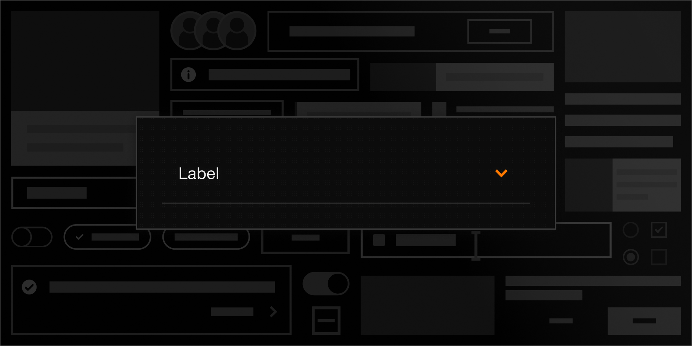

## Anatomy

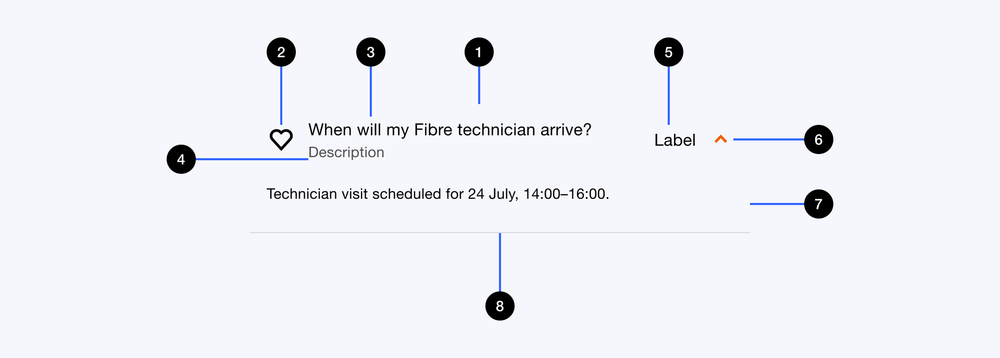

| # | Element | Purpose | Optional |
|---|---------|---------|----------|
| 1 | Container | The full-width trigger row that reveals and hides the answer, with optional background | No |
| 2 | Leading container | An icon that helps users recognise the topic of the question | Yes |
| 3 | Label | The question, regular or bold, with an optional overline | No |
| 4 | Description | Supporting text below the question | Yes |
| 5 | Trailing container | Short secondary information related to the question | Yes |
| 6 | Expanding indicator | Chevron or plus icon that shows whether the answer is visible, at the end or the start | No |
| 7 | Expanded container | The answer: Expanded text and/or the Expand slot | Yes |
| 8 | Bottom border | Separates adjacent questions that share the same surface | Yes |

## Definition

An accordion Q&A is a UI element designed as a row that accommodates a question-and-answer format, used to reveal or hide an answer within the current context.

Accordion Q&A are used to organize frequently asked questions into a compact, easy-to-scan list where users can open only the information they need. The question serves as the accordion trigger, and the related answer appears directly below when expanded.

## Expanded

<!-- zh-row -->

**`False`** Use the collapsed state when the answer is hidden. Only the question remains visible, allowing users to scan the available Q&A topics quickly without displaying all answers at once.

**`True`** Use the expanded state when the answer related to the question is visible. The answer appears directly below the trigger and should clearly respond to the question above it.

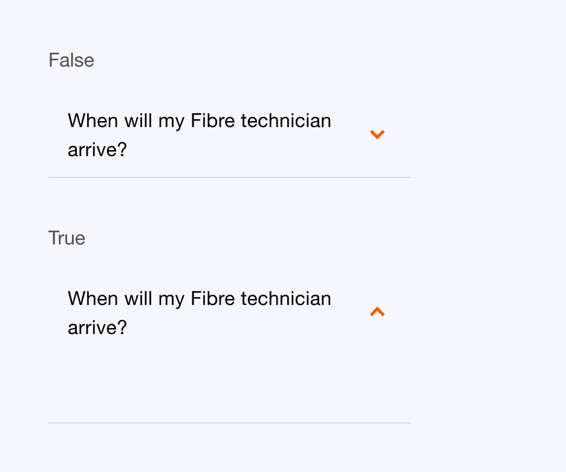

## Expanded text

<!-- zh-row -->

**`False`** No standard answer text is displayed in the expanded area.  
Use this option when the answer is provided through Slot (Expand) or when no standard text content is required.

**`True`** Standard answer text is displayed below the Q&A when the item is expanded.

Use it for:  
• Short answers.  
• Explanations.  
• Instructions.  
• Conditions or requirements.  
• Supporting information directly related to the question.

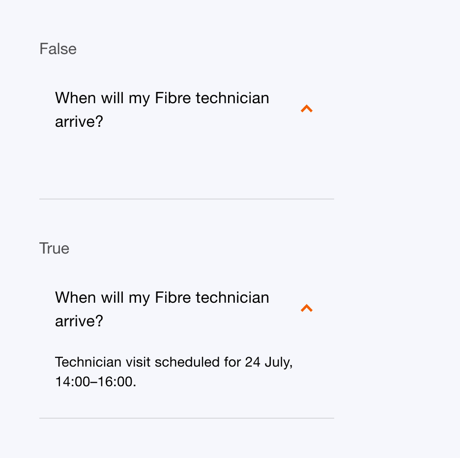

## Slot (Below text)

The Below text slot adds custom supporting content directly below the main text content.  
Use it when additional information needs to remain closely associated with the Label, Description or other text content rather than span the complete trigger width.  
The slot follows the position and alignment of the text container. Its exact placement may vary depending on the Accordion component structure.

<!-- zh-row -->

**`False`** No additional content is displayed below the main trigger content.

**`True`** A custom content area is displayed directly below the main text content.

⚠️ Keep Below text content concise.  
⚠️ Use Slot (bottom) when the content requires a wider area outside the text container.  
⚠️ Use Slot (Expand) when the content should only become visible after expansion.

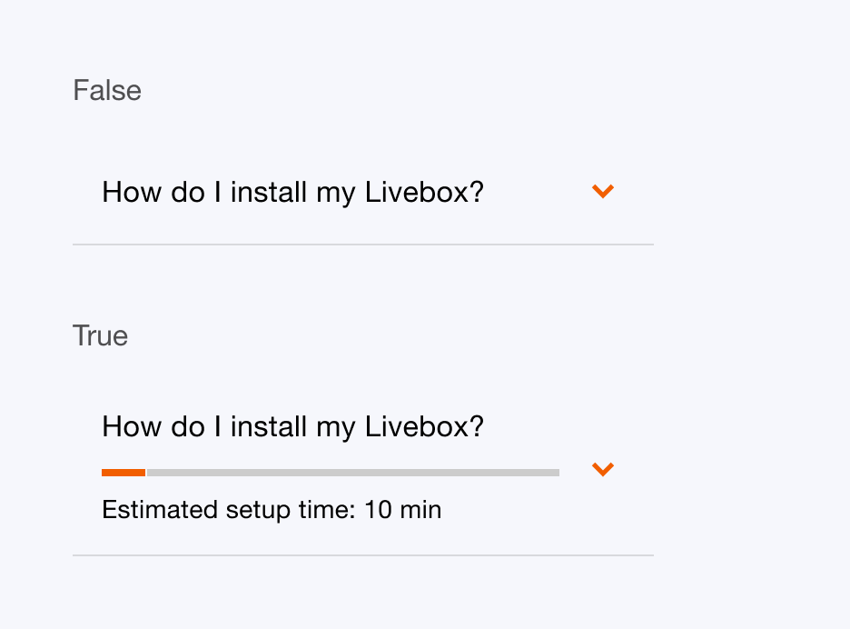

## Slot (Bottom)

The Bottom slot adds custom supporting content below the complete trigger content.  
Use it when information needs to remain visible independently of the Expanded state and requires more space or flexibility than the standard text properties.  
The slot is positioned at the bottom of the trigger area. Its exact width and alignment may vary depending on the Accordion component structure.

<!-- zh-row -->

**`False`** No additional content is displayed below the main trigger content.

**`True`** A custom supporting area is displayed below the main trigger content.

⚠️ Bottom slot content remains part of the trigger and should not behave as an independent action.  
⚠️ Use Slot (below text) when the information needs to remain closely aligned with the main text content.  
⚠️ Use Slot (Expand) when the content should only become visible after expansion.

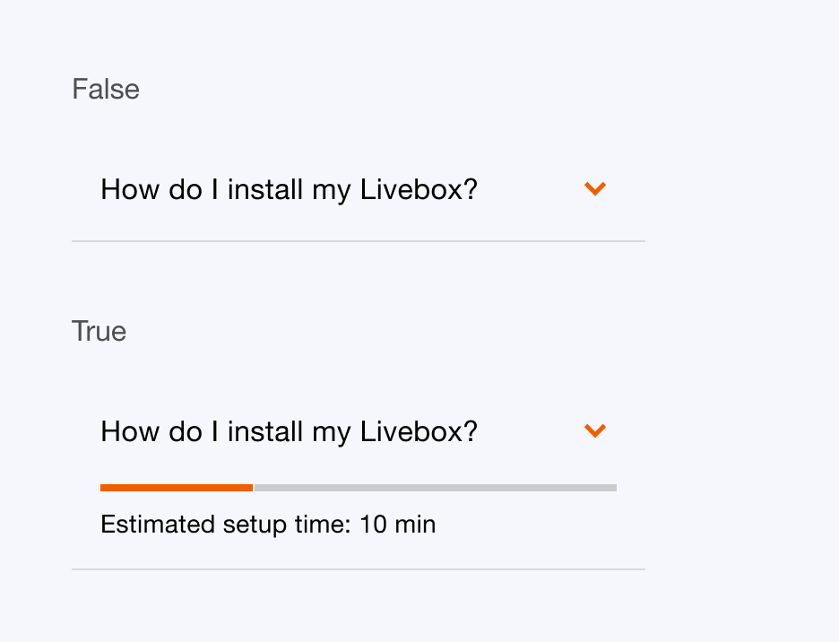

## Slot (Expand)

The Expand slot adds custom content inside the expanded area of the Accordion.  
Use it when the revealed content requires a structure that cannot be represented clearly by standard Expanded text alone.  
The slot is displayed only when the Accordion is expanded. Its exact placement inside the expanded area may vary depending on the Accordion component structure.

<!-- zh-row -->

**`False`** No additional content is displayed below the main trigger content.

**`True`** A custom content area is displayed when the Accordion is expanded.

⚠️ Use Slot (below text) or Slot (bottom) when the content needs to remain visible in both collapsed and expanded states.

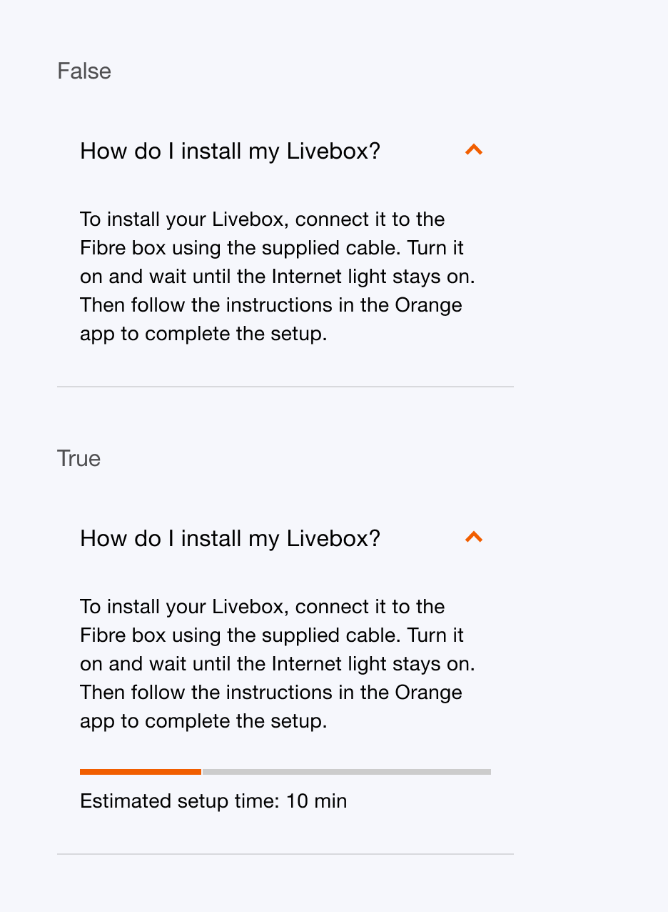

## Alternative icon

<!-- zh-row -->

**`False`** Use the default chevron as the Expanding indicator. This is the recommended option for standard Q&A patterns and clearly communicates that the answer can be expanded or collapsed.

**`True`** Use the alternative expand / collapse icon when the product context requires the + pattern instead of a chevron.  
The icon must communicate the same expanded state consistently across all items within the same accordion.

⚠️ Do not mix chevron and + indicators within the same accordion. Different indicators may suggest different behaviours even when the interaction is identical.

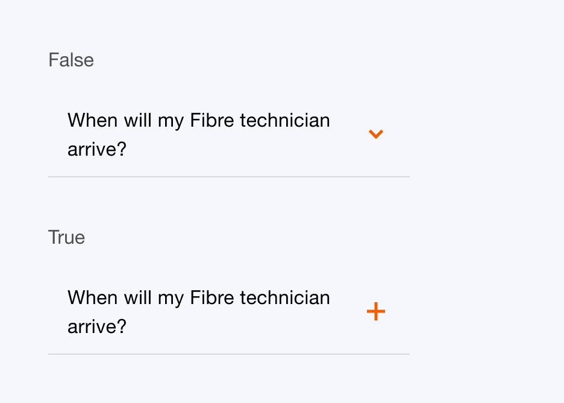

## Reverse

<!-- zh-row -->

**`False`** Use False as the standard layout.  
The Expanding indicator is displayed at the logical end of the Q&A trigger, after the question and any optional Trailing content.

**`True`** Use Reverse when the Expanding indicator needs to appear at the logical start of the Q&A trigger. The indicator is positioned before the question.

⚠️ Reverse changes only the position of the Expanding indicator. It must not change the reading order, meaning or expand / collapse behaviour of the Q&A item.

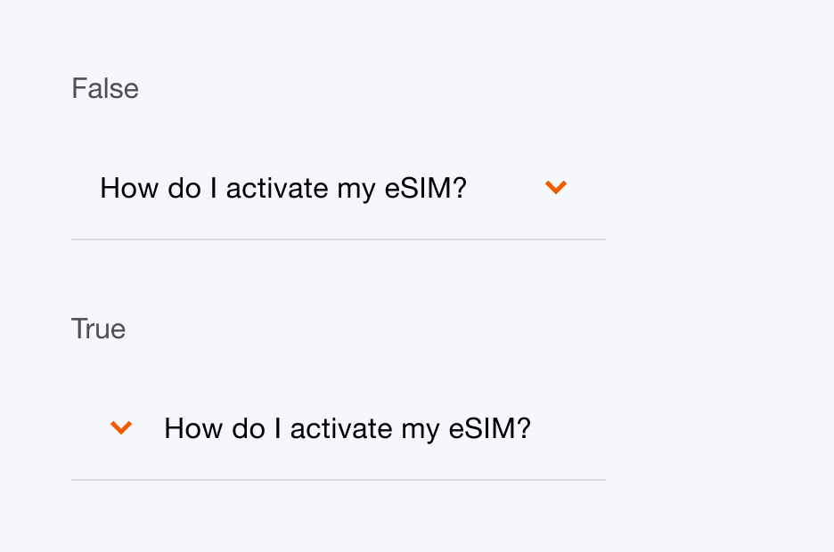

## Leading

Leading displays an Icon before the Q&A. Use it when an Icon provides useful context or helps users identify the topic of the question more quickly.

<!-- zh-row -->

**`False`** No Leading content is displayed. The main content starts at the default horizontal padding.

**`True`** A Leading Icon is displayed before the Q&A. Choose an Icon that clearly represents the topic.

⚠️ Avoid decorative Icons that do not help users understand the question.

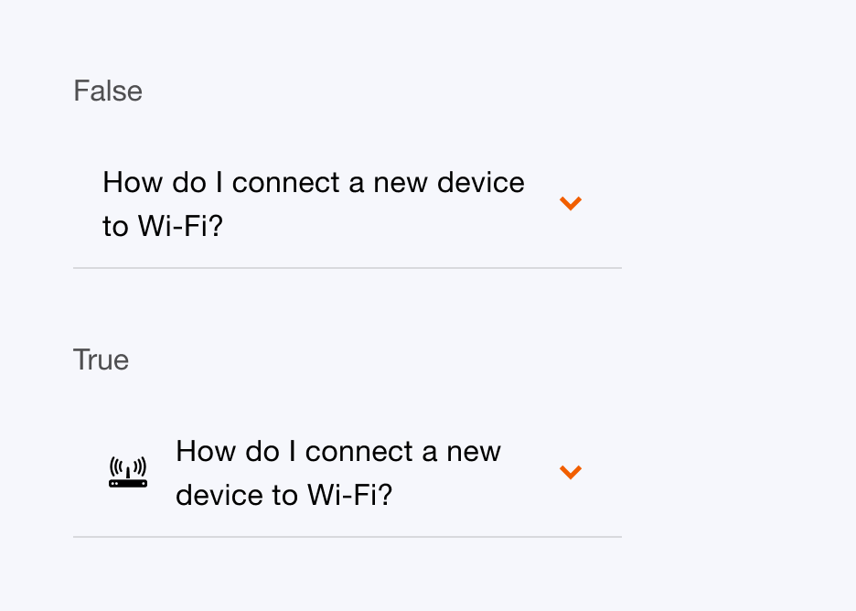

## Trailing

Trailing content displays short secondary information related to the Q&A before the Expanding indicator.  
Use it sparingly when this information helps users understand the context of the question before opening the answer.

<!-- zh-row -->

**`False`** No Trailing content is displayed. The main content can use the available width before the Expanding indicator.

**`True`** Trailing text is displayed after the question and before the Expanding indicator.

Use it for short contextual information such as:  
• A value.  
• A date.  
• A short status.  
• A compact qualifier.

⚠️ Do not place the answer itself in the Trailing area. Use Expanded text or Slot (Expand) instead.

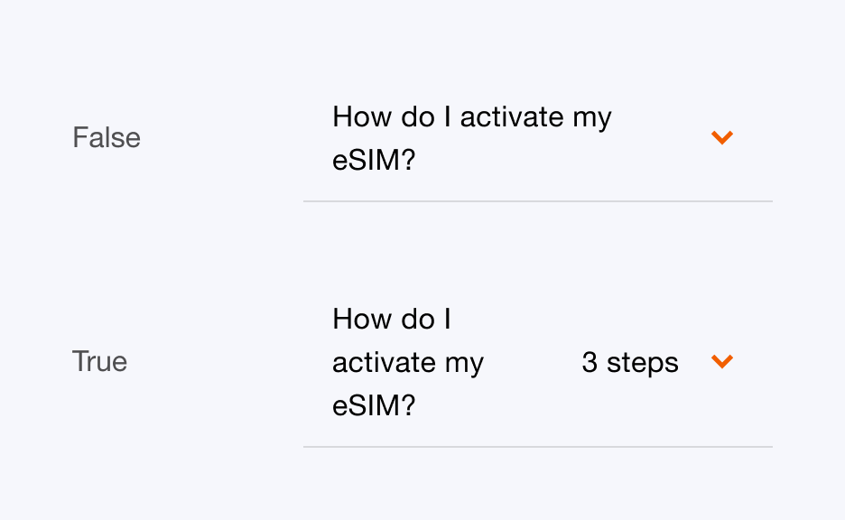

## Trailing container type

<!-- zh-row -->

**Trailing Text** Use Text to display a short value or secondary piece of information associated with the accordion section.

⚠️ Keep Trailing text concise. When the information requires a sentence or explanation, use the Description or place the information inside the expanded content instead.  
⚠️ Trailing text must not look like a separate link or action.  
⚠️ Keep trailing text to 1–2 words whenever possible. Longer content can reduce the space available for the primary label and cause excessive wrapping, especially when users zoom in or increase the text size.

**`Label`** Use Label for standard secondary information related to the Q&A. Use it when the trailing information is useful before expansion but does not require additional emphasis.

**`Label muted`** Use Label muted for low-priority contextual information that supports the question but is not essential before expansion. Suitable for information such as update dates, estimated durations or secondary metadata.

**`Label strong`** Use Label strong when the trailing information requires greater visual emphasis and is useful to notice before expanding the Q&A. Use it sparingly for important dates, values or statuses.

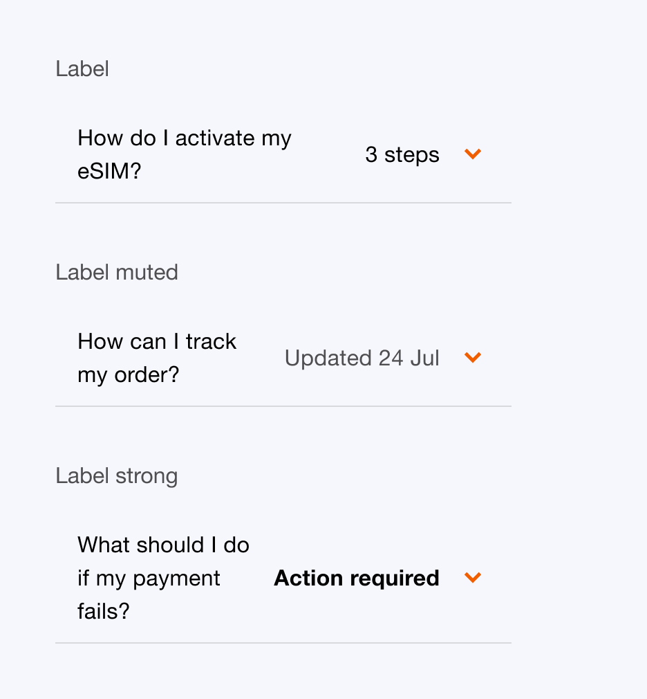

## Divider

<!-- zh-row -->

**`False`** No Divider is displayed. Use this option when Q&A items are already clearly separated by spacing, Background or another visual treatment.

**`True`** A Divider is displayed between adjacent Q&A items. Use it when several questions share the same surface and additional visual separation improves scanning.

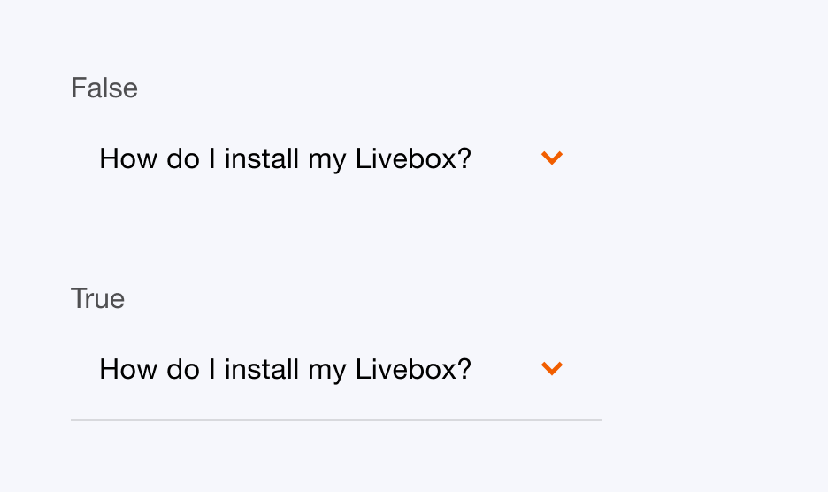

## Background

<!-- zh-row -->

**`False`** The Q&A item uses the surrounding container surface without an individual Background. Use this option for standard Q&A lists where spacing or Dividers already provide sufficient visual separation.

**`True`** A Background is applied to the complete Q&A item. Use it when individual questions require stronger visual grouping from the surrounding content. When expanded, the Background must visually contain both the question and its answer.

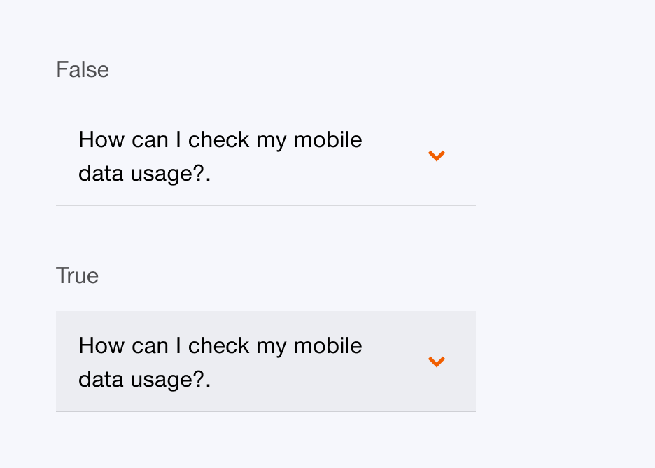

## Label bold

<!-- zh-row -->

**`False`** Use the standard Label emphasis for most Q&As.

**`True`** Use Bold when stronger emphasis is required for the Q&A.

It may be appropriate when:  
• Questions need stronger visual separation in a dense Q&A list.  
• The Q&A is presented as a prominent content section.  
• The established product pattern uses stronger question emphasis.

⚠️ Use the same Label emphasis consistently across equivalent Q&A items. Do not use Bold on an individual question only to suggest that it is more important than the others.

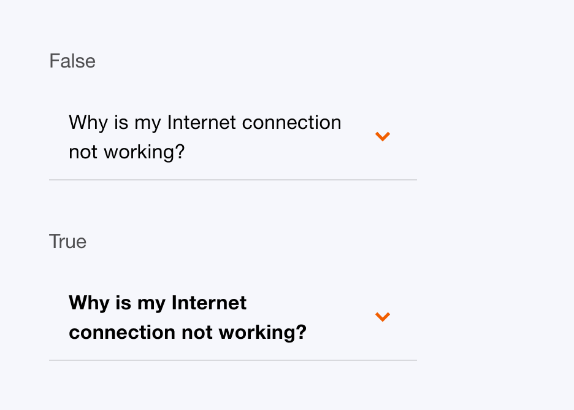

## Overline

<!-- zh-row -->

**`False`** No overline is displayed.

**`True`** A short contextual Label is displayed above the Q&A. Use an Overline when users need additional context to understand the category or scope of the question.

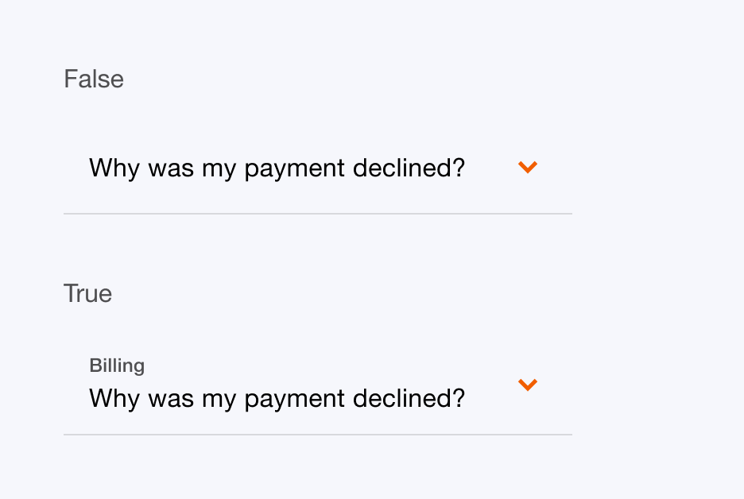

## Description

<!-- zh-row -->

**`False`** No supporting description is displayed.

**`True`** Supporting text is displayed below the Q&A. Use a Description when users need additional context to understand whether the question applies to their situation.  
The Description should clarify the scope or conditions of the question rather than provide the answer itself.

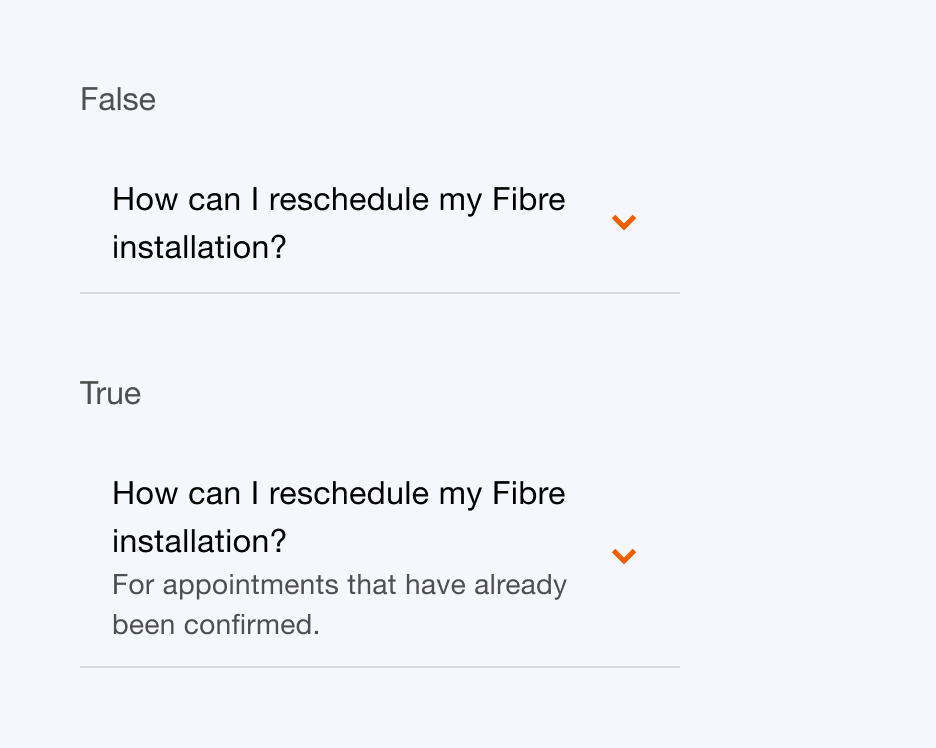

## Rich text

Rich text should be used sparingly to improve scanning and highlight the most important information in the answer.  
It must never compensate for unclear writing.

<!-- zh-row -->

### Strong text
• Strong text can be used sparingly in the Description or Expanded text to highlight key information, such as a status, date, amount or required step. Rich text must use the **Label/Medium/Strong** token only.  
• No other text styles or custom font weights should be used.

&nbsp;

### ⚠️ Underline text and Hyperlinks
• Underlined text must not be applied manually in the Description as users commonly interpret underlined content as a hyperlink.

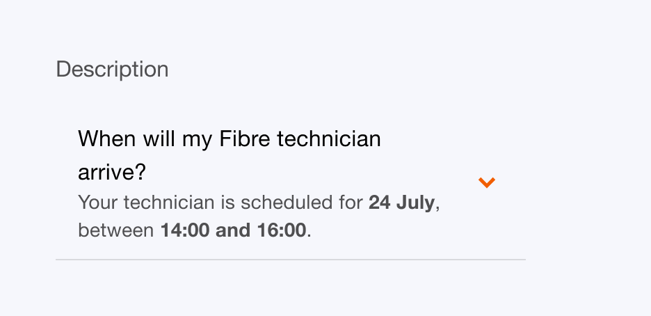

## Technical layout adjustments

<!-- zh-row -->

Even though the component has a single structure in Figma for easier use by designers, its technical implementation may differ between Web and native environments to respect the layout conventions of each platform.  
The Q&A trigger and its Expanded answer must remain visually aligned and clearly perceived as parts of the same question-and-answer item.

&nbsp;

### Web (mobile, tablet, and desktop)
The Q&A component is contained within the browser layout and follows the available container or grid width. Internal horizontal spacing follows the corresponding Web spacing tokens.

When expanded, the answer grows vertically below the trigger without changing the horizontal position of the Q&A item. The question and answer must remain aligned within the same content area.

&nbsp;

### Native app (Android, iOS, Flutter)
The Q&A component follows the screen and grid-margin conventions defined by the native product. Its horizontal spacing uses the corresponding native grid-margin tokens. When expanded, the answer grows vertically while maintaining the same relationship with its trigger.

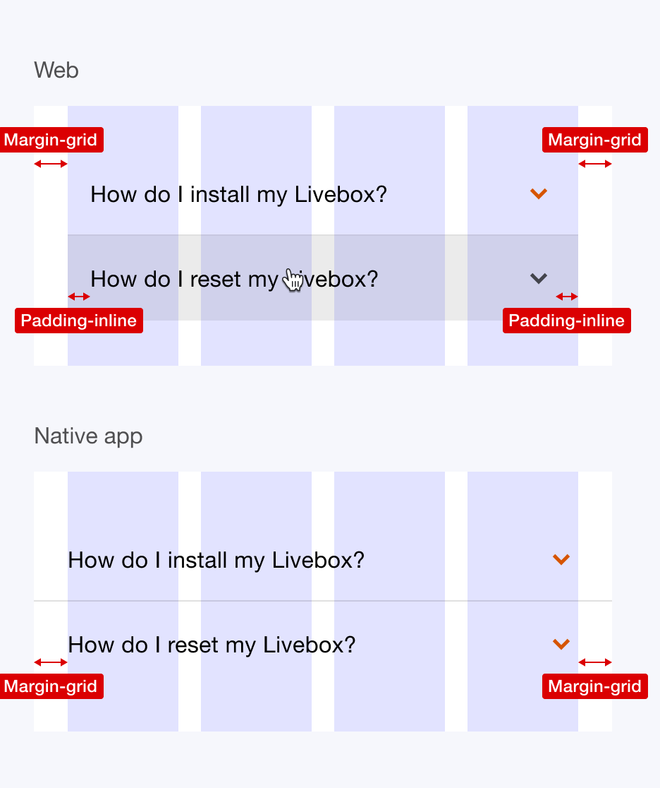

## Multiline and responsiveness

<!-- zh-row -->

### Multiline
Accordion Q&A supports multiline questions and answers. The number of lines is not limited. The question, Description, Trailing text and Expanded text must wrap when there is not enough horizontal space.

The Q&A item expands vertically to display its complete content. Do not use a fixed height or truncate information required to understand the question or answer.

The Expanding indicator must remain visible and must not overlap or become visually disconnected from the question.

&nbsp;

### Max-width vs full-width
Accordion Q&A does not have a default maximum width. Its width is defined by the parent container or Q&A layout.

The complete visible trigger remains one interactive target. The clickable area must not be limited to the question or Expanding indicator.

On wide layouts, the text area may use a product-defined maximum width to maintain comfortable reading.

The Expanded answer follows the same content alignment as its associated question.

The Expanding indicator remains positioned according to the Reverse property:  
• At the logical end when Reverse is False.  
• At the logical start when Reverse is True.

Optional Leading and Trailing content must not reduce the question to an unusable width.

&nbsp;

### User zoom in/out
Accordion Q&A does not have a default maximum width.

• Its width is defined by the parent container or Q&A layout.  
• The complete visible trigger remains one interactive target. The clickable area must not be limited to the question or Expanding indicator.  
• On wide layouts, the text area may use a product-defined maximum width to maintain comfortable reading.  
• The Expanded answer follows the same content alignment as its associated question.  
• The Expanding indicator remains positioned according to the Reverse property:  
  • At the logical end when Reverse is False.  
  • At the logical start when Reverse is True.  
• Optional Leading and Trailing content must not reduce the question to an unusable width.

⚠️ Avoid creating excessive horizontal distance between the question and Expanding indicator. The complete trigger should remain visually understandable as one control.

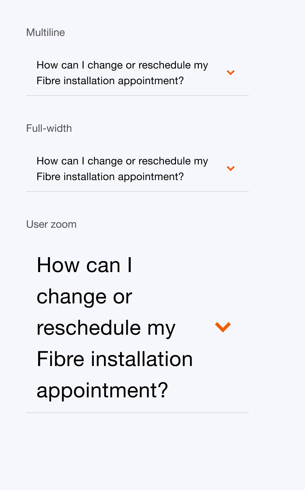

## Animation

When enabled, the accordion uses a smooth expansion animation (entry and exit) rather than appearing with an immediate cut.  
The accordion content expands from its collapsed state when opened, providing a clear visual transition that helps users understand the relationship between the trigger and the revealed content and establishes a stronger sense of spatial continuity.

## Slot spacing customization

Slots may include default padding to guide designers in their usage. This padding is optional and can be modified or removed depending on the design needs. When customizing padding within a slot, use semantic spacing tokens instead of component-specific tokens. Any spacing that must remain mandatory should be applied to the parent frame outside the slot, rather than within the slot itself.

# Specs

## Layout and spacing

## States

<!-- zh-row -->

**`Enabled`** Enabled is the default state.  
The Q&A can be expanded or collapsed. The complete trigger area acts as a single control for changing the Expanded state.

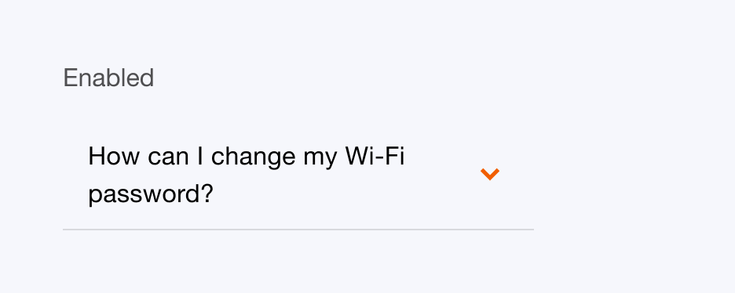

<!-- zh-row -->

**`Hover`** Hover provides visual feedback when a pointer is positioned over the Q&A trigger.

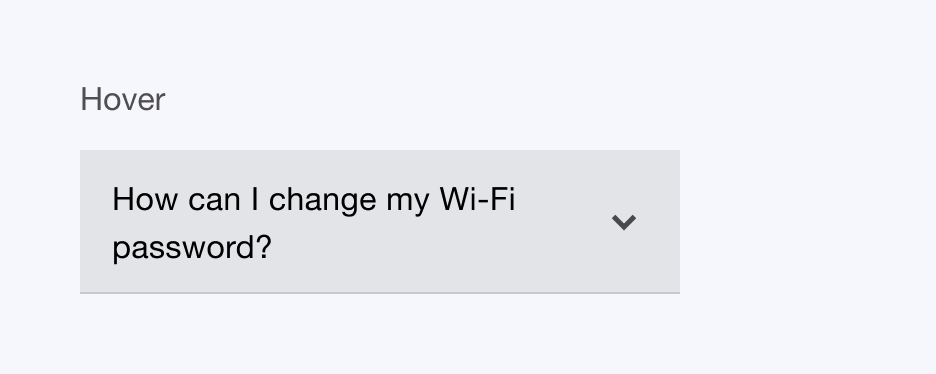

<!-- zh-row -->

**`Focus`** Focus indicates that the Q&A trigger is currently selected for keyboard interaction. Display one clear Focus treatment around the complete trigger area. When the expanded answer contains interactive elements, those elements receive their own Focus state independently from the Q&A trigger.

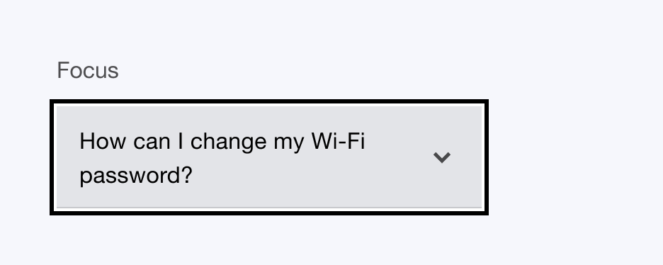

<!-- zh-row -->

**`Pressed`** Pressed is a temporary state displayed while the Q&A trigger is being activated.

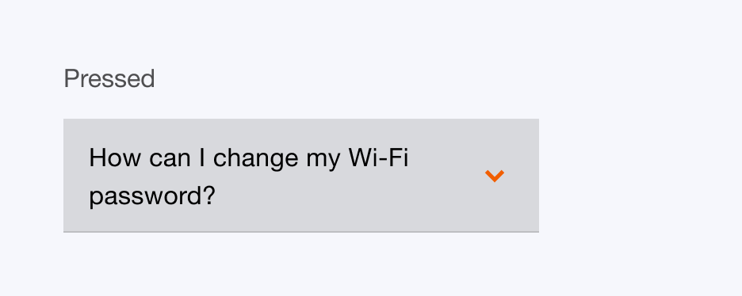

<!-- zh-row -->

**`Disabled`** Use Disabled when the Q&A is temporarily unavailable or cannot currently be expanded. A Disabled trigger must not respond to activation.

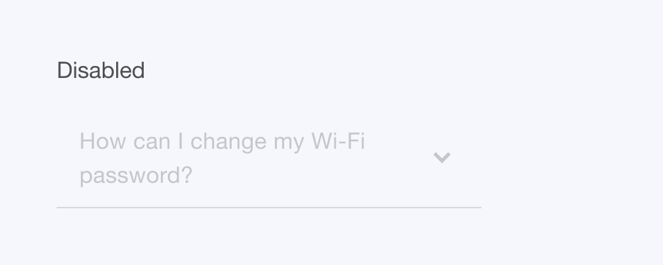

<!-- zh-row -->

**`Skeleton`** Use Skeleton while the Q&A or its required content is loading and the final information is not yet available. A Skeleton Q&A item acts as a placeholder and must not expand or collapse.

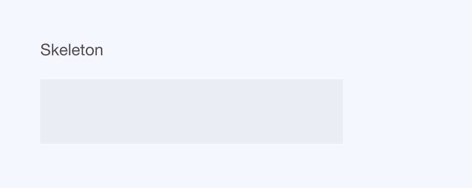

# Accessibility

## Motion & Animation accessibility rules

In terms of animation, there are accessibility criteria to consider: “Animation from Interactions” and “Pause, Stop, Hide.”  
These two main criteria address different issues:

&nbsp;

### Pause, Stop, Hide - WCAG 2.2.2
This concerns moving, blinking, scrolling, or automatically updating content.  
The question to ask is: does the animation start automatically and meet the criterion’s conditions?  
When a relevant animation lasts more than 5 seconds, users must be able to pause, stop, or hide it.  
The two criteria should therefore be evaluated independently.

&nbsp;

### Reduced Motion (Animation from Interactions) - WCAG 2.3.3
This primarily concerns motion-based animations triggered by user interaction.  
The question to ask is: is the movement essential to the functionality or to the information being conveyed?  
If not, the animation should be removed, reduced, or replaced when the user has enabled Reduced Motion.

ℹ️ The reduced motion preference can be configured by the user at the operating system level and is available to websites through the CSS prefers-reduced-motion media feature.

Concrete application to the Accordion:

&nbsp;

### Pause, Stop, Hide
The expansion and collapse of an accordion are triggered by the user and do not generally fall within the scope of this criterion.  
However, if the expanded content contains moving, blinking, scrolling, or automatically updating content, that content must be evaluated separately.

&nbsp;

### Reduced Motion
The animated expansion and collapse of an accordion are not essential to its functionality or to understanding its content.  
When Reduced Motion is enabled, the animated transition should therefore be removed or replaced with an instantaneous transition.  
Default: animated expansion and collapse  
Reduced Motion: instantaneous expansion and collapse

# Develop

## Developer documentation

| Platform | Developer documentation |
|---|---|
| OUDS Web | Not available yet |
| OUDS Android | Not available yet |
| OUDS iOS | Not available yet |
| OUDS Flutter | Not available yet |

# Changelog

## Availability

| Platform | Resource | Status | Version |
|---|---|---|---|
| Figma | Design component | Early Access | 1.0.0 |
| OUDS Web (former Boosted) | Web dev documentation | To do | – |
| OUDS Android - Jetpack Compose | Android dev documentation | To do | – |
| OUDS iOS - Swift | iOS dev documentation | To do | – |
| OUDS Flutter | Flutter dev documentation | To do | – |

|  |  | N/A |  | To do |  | Draft |  |  |  | In progress |  | Early Access |  | Live |
|---|---|---|---|---|---|---|---|---|---|---|---|---|---|---|

## Design changelog

| Date | Number | Notes |
|------|--------|-------|
| Nov 10, 2026 | - | Documentation update: Slot spacing customization<ul><li>Clarified the spacing rules for Below text, Bottom, and Expand slots. Default padding, where present, is optional and can be modified or removed using semantic spacing tokens. Mandatory spacing must be applied outside the slots, within the parent frame.</ul> |
| Sep 1, 2026 | - | <ul><li>Documentation writing: Motion & Animation accessibility rules.</ul> |
| Jul 28, 2026 | 1.0.0 | **Version 2.6 of the design tokens is required for the development of this update.**<ul><li>Component creation</ul> |
