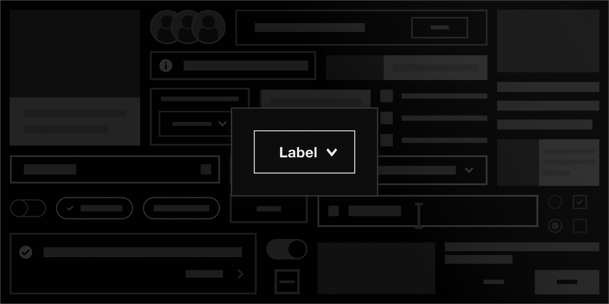
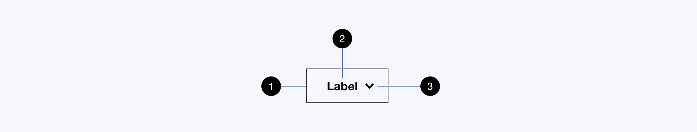
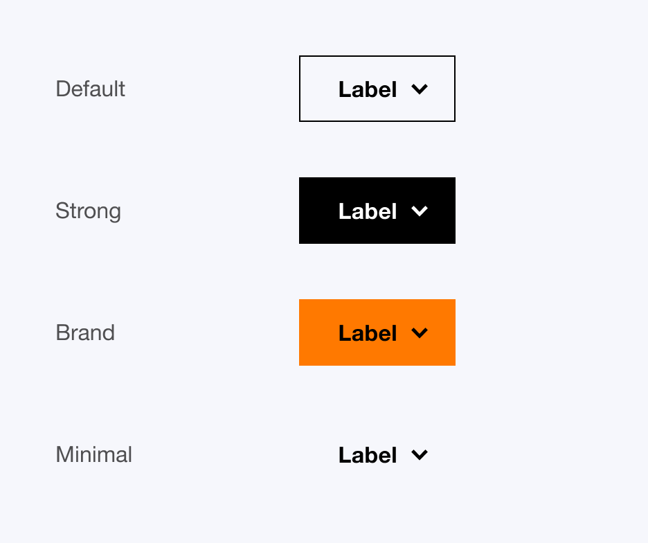
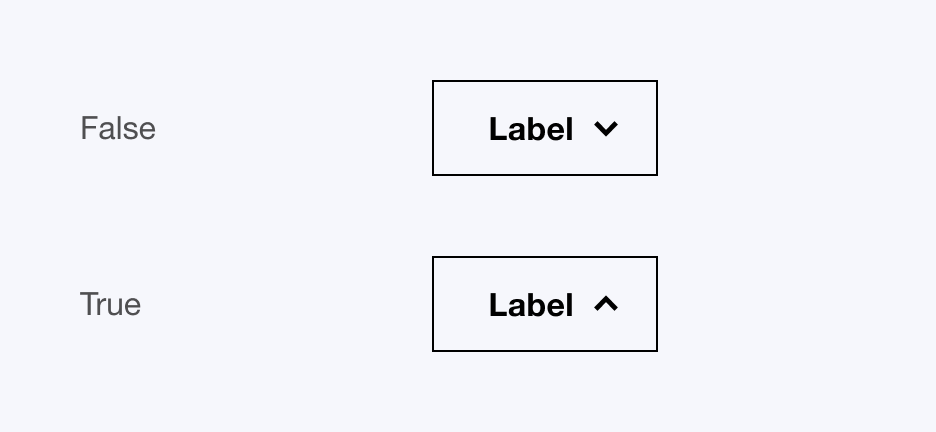
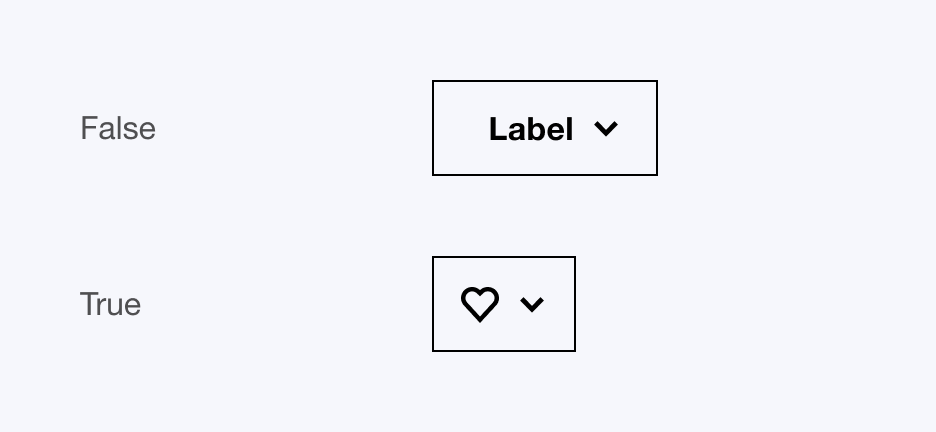
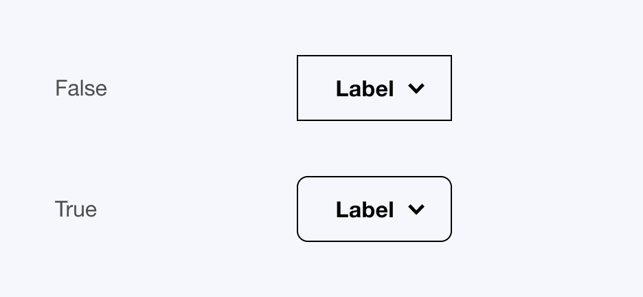
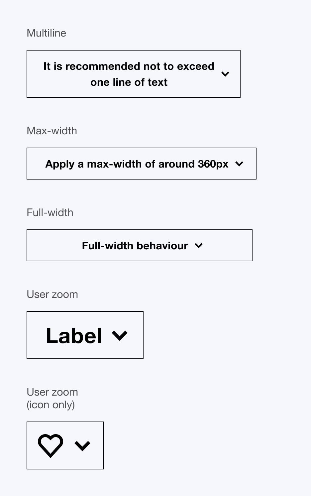
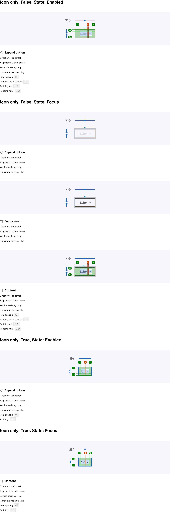
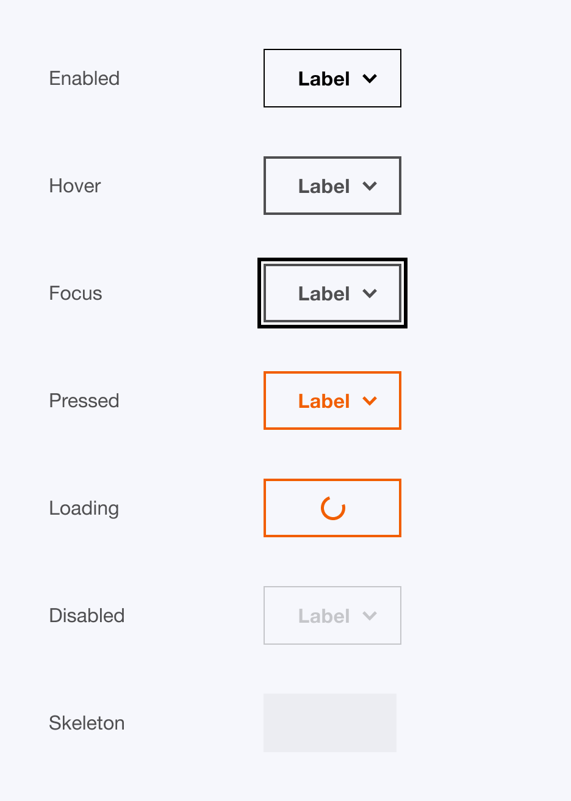

# Expand button

A button expand is a UI element that toggles content visibility, allowing users to expand or collapse content sections.

# Guideline

## Anatomy

| # | Element | Purpose | Optional |
|---|---------|---------|----------|
| 1 | Container | Tappable target that follows Button radius and elevation tokens. | No |
| 2 | Label | Short, scannable destination name. | Yes |
| 3 | Chevron | Visual indicator of expandable state (collapsed / expanded). | No |

## Definition

A button expand is a UI element that toggles content visibility, allowing users to expand or collapse content sections.

The expand button minimises visual clutter by displaying only essential information and allowing access to additional details when necessary.

## Appearance

<!-- zh-row -->

**`Default`** Default expand buttons are used for standard interactions where expanding or collapsing content doesn't require strong emphasis. They provide a balanced and neutral look suitable for most layouts.  
Use case: Expanding FAQ sections or showing additional text in articles.

**`Strong`** The Strong expand button is prominent and visually emphasized, reserved for the most important expandable sections where visibility and clarity are critical.  
Use case: Expanding a key section in a form, such as "Payment details" in a checkout process.

**`Brand`** The Brand expand button uses the brand's primary color as an alternative to the Strong button. It should be used sparingly to anchor a branded moment or highlight a special section.  
Use case: Expanding promotional or branded content blocks.

**`Minimal`** Minimal expand buttons are lightweight and understated, best for secondary or less critical expandable areas. They reduce visual noise and integrate seamlessly with simple layouts.  
Use case: Expanding advanced options in a settings menu or filters in a search panel.

**Do:** Write specific, actionable error messages that tell users exactly what went wrong and how to fix it

**Don't:** Use generic error messages like "Invalid input" or "Error"—they don't help users understand the problem

## Expanded

<!-- zh-row -->

**`False`** The Expanded = false state indicates that the content controlled by the button is currently hidden or collapsed. The button should visually suggest that more information is available (with a downward chevron).  
Use case: Default state in FAQs, dropdowns, or collapsible panels before the user interacts with them.

**`True`** The Expanded = true state indicates that the content has been revealed or expanded. The button should update its visual affordance to show that the section is open (with an upward chevron) and that it can be collapsed again.  
Use case: Active state when a user expands details, advanced options, or additional filters in a panel.

## Icon only

<!-- zh-row -->

**`False`** The Icon only = false state displays both a text label and an icon. This version provides greater clarity and is recommended when users may need additional context to understand the button's action.  
Use case: Expanding or collapsing sections in forms or settings, where descriptive text improves usability.

**`True`** The Icon only = true state displays only the icon without a visible label. It creates a more compact appearance, suitable for space-constrained layouts or when the icon meaning is universally understood. For accessibility, always provide an alternative text label via aria-label or a tooltip.  
Use case: Expanding or collapsing filters, toolbars, or mobile panels where space is limited.

## Rounded corner

<!-- zh-row -->

Even though in Figma this rendering option is available and editable from the properties of each button component, the configuration of this rendering option is actually transversal across the entire product/service in which the component is used. It is therefore impossible to have one button component set to Rounded corner=True and another set to Rounded corner=False within the same product/service.

**`False`** The square rendering corresponds to Orange's historical style. It conveys the brand's sense of seriousness, robustness and utility-driven. It remains the default style for our digital interface components.

**`True`** The rounded rendering offers flexibility without sacrificing the attribution to the brand. It helps anchoring the service in a reality where the visual codes of the mobile area tends to rub off on all interfaces. Use rounded corners for a softer, more approachable, friendly and tactile feel.

&nbsp;

### Brand theme availability
This option is technically not available for all brand themes. Here's the list of rounded corners availability by brand theme:

| Brand theme | Availability |
|---|---|
| Orange | ✅ Available |
| Orange Compact | ✅ Available |
| Sosh | ❌ Unavailable |
| Wireframe | ❌ Unavailable |

## Multiline and responsiveness

<!-- zh-row -->

### Multiline
This component allows multi-line text editing. Although the number of lines is not technically limited, it is recommended not to exceed one line of text.  
Nevertheless, if the label spans multiple lines, the label remains horizontally centred and the chevron icon remains vertically centred.

&nbsp;

### Max-width vs full-width
For greater flexibility, this component doesn't have a default max-width. To avoid exceeding a width that would degrade readability and the perception of a compact interactive element, we recommend applying **a max-width of around 360px.**  
The component can also naturally wrap within the parent container (or the screen in a mobile use context for exemple) and use the full available width.  
Please note that this behavior is not the default rule; it may be preferred if the template allows it (to improve user comfort or for better page structure/hierarchy).

&nbsp;

### User zoom in/out
The behavior of the text during user zoom in/out must follow a fundamental principle: the text must remain readable, accessible, and must never break the structure or lose information.
* The text must always scale proportionally with user zoom. Text resizing must never be blocked.
* Zooming must never cause text to be truncated or hidden. The component must expand vertically to allow line wrapping.
* The component's height and width must be flexible, never fixed, in order to automatically adapt its dimensions according to the level of zoom.
* In order to preserve the minimun interactive area during user zoom out, this component have a min-width and a min-height **of 48px**.
* Even if, the component has a max-height or a max-width for resizing control purposes, technically, during user zoom in, these limitations are not fixed but must be scalable in order to adapt to the user's zoom level.
* As the chevron icon is functional, it must follow the same rules as text.
* As the text is missing, in its "Icon only" variant, the icons follow the same rules as the text.

# Specs

## Layout and spacing

## States

<!-- zh-row -->

**`Enabled`** The default state of the Expand button when it is available for interaction.  
Use case: A collapsed section ready to be expanded by the user.

**`Hover`** The state when a user places the pointer over the Expand button without activating it. Provides a visual cue that the element is interactive.  
Use case: Highlighting that a FAQ or dropdown section can be opened.

**`Focus`** The state when the button is selected via keyboard or voice command but not yet activated. Usually shows an outline or border to ensure accessibility.  
Use case: Allowing users with keyboard navigation to expand or collapse sections clearly.

**`Pressed`** A transient state indicating that the user has clicked or tapped the Expand button and the action is being executed.  
Use case: User presses the button to reveal advanced options in a form.

**`Loading`** Used when expanding content requires fetching or processing data before it is displayed. The button shows a loading indicator.  
Use case: Expanding a collapsible panel that loads additional product details from the server.

**`Disabled`** Indicates that the Expand button cannot be interacted with, for example when expansion is not allowed or content is unavailable.  
Use case: Expand option disabled for sections restricted to certain user roles.

**`Skeleton`** A placeholder state that represents the Expand button before it is fully loaded. Improves perceived performance by showing the button will appear soon.  
Use case: During initial page load when collapsible components are still being fetched.

# Accessibility

Work is in progress to deliver this content.

# Develop

## OUDS-Web example

[Components/Buttons › Buttons 29](https://web.unified-design-system.orange.com/storybook/?path=/story/components-buttons--buttons-29)

## Developer documentation

| Platform | Developer documentation |
|---|---|
| OUDS Web | [S-ouds-web-expand-button](https://r.orange.fr/r/S-ouds-web-expand-button) |
| OUDS Android | Not available yet |
| OUDS iOS | Not available yet |
| OUDS Flutter | Not available yet |

# Changelog

## Availability

| Platform | Resource | Status | Version |
|---|---|---|---|
| Figma | [Expand button component](https://r.orange.fr/r/S-ouds-design-expand-button) | Live | 3.3.0 |
| OUDS Web (former Boosted) | [Web dev documentation](https://r.orange.fr/r/S-ouds-web-expand-button) | Live | 3.3.0 |
| OUDS Android - Jetpack Compose | Not available yet | To do | – |
| OUDS iOS - Swift | Not available yet | To do | – |
| OUDS Flutter | Not available yet | To do | – |

## Design changelog

| Date | Number | Notes |
|------|--------|-------|
| Jul 31, 2026 | 3.3.0 | Version 2.7 of the design tokens is required for the development of this update.<ul><li>A maximum width is now applied to the component.</ul> |
| Jul 1, 2026 | - | <ul><li>Updated the Progress Indicator version. Components with Rounded Corner = True now use the Progress Indicator (Rounded Corner = True) variant.</ul> |
| Jun 5, 2026 | 3.2.0 | Version 2.6 of the design tokens is required for the development of this update.<ul><li>The loader frame has been renamed to Progress indicator container.<ul><li>It now contains the new Circular Progress Indicator component.</ul></ul> |
| Mar 16, 2026 | - | <ul><li>Documentation writing:<ul><li>Rounded corners brand theme availability<li>Multiline and responsiveness</ul></ul> |
| Jan 21, 2026 | - | <ul><li>Documentation writing: Rounded corners update</ul> |
| Jan 6, 2026 | - | <ul><li>Documentation writing: Definition update</ul> |
| Sep 28, 2025 | 3.1.0 | <ul><li>Brand variant: New background and content color tokens added for hover/pressed/loading/focus states <li>The name of the "Hierarchy" variant has been replaced to "Appearance"</ul> |
| Jul 24, 2025 | 3.0.0 | <ul><li>New hierarchical variant: Brand → [Component tokens changelog 1.4.0](https://www.figma.com/design/Co2t6wHMf4GB9NJVGs2Hes/-OUDS-Core-Lib--Design-tokens?m=auto&node-id=9280-2568&t=HLVB4jOd35DWr8Bj-1) <li>Rounded corner property is now available → [Component tokens changelog 1.4.0](https://www.figma.com/design/Co2t6wHMf4GB9NJVGs2Hes/-OUDS-Core-Lib--Design-tokens?m=auto&node-id=9280-2568&t=HLVB4jOd35DWr8Bj-1) <li>Minimal variant: Color and width border tokens removed <li>Minimal variant: Color background tokens removed in the enabled state <li>Minimal variant: Color background tokens removed in the loading state <li>Minimal variant: Color background tokens removed in the disabled state</ul> |
| Jul 21, 2025 | 2.1.0 | <ul><li>Several design token updates: [Component tokens changelog 1.3.0](https://www.figma.com/design/Co2t6wHMf4GB9NJVGs2Hes/-OUDS-Core-Lib--Design-tokens?m=auto&node-id=9280-2568&t=HLVB4jOd35DWr8Bj-1) <li>Button: Expanded: The chevron is also present in the 'icon only' variant. The gap between these 2 elements is defined by a design token: ouds-action-button-space-column-gap-icon-chevron→ouds-space-column-gap-2xs</ul> |
| Apr 19, 2025 | 2.0.0 | <ul><li>Creation of "On colored bg" variant</ul> |
| Dec 5, 2024 | 1.0.0 | <ul><li>Component creation</ul> |
