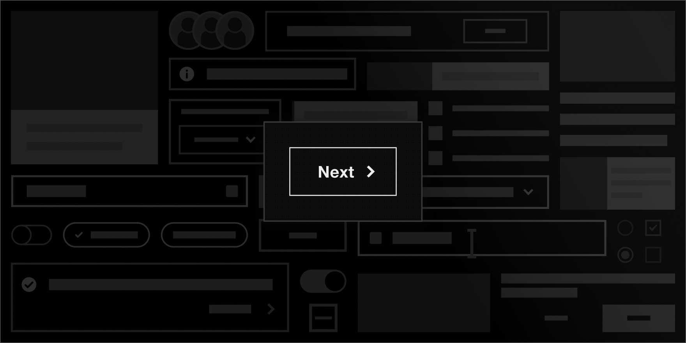
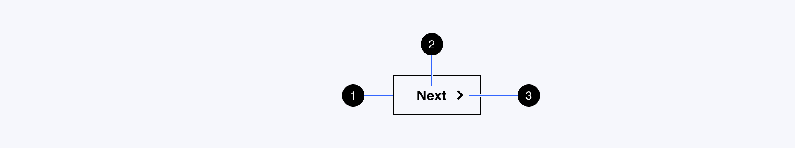
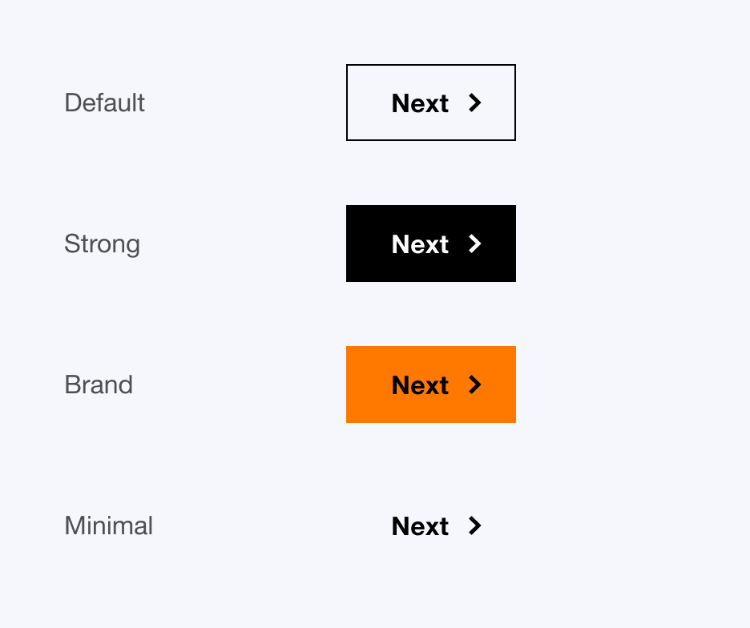
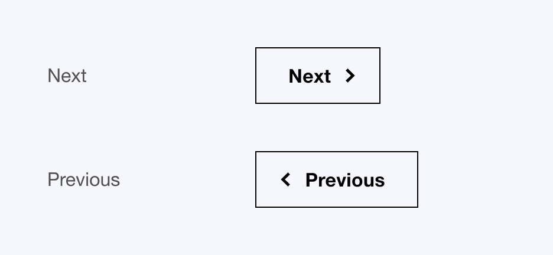
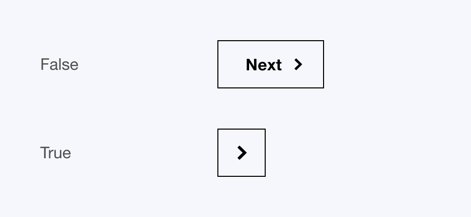
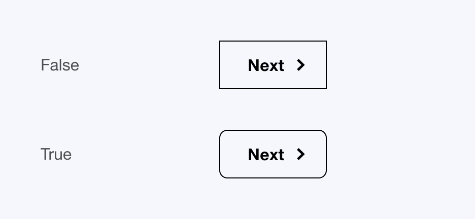
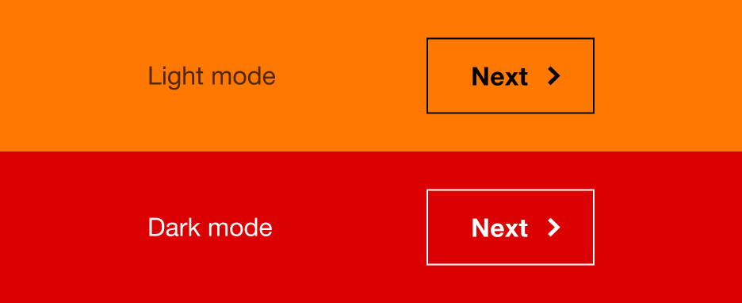
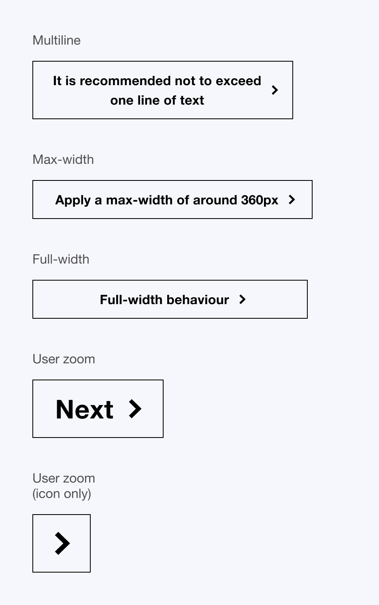
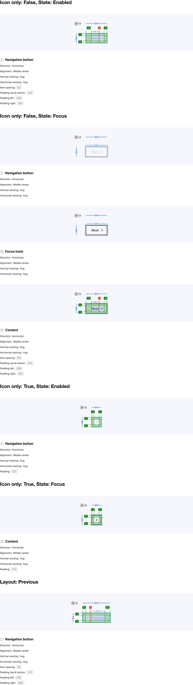
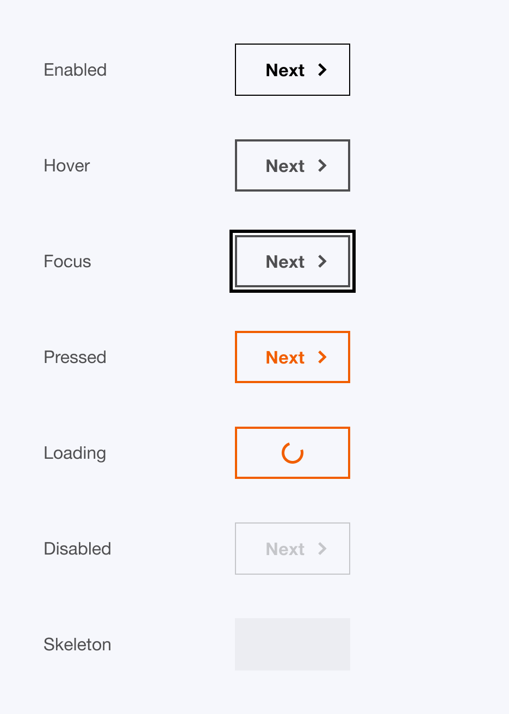

# Navigation button

A navigation button is a UI element that enables movement between different pages within a multi-page interface.

# Guideline

## Anatomy

| # | Element | Purpose | Optional |
|---|---------|---------|----------|
| 1 | Container | Tappable target that follows Button radius and elevation tokens. | No |
| 2 | Label | Short, scannable destination name. | Yes |
| 3 | Chevron | Directional icon that indicates navigation to another view or screen. | No |

## Definition

A navigation button is a UI element that enables movement between different pages within a multi-page interface.

The navigation button is typically arranged in a sequence to indicate the user’s current position and provide controls for accessing previous, next, or specific pages.

## Appearance

<!-- zh-row -->

**`Default`** Default Navigation buttons are used for navigation between pages that are not critical or emphasized. They typically represent inactive page states and support smooth movement across content.  
Use case: Standard "next/previous" navigation in product listings or search results.

**`Strong`** The Strong Navigation button should be singular and prominent, reserved for highlighting the active page. It ensures the user always knows their current position within a sequence.  
Use case: Highlighting the active page in long catalog navigation.

**`Brand`** A brand-colored alternative to the Strong Navigation button. It should be used sparingly for high-value navigation points or to visually anchor a brand moment. Avoid using it as the default for all pages.  
Use case: Emphasizing a key page (a promotional offer) with the brand's primary color.

**`Minimal`** Minimal Navigation buttons are simplified and less emphasized, suitable when pagination is not the primary focus. They can be used independently or in combination with stronger buttons.  
Use case: Secondary interfaces, such as blogs or FAQs, where pagination is less critical.

**Do:** Write specific, actionable error messages that tell users exactly what went wrong and how to fix it

**Don't:** Use generic error messages like "Invalid input" or "Error"—they don't help users understand the problem

## Layouts

<!-- zh-row -->

**`Next`** The Next layout button is used to move the user forward in a sequence of content, steps, or pages.  
Use case: Navigating to the next page in a multi-step form, product catalog, or article series.

**`Previous`** The Previous layout button allows the user to return to the prior step, page, or section.  
Use case: Going back to the previous step in a checkout flow or returning to the prior search results page.

## Icon only

<!-- zh-row -->

**`False`** When Icon only is set to false, the button displays both an icon and a text label. This makes the action more explicit and accessible, especially for new users or in contexts where clarity is critical.  
Use case: Using a "Next" button with both text and icon in a multi-step checkout flow to ensure the action is clearly understood.

**`True`** The Icon only Navigation button is used in layouts where space is limited or where a minimalist design is required. It relies solely on universally recognized icons (such as arrows) to indicate navigation actions without additional text. This variant should be applied selectively — for example in carousels, mobile navigation bars, or compact toolbars — where the context makes the meaning obvious. To ensure accessibility, it must always be paired with a hidden text label (via aria-label or tooltip) so that assistive technologies can convey the action clearly.

## Rounded corner

<!-- zh-row -->

Even though in Figma this rendering option is available and editable from the properties of each button component, the configuration of this rendering option is actually transversal across the entire product/service in which the component is used. It is therefore impossible to have one button component set to Rounded corner=True and another set to Rounded corner=False within the same product/service.

**`False`** The square rendering corresponds to Orange's historical style. It conveys the brand's sense of seriousness, robustness and utility-driven. It remains the default style for our digital interface components.

**`True`** The rounded rendering offers flexibility without sacrificing the attribution to the brand. It helps anchoring the service in a reality where the visual codes of the mobile area tends to rub off on all interfaces. Use rounded corners for a softer, more approachable, friendly and tactile feel.

&nbsp;

### Brand theme availability
This option is technically not available for all brand themes. Here's the list of rounded corners availability by brand theme:

| Brand theme | Availability |
|---|---|
| Orange | ✅ Available |
| Orange Compact | ✅ Available |
| Sosh | ❌ Unavailable |
| Wireframe | ❌ Unavailable |

## Specific component: On colored bg

<!-- zh-row -->

This variant ensures a sufficiently high level of accessibility when the component is used on a background that is "out of control".

&nbsp;

### To invert color
* In light mode: For a black finish
* In dark mode: For a white finish

## Multiline and responsiveness

<!-- zh-row -->

### Multiline
This component allows multi-line text editing. Although the number of lines is not technically limited, it is recommended not to exceed one line of text.  
Nevertheless, if the label spans multiple lines, the label remains horizontally centred and the chevron icon remains vertically centred.

&nbsp;

### Max-width vs full-width
For greater flexibility, this component doesn't have a default max-width. To avoid exceeding a width that would degrade readability and the perception of a compact interactive element, we recommend applying **a max-width of around 360px.**  
The component can also naturally wrap within the parent container (or the screen in a mobile use context for exemple) and use the full available width.  
Please note that this behavior is not the default rule; it may be preferred if the template allows it (to improve user comfort or for better page structure/hierarchy).

&nbsp;

### User zoom in/out
The behavior of the text during user zoom in/out must follow a fundamental principle: the text must remain readable, accessible, and must never break the structure or lose information.
* The text must always scale proportionally with user zoom. Text resizing must never be blocked.
* Zooming must never cause text to be truncated or hidden. The component must expand vertically to allow line wrapping.
* The component's height and width must be flexible, never fixed, in order to automatically adapt its dimensions according to the level of zoom.
* In order to preserve the minimun interactive area during user zoom out, this component have a min-width and a min-height **of 48px**.
* Even if, the component has a max-height or a max-width for resizing control purposes, technically, during user zoom in, these limitations are not fixed but must be scalable in order to adapt to the user's zoom level.
* As the chevron icon is functional, it must follow the same rules as text.

# Specs

## Layout and spacing

## States

<!-- zh-row -->

**`Enabled`** The default state of the Navigation button when it is available for interaction. It represents a normal, ready-to-use navigation control.  
Use case: Visible as the standard button for moving to the next or previous page.

**`Hover`** The state when a user places a pointing device over the Navigation button without yet clicking it. It provides a visual cue that the button is interactive.  
Use case: Helps users identify the button as clickable when navigating with a mouse.

**`Focus`** The state when a Navigation button is selected via keyboard or voice command but not yet activated. It usually mirrors the hover style with an additional outline for clarity.  
Use case: Ensures accessibility and visibility for keyboard or assistive technology users.

**`Pressed`** A transient state indicating that the user has taken action on the button and the navigation is in progress. It confirms the interaction before moving to the next page.  
Use case: Shown briefly after clicking "Next" to indicate the command has been received.

**`Loading`** The state used when the Navigation button is fetching or processing data before displaying the next set of content. It uses a loading indicator to communicate progress.  
Use case: Appears when moving between pages in a data-heavy table or search results.

**`Disabled`** Indicates that the Navigation button is not available for interaction, such as when the user is already on the first or last page.  
Use case: "Previous" button disabled on the first page, or "Next" disabled on the last page.

**`Skeleton`** A placeholder state used while the Navigation button is still loading. It improves perceived performance by giving users a visual indication that the control will appear soon.  
Use case: Displayed during initial page load or while waiting for navigation controls to render.

# Accessibility

Work is in progress to deliver this content.

# Develop

## OUDS-Web example

[Components/Buttons › Buttons 19](https://web.unified-design-system.orange.com/storybook/?path=/story/components-buttons--buttons-19)

[Components/Buttons › Buttons 21](https://web.unified-design-system.orange.com/storybook/?path=/story/components-buttons--buttons-21)

## Developer documentation

| Platform | Developer documentation |
|---|---|
| OUDS Web | [S-ouds-web-navigation-button](https://r.orange.fr/r/S-ouds-web-navigation-button) |
| OUDS Android | [S-ouds-android-navigation-button](https://r.orange.fr/r/S-ouds-android-navigation-button) |
| OUDS iOS | Not available yet |
| OUDS Flutter | [S-ouds-flutter-navigation-button](https://r.orange.fr/r/S-ouds-flutter-navigation-button) |

# Changelog

## Availability

| Platform | Resource | Status | Version |
|---|---|---|---|
| Figma | [Navigation button component](https://r.orange.fr/r/S-ouds-design-navigation-button) | Live | 3.4.0 |
| OUDS Web (former Boosted) | [Web dev documentation](https://r.orange.fr/r/S-ouds-web-navigation-button) | Live | 3.4.0 |
| OUDS Android - Jetpack Compose | [Android dev documentation](https://r.orange.fr/r/S-ouds-android-navigation-button) | Live | 3.4.0 |
| OUDS iOS - Swift | Not available yet | To do | – |
| OUDS Flutter | [Flutter dev documentation](https://r.orange.fr/r/S-ouds-flutter-navigation-button) | Live | 3.4.0 |

## Design changelog

| Date | Number | Notes |
|------|--------|-------|
| Jul 31, 2026 | 3.4.0 | Version 2.7 of the design tokens is required for the development of this update.<ul><li>A maximum width is now applied to the component.</ul> |
| Jul 1, 2026 | - | <ul><li>Updated the Progress Indicator version. Components with Rounded Corner = True now use the Progress Indicator (Rounded Corner = True) variant.</ul> |
| Jun 5, 2026 | 3.3.0 | Version 2.6 of the design tokens is required for the development of this update.<ul><li>The loader frame has been renamed to Progress indicator container.<ul><li>It now contains the new Circular Progress Indicator component.</ul><li>For the "Icon only" variant, absolute positioning has been removed and replaced with Auto Layout.<ul><li>The container now uses:<ul><li>icon-only-default (ouds/space/inset/medium) for the Default size</ul></ul><li>Inside the container, the Circular Progress Indicator uses:<ul><li>progress-indicator-only-default</ul></ul> |
| Apr 21, 2026 | 3.2.1 | Correction: Changing the size of the chevron in the 'Icon only' variant → 20 to 24px. |
| Mar 16, 2026 | - | <ul><li>Documentation writing:<ul><li>Rounded corners brand theme availability<li>Multiline and responsiveness</ul></ul> |
| Jan 21, 2026 | - | <ul><li>Documentation writing: Rounded corners update<li>Documentation writing: Dedicated component: On coloured bg</ul> |
| Jan 6, 2026 | - | <ul><li>Documentation writing: Definition update</ul> |
| Oct 10, 2025 | 3.2.0 | New component name: Navigation button (vs Pagination button) The specific component "On colored bg" has been split into two distinct components: <ul><li>A public version offering traditional management of dark and light modes <li>A private version (allowing the core team to nest the component with other components) offering customized mode management with four possible configurations: <ul><li>Always in light mode <li>Always in dark mode <li>Light to dark mode <li>Dark to light mode </ul><li>Consequently, for the private version, the name of the "Inverted color" variant has been replaced to "Mode control".</ul> | Maxime Tonnerre |
| Sep 28, 2025 | 3.1.0 | <ul><li>Brand variant: New background and content color tokens added for hover/pressed/loading/focus states <li>The name of the "Hierarchy" variant has been replaced to "Appearance"</ul> |
| Jul 24, 2025 | 3.0.0 | <ul><li>New hierarchical variant: Brand → [Component tokens changelog 1.4.0](https://www.figma.com/design/Co2t6wHMf4GB9NJVGs2Hes/-OUDS-Core-Lib--Design-tokens?m=auto&node-id=9280-2568&t=HLVB4jOd35DWr8Bj-1) <li>Rounded corner property is now available → [Component tokens changelog 1.4.0](https://www.figma.com/design/Co2t6wHMf4GB9NJVGs2Hes/-OUDS-Core-Lib--Design-tokens?m=auto&node-id=9280-2568&t=HLVB4jOd35DWr8Bj-1) <li>Minimal variant: Color and width border tokens removed <li>Minimal variant: Color background tokens removed in the enabled state <li>Minimal variant: Color background tokens removed in the loading state <li>Minimal variant: Color background tokens removed in the disabled state</ul> |
| Jul 21, 2025 | 2.1.0 | <ul><li>Several design token updates: [Component tokens changelog 1.3.0](https://www.figma.com/design/Co2t6wHMf4GB9NJVGs2Hes/-OUDS-Core-Lib--Design-tokens?m=auto&node-id=9280-2568&t=HLVB4jOd35DWr8Bj-1) <li>Button: Expanded: The chevron is also present in the 'icon only' variant. The gap between these 2 elements is defined by a design token: ouds-action-button-space-column-gap-icon-chevron→ouds-space-column-gap-2xs</ul> |
| Apr 19, 2025 | 2.0.0 | <ul><li>Creation of "On colored bg" variant</ul> |
| Dec 5, 2024 | 1.0.0 | <ul><li>Component creation</ul> |
