# Action card

An action card is a surface-like UI element that groups related information within an interactive surface and allows a user to perform a single primary action or navigate to a destination.

# Guideline

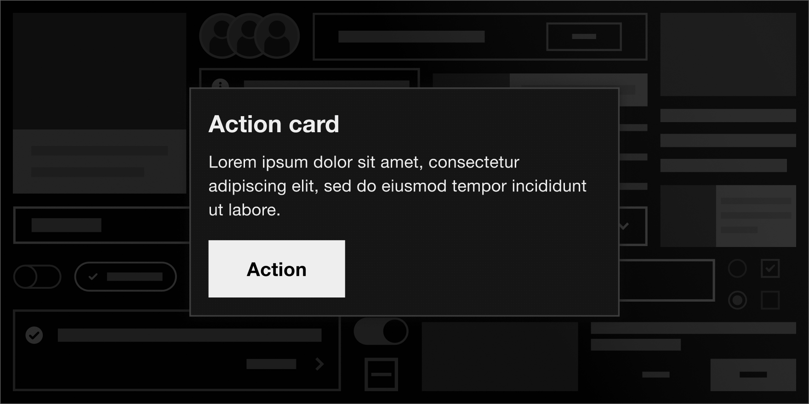

## Anatomy

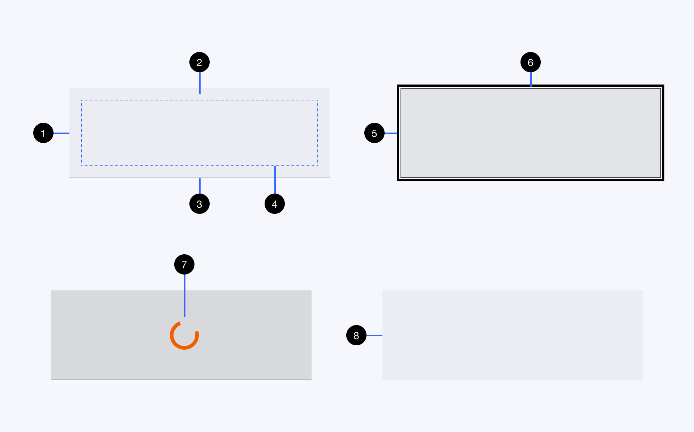

| # | Element | Purpose | Optional |
|---|---------|---------|----------|
| 1 | Container | The card itself: the surface that holds the background, the divider and the slot. | No |
| 2 | Background | Interaction support layer that sits over the card surface and carries the enabled treatment. | Yes |
| 3 | Divider | Predefined line that reinforces the separation of a Filled card from its surrounding surface. | Yes |
| 4 | Slot | Holds the customizable content of the card: text, imagery and other elements. | No |
| 5 | Focus | Focus indicator shown around the complete card when it receives keyboard focus. | Yes |
| 6 | Focus inset | Inner line of the focus indicator that keeps it visible on any surface. | Yes |
| 7 | Circular progress indicator | Shows that an action triggered by the card is being processed, in the Loading state. | Yes |
| 8 | Skeleton | Placeholder shown while the content of the card is not yet available. | Yes |

## Definition

An action card is a surface-like UI element that groups related information within an interactive surface and allows a user to perform a single primary action or navigate to a destination.

The entire card acts as the interaction target and can behave as a button, an internal link, or an external link. Unlike the card, which can contain independent interactive elements, the action card is designed around one primary interaction.

## Style

<!-- zh-row -->

**`Filled`** Filled cards use a background surface to visually separate their content from the surrounding interface. By default, the card is displayed on a bg/primary background, with an additional action/support/enabled layer controlled by the Background Boolean property. The Background property controls only the interaction support layer, not the surrounding background surface. To display the card on a different background, designers should use a parent frame with one of the supported OUDS background or surface tokens, rather than manually overriding the card's interaction layers. This ensures that Hover, Focus and Pressed states remain consistent across different background contexts.

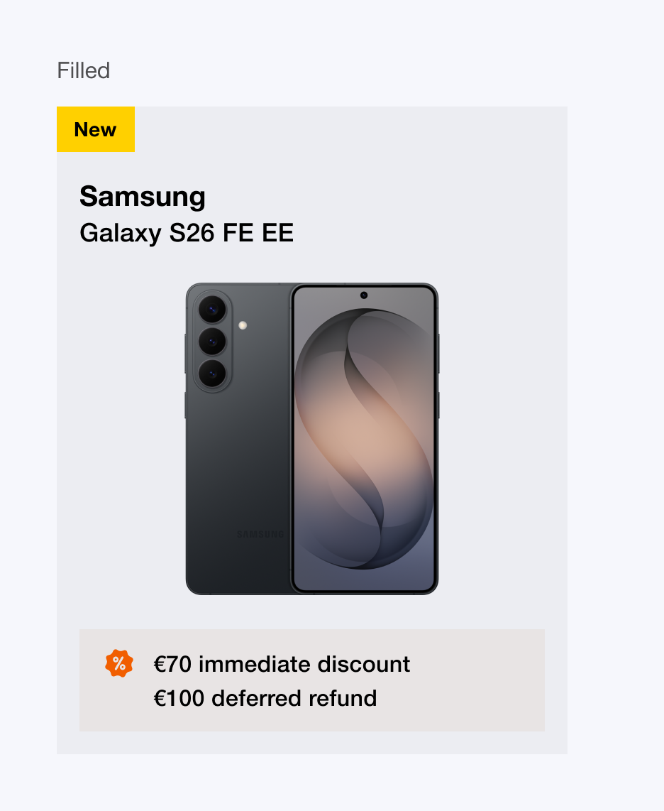

<!-- zh-row -->

**`Outlined`** Outlined cards define their boundaries with a border instead of a background fill. The card remains transparent, allowing the surrounding surface to show through.

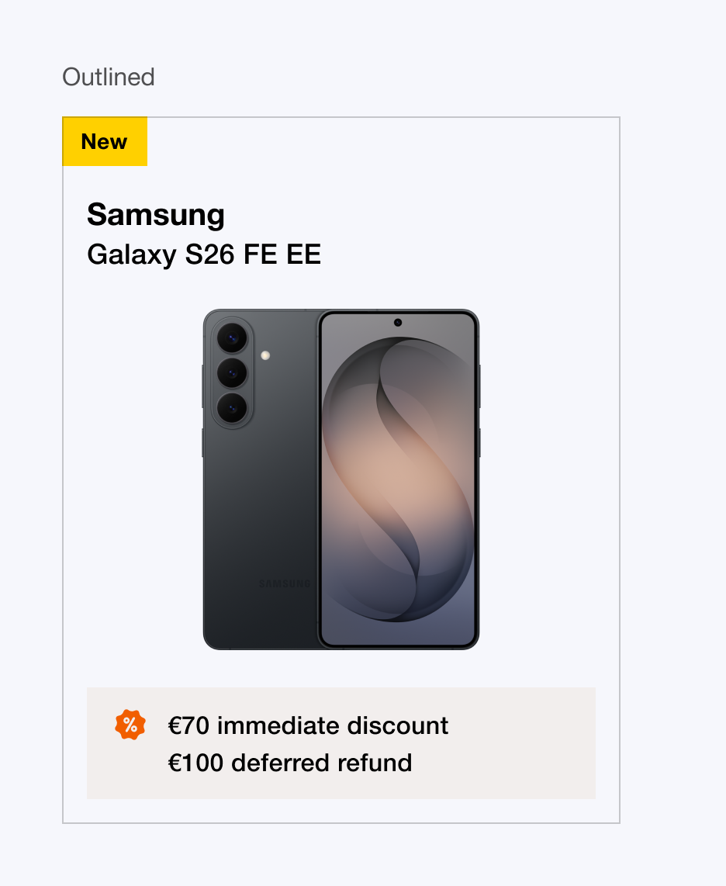

<!-- zh-row -->

**`Elevated`** Elevated cards create visual separation through a shadow, giving the card a raised appearance. Unlike transparent cards, Elevated cards require a visible background surface to ensure that the shadow is rendered correctly. The shadow must apply to the card as a whole, not to individual elements within the slot. Designers must use the predefined OUDS elevation and background tokens. Custom shadows or opacity workarounds should not be applied.

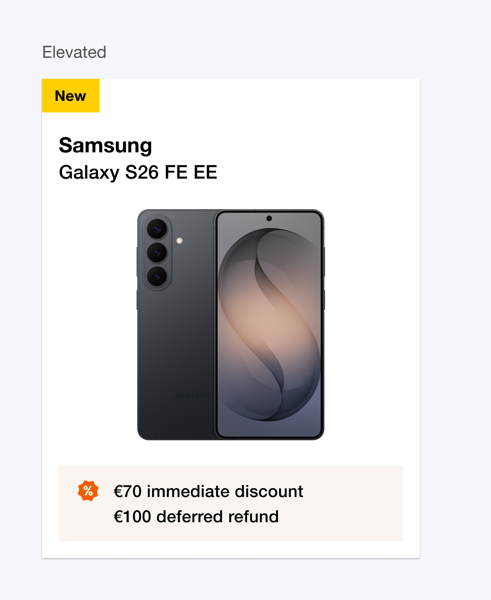

<!-- zh-row -->

### Inverse background
Inverse backgrounds introduce a different color context within the interface. Text, icons, and interactive elements must adapt to the appropriate light or dark theme to maintain readability and contrast.

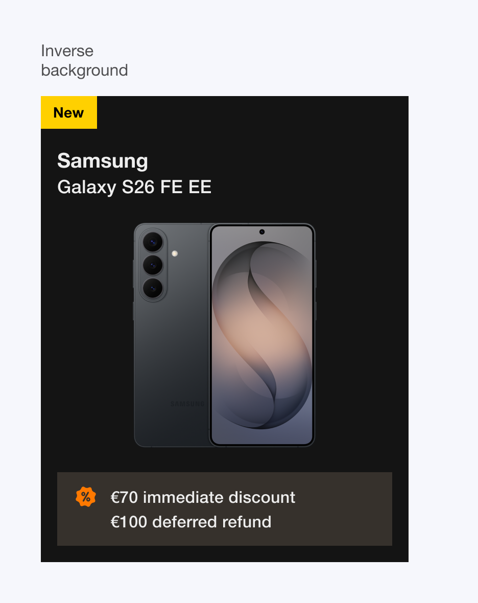

<!-- zh-row -->

### Image background
A background image can replace the default Filled surface.  
The image must preserve content readability across different screen sizes and cropping configurations. Interaction support layers must remain visible above the background image in all applicable states, including Hover, Focus and Pressed. The background image must not hide or override the card's interaction feedback.

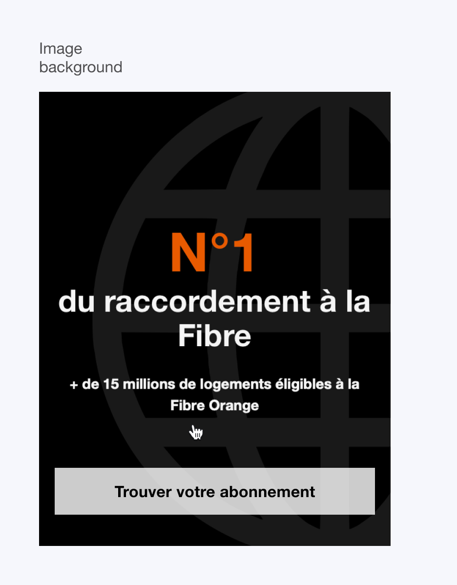

⚠️ Only the predefined stroke, divider, and background colors specified for this component may be used. Custom colors are not allowed.

## Rounded corner

<!-- zh-row -->

Although this property can be edited on individual components in Figma, the corner treatment is defined consistently at product or service level by the selected brand theme. Do not mix rounded and square treatments within the same product or service.

**`True`** Displays the card with rounded corners, creating a softer appearance in themes that support this treatment.

**`False`** Displays the card with square corners, reflecting Orange’s more structured visual language. The rounded-corner option is available for Orange and Orange Compact, but unavailable for Sosh and Wireframe.

This option is technically not available for all brand themes  
Here’s the list of rounded corners availability by brand theme

| Brand theme | Status |
|---|---|
| Orange | ✅ Available |
| Orange Compact | ✅ Available |
| Sosh | ❌ Unavailable |
| Wireframe | ❌ Unavailable |

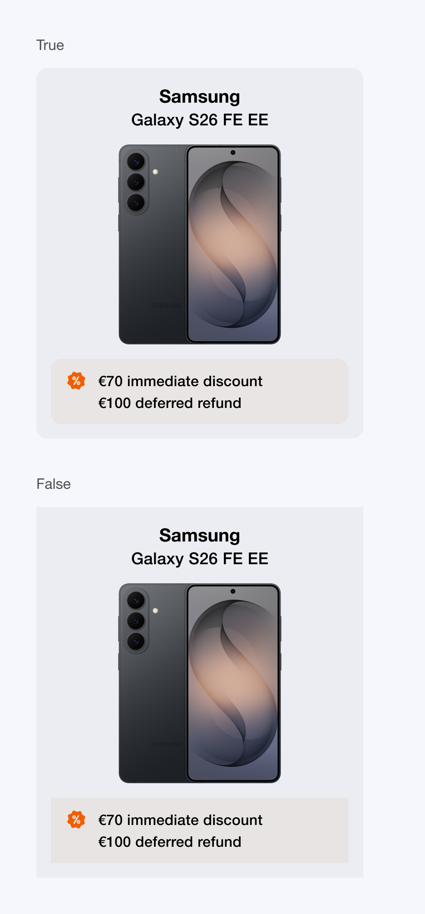

## Background

<!-- zh-row -->

The Background Boolean property controls the visibility of the predefined color/action/support/enabled layer within the Card component. This property is available for the Filled and Elevated styles when State = Enabled.

**`True`** Displays the predefined color/action/support/enabled layer within the Card, over the underlying surface.

**`False`** Hides the internal Background layer, leaving the underlying surface visible without the additional support treatment.

&nbsp;

### ⚠️ Surface customization
In the Filled style, designers can place the Card inside an additional Surface frame to customize its base background using supported tokens, such as surface/primary, surface/secondary, or surface/tertiary etc...

This external frame acts as the underlying surface of the Card and is independent of the component's internal Background layer.  
The Background Boolean can be enabled or disabled independently of the selected Surface.

For other styles:  
• Elevated: Uses its predefined surface/primary background. The Background Boolean remains available, but the external Surface customization is not supported.  
• Outlined: Does not support the Background Boolean or additional Surface customization.

⚠️ The external Surface frame must use predefined OUDS surface tokens. The Card's internal Background layer must not be manually modified or replaced.

⚠️ When Rounded corner = True, the external Surface frame must use a predefined OUDS corner-radius token matching the Card's corner-radius value. This ensures consistent corner alignment between the Card and its underlying Surface.

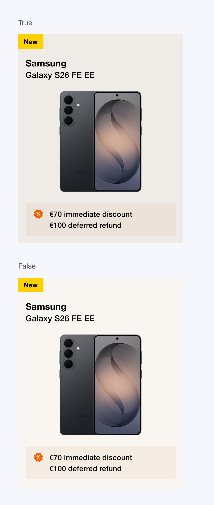

## Divider

<!-- zh-row -->

The Divider Boolean property is available only when Style = Filled. It reinforces the card’s visual separation from its surrounding surface and follows the design system’s predefined color treatment.

**`True`** Displays the predefined divider on the Filled card.

**`False`** Hides the divider. The card relies on its Filled surface for visual separation.

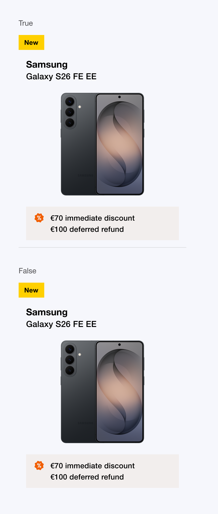

## Slot spacing

<!-- zh-row -->

The slot allows designers to customize the content and layout inside the card, including its text, imagery, and independent actions.  
Internal padding and spacing can be adjusted using two types of spacing tokens.

**`Fixed space`** Uses a consistent spacing value across screen references. The spacing remains the same on mobile and desktop.

**`Scaled space`** Uses responsive spacing values that adapt to the screen reference. Spacing may differ between mobile and desktop to preserve the intended layout. Use the appropriate OUDS spacing tokens rather than arbitrary values to maintain consistency across layouts.

⚠️ By default, all padding values within the Action card slot are set to 0. Designers can define and customize spacing according to their layout needs using the appropriate OUDS Fixed or Scaled spacing tokens.  
When using nested components, their predefined internal spacing and corner-radius rules must be preserved.

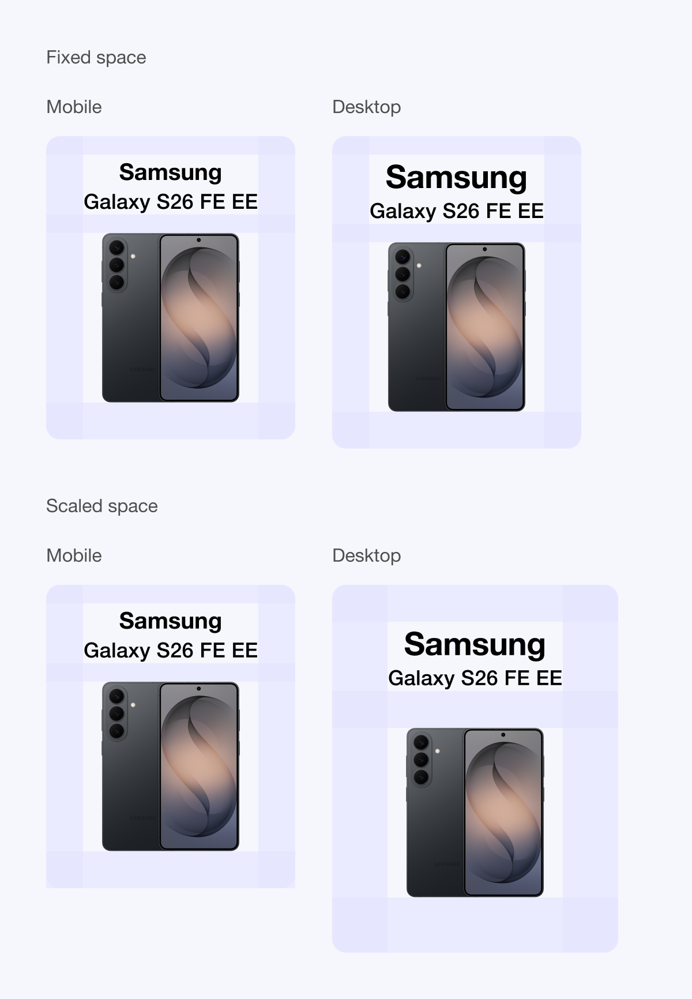

## Role

<!-- zh-row -->

The primary action must use the appropriate semantic element according to its behavior.

**`External Link`** Navigates to an external destination using link semantics.

**`Link`** Navigates to another destination.

**`Button`** Triggers an action without navigation.

When independent secondary actions are present, the primary action and secondary controls must be implemented as separate interactive elements within a non-interactive structural container.

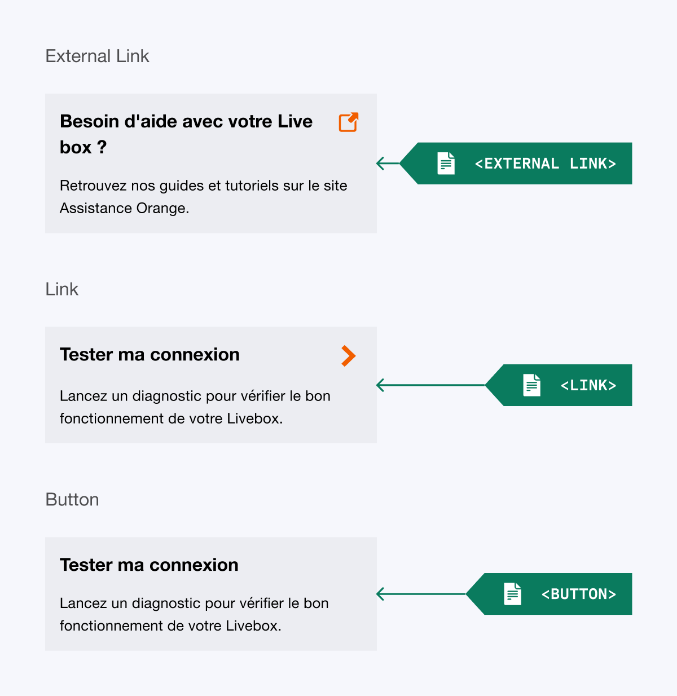

## Which component should use?

Choose the component based on where the interaction happens, not on its visual style or the number of elements.  
A single action can belong either to a Card or to an Action card.

| Interaction pattern | Actions | Use | Interactive area |
|---|---|---|---|
| Display information only | 0 | Card | No interactive target |
| Provide one explicit CTA | 1 | Card | Only the internal button or link |
| Provide independent CTAs | 2+ | Card | Each internal control independently |
| Make the whole card one action | 1 | Action card | Available card surface |
| Reinforce the same action visually | 1 | Action card | One target; CTA is not focusable |
| Add one different secondary action | 2 | Action card | Primary region + secondary target |
| Add several secondary actions | 3+ | Action card | Primary region + independent targets |

Use Card when the container itself does nothing. Use Action card when the available card surface triggers a primary action.

Action card with independent secondary controls is conditional on platform and accessibility validation.  
If unsupported, use Card with an explicit primary CTA and separate secondary controls.  
Never nest links or buttons inside the primary card link/button; each independent action needs its own focus target

## Actions

The Action card provides one primary action. Additional elements within the slot may visually reinforce this action or, when supported, provide independent secondary actions.

<!-- zh-row -->

### Single action - Card only

The entire Action card represents a single interactive target. No additional interactive controls are present within the slot. Visual indicators, such as arrows or icons, do not create separate actions.  
Use a link for navigation or a button to trigger an action.

Use case: The card redirects users to the Assistance Orange website, where they can find guides and tutorials for their Livebox. Clicking anywhere on the card opens the same destination.

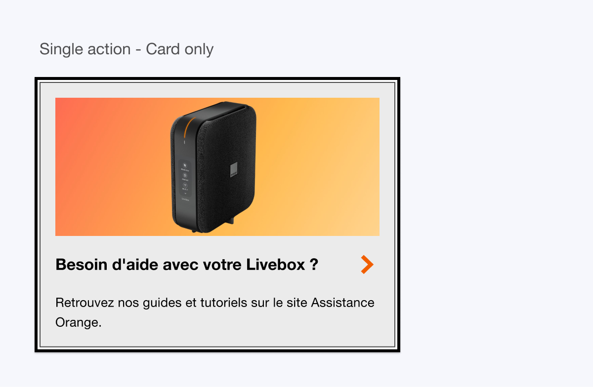

<!-- zh-row -->

### Single action - Shared interaction

The card and an internal visual CTA represent the same action or destination. The CTA serves as a visual affordance and must not create an additional interactive element or keyboard focus target.

Hover, Focus and Pressed states apply to the primary card action. The card provides only one accessible interactive target.

Use case: The card provides access to Livebox support, with a visual "Consulter les guides" CTA reinforcing the primary action. Clicking anywhere on the card, including the CTA area, opens the Assistance Orange website.

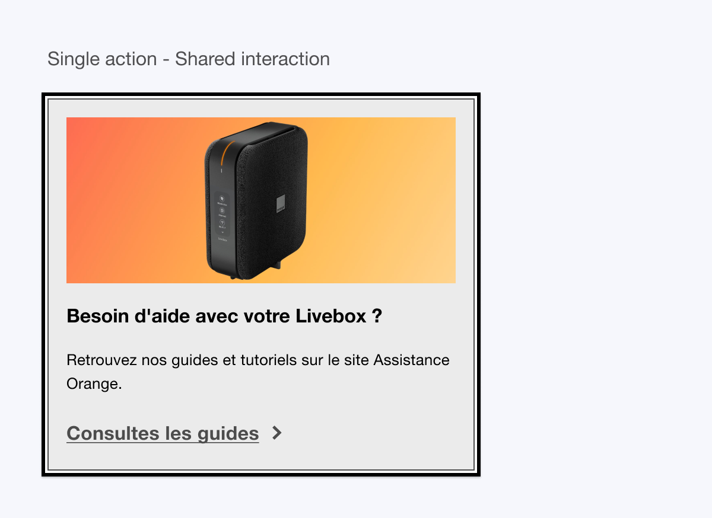

<!-- zh-row -->

### Multiple actions - One secondary action

The card provides a primary action, while one additional interactive element triggers a different action.

Both actions must be implemented as separate interactive elements, with independent interaction states and keyboard focus. Activating the secondary action must not trigger the primary card action.

Use case: The card opens the Livebox help section within the application, while a separate "Accéder au site Assistance Orange" link redirects users to the external support website.

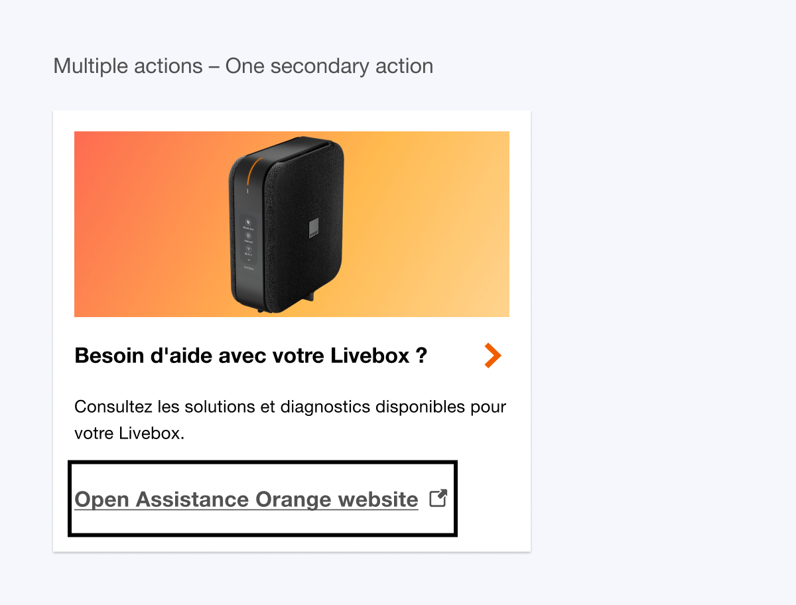

<!-- zh-row -->

### Multiple actions - Several secondary actions

The card provides one primary action and two or more independent secondary actions. Each interactive element must have its own semantic role, accessible name and interaction states.

All actions must be independently accessible using a keyboard. Activating one action must not trigger any other action.

Use case: The card opens the Livebox help section, while two additional controls allow users to access the Assistance Orange website or start a connection diagnostic using the "Tester ma connexion" button.

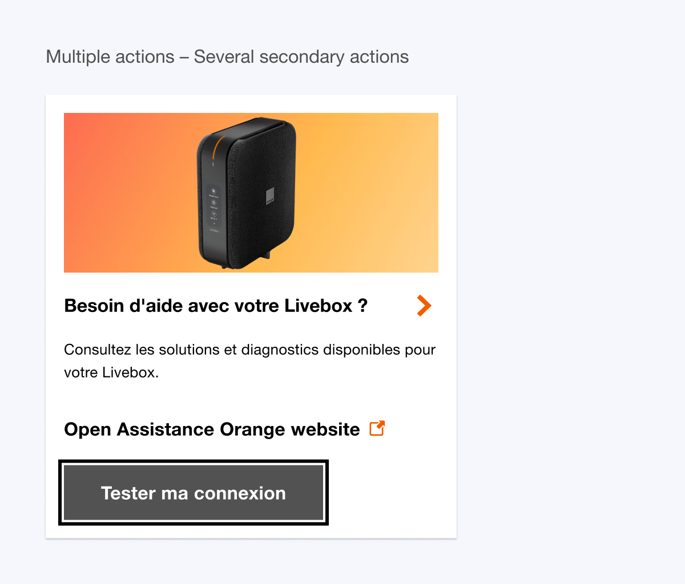

# Specs

## Layout and spacing

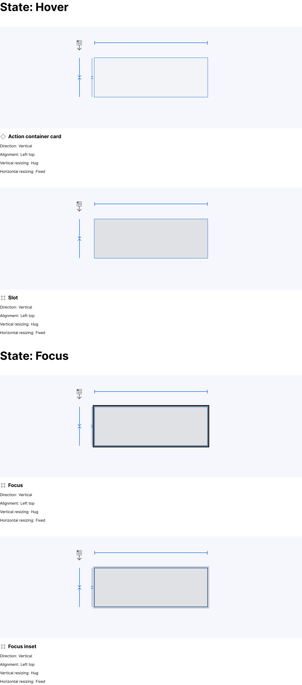

## States

<!-- zh-row -->

**`Enabled`** The default state. The entire card is available for interaction and displays its content normally.

<!-- zh-row -->

**`Hover`** Indicates that the pointer is positioned over the card.  
Use it to provide visual feedback that the card is interactive.

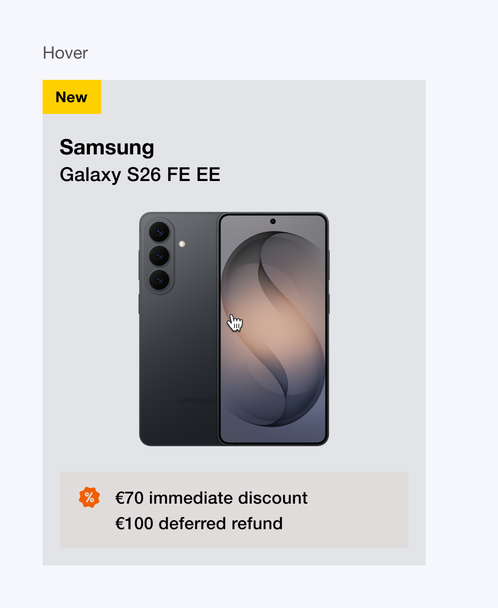

<!-- zh-row -->

**`Focus`** Indicates that an interactive action has received keyboard focus.  
When the primary action receives focus, the focus indicator must remain clearly visible around the primary interactive region.  
When a secondary action receives focus, only that action must display its focus indicator. The primary action must not appear focused simultaneously.

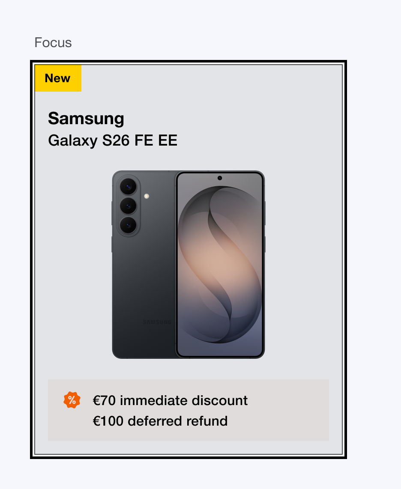

<!-- zh-row -->

**`Pressed`** Provides immediate visual feedback while the user is pressing or activating the card.

⚠️ After activation, the card can follow only one interaction pattern.  
• Action or navigation: the card triggers an action or destination, behaving as a button or link.

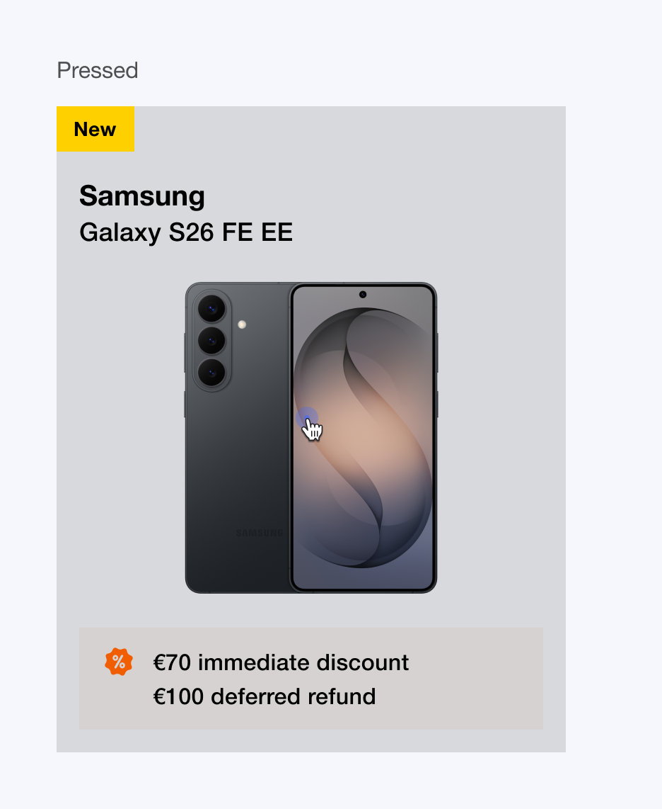

<!-- zh-row -->

**`Loading`** Loading indicates that an action triggered by the card is currently being processed. During this state, the card must not accept additional interactions. By default, the card content is hidden by the action/support/loading overlay, and a Progress indicator is displayed.  
In Figma, designers must set the loading overlay opacity to 100% to fully hide the underlying content.

For specific use cases, designers may customize the slot composition to preserve the existing content and display a Progress indicator over it. Loading should only be applied to the card performing an action. When multiple cards are waiting for content to load, use the Skeleton state instead.

In the Loading state, the card must provide sufficient space to display the Progress Indicator without clipping.

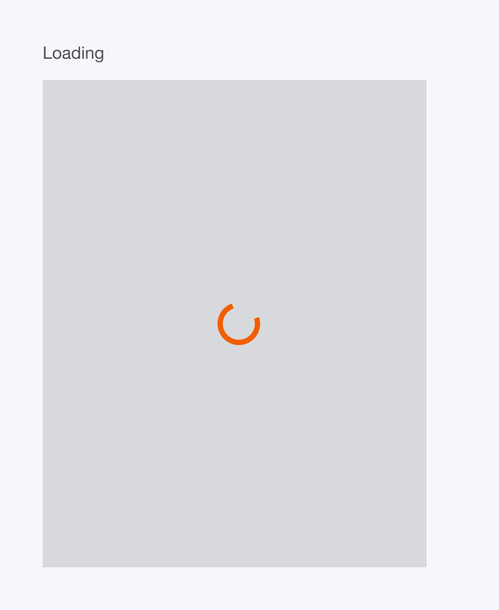

<!-- zh-row -->

**`Disabled`** Indicates that the card is temporarily unavailable for interaction.

When a card is disabled, all content within the card must visually reflect the disabled state to maintain a consistent hierarchy and clearly communicate that the entire card is unavailable. Interactive or status elements such as buttons, tags, badges, links, or other components should use their corresponding Disabled state when available. Typography should use the appropriate disabled color tokens, while images and illustrations should use the defined disabled opacity.

The card and its content must not respond to user interaction while disabled.

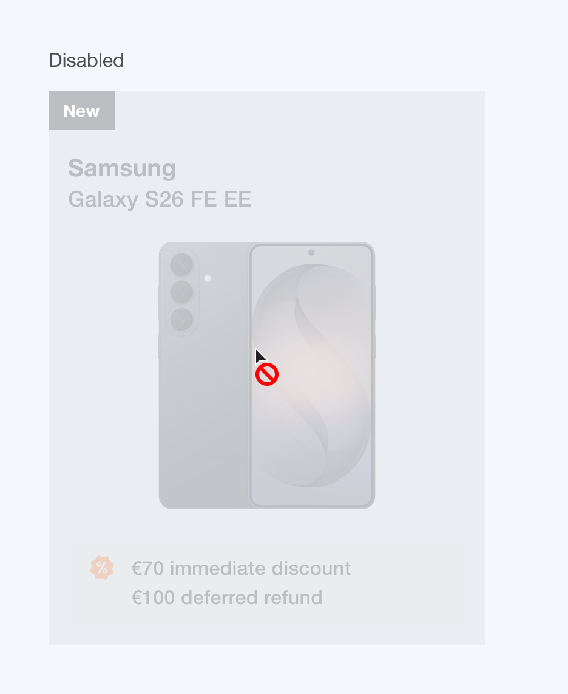

<!-- zh-row -->

**`Skeleton`** Represents the card while its content is not yet available.  
Use Skeleton when loading the initial content of a card or when multiple cards are loading at the same time, such as when displaying a list, grid, search results, or a page containing several cards.

Unlike the Loading state, Skeleton represents content that has not yet been loaded, rather than feedback for an action already initiated by the user.

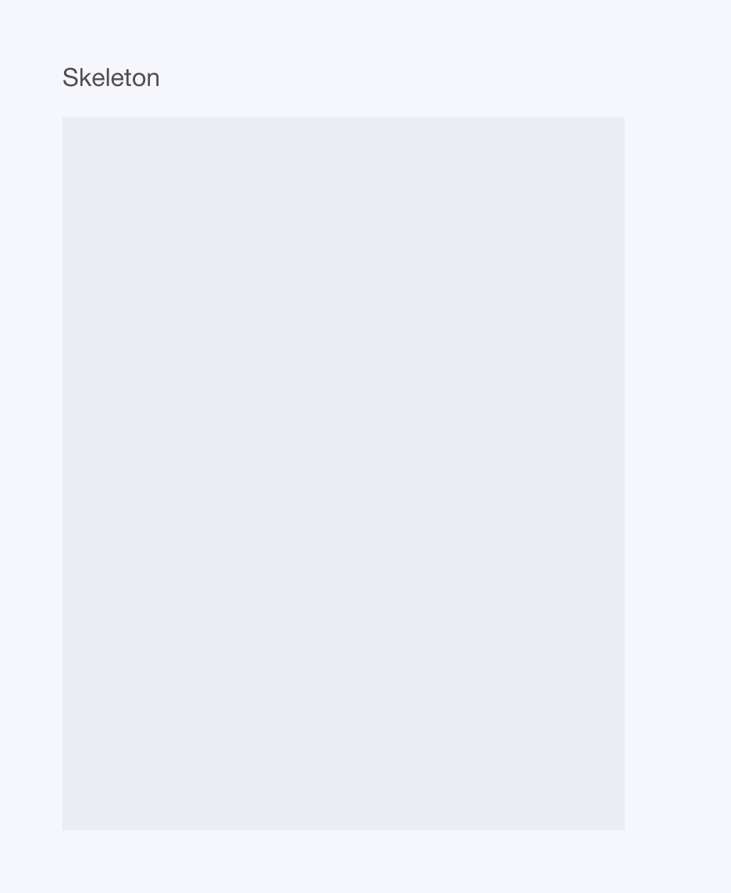

# Accessibility

## Interaction and accessibility

• The card must have a meaningful accessible name that clearly communicates its purpose without unnecessarily repeating all the content displayed within the slot.

• Hover, Focus and Pressed states must provide visual feedback across the entire card surface.

• Each interactive target must manage its own Hover, Focus and Pressed states without unintentionally activating or highlighting another action.

• A visual button or link may be displayed within the slot to reinforce the primary action, provided it represents the same destination or action as the card itself.

• ⚠️ The synchronization of interaction states between the card and a nested visual action depends on platform implementation and must be validated with the relevant development team.

# Develop

## Developer documentation

| Platform | Developer documentation |
|---|---|
| OUDS Web | Not available yet |
| OUDS Android | Not available yet |
| OUDS iOS | Not available yet |
| OUDS Flutter | Not available yet |

# Changelog

## Availability

| Platform | Resource | Status | Version |
|---|---|---|---|
| Figma | [Action card component](https://r.orange.fr/r/S-ouds-design-action-card) | Live | 1.0.0 |
| OUDS Web (former Boosted) | Not available yet | To do | – |
| OUDS Android - Jetpack Compose | Not available yet | To do | – |
| OUDS iOS - Swift | Not available yet | To do | – |
| OUDS Flutter | Not available yet | To do | – |

## Design changelog

| Date | Number | Notes |
|------|--------|-------|
| Nov 10, 2026 | - | Documentation update: Slot padding defaults to 0 and can be customized using Fixed or Scaled semantic spacing tokens. |
| Oct 26, 2026 | 1.0.0 | **Version 2.8 of the design tokens is required for the development of this update.**<ul><li>Component creation</ul> |
