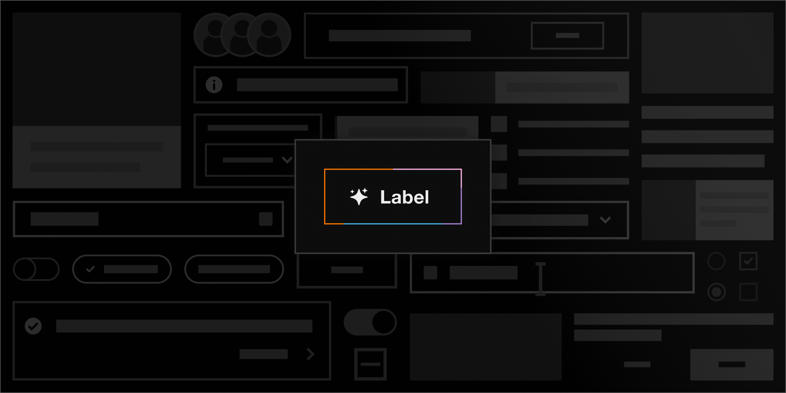
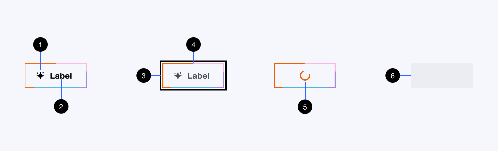
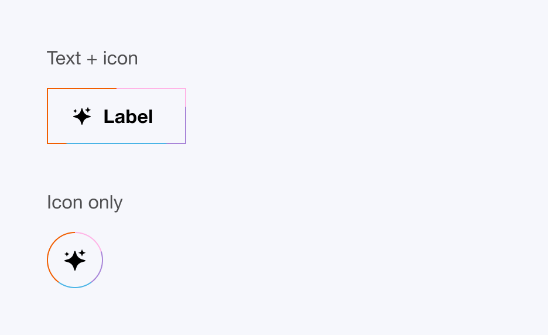
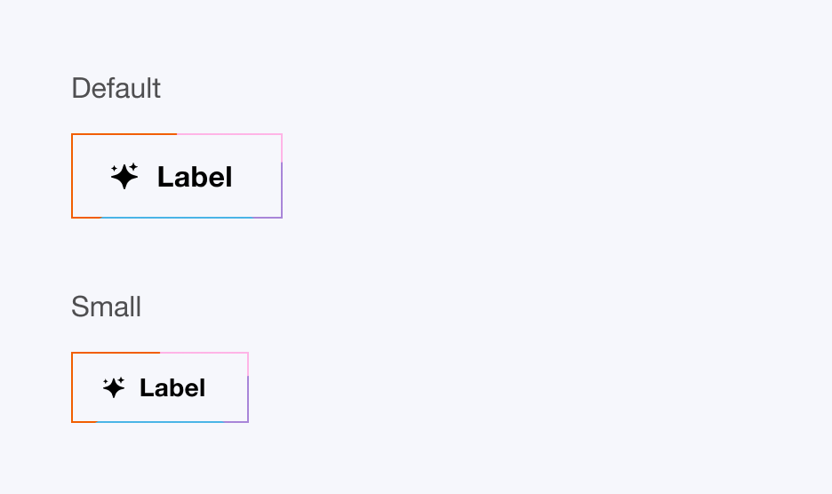
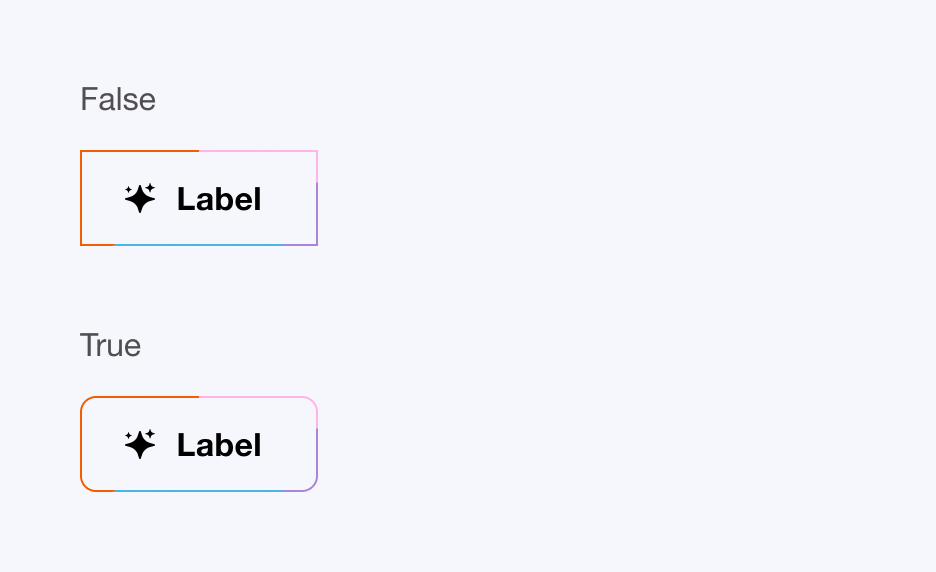
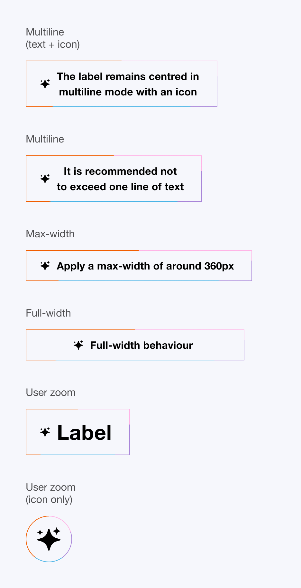
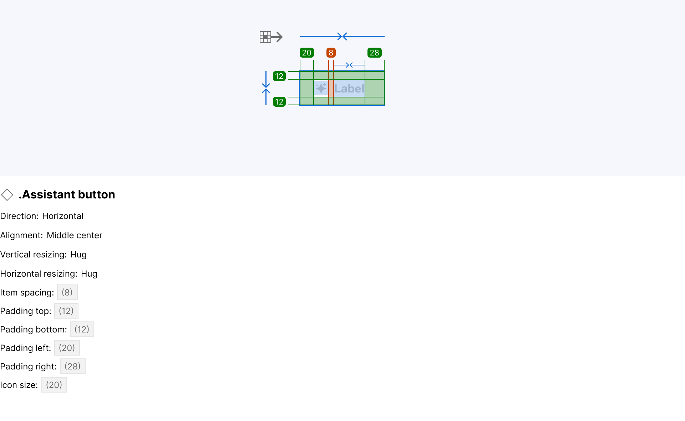
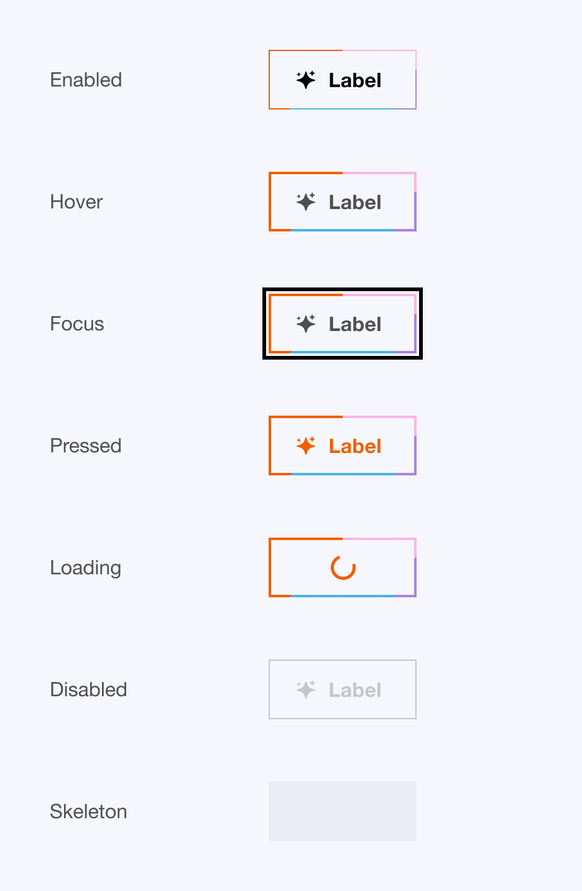

# Assistant button

An assistant button is a UI element that triggers an action or event featuring AI-powered capabilities, such as conversational assistance, content generation, or contextual suggestions.

# Guideline

## Anatomy

| # | Element | Purpose | Optional |
|---|---------|---------|----------|
| 1 | Icon | The AI assistant symbol that identifies the action as AI-driven | No |
| 2 | Label text | The text describing the action; absent in the icon-only layout | Yes |
| 3 | Focus inset | The outline drawn inside the component on keyboard focus | No |
| 4 | Content | The group holding the icon and the label, centred in the button | No |
| 5 | Circular progress indicator | The spinner shown in place of the content during the Loading state | Yes |
| 6 | Skeleton | The neutral placeholder shown before the button has loaded | Yes |

## Definition

An assistant button is a UI element that triggers an action or event featuring AI-powered capabilities, such as conversational assistance, content generation, or contextual suggestions.

The assistant button combines standard button functions with AI-specific visual features to clearly indicate actions enhanced or powered by artificial intelligence.

## Layouts

<!-- zh-row -->

**`Text + icon`** Displays an "sparkle" icon alongside a label to clearly communicate the AI assistant action. Recommended when clarity, discoverability, and explicit communication are priorities.

**`Icon only`** Displays only the AI assistant icon for a more compact and minimal interface. Recommended when the context already makes the action understandable or when space is limited. It is rarely standalone (usually part of a group of elements).

## Sizes

<!-- zh-row -->

**`Default`** This is the default size of the component.  
This size is used for the vast majority of applications.

**`Small`** This size can be particularly useful in an information-dense interface or in the construction of a template or component requiring the use of small elements (in an "Assistant input" component, for example).

## Rounded corner

<!-- zh-row -->

Even though in Figma this rendering option is available and editable from the properties of each button component, the configuration of this rendering option is actually transversal across the entire product/service in which the component is used. It is therefore impossible to have one button component set to Rounded corner=True and another set to Rounded corner=False within the same product/service.

**`False`** The square rendering corresponds to Orange's historical style. It conveys the brand's sense of seriousness, robustness and utility-driven. It remains the default style for our digital interface components.

**`True`** The rounded rendering offers flexibility without sacrificing the attribution to the brand. It helps anchoring the service in a reality where the visual codes of the mobile area tends to rub off on all interfaces. Use rounded corners for a softer, more approachable, friendly and tactile feel.

&nbsp;

### Brand theme availability
This option is technically not available for all brand themes. Here's the list of rounded corners availability by brand theme:

| Brand theme | Availability |
|---|---|
| Orange | ✅ Available |
| Orange Compact | ✅ Available |
| Sosh | ❌ Unavailable |
| Wireframe | ❌ Unavailable |

## Multiline and responsiveness

<!-- zh-row -->

### Multiline
This component allows multi-line text editing. Although the number of lines is not technically limited, it is recommended not to exceed one line of text.  
In its "Text + icon" variant, if the label spans multiple lines, the label remains horizontally centred and the icon remains vertically centred.

&nbsp;

### Max-width vs full-width
For greater flexibility, this component doesn't have a default max-width. To avoid exceeding a width that would degrade readability and the perception of a compact interactive element, we recommend applying **a max-width of around 360px.**  
The component can also naturally wrap within the parent container (or the screen in a mobile use context for exemple) and use the full available width.  
Please note that this behavior is not the default rule; it may be preferred if the template allows it (to improve user comfort or for better page structure/hierarchy).

&nbsp;

### User zoom in/out
The behavior of the text during user zoom in/out must follow a fundamental principle: the text must remain readable, accessible, and must never break the structure or lose information.
* The text must always scale proportionally with user zoom. Text resizing must never be blocked.
* Zooming must never cause text to be truncated or hidden. The component must expand vertically to allow line wrapping.
* The component's height and width must be flexible, never fixed, in order to automatically adapt its dimensions according to the level of zoom.
* In order to preserve the minimun interactive area during user zoom out, this component have a min-width and a min-height **of 48px**.
* Even if, the component has a max-height or a max-width for resizing control purposes, technically, during user zoom in, these limitations are not fixed but must be scalable in order to adapt to the user's zoom level.
* In its "Text + icon" variant, user zoom in/out doesn't affect the size of the icons; they remain fixed in size (decorative use).
* As the text is missing, in its "Icon only" variant, the icons follow the same rules as the text.

# Specs

## Layout and spacing

## States

<!-- zh-row -->

**`Enabled`** The status of the button before a user has interacted with it, or other content affects it.

**`Hover`** When a user places a pointing device over a button, but has not yet taken action on it.

**`Focus`** When a user selects a button via keyboard or voice command, but has not yet taken action on it.  
Mirrors the "Hover" state but includes an additional border.

**`Pressed`** An intermediate state that communicates a user has taken action on a button, and that it is in the process of navigating to a destination, triggering logic, or transmitting data.

**`Loading`** A button is fetching data from another internal or external resource.  
Uses the "Loading indicator" component.

**`Disabled`** Used to indicate a button that cannot be selected.

**`Skeleton`** Improves the perceived loading time by providing a visual cue of where button will appear once fully loaded.  
Uses the "Skeleton" component, variant "Security marge=False".

# Accessibility

Work is in progress to deliver this content.

# Develop

## OUDS-Web example

[Components/Buttons › Buttons 35](https://web.unified-design-system.orange.com/storybook/?path=/story/components-buttons--buttons-35)

[Components/Buttons › Buttons 37](https://web.unified-design-system.orange.com/storybook/?path=/story/components-buttons--buttons-37)

## Developer documentation

| Platform | Developer documentation |
|---|---|
| OUDS Web | [S-ouds-web-assistant-button](https://r.orange.fr/r/S-ouds-web-assistant-button) |
| OUDS Android | Not available yet |
| OUDS iOS | Not available yet |
| OUDS Flutter | Not available yet |

# Changelog

## Availability

| Platform | Resource | Status | Version |
|---|---|---|---|
| Figma | [Assistant button component](https://r.orange.fr/r/S-ouds-design-assistant-button) | Live | 1.1.0 |
| OUDS Web (former Boosted) | [Web dev documentation](https://r.orange.fr/r/S-ouds-web-assistant-button) | Live | 1.1.0 |
| OUDS Android - Jetpack Compose | Not available yet | To do | – |
| OUDS iOS - Swift | Not available yet | To do | – |
| OUDS Flutter | Not available yet | To do | – |

## Design changelog

| Date | Number | Notes | Designer |
|------|--------|-------|----------|
| Sep 18, 2026 | 1.1.0 | Version 2.7 of the design tokens is required for the development of this update.<ul><li>A maximum width is now applied to the component.<li>Renamed the Progress indicator container to Circular progress indicator container.</ul> | Anton Astafev Maxime Tonnerre |
| Jun 8, 2026 | 1.0.0 | Version 2.6 of the design tokens is required for the development of this update.<ul><li>Component creation</ul> | Maxime Tonnerre |
