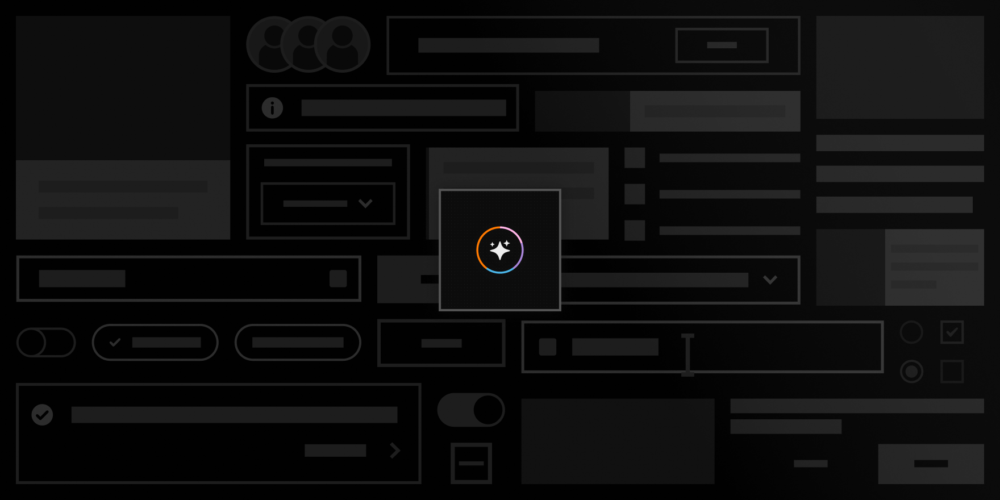
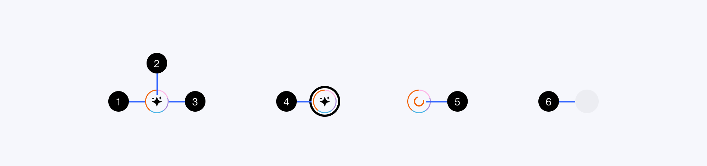
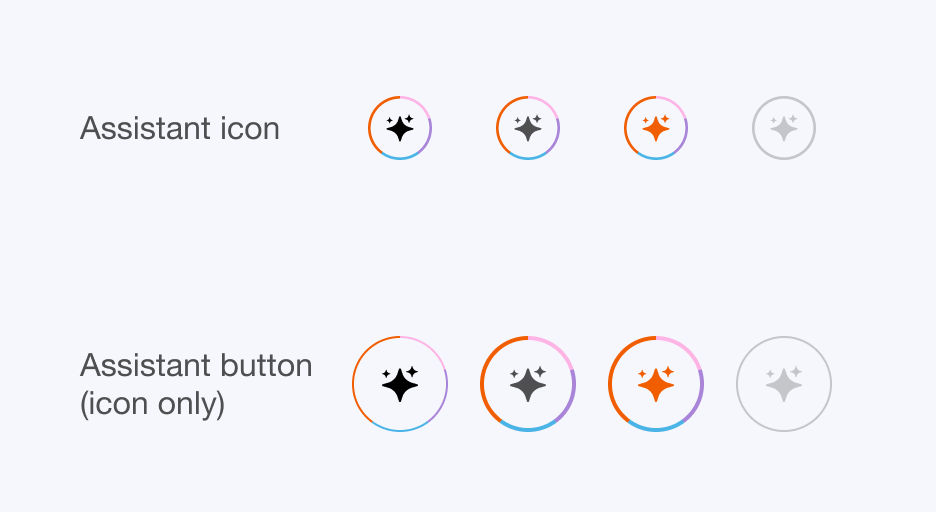
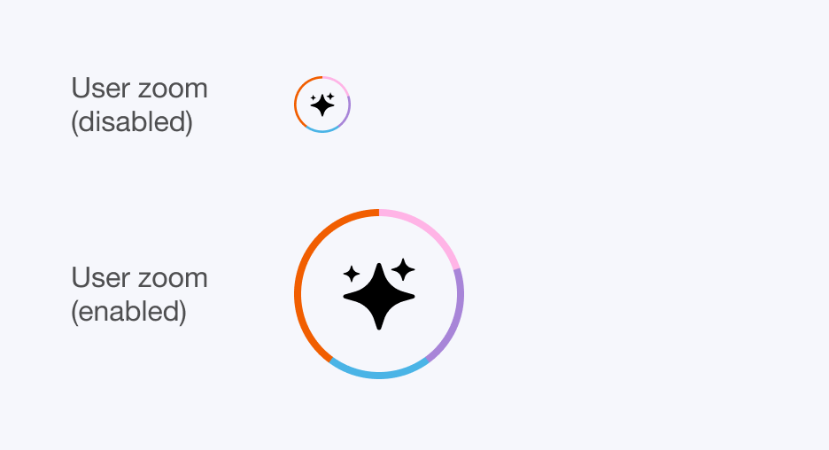
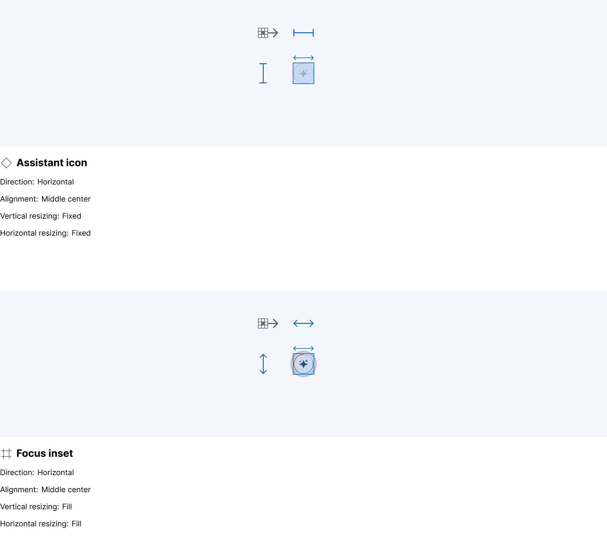
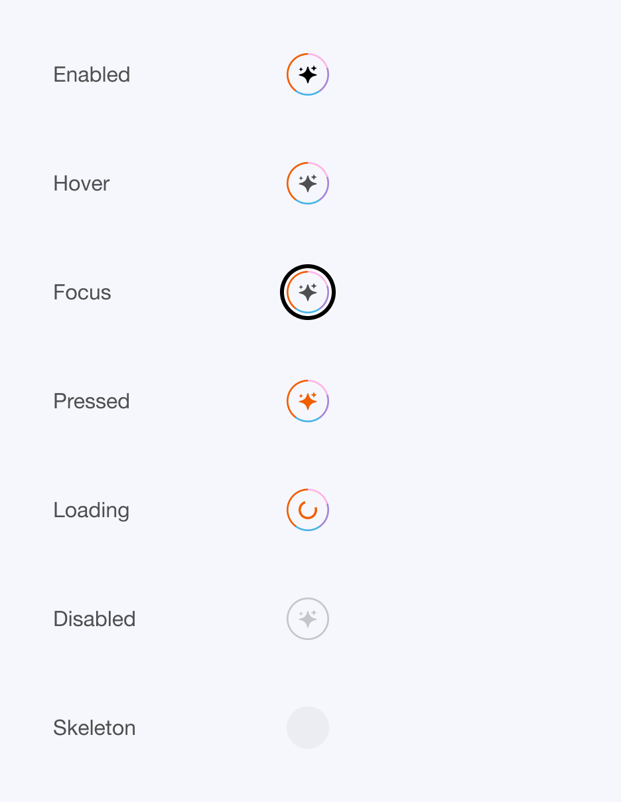

# Assistant icon

An assistant icon is a UI element that triggers an action or event featuring AI-powered capabilities, such as conversational assistance, content generation, or contextual suggestions.

# Guideline

## Anatomy

| # | Element | Purpose | Optional |
|---|---------|---------|----------|
| 1 | Assistant icon | The interactive container: the pointer and touch target that carries the states | No |
| 2 | Icon | The AI assistant symbol communicating the action | No |
| 3 | Stroke | The gradient outline that marks the control as an AI entry point | No |
| 4 | Focus inset | The outline drawn inside the component on keyboard focus | No |
| 5 | Circular loading indicator | The spinner shown in place of the icon during the Loading state | Yes |
| 6 | Skeleton | The neutral placeholder shown before the icon has loaded | Yes |

## Definition

An assistant icon is a UI element that triggers an action or event featuring AI-powered capabilities, such as conversational assistance, content generation, or contextual suggestions.

The assistant icon combines standard interactive icon behaviors with AI-specific visual features to clearly indicate actions enhanced or powered by artificial intelligence.

## ⚠️ Interactive icon vs button (icon only)

**Although both components provide an icon-based interaction, they serve different purposes and should be selected according to the desired visual emphasis and layout constraints.**

An Assistant button (icon only) includes a dedicated interactive container that can display a visible background, either in its default state or during state transitions such as hover, pressed, or selected. This additional visual layer reinforces the affordance of the component and makes it suitable for primary or clearly identifiable actions.

An Assistant icon, on the other hand, relies solely on the icon itself to communicate interactivity. It does not include any additional background or container. State changes are expressed exclusively through color transitions, resulting in a lighter visual footprint that integrates more naturally within surrounding content.

The two components also differ in their sizing approach. The Assistant button (icon only) is designed around predefined dimensions (48px for the default size and 40px for the small size) to ensure consistent touch targets and alignment across interfaces. In contrast, the Assistant icon is not constrained to specific dimensions and can be used at any size required by the layout.

This flexibility allows an Assistant icon to be positioned closer to text or adjacent elements when a more compact and visually harmonious composition is needed, while still preserving its interactive behavior.

## Multiline and responsiveness

### User zoom in/out
The component's height and width must be flexible, never fixed, in order to automatically adapt its dimensions according to the level of zoom (the icons follow the same rules as the text).  
In order to preserve the minimun interactive area during user zoom out, this component have a min-width and a min-height **of 28px**.

&nbsp;

### Responsive behavior of the outer border
The outer border (surrounding the “sparkles” icon) is not implemented in the same way between the design component (Figma) and the technical component.  
  • On the design side, the outer border is a vector shape, and its size scales according to the size of the component.  
  • On the technical side, the thickness of this border is calculated dynamically (there is no vector shape within the component). The calculation is based on the following:  
An inner circle of 22px  
An outer circle of 24px  
The border thickness is therefore 1px  
Thus: (1/24) * 100 = 4.16666666%

# Specs

## Layout and spacing

## States

**`Enabled`** The status of the icon before a user has interacted with it, or other content affects it.

**`Hover`** When a user places a pointing device over an icon, but has not yet taken action on it.

**`Focus`** When a user selects an icon via keyboard or voice command, but has not yet taken action on it.  
Mirrors the "Hover" state but includes an additional border.

**`Pressed`** An intermediate state that communicates a user has taken action on an icon, and that it is in the process of navigating to a destination, triggering logic, or transmitting data.

**`Loading`** An icon is fetching data from another internal or external resource.  
Uses the "Loading indicator" component.

**`Disabled`** Used to indicate an icon that cannot be selected.

**`Skeleton`** Improves the perceived loading time by providing a visual cue of where icon will appear once fully loaded.  
Uses the "Skeleton" component, variant "Security marge=False".

# Accessibility

Work is in progress to deliver this content.

# Develop

## OUDS-Web example

[Components/Icons › Icons 8](https://web.unified-design-system.orange.com/storybook/?path=/story/components-icons--icons-8)

## Developer documentation

| Platform | Developer documentation |
|---|---|
| OUDS Web | [S-ouds-web-assistant-icon](https://r.orange.fr/r/S-ouds-web-assistant-icon) |
| OUDS Android | Not available yet |
| OUDS iOS | Not available yet |
| OUDS Flutter | Not available yet |

c

# Changelog

## Availability

Design status: **DEV**

| Platform | Resource | Status | Version |
|---|---|---|---|
| Figma | [Assistant icon component](https://r.orange.fr/r/S-ouds-design-assistant-icon) | Done | 1.0.0 |
| OUDS Web (former Boosted) | [Web dev documentation](https://r.orange.fr/r/S-ouds-web-assistant-icon) | Done | 1.0.0 |
| OUDS Android - Jetpack Compose | Not available yet | To do | – |
| OUDS iOS - Swift | Not available yet | To do | – |
| OUDS Flutter | Not available yet | To do | – |

## Design changelog

| Date | Number | Notes | Designer |
|------|--------|-------|----------|
| Jun 8, 2026 | 1.0.0 | Version 2.6 of the design tokens is required for the development of this update.<ul><li>Component creation</ul> | Maxime Tonnerre |
