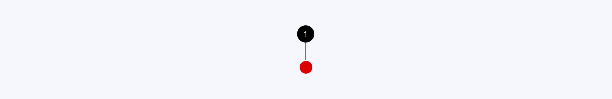
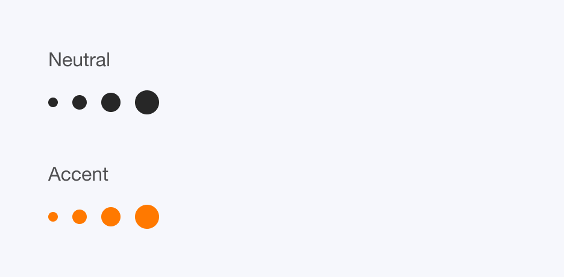
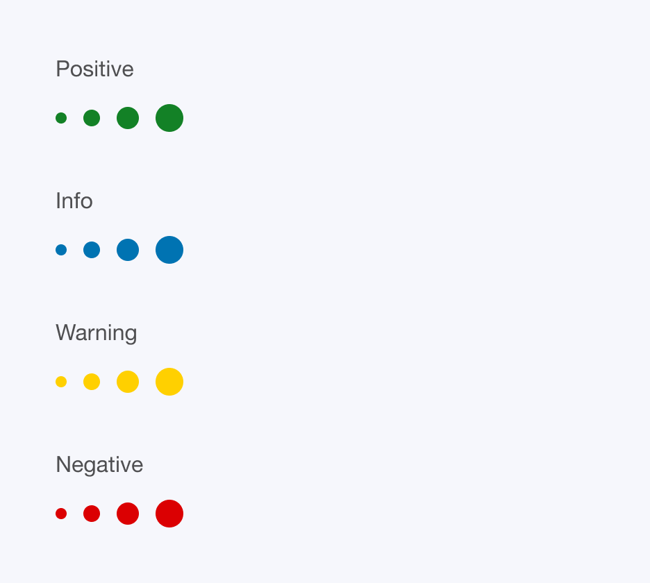
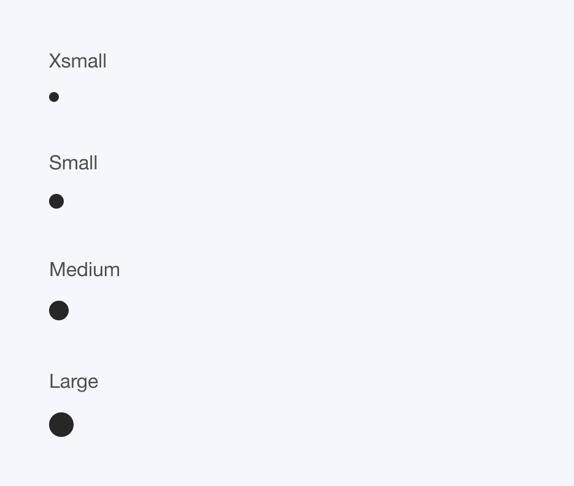
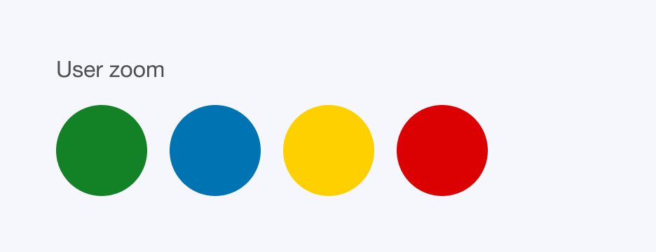
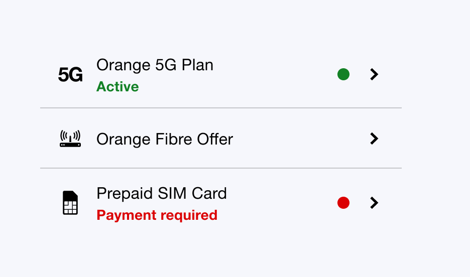
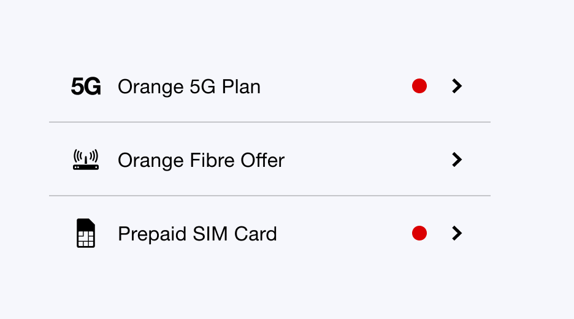
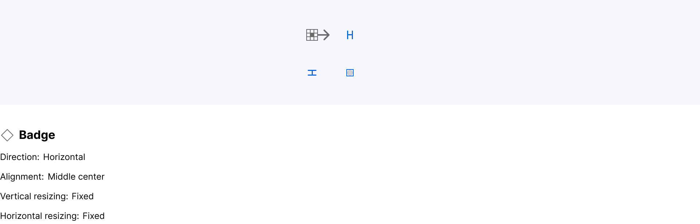
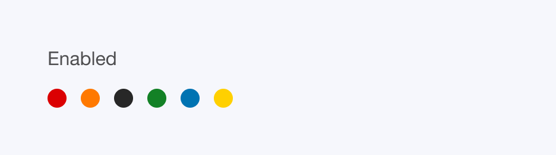
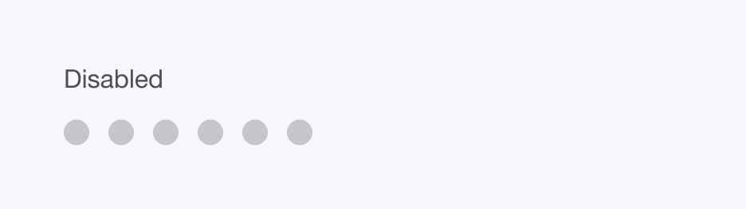

# Badge

A badge is a UI element that highlights system notifications, statuses, or the categorisation of information through colour alone.

# Guideline

## When to use

✅ To display status or categorization (e.g. online / offline, new, pending)

✅ As an atomic element embedded within other components

✅ When a non-intrusive visual indicator is sufficient

✅ For persistent states that do not change frequently

## Anatomy

| # | Element | Purpose | Optional |
|---|---------|---------|----------|
| 1 | Container | A compact, rounded shape. | No |

## Definition

A badge is a UI element that highlights system notifications, statuses, or the categorisation of information through colour alone.

The badge is displayed as a coloured shape, without an icon, text, or number; its selected size remains constant, regardless of any changes to the interface size.

## Status

Badges have seven states depending on the context of the information they represent. Each state is designed to convey a specific meaning and ensure clarity in communication.

Using a badge without icons may require additional context, such as a label or description, to ensure accessibility for users with color blindness. For more details, see 'Context of Color Usage (badge without icon)'.

### Not functional

<!-- zh-row -->

**`Neutral`** Used for general labels without specific emphasis.

**`Accent`** Employed to highlight discovery or exploration-related content.

### Functional

<!-- zh-row -->

**`Positive`** Indicates success, completion, or approval.

**`Info`** Provides informational context without urgency.

**`Warning`** Negatives the user to potential risks or cautionary messages.

**`Negative`** Draws attention to important or critical information. Often used for errors, restrictions, or urgent messages, but not exclusively for failures.

## Size

<!-- zh-row -->

**`Xsmall`** A compact badge for minimal space usage, ideal for small UI elements like icons or tooltips.

**`Small`** A slightly larger badge that remains subtle but improves readability, often used for inline labels.

**`Medium`** The default size, providing a balance between visibility and space efficiency, suitable for most use cases.

**`Large`** A prominent badge for drawing more attention, often used in dashboards or highlighted sections.

## Badge without icon user zoom and responsiveness

<!-- zh-row -->

### Max-width vs full-width
This component have a max-width.  
It is not possible to set this component to use the full available width (of the screen or the container).

&nbsp;

### User zoom in/out
- Component must always scale proportionally with user zoom.
- In order to preserve the minimun interactive area during user zoom out, this component have:
  - Large size: a min-width and a min-height **of 20px**
  - Medium size: a min-width and a min-height **of 16px**
  - Small size: a min-width and a min-height **of 12px**
  - Xsmall size: a min-width and a min-height **of 8px**
- Even if, the component has a max-height or a max-width for resizing control purposes, technically, during user zoom in, these limitations are not fixed but must be scalable in order to adapt to the user's zoom level.

## Context of Color Usage

A color-only badge should not be used as the only way to show functional information.  
It needs to be clearly visible on its background, with enough contrast and a readable size, especially for people with low vision or color blindness.

<!-- zh-row -->

### Status context (badge + label)

- Color alone doesn't explain meaning. It can support the interface visually, but it shouldn't be the only way to show a status or state. If multiple badge colors are used within the same interface, each color must have an accessible equivalent (e.g. visible text).
- In this example, the badge is used together with an Extra label that clearly conveys the status (positive and negative). The badge only reinforces this meaning visually, allowing multiple statuses to coexist within the same interface.

<!-- zh-row -->

### Non-status context (badge only)

- If it is not possible to provide an accessible alternative (text or label), the badge must be considered decorative and must not be used to convey information or differentiate states.
- In this context, the red badge is not used to indicate an error or negative status, but rather as a visual accent to draw attention. No other badge colors are used in the interface to avoid interpreting color as a carrier of meaning.

⚠️ Within a single interface, either a decorative or a functional color context should be used, but not both at the same time. This distinction ensures consistency and aligns with accessible design principles.

# Specs

## Layout and spacing

## States

<!-- zh-row -->

**`Enabled`** The active state of a badge. Includes all possible visual statuses that represent the current state of the system or element (e.g., success, warning, error, information, etc.). Used when the badge should attract attention and convey meaningful information.

<!-- zh-row -->

**`Disabled`** The inactive state of a badge. Used to indicate that the user isn't allowed to interact with an element, or when the status is unavailable. It appears less prominent and serves as a secondary indication.

# Accessibility

Work is in progress to deliver this content.

# Develop

## OUDS-Web example

[Components/Badges › Badges 4](https://web.unified-design-system.orange.com/storybook/?path=/story/components-badges--badges-4)

[Components/Badges › Badges 5](https://web.unified-design-system.orange.com/storybook/?path=/story/components-badges--badges-5)

## Developer documentation

| Platform | Developer documentation |
|---|---|
| OUDS Web | [S-ouds-web-badge](https://r.orange.fr/r/S-ouds-web-badge) |
| OUDS Android | [S-ouds-android-badge](https://r.orange.fr/r/S-ouds-android-badge) |
| OUDS iOS | [S-ouds-ios-badge](https://r.orange.fr/r/S-ouds-ios-badge) |
| OUDS Flutter | [S-ouds-flutter-badge](https://r.orange.fr/r/S-ouds-flutter-badge) |

# Changelog

## Availability

| Platform | Resource | Status | Version |
|---|---|---|---|
| Figma | [Badge component](https://r.orange.fr/r/S-ouds-design-badge) | Live | 1.2.0 |
| OUDS Web (former Boosted) | [Web dev documentation](https://r.orange.fr/r/S-ouds-web-badge) | Live | 1.2.0 |
| OUDS Android - Jetpack Compose | [Android dev documentation](https://r.orange.fr/r/S-ouds-android-badge) | Live | 1.2.0 |
| OUDS iOS - Swift | [iOS dev documentation](https://r.orange.fr/r/S-ouds-ios-badge) | Live | 1.2.0 |
| OUDS Flutter | [Flutter dev documentation](https://r.orange.fr/r/S-ouds-flutter-badge) | Live | 1.2.0 |

## Design changelog

| Date | Number | Notes |
|------|--------|-------|
| Apr 7, 2026 | - | <ul><li>Documentation writing: Context of Color Usage (badge without icon)</ul> |
| Mar 16, 2026 | - | <ul><li>Documentation writing: User zoom and responsiveness</ul> |
| Jan 6, 2026 | - | <ul><li>Documentation writing: Definition update</ul> |
| Oct 14, 2025 | 1.2.0 | <ul><li>The component now has two states: Enabled and Disabled. <li>Documentation has been updated and published in Zeroeight, with use case examples provided for every state. <li>The colors and background tokens for the functional states of the positive and info statuses have been changed. <li>For the "Status neutral" variant, the surface token "color-surface-status-neutral-emphasized" has been replaced by the token "color-surface-inverse-high"</ul> |
| Jun 16, 2025 | 1.1.0 | <ul><li>"Accent" variant added</ul> |
| Mai 9, 2025 | 1.0.0 | <ul><li>Component creation</ul> |
