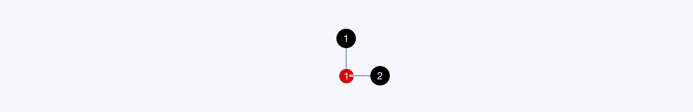
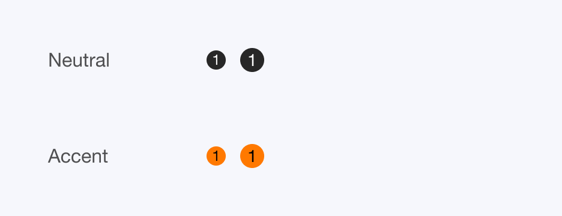
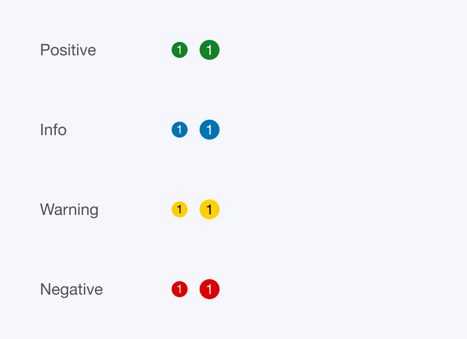
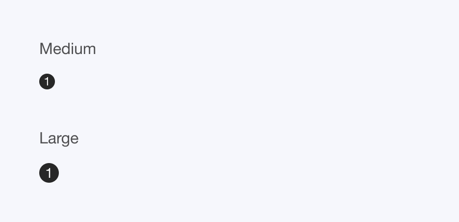
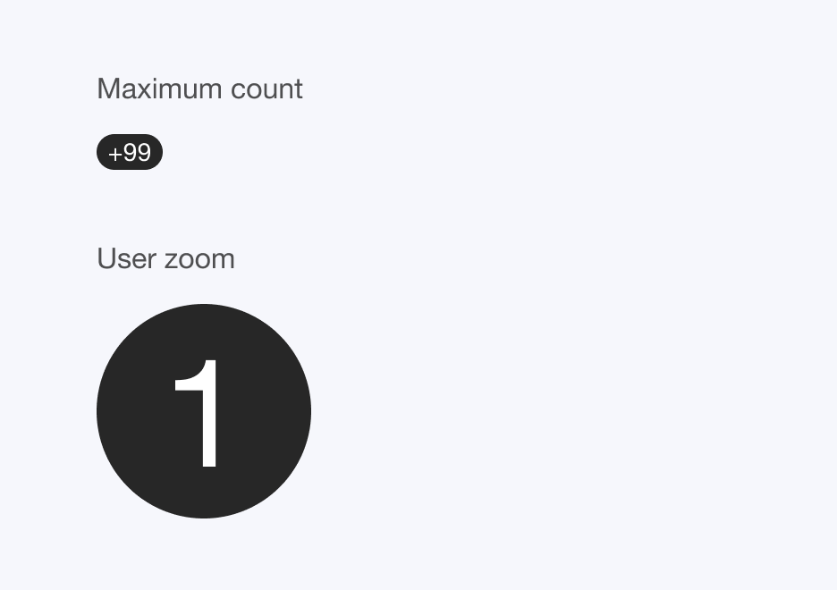
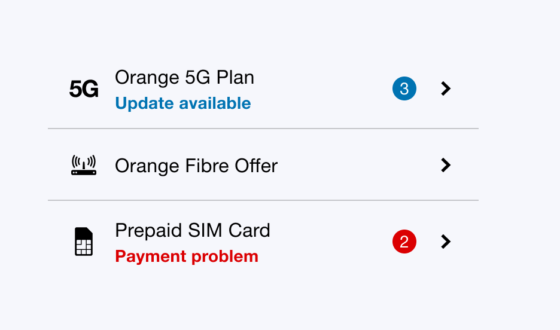
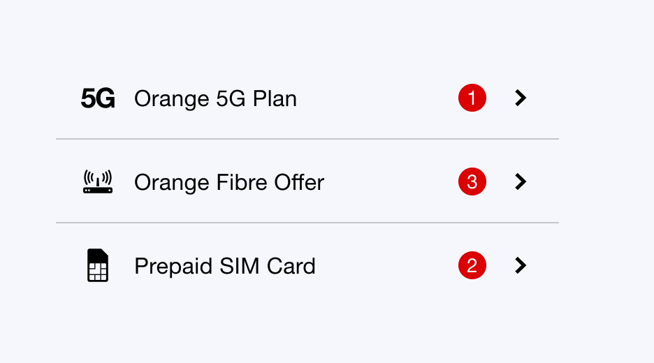
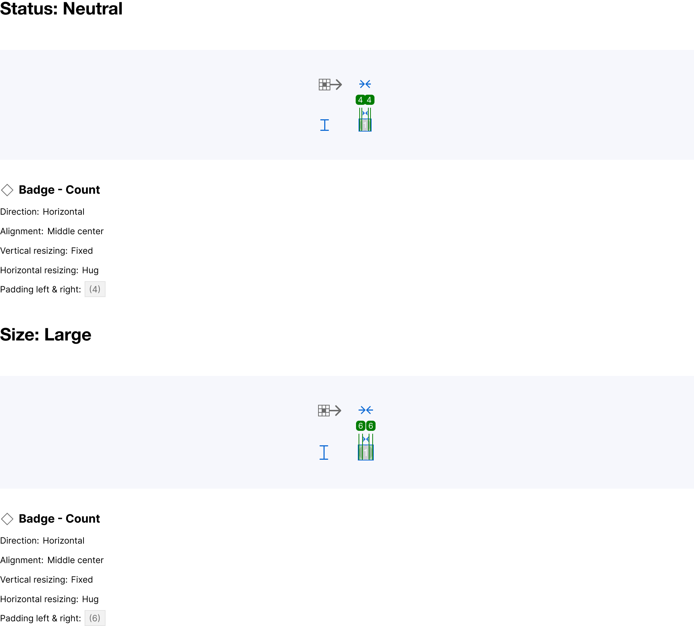
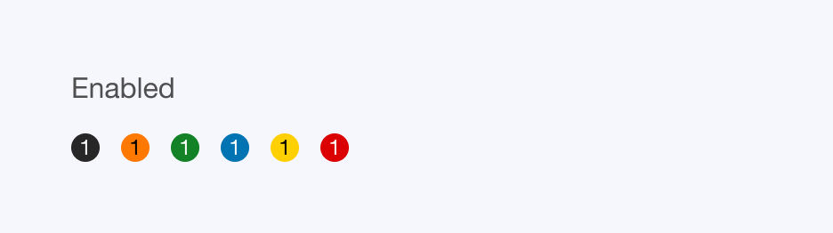
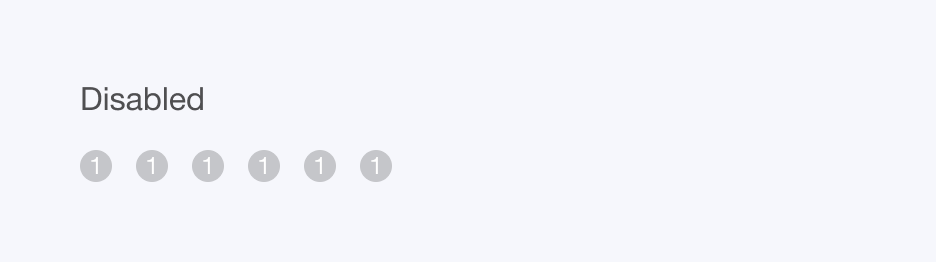

# Badge count

A badge count is a UI element that highlights system notifications, status, or the categorisation of information through colour and numerical value.

# Guideline

## Anatomy

| # | Element | Purpose | Optional |
|---|---------|---------|----------|
| 1 | Container | A compact, rounded shape that holds the badge content number. | No |
| 2 | Label | Displays a numeric value that represents a count — such as unread messages, notifications, or items. | No |

## Definition

A badge count is a UI element that highlights system notifications, status, or the categorisation of information through colour and numerical value.

The badge count is displayed as a coloured shape that shows numerical values, and its selected size remains consistent regardless of any changes to the interface size.

## Status

Badges have seven states depending on the context of the information they represent. Each state is designed to convey a specific meaning and ensure clarity in communication.

### Not functional

<!-- zh-row -->

**`Neutral`** Used for general labels without specific emphasis.

**`Accent`** Employed to highlight discovery or exploration-related content.

### Functional

<!-- zh-row -->

**`Positive`** Indicates success, completion, or approval.

**`Info`** Provides informational context without urgency.

**`Warning`** Negatives the user to potential risks or cautionary messages.

**`Negative`** Draws attention to important or critical information. Often used for errors, restrictions, or urgent messages, but not exclusively for failures.

## Size

<!-- zh-row -->

**`Medium`** The default size, providing a balance between visibility and space efficiency, suitable for most use cases.

**`Large`** A prominent badge for drawing more attention, often used in dashboards or highlighted sections.

## Multiline and responsiveness

<!-- zh-row -->

### Multiline
This component doesn't allows multi-line text editing. This is a design recommendation, technically, and for several reasons (responsive behavior, user zoom, etc.), multiline remains possible.

&nbsp;

### Max-width vs full-width vs maximum count
For greater flexibility, this component doesn't have a max-width but the badge must not display numbers greater than 99 (above 99, the label becomes +99.  
It is not possible to set this component to use the full available width (of the screen or the container).

&nbsp;

### User zoom in/out
The behavior of the text during user zoom in/out must follow a fundamental principle: the text must remain readable, accessible, and must never break the structure or lose information.
- The text must always scale proportionally with user zoom. Text resizing must never be blocked.
- Zooming must never cause text to be truncated or hidden. The component must expand vertically to allow line wrapping.
- The component's height and width must be flexible, never fixed, in order to automatically adapt its dimensions according to the level of zoom.
- In order to preserve the minimun interactive area during user zoom out, this component have:
  - Large size: a min-width and a min-height **of 20px**
  - Medium size: a min-width and a min-height **of 16px**
- Even if, the component has a max-height or a max-width for resizing control purposes, technically, during user zoom in, these limitations are not fixed but must be scalable in order to adapt to the user's zoom level.
- In order to preserve a perfectly rounded appearance of the component, increasing the component's height (caused by increasing the text size) also proportionally increases its width.

## Context of Color Usage

A badge count should not rely on color alone to convey meaning.  
The number itself is the primary source of information, while color may support it visually.  
The badge must remain clearly visible with sufficient contrast and readable size, especially for users with low vision or color blindness.

<!-- zh-row -->

### Status context (badge count + label)

- The numeric value is the main information (e.g. number of messages, notifications, items). Color should only reinforce meaning, not replace it. If multiple colors are used, each must correspond to a clear and consistent meaning
- In this example, color can represent different states (e.g. info and error), but the meaning remains understandable through the number and context (Extra label).

<!-- zh-row -->

### Non-status context (badge count only)

- When color does not represent a specific status, it should be treated as a visual accent only. In such cases, a single color (commonly red) is used consistently across the interface. The meaning comes from the number and context (e.g. unread messages), not from the color
- In this example, the badge does not indicate error or status, but simply draws attention to new or unread items.

⚠️ Within a single interface, either a decorative or a functional color context should be used, but not both at the same time. This distinction ensures consistency and aligns with accessible design principles.

# Specs

## Layout and spacing

## States

<!-- zh-row -->

**`Enabled`** The active state of a badge. Includes all possible visual statuses that represent the current state of the system or element (e.g., success, warning, error, information, etc.). Used when the badge should attract attention and convey meaningful information.

<!-- zh-row -->

**`Disabled`** The inactive state of a badge. Used to indicate that the user isn't allowed to interact with an element, or when the status is unavailable. It appears less prominent and serves as a secondary indication.  
Badges with content keep the Enabled content but change their visual appearance.

# Accessibility

Work is in progress to deliver this content.

# Develop

## OUDS-Web example

[Components/Badges › Badges 11](https://web.unified-design-system.orange.com/storybook/?path=/story/components-badges--badges-11)

## Developer documentation

| Platform | Developer documentation |
|---|---|
| OUDS Web | [S-ouds-web-badge-count](https://r.orange.fr/r/S-ouds-web-badge-count) |
| OUDS Android | [S-ouds-android-badge-count](https://r.orange.fr/r/S-ouds-android-badge-count) |
| OUDS iOS | [S-ouds-ios-badge-count](https://r.orange.fr/r/S-ouds-ios-badge-count) |
| OUDS Flutter | [S-ouds-flutter-badge-count](https://r.orange.fr/r/S-ouds-flutter-badge-count) |

# Changelog

## Availability

| Platform | Resource | Status | Version |
|---|---|---|---|
| Figma | [Badge count component](https://r.orange.fr/r/S-ouds-design-badge-count) | Live | 1.2.0 |
| OUDS Web (former Boosted) | [Web dev documentation](https://r.orange.fr/r/S-ouds-web-badge-count) | Live | 1.2.0 |
| OUDS Android - Jetpack Compose | [Android dev documentation](https://r.orange.fr/r/S-ouds-android-badge-count) | Live | 1.2.0 |
| OUDS iOS - Swift | [iOS dev documentation](https://r.orange.fr/r/S-ouds-ios-badge-count) | Live | 1.2.0 |
| OUDS Flutter | [Flutter dev documentation](https://r.orange.fr/r/S-ouds-flutter-badge-count) | Live | 1.2.0 |

## Design changelog

| Date | Number | Notes |
|------|--------|-------|
| Apr 7, 2026 | - | <ul><li>Documentation writing: Context of Color Usage</ul> |
| Mar 16, 2026 | - | <ul><li>Documentation writing: Multiline and responsiveness</ul> |
| Jan 6, 2026 | - | <ul><li>Documentation writing: Definition update</ul> |
| Oct 14, 2025 | 1.2.0 | <ul><li>The component now has two states: Enabled and Disabled. <li>Documentation has been updated and published in Zeroeight, with use case examples provided for every state. <li>The colors and background tokens for the functional states of the positive and info statuses have been changed. <li>The minimum required contrast ratio has been corrected from 3:1 to 4.5:1 between content (count) and background for Enable state.</ul>For the "Status neutral" variant: <ul><li>The content token "color-content-on-status-neutral-emphasized" has been replaced by the token "color-content-inverse" <li>The surface token "color-surface-status-neutral-emphasized" has been replaced by the token "color-surface-inverse-high"</ul> |
| Jun 16, 2025 | 1.1.0 | <ul><li>"Accent" variant added</ul> |
| Mai 9, 2025 | 1.0.0 | <ul><li>Component creation</ul> |
