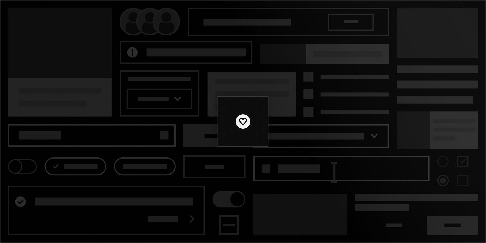
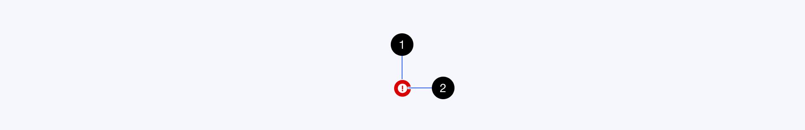
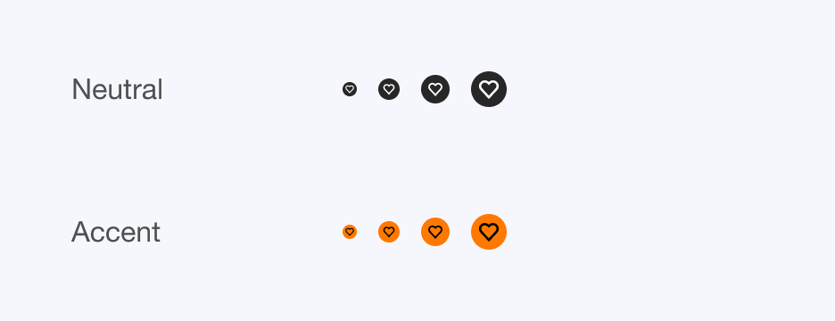
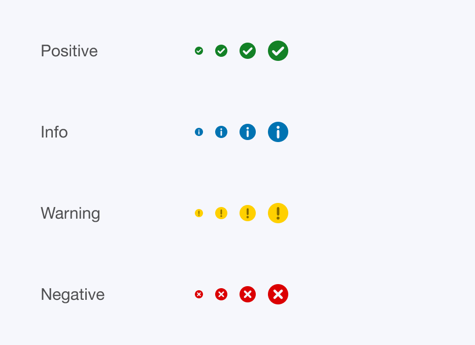
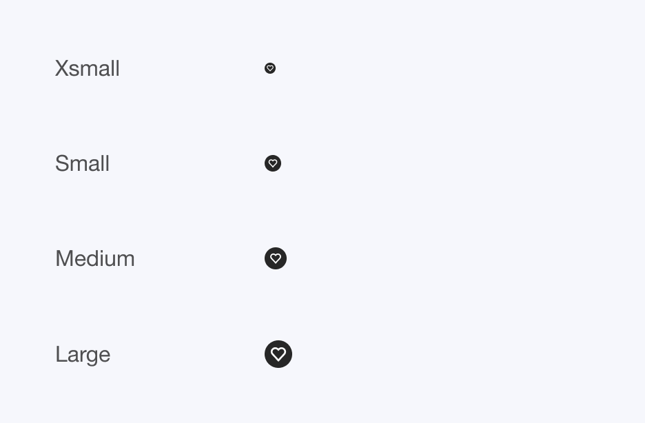
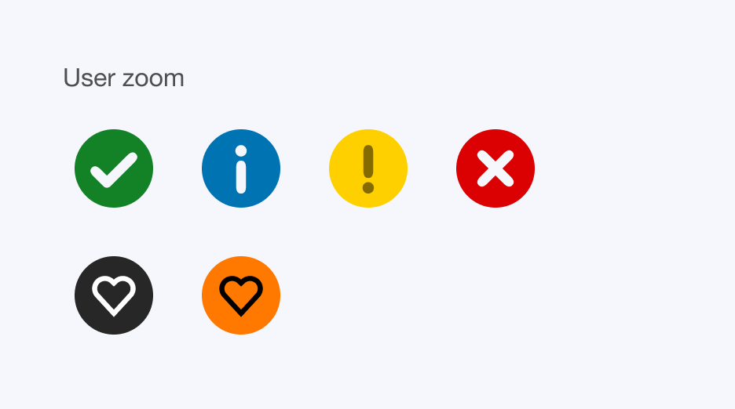
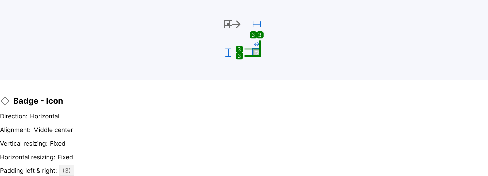
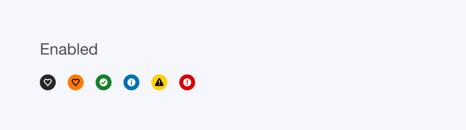
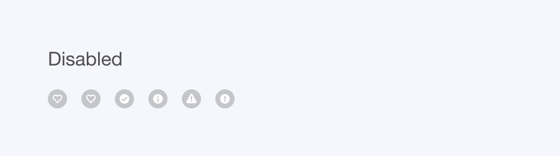

# Badge icon

A badge icon is a UI element that highlights system notifications, statuses, or the categorisation of information through colour and iconography.

# Guideline

## Anatomy

| # | Element | Purpose | Optional |
|---|---------|---------|----------|
| 1 | Container | A compact, rounded shape that holds the badge content icon. | No |
| 2 | Icon | Indicates the badge type or status and helps users quickly understand its meaning without text. | No |

## Definition

A badge icon is a UI element that highlights system notifications, statuses, or the categorisation of information through colour and iconography.

The badge icon is presented as a coloured shape that displays an icon, and its selected size remains constant despite any changes to the interface size.

## Status

Badges have seven states depending on the context of the information they represent. Each state is designed to convey a specific meaning and ensure clarity in communication.

### Not functional

<!-- zh-row -->

**`Neutral`** Used for general labels without specific emphasis.

**`Accent`** Employed to highlight discovery or exploration-related content.

### Functional

<!-- zh-row -->

**`Positive`** Indicates success, completion, or approval.

**`Info`** Provides informational context without urgency.

**`Warning`** Negatives the user to potential risks or cautionary messages.

**`Negative`** Draws attention to important or critical information. Often used for errors, restrictions, or urgent messages, but not exclusively for failures.

## Size

<!-- zh-row -->

**`Xsmall`** A compact badge for minimal space usage, ideal for small UI elements like icons or tooltips.

**`Small`** A slightly larger badge that remains subtle but improves readability, often used for inline labels.

**`Medium`** The default size, providing a balance between visibility and space efficiency, suitable for most use cases.

**`Large`** A prominent badge for drawing more attention, often used in dashboards or highlighted sections.

## User zoom and responsiveness

<!-- zh-row -->

### Max-width vs full-width
This component have a max-width and a max-height.  
It is not possible to set this component to use the full available width (of the screen or the container).

&nbsp;

### User zoom in/out
- Icons must always scale proportionally with user zoom. Icon resizing must never be blocked.
- In order to preserve the minimun interactive area during user zoom out, this component have:
  - Large size: a min-width and a min-height **of 20px**
  - Medium size: a min-width and a min-height **of 16px**
- Even if, the component has a max-height or a max-width for resizing control purposes, technically, during user zoom in, these limitations are not fixed but must be scalable in order to adapt to the user's zoom level.

# Specs

## Layout and spacing

## States

<!-- zh-row -->

**`Enabled`** The active state of a badge. Includes all possible visual statuses that represent the current state of the system or element (e.g., success, warning, error, information, etc.). Used when the badge should attract attention and convey meaningful information.

<!-- zh-row -->

**`Disabled`** The inactive state of a badge. Used to indicate that the user isn't allowed to interact with an element, or when the status is unavailable. It appears less prominent and serves as a secondary indication.  
Badges with content keep the Enabled content but change their visual appearance.

# Accessibility

Work is in progress to deliver this content.

# Develop

## OUDS-Web example

[Components/Badges › Badges 16](https://web.unified-design-system.orange.com/storybook/?path=/story/components-badges--badges-16)

[Components/Badges › Badges 17](https://web.unified-design-system.orange.com/storybook/?path=/story/components-badges--badges-17)

## Developer documentation

| Platform | Developer documentation |
|---|---|
| OUDS Web | [S-ouds-web-badge-icon](https://r.orange.fr/r/S-ouds-web-badge-icon) |
| OUDS Android | [S-ouds-android-badge-icon](https://r.orange.fr/r/S-ouds-android-badge-icon) |
| OUDS iOS | [S-ouds-ios-badge-icon](https://r.orange.fr/r/S-ouds-ios-badge-icon) |
| OUDS Flutter | [S-ouds-flutter-badge-icon](https://r.orange.fr/r/S-ouds-flutter-badge-icon) |

# Changelog

## Availability

| Platform | Resource | Status | Version |
|---|---|---|---|
| Figma | [Badge icon component](https://r.orange.fr/r/S-ouds-design-badge-icon) | Live | 1.3.0 |
| OUDS Web (former Boosted) | [Web dev documentation](https://r.orange.fr/r/S-ouds-web-badge-icon) | Live | 1.3.0 |
| OUDS Android - Jetpack Compose | [Android dev documentation](https://r.orange.fr/r/S-ouds-android-badge-icon) | Live | 1.3.0 |
| OUDS iOS - Swift | [iOS dev documentation](https://r.orange.fr/r/S-ouds-ios-badge-icon) | Live | 1.3.0 |
| OUDS Flutter | [Flutter dev documentation](https://r.orange.fr/r/S-ouds-flutter-badge-icon) | Live | 1.3.0 |

## Design changelog

| Date | Number | Notes |
|------|--------|-------|
| Apr 21, 2026 | 1.3.0 | <ul><li>**Version 2.4 of the design tokens is required for the development of this update.** <li>Addition of 2 new sizes (Xsmall and Small) <li>For the "Positive", "Info", "Warning", and "Negative" status variants: <ul><li>Replacement of the vector icon with a new asset without internal padding. <li>Removal of space-inset tokens → 0px</ul><li>For the "Neutral" and "Accent" status variants and for the 2 new sizes: <ul><li>Size: Xsmall → Addition of a new token space-inset-xsmall <li>Size: Small → Addition of a new token space-inset-small</ul></ul> |
| Mar 16, 2026 | - | <ul><li>Documentation writing: User zoom and responsiveness</ul> |
| Jan 6, 2026 | - | <ul><li>Documentation writing: Definition update</ul> |
| Oct 14, 2025 | 1.2.0 | <ul><li>The component now has two states: Enabled and Disabled. <li>Documentation has been updated and published in Zeroeight, with use case examples provided for every state. <li>The colors and background tokens for the functional states of the positive and info statuses have been changed. <li>The minimum required contrast ratio has been corrected from 3:1 to 4.5:1 between content (icon) and background for Enable state. <li>Functional badges (Positive, Warning, Negative, Info) differ from non-functional ones: they can only use functional icons, while non-functional badges are not supported. <li>For the "Status neutral" variant: <ul><li>The content token "color-content-on-status-neutral-emphasized" has been replaced by the token "color-content-inverse" <li>The surface token "color-surface-status-neutral-emphasized" has been replaced by the token "color-surface-inverse-high" </ul></ul> |
| Jun 16, 2025 | 1.1.0 | <ul><li>"Accent" variant added</ul> |
| Mai 9, 2025 | 1.0.0 | <ul><li>Component creation</ul> |
