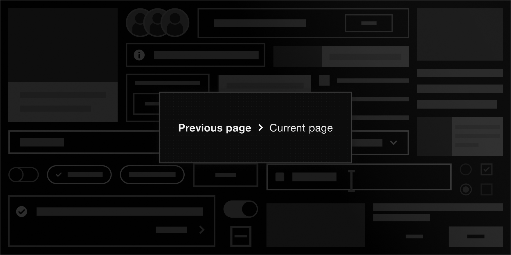
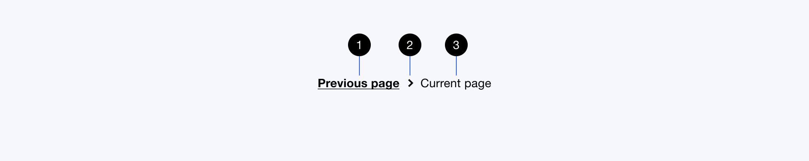
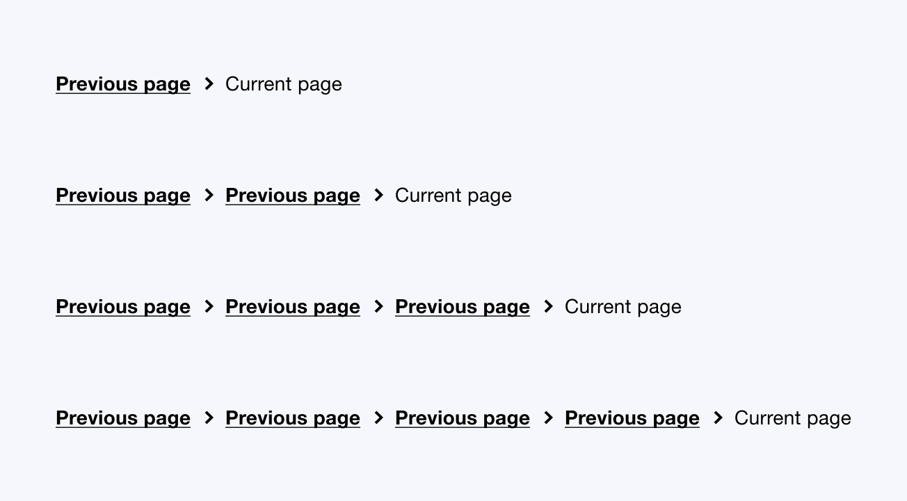
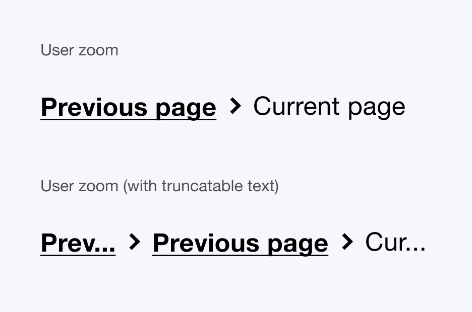
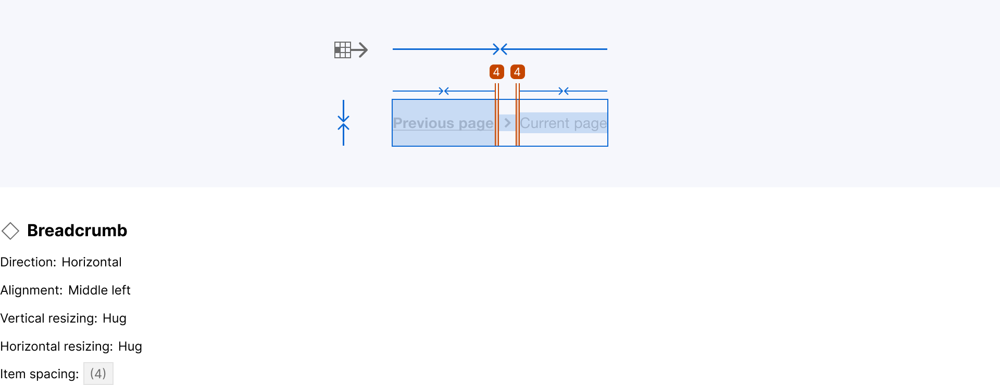

# Breadcrumb

A breadcrumb is a UI element that aids in navigation and identifies the current location on a website by displaying a hierarchical path of web pages.

# Guideline

## Anatomy

| # | Element | Purpose | Optional |
|---|---------|---------|----------|
| 1 | Page Link | A clickable link that navigates to a higher-level page in the hierarchy. | No |
| 2 | Chevron | A visual separator between each level in the breadcrumb trail. Not interactive. | No |
| 3 | Current page title | The title of the current page. Not interactive. | No |

## Definition

A breadcrumb is a UI element that aids in navigation and identifies the current location on a website by displaying a hierarchical path of web pages.

## Drilldown

<!-- zh-row -->

Breadcrumbs can be categorized into different levels based on their complexity and hierarchy. The current page is never interactive.

**`N+1`** The first level beyond the home page.

**`N+2`** A subcategory or a more specific section.

**`N+3`** A deeper level of navigation, often product or content grouping.

**`N+4`** A more refined selection, like a product variant or article.

## Display rule

The general display rule is: Depending on the screen width (breakpoint), we hierarchically hide page names by prioritizing the display of the currently viewed page back to the homepage.  
We prioritize displaying the name of the currently viewed page, then the previous page, and so on, up to displaying the homepage name if the screen width allows it.

At a minimum, and for all breakpoints, the currently viewed page and page n-1 (the page preceding the currently viewed page) are always displayed.  
Depending on the breakpoints, the number of pages shown or hidden changes:
- 2xs, xs, sm: 2 names max -> Previous / Current
- md: 3 names max -> Previous / Previous / Current
- lg: 4 names max -> Previous / Previous / Previous / Current
- xl, 2xl, 3xl: The entire hierarchy is displayed

Note that technically (CSS helper classes) and depending on the breakpoint, it is possible to force the specific display of a page that is not shown by default, and vice versa.

Except for the name of page n-1, which is never truncated, the names of the other pages may be truncated (from the homepage to the currently viewed page inclusive).  
Note that technically (CSS helper classes), we retain the ability not to truncate the display of a specific page (for example, we prefer not to truncate the homepage name).

## Multiline and responsiveness

<!-- zh-row -->

### Multiline
This component doesn't allows multi-line text editing.

&nbsp;

### Max-width
For greater flexibility, this component doesn't have a max-width.

&nbsp;

### User zoom in/out
The behavior of the text during user zoom in/out must follow a fundamental principle: the text must remain readable, accessible, and must never break the structure or lose information.
- The text must always scale proportionally with user zoom. Text resizing must never be blocked.
- Except for the name of page n-1, which is never truncated, and for this specific component, zooming may cause text to be truncated or hidden. The component must expand vertically to allow line wrapping.
- The component's height and width must be flexible, never fixed, in order to automatically adapt its dimensions according to the level of zoom.
- In order to preserve the minimun interactive area during user zoom out or during page name truncation, each link have a min-width and a min-height of 44px.
- Even if, the component has a max-height or a max-width for resizing control purposes, technically, during user zoom in, these limitations are not fixed but must be scalable in order to adapt to the user's zoom level.
- Even with user zoom in/out, this component does not allow multi-line text editing. As a result, the component may end up with horizontal scrolling if the total width of the non-truncatable labels exceeds the width of the container or the page.
- As the chevron icon is functional, it must follow the same rules as text.

# Specs

## Layout and spacing

# Accessibility

Work is in progress to deliver this content.

# Develop

## OUDS-Web example

[Components/Breadcrumb › Breadcrumb 0](https://web.unified-design-system.orange.com/storybook/?path=/story/components-breadcrumb--breadcrumb-0)

## Developer documentation

| Platform | Developer documentation |
|---|---|
| OUDS Web | [S-ouds-web-breadcrumb](https://r.orange.fr/r/S-ouds-web-breadcrumb) |
| OUDS Android | Not applicable |
| OUDS iOS | Not applicable |
| OUDS Flutter | Not applicable |

# Changelog

## Availability

| Platform | Resource | Status | Version |
|---|---|---|---|
| Figma | [Breadcrumb component](https://r.orange.fr/r/S-ouds-design-breadcrumb) | Live | 1.2.0 |
| OUDS Web (former Boosted) | [Web dev documentation](https://r.orange.fr/r/S-ouds-web-breadcrumb) | Live | 1.2.0 |
| OUDS Android - Jetpack Compose | Not applicable | To do | – |
| OUDS iOS - Swift | Not applicable | To do | – |
| OUDS Flutter | Not applicable | To do | – |

## Design Changelog

| Date | Number | Notes |
|------|--------|-------|
| Jul 1, 2026 | 1.2.0 | Version 2.6 of the design tokens is required for the development of this update. <ul><li>Following the modification of the Link component's minimum width, the breadcrumb has been updated.</ul> |
| Mar 16, 2026 | - | <ul><li>Documentation writing:<ul><li>Display rule<li>Multiline and responsiveness</ul></ul> |
| Jan 6, 2026 | - | <ul><li>Documentation writing: Definition update</ul> |
| Oct 10, 2025 | 1.1.0 | <ul><li>Update of the component token value: ouds-💠_navigation-breadcrumb-space-column-gap-links (visual render from 8px to 4px) <li>Removal of the component token: ouds-💠_navigation-breadcrumb-space-column-gap-icon <li>Update of the layer name from "Chevron" to "Icon"</ul> |
| Fev 14, 2025 | 1.0.0 | <ul><li>Component creation</ul> |
