# Bullet list

A bullet list is a UI element that allows users to view related individual text items grouped together, with items typically starting with a number or a bullet.

# Guideline

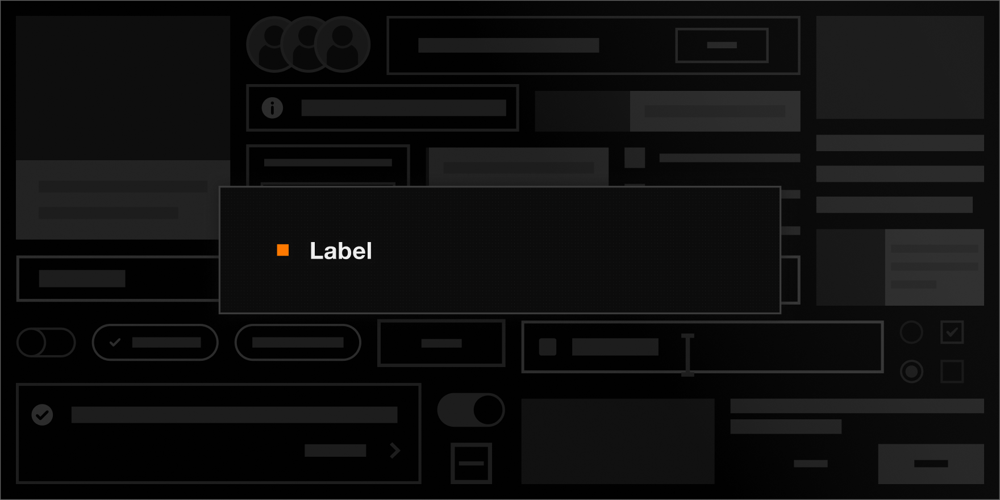

## Anatomy

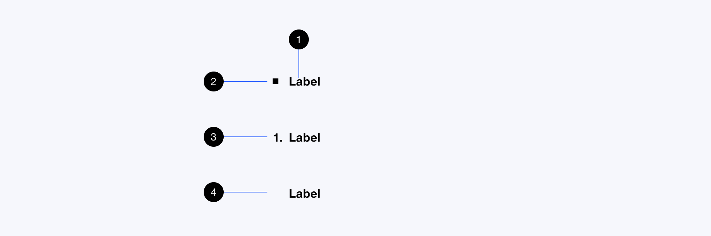

| # | Element | Purpose | Optional |
|---|---------|---------|----------|
| 1 | Label | Text content of the list item | No |
| 2 | Unordered list | Displays list items without a defined sequence, using a bullet or custom marker | No |
| 3 | Ordered list | Displays list items in a specific sequence using numeric ordering | No |
| 4 | Unstyled list | Displays list items without visual markers while preserving indentation and structure | No |

## Definition

A bullet list is a UI element that allows users to view related individual text items grouped together, with items typically starting with a number or a bullet.

The bullet list, also referred to as an 'unordered list' or 'ordered list,' is typically not an interactive element, although text items can include hypertext links.

## Type

<!-- zh-row -->

**`Unordered`** Collects related items that don't need to be in a specific order or sequence. List items are typically marked with bullets, but it is also possible to use a tick or any Solaris icon.

**`Ordered`** Collects related items with numeric order or sequence. Numbering starts at 1 with the first list item and increases by increments of 1 for each successive ordered list item.

**`Bare`** An unordered list without any bullets or alphanumeric sequence. It still have left-padding, so list items will appear indented. This is the default and is also known as undecorated "Unstyled" list.

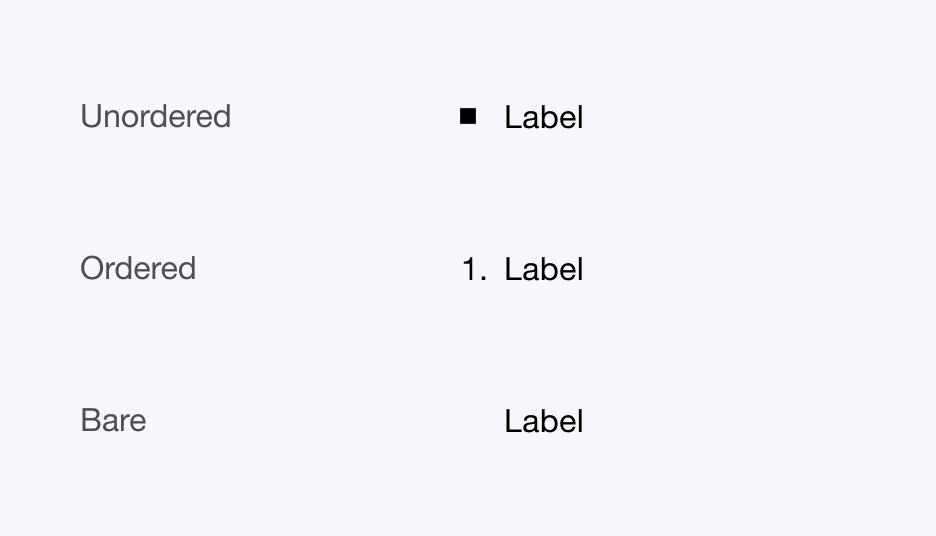

## Text style

List can be used with different font sizes, these sizes are based on our body font-size.  
Today, list is available with two text styles: Body large and body Medium.

<!-- zh-row -->

**`Body Large`** Make sure to use this reference if the text accompanying the list component is the Body Large text.  
This variant is designed for more visual, engaging experiences.

**`Body Medium`** Make sure to use this reference if the text accompanying the list component is the Body Medium text.  
This variant is best suited for functional, task-oriented experiences.

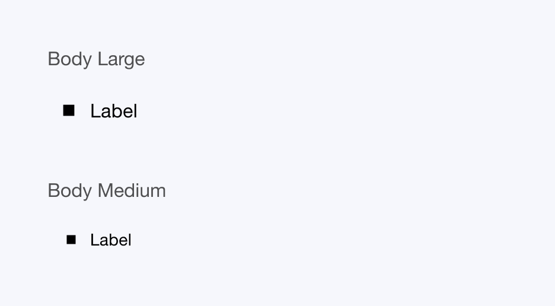

## Nested level

Lists can include nested items to indicate hierarchy or subcategories, with indentation distinguishing each level. Arrange ordered list items logically, such as ranking by importance, highest to lowest values, or in alphabetical/numeric order.

<!-- zh-row -->

**`Nested level: 0`** Level 0 list items define the main structure.  
Unordered level 0 list items are marked with full squares.  
Ordered level 0 list items are marked with numbers.

**`Nested level: 1`** Level 1 (nested) list items provide hierarchy or subcategories.  
Unordered level 1 list items are marked with outlined squares.  
Ordered level 1 list items are marked with uppercase letters.

**`Nested level: 2`** Level 2 (nested) list items provide hierarchy or subcategories.  
Unordered level 2 list items are marked with dashes.  
Ordered level 2 list items are marked with lowercase letters.

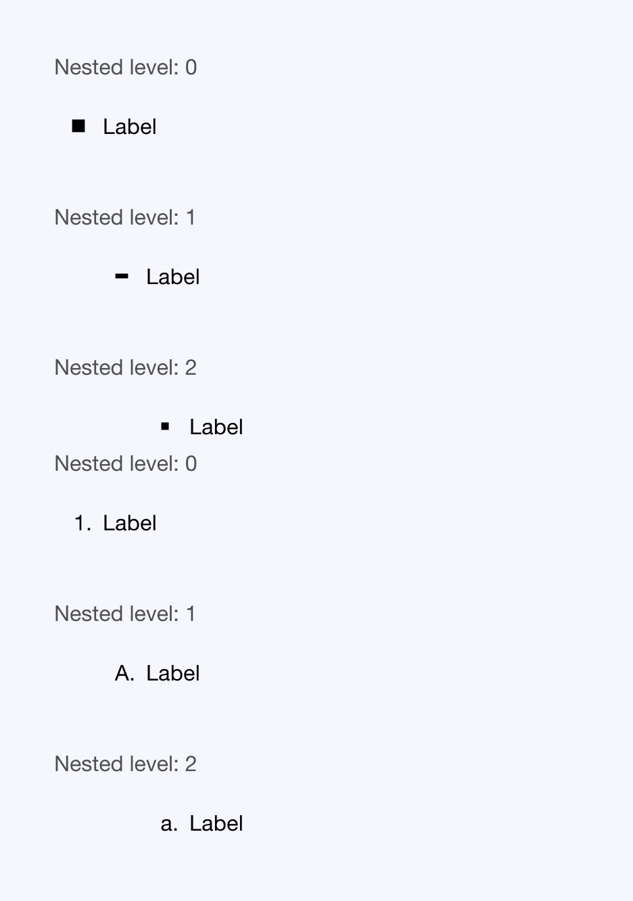

<!-- zh-row -->

Ordered lists can be combined with unordered items in the same list as well.

Note that, in this context, even though the Unordered list item is placed at nested level 1, it is rendered as if it were at nested level 0 (full square) because, in the technical implementation, **the combination of Ordered and Unordered lists is not incremental.**

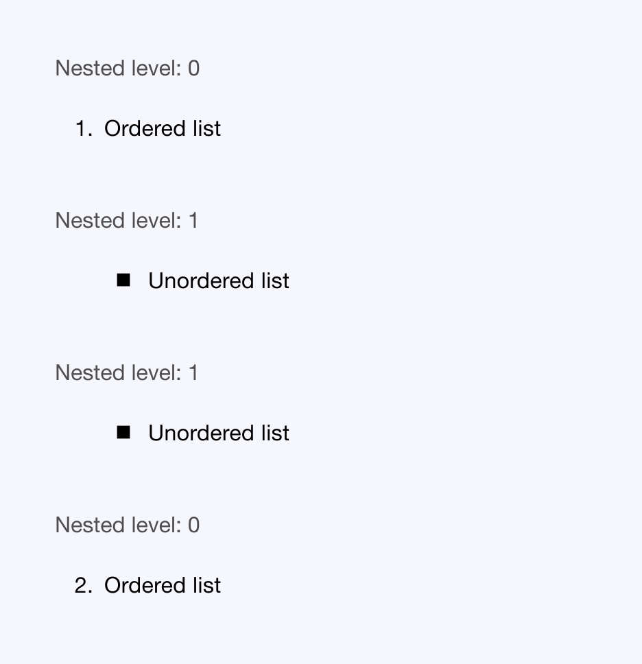

<!-- zh-row -->

Conversely, **in a context using only Unordered lists, the incrementing does apply** even if the choice of nested items differs (bullet items with ticks or Solairs icons).

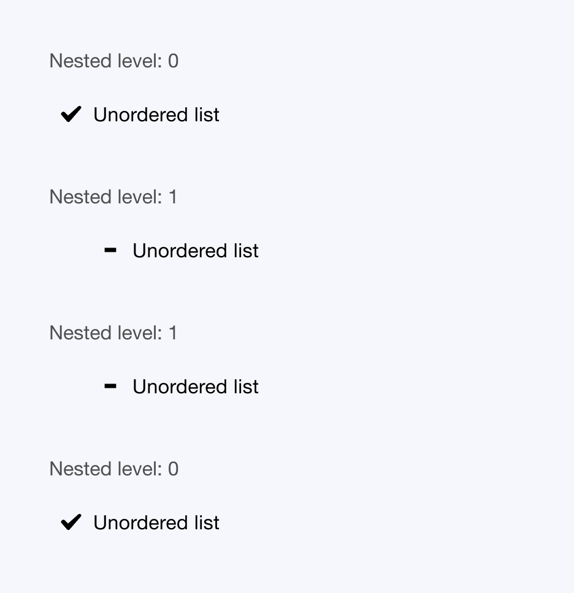

<!-- zh-row -->

In the technical implementation, **Bar lists are considered as Unordered lists**. The incrementing between lists does apply.

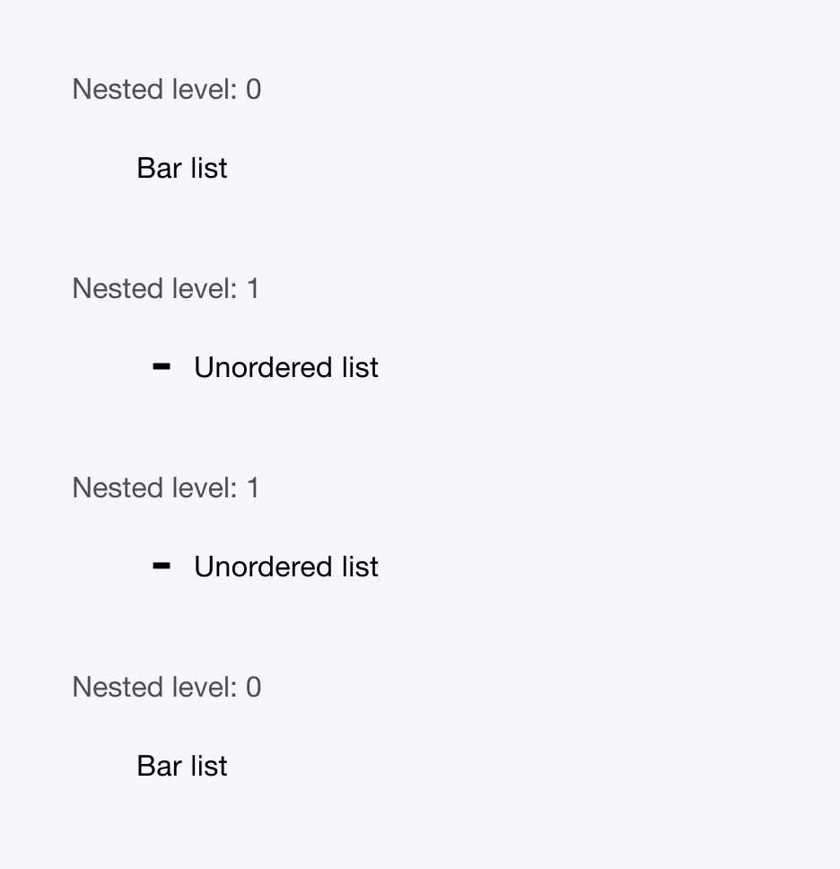

## Other boolean options

<!-- zh-row -->

**`Bold`** The label text can be bolded.

**`Skeleton`** Improves the perceived loading time by providing a visual cue of where switch will appear once fully loaded.  
Uses the "Skeleton" component, variant "Security marge=True".

**`Brand color - True`** Use the brand color for bullets when the list highlights important, actionable, or user-facing information that requires attention.

**`Brand color - False`** Use neutral (achromatic) bullets for descriptive or secondary content where emphasis is not needed and readability should remain the priority.

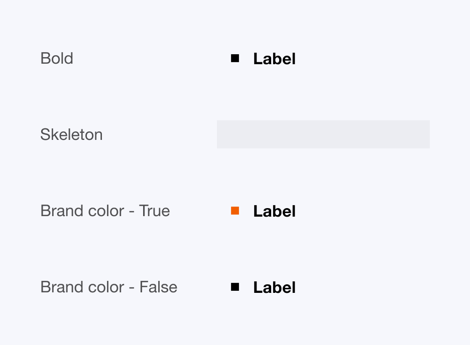

<!-- zh-row -->

Even if the "Bold" option is not active, it is also possible to add a hyperlink in the content of a list. In terms of design, and depending on the chosen text style, the typographic reference "Body/Large/Underline" or "Body/Medium/Underline" must be used.

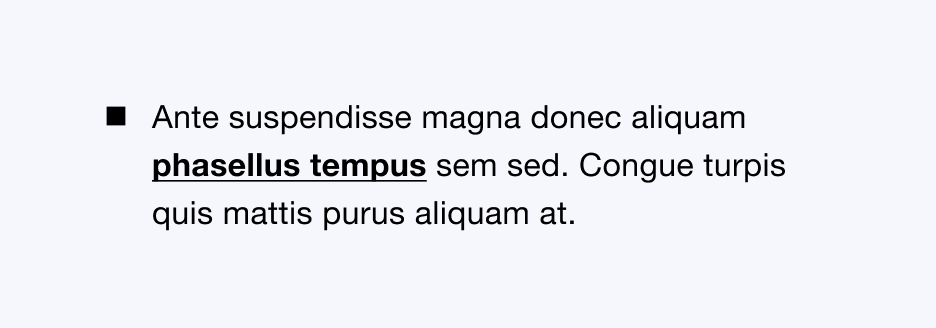

## Multiline and responsiveness

<!-- zh-row -->

### Multiline
This component allows multi-line text editing. The number of lines is not limited.

&nbsp;

### Max-width
The max-width must be applied at the bullet list container level, not on individual list items. This ensures consistent alignment, readable line lengths, and a coherent vertical structure.  
List items must naturally wrap within the parent container  
The max-width value depends on the maximum width value assigned to the typographic reference used.  
Since the component is standalone, it is up to the designer to manually add a max-width to the group of multiple bullet lists.  
For the "body large" variant, the global max-width token will be: **size-max-width-body-large**  
For the "body medium" variant, the global max-width token will be: **size-max-width-body-medium**

&nbsp;

### User zoom in/out
The behavior of the text during user zoom in/out must follow a fundamental principle: the text must remain readable, accessible, and must never break the structure or lose information.
* The text must always scale proportionally with user zoom. Text resizing must never be blocked.
* Zooming must never cause text to be truncated or hidden. The component must expand vertically to allow line wrapping.
* The component's height and width must be flexible, never fixed, in order to automatically adapt its dimensions according to the level of zoom.
* Even if, the component has a max-height or a max-width for resizing control purposes, technically, during user zoom in, these limitations are not fixed but must be scalable in order to adapt to the user's zoom level.
* In order to preserve the same display rendering, numbers, uppercase/lowercase letters, and bullet points follow the same rules as the text.

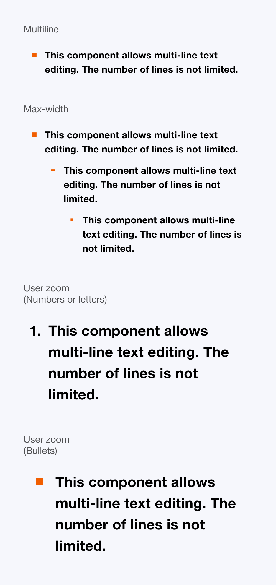

## Rich text

<!-- zh-row -->

### Bold option is false

#### Text style Body Large

* **Strong text**
  * Strong text can be used sparingly within alert messages to highlight key information. Rich text must use the **Body/Large/Strong** token only.
  * No other text styles or custom font weights should be used.
* **Underlined text and hyperlink**
  * Underlined text must not be used for emphasis, as it is commonly associated with links.
  * If a **hyperlink** is needed within the content, the typographic reference **Body/Large/Underline** must be used.

#### Text style Body Medium

* **Strong text**
  * Strong text can be used sparingly within alert messages to highlight key information. Rich text must use the **Body/Medium/Strong** token only.
  * No other text styles or custom font weights should be used.
* **Underlined text and hyperlink**
  * Underlined text must not be used for emphasis, as it is commonly associated with links.
  * If a **hyperlink** is needed within the content, the typographic reference **Body/Medium/Underline** must be used.

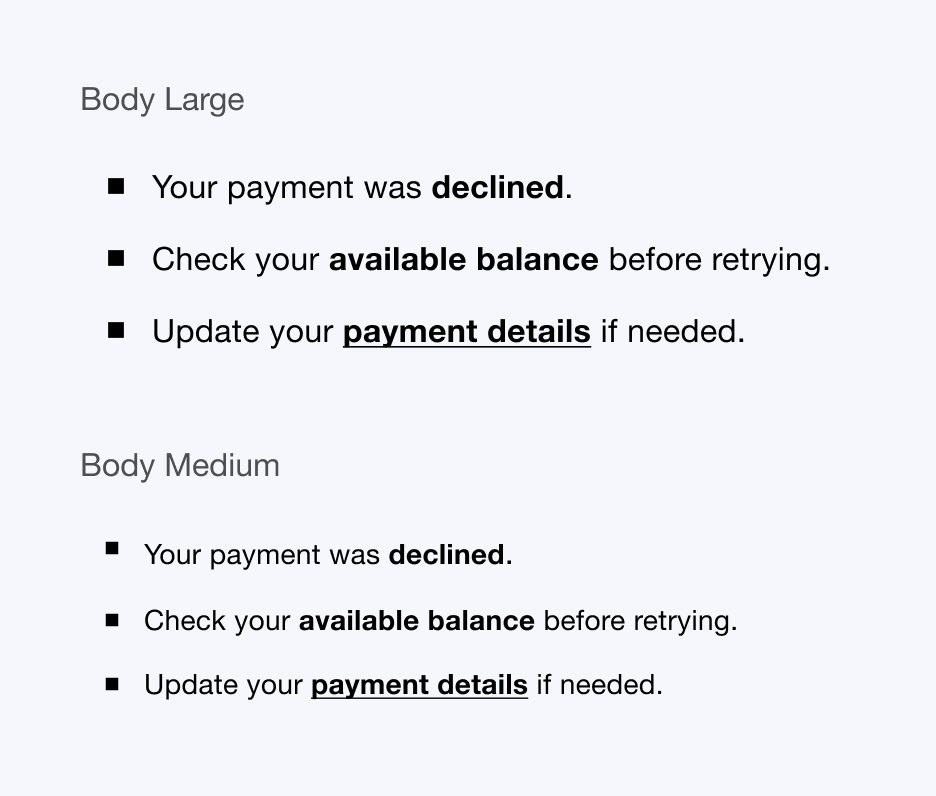

<!-- zh-row -->

### Bold option is true

#### Text style Body Large

* **Underlined text and hyperlink**
  * Underlined text must not be used for emphasis, as it is commonly associated with links.
  * If a hyperlink is needed within the content, the typographic reference **Body/Large/Underline** must be used.

#### Text style Body Medium

* **Underlined text and hyperlink**
  * Underlined text must not be used for emphasis, as it is commonly associated with links.
  * If a hyperlink is needed within the content, the typographic reference **Body/Medium/Underline** must be used.

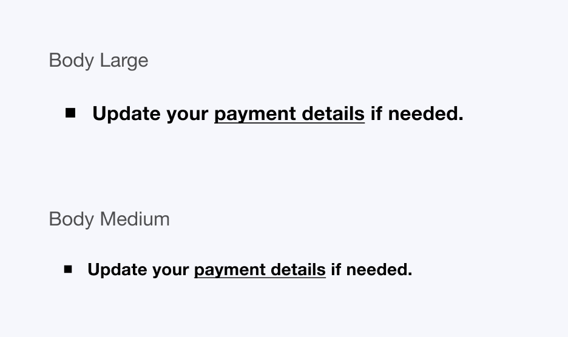

# Specs

## Layout and spacing

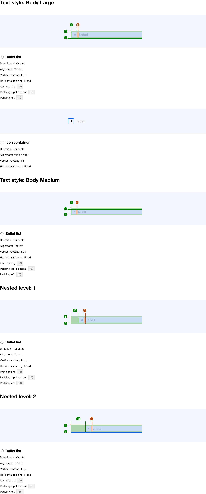

# Accessibility

Use semantic HTML: `<ul>` or `<ol>` with `<li>`.

Avoid additional ARIA roles.  
  
Add `aria-label` or `aria-labelledby` if the list purpose is not otherwise clear.

List links must meet minimum hit target (24px line height).

## Web keyboard navigation

Lists are not keyboard operable, unless the list items themselves are operable. In this situation, the list items will retain the component’s default keyboard interaction. For example, in a list of links, each link will be in the tab order and can be activated by Enter.

## Support screen readers

Ensure that the lists are correctly announced by screen readers.
Add explicit labels if necessary `aria-label` or `aria-labelledby` on `<ul>` or `<ol>` if the context is unclear.
  
It is recommend to use a label property in all lists. The label will be announced by the screen reader describing the purpose or content of the list. Even though text preceding the list can introduce the list, screen readers will read both pieces of information in sequential order. When using the label property, the information is embedded into the list announcement supporting the comprehension of the list.

## Alt text

Icons or images inside lists should include `alt` text or be marked `aria-hidden="true"` if decorative.

# Develop

## OUDS-Web example

[Components/BulletList › Bullet List 1](https://web.unified-design-system.orange.com/storybook/?path=/story/components-bulletlist--bullet-list-1)

[Components/BulletList › Bullet List 3](https://web.unified-design-system.orange.com/storybook/?path=/story/components-bulletlist--bullet-list-3)

## Developer documentation

| Platform | Developer documentation |
|---|---|
| OUDS Web | [S-ouds-web-bullet-list](https://r.orange.fr/r/S-ouds-web-bullet-list) |
| OUDS Android | [S-ouds-android-bullet-list](https://r.orange.fr/r/S-ouds-android-bullet-list) |
| OUDS iOS | [S-ouds-ios-bullet-list](https://r.orange.fr/r/S-ouds-ios-bullet-list) |
| OUDS Flutter | Not applicable |

# Changelog

## Availability

| Platform | Resource | Status | Version |
|---|---|---|---|
| Figma | [Bullet list component](https://r.orange.fr/r/S-ouds-design-bullet-list) | Live | 1.1.0 |
| OUDS Web (former Boosted) | [Web dev documentation](https://r.orange.fr/r/S-ouds-web-bullet-list) | Live | 1.1.0 |
| OUDS Android - Jetpack Compose | [Android dev documentation](https://r.orange.fr/r/S-ouds-android-bullet-list) | Live | 1.1.0 |
| OUDS iOS - Swift | [iOS dev documentation](https://r.orange.fr/r/S-ouds-ios-bullet-list) | Live | 1.1.0 |
| OUDS Flutter | Not applicable | To do | – |

## Design changelog

| Date | Number | Notes |
|------|--------|-------|
| Apr 21, 2026 | 1.1.0 | <ul><li>Version 2.4 of the design tokens is required for the development of this update.<li>Update: To ensure the viability of RTL mode (and especially the use of Helvetica Neue Arabic), control of the width of the leading containers (bullets, numbers, empty) is no longer handled via the "width" property but via the "min-width" property. The tokens remain unchanged (size-icon-with-body-large/medium-size-medium).</ul> |
| Mar 16, 2026 | - | <ul><li>Documentation writing: Multiline and responsiveness</ul> |
| Jan 6, 2026 | - | <ul><li>Documentation writing: Definition update</ul> |
| Mar 26, 2025 | 1.0.0 | • Component creation |
