# Button

A button is a UI element that triggers an action or event, used to initiate tasks or confirm an action.

# Guideline

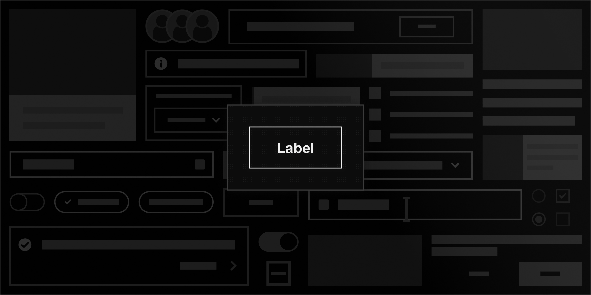

## Anatomy

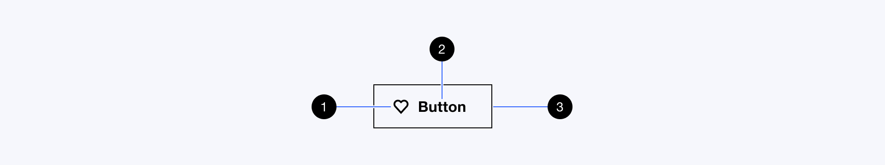

| # | Element | Purpose | Optional |
|---|---------|---------|----------|
| 1 | Icon | Use an icon to add an affordance where it has a clear, well-established meaning. | Yes |
| 2 | Label | Text describing the button action. Use action verbs or phrases to tell the user what will happen next. | No |
| 3 | Container | The selectable area of the button. | No |

## Definition

A button is a UI element that triggers an action or event, used to initiate tasks or confirm an action.

The button comes in various layouts, styles, and states to convey hierarchy or emphasis.

## Appearance

<!-- zh-row -->

**`Default`** Default buttons are used for actions which are not mandatory or essential for the user. Often screens will include multiple Outline buttons alongside one of the Full button.

**`Strong`** The Strong button on the page should be singular and prominent, ideally limited to one per view. It should be reserved for the most critical action, such as "Buy," "Save," "Submit," etc.

**`Brand`** A brand primary color alternative to the Strong button.  
To be used sparingly for high-value specific actions or to visually anchor a brand moment. Do not use it as the default primary button in your interfaces.

**`Minimal`** Minimal buttons are commonly used for actions that are considered less crucial. They can be used independently or together with a strong button.

**`Negative`** Negative buttons should be used sparingly to warn of a destructive action, for example, delete or remove, typically resulting in the opening of a confirmation dialog.

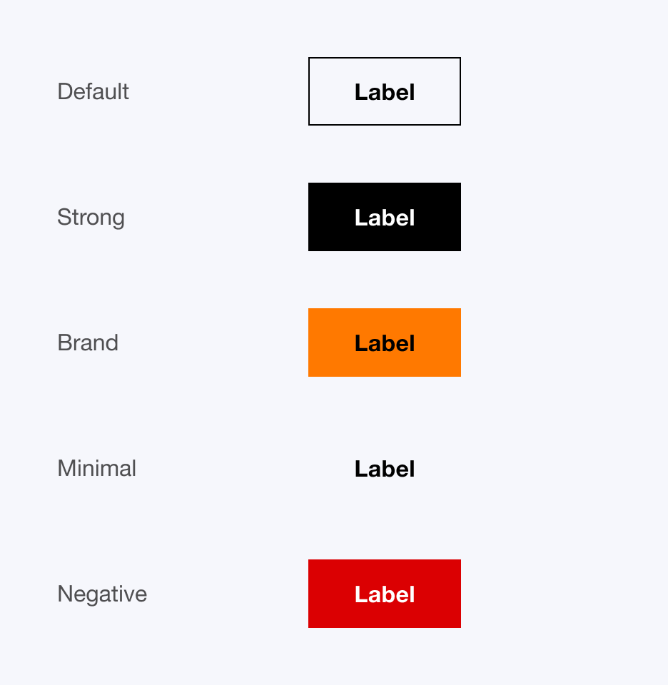

## Layouts

<!-- zh-row -->

**`Text only`** This is the default layout of the component.

**`Text + icon`** This option includes functionality to choose any Solaris icon.  
Its use must be restricted and remain specific to certain clearly identified contexts (the use of an icon within a "Play" button is standard in the context of TV or video streaming).

**`Icon only`** Typically utilized in business or back-office interfaces, it is rarely standalone (usually part of a group of elements).

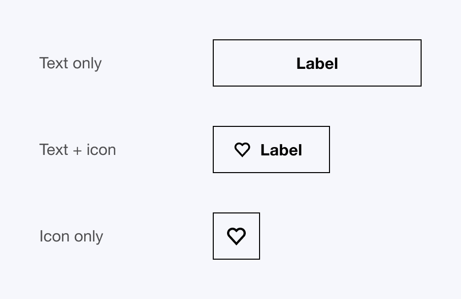

## Sizes

<!-- zh-row -->

**`Default`** This is the default size of the component. This size is used for the vast majority of applications.

**`Small`** This size can be particularly useful in an information-dense interface or in the construction of a template or component requiring the use of small elements (in an "List item" component, for example).

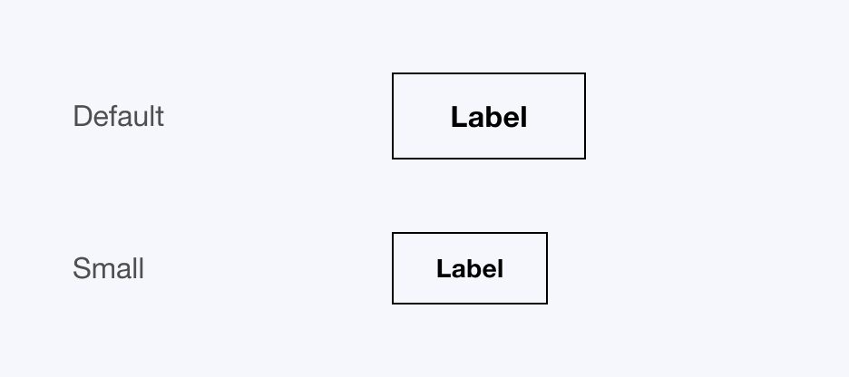

## Rounded corner

<!-- zh-row -->

Even though in Figma this rendering option is available and editable from the properties of each button component, the configuration of this rendering option is actually transversal across the entire product/service in which the component is used. It is therefore impossible to have one button component set to Rounded corner=True and another set to Rounded corner=False within the same product/service.

**`False`** The square rendering corresponds to Orange's historical style. It conveys the brand's sense of seriousness, robustness and utility-driven. It remains the default style for our digital interface components.

**`True`** The rounded rendering offers flexibility without sacrificing the attribution to the brand. It helps anchoring the service in a reality where the visual codes of the mobile area tends to rub off on all interfaces. Use rounded corners for a softer, more approachable, friendly and tactile feel.

&nbsp;

### Brand theme availability
This option is technically not available for all brand themes. Here's the list of rounded corners availability by brand theme:

| Brand theme | Availability |
|---|---|
| Orange | ✅ Available |
| Orange Compact | ✅ Available |
| Sosh | ❌ Unavailable |
| Wireframe | ❌ Unavailable

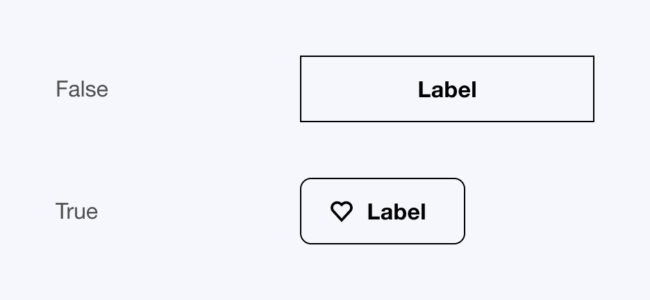

## Specific component: On colored bg

<!-- zh-row -->

This variant ensures a sufficiently high level of accessibility when the component is used on a background that is "out of control".

&nbsp;

### To invert color
* In light mode: For a black finish
* In dark mode: For a white finish

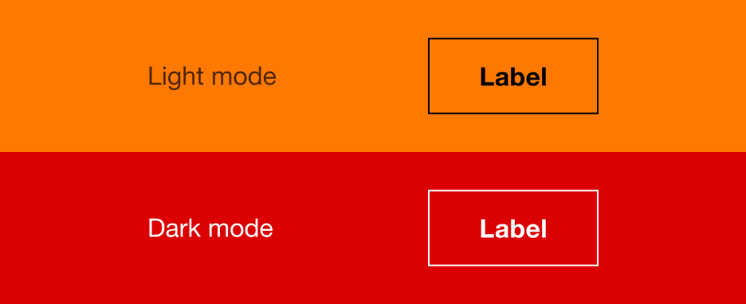

## Multiline and responsiveness

<!-- zh-row -->

### Multiline
This component allows multi-line text editing. Although the number of lines is not technically limited, it is recommended not to exceed one line of text.  
In its "Text + icon" variant, if the label spans multiple lines, the label remains horizontally centred and the icon remains vertically centred.

&nbsp;

### Max-width vs full-width
For greater flexibility, this component doesn't have a default max-width. To avoid exceeding a width that would degrade readability and the perception of a compact interactive element, we recommend applying **a max-width of around 360px.**  
The component can also naturally wrap within the parent container (or the screen in a mobile use context for exemple) and use the full available width.  
Please note that this behavior is not the default rule; it may be preferred if the template allows it (to improve user comfort or for better page structure/hierarchy).

&nbsp;

### User zoom in/out
The behavior of the text during user zoom in/out must follow a fundamental principle: the text must remain readable, accessible, and must never break the structure or lose information.
* The text must always scale proportionally with user zoom. Text resizing must never be blocked.
* Zooming must never cause text to be truncated or hidden. The component must expand vertically to allow line wrapping.
* The component's height and width must be flexible, never fixed, in order to automatically adapt its dimensions according to the level of zoom.
* In order to preserve the minimun interactive area during user zoom out, this component have a min-width and a min-height **of 48px**.
* Even if, the component has a max-height or a max-width for resizing control purposes, technically, during user zoom in, these limitations are not fixed but must be scalable in order to adapt to the user's zoom level.
* In its "Text + icon" variant, user zoom in/out doesn't affect the size of the icons; they remain fixed in size (decorative use).
* As the text is missing, in its "Icon only" variant, the icons follow the same rules as the text.

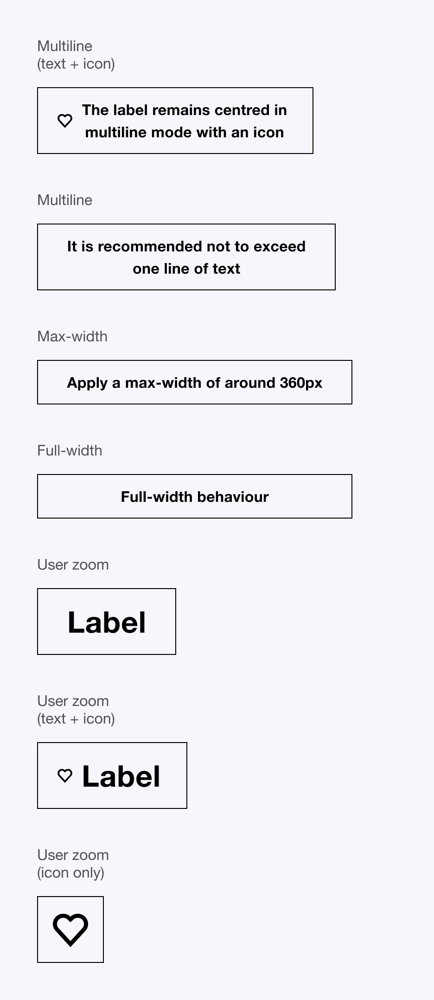

# Specs

## Layout and spacing

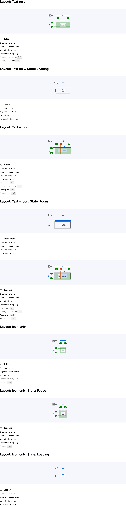

## States

<!-- zh-row -->

**`Enabled`** The status of the button before a user has interacted with it, or other content affects it.

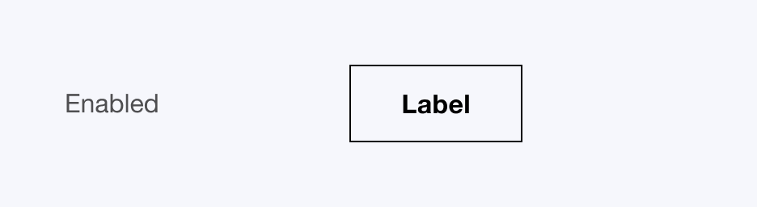

<!-- zh-row -->

**`Hover`** When a user places a pointing device over a button, but has not yet taken action on it.

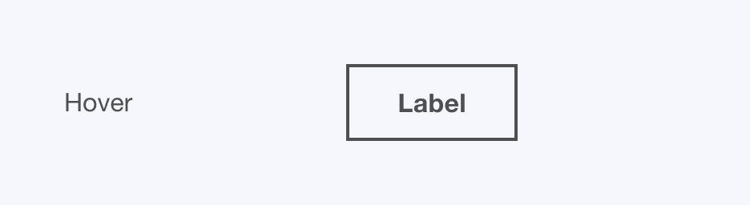

<!-- zh-row -->

**`Focus`** When a user selects a button via keyboard or voice command, but has not yet taken action on it.  
Mirrors the "Hover" state but includes an additional border.

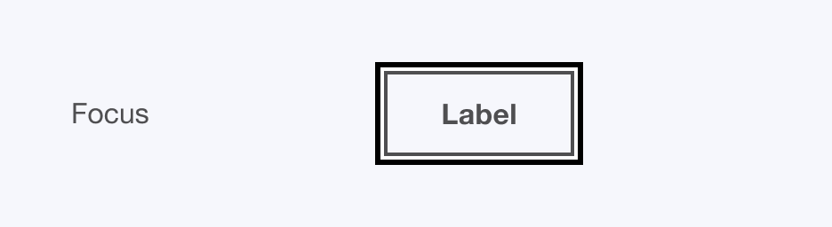

<!-- zh-row -->

**`Pressed`** An intermediate state that communicates a user has taken action on a button, and that it is in the process of navigating to a destination, triggering logic, or transmitting data.

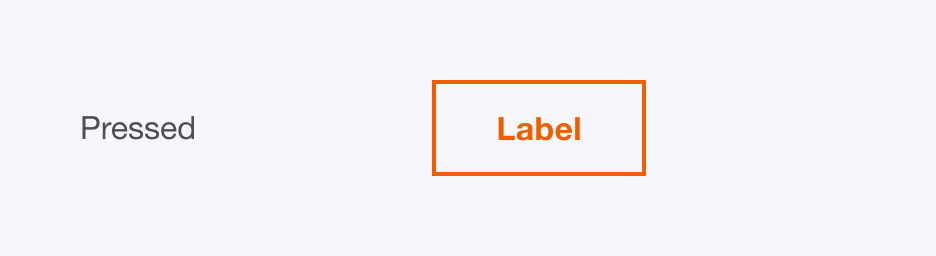

<!-- zh-row -->

**`Loading`** A button is fetching data from another internal or external resource.  
Uses the "Loading indicator" component.

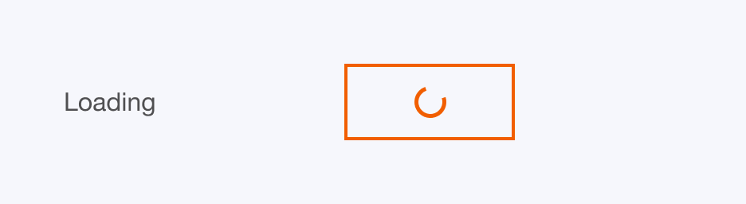

<!-- zh-row -->

**`Disabled`** Used to indicate a button that cannot be selected.

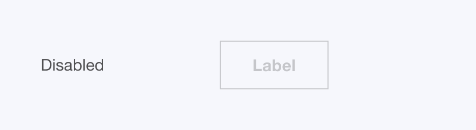

<!-- zh-row -->

**`Skeleton`** Improves the perceived loading time by providing a visual cue of where button will appear once fully loaded.  
Uses the "Skeleton" component, variant "Security marge=False".

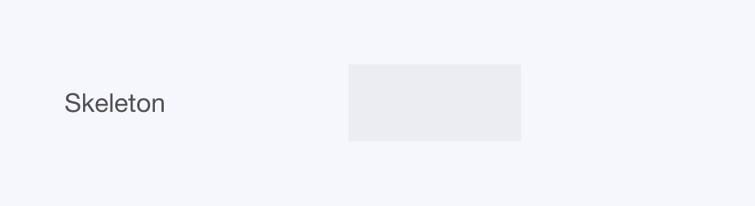

# Accessibility

## Touch target

When placing two or more buttons inline, ensure they are a sufficient size or have spacing between them to avoid users accidentally hitting the wrong button.

**Do:** Ensure buttons are a sufficient size or have spacing between them to avoid users accidentally hitting the wrong button.

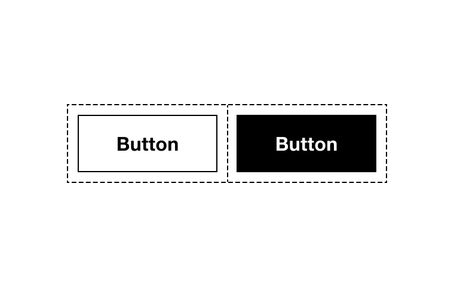

**Don't:** Don't space buttons too close. Buttons that are closely spaced together make selection difficult.

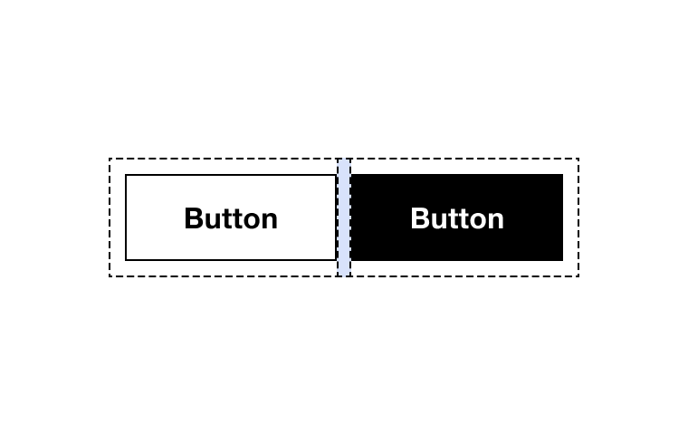

## Color and contrast

Do not use custom colours for buttons. The colours of different button variations have been designed to be accessible and consistent.

**Do:** Use stantard colours to ensure buttons remain accessible and button hierarchy is maintained.

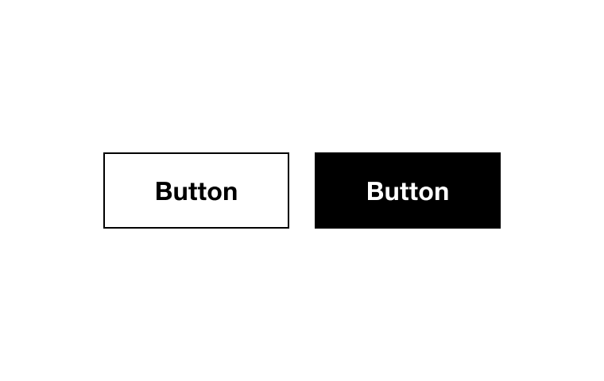

**Don't:** Don't override standard colours for buttons to fit a particular context.

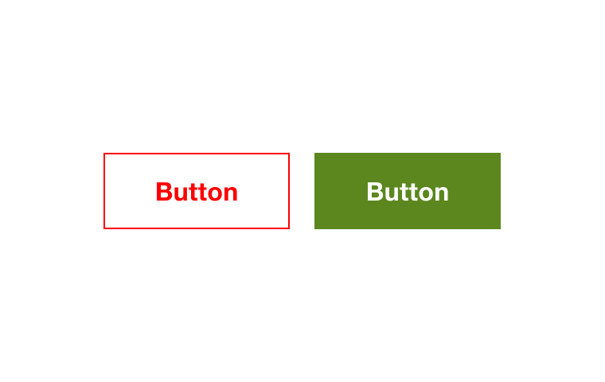

## Buttons on imagery

When using the Default and Minimal buttons over photography or illustrations, ensure the button is positioned over a plain area with little texture or colour variation so there is sufficient contrast for the button label to be legible. Be aware that resizing the browser window could reposition the button over different parts of the image. Test your button’s responsiveness across screen sizes to ensure it remains legible regardless of its positioning.

**Do:** Positioned buttons over a plain area with little texture or colour variation.

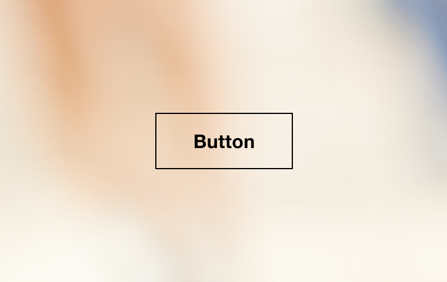

**Don't:** Don't position buttons where labels are not legible.

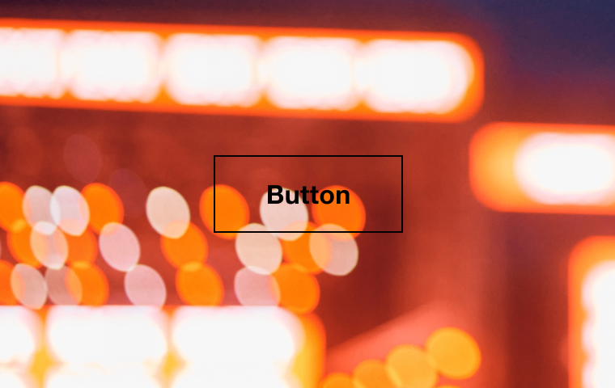

## Accessibility descriptors

Accessibility descriptors are semantic metadata that provide labels, hints, and contextual information to describe the purpose or action associated with a user interface (UI) element, such as a button. These descriptors help ensure that users, particularly those with visual impairments, can effectively navigate and interact with content using assistive technologies like screen readers. Each platform offers specific methods for adding these descriptions:

- Web: `alt` text describes images and UI elements.
- Android: `contentDescription` provides concise descriptions for elements.
- iOS: Properties like `accessibilityLabel`, `accessibilityHint`, and `accessibilityActions` allow developers to define labels, additional guidance, and custom interactions.

When a button’s label is unique and self-explanatory, additional descriptors may not be necessary. However, in scenarios where multiple buttons share the same label (e.g., multiple "Buy" buttons on a product page), accessibility descriptors should provide a unique context to distinguish between them (e.g., "Buy product A" or "Buy product B"). Additionally, if a label is too generic or unclear, descriptors can add vital context to clarify the button's purpose.

# Develop

## OUDS Web

[Components/Buttons › Buttons 5](https://web.unified-design-system.orange.com/storybook/?path=/story/components-buttons--buttons-5)

[Components/Buttons › Buttons 9](https://web.unified-design-system.orange.com/storybook/?path=/story/components-buttons--buttons-9)

[Components/Buttons › Buttons 10](https://web.unified-design-system.orange.com/storybook/?path=/story/components-buttons--buttons-10)

## Developer documentation

| Platform | Developer documentation |
|---|---|
| OUDS Web | [S-ouds-web-button](https://r.orange.fr/r/S-ouds-web-button) |
| OUDS Android | [S-ouds-android-button](https://r.orange.fr/r/S-ouds-android-button) |
| OUDS iOS | [S-ouds-ios-button](https://r.orange.fr/r/S-ouds-ios-button) |
| OUDS Flutter | [S-ouds-flutter-button](https://r.orange.fr/r/S-ouds-flutter-button) |

# Changelog

## Availability

| Platform | Resource | Status | Version |
|---|---|---|---|
| Figma | [Button component](https://r.orange.fr/r/S-ouds-design-button) | Live | 3.4.0 |
| OUDS Web (former Boosted) | [Web dev documentation](https://r.orange.fr/r/S-ouds-web-button) | Live | 3.4.0 |
| OUDS Android - Jetpack Compose | [Android dev documentation](https://r.orange.fr/r/S-ouds-android-button) | Live | 3.4.0 |
| OUDS iOS - Swift | [iOS dev documentation](https://r.orange.fr/r/S-ouds-ios-button) | Live | 3.4.0 |
| OUDS Flutter | [Flutter dev documentation](https://r.orange.fr/r/S-ouds-flutter-button) | Live | 3.4.0 |

## Design changelog

| Date | Number | Notes |
|------|--------|-------|
| Jul 31, 2026 | 3.4.0 | Version 2.7 of the design tokens is required for the development of this update.<ul><li>A maximum width is now applied to the component.</ul> |
| Jul 1, 2026 | - | <ul><li>Updated the Progress Indicator version. Components with Rounded Corner = True now use the Progress Indicator (Rounded Corner = True) variant.</ul> |
| Jun 5, 2026 | 3.3.0 | Version 2.6 of the design tokens is required for the development of this update.<ul><li>New small size.<li>The loader frame has been renamed to Progress indicator container.<ul><li>It now contains the new Circular Progress Indicator component.</ul><li>For the "Icon only" variant, absolute positioning has been removed and replaced with Auto Layout.<ul><li>icon-only-default (ouds/space/inset/medium) for the Default size<li>icon-only-small (ouds/space/inset/small) for the Small size</ul><li>Inside the container, the Circular Progress Indicator uses:<ul><li>progress-indicator-only-default<li>progress-indicator-only-small</ul></ul> |
| Mar 16, 2026 | - | <ul><li>Documentation writing:<ul><li>Rounded corners brand theme availability<li>Multiline and responsiveness</ul></ul> |
| Jan 21, 2026 | - | <ul><li>Documentation writing: Rounded corners update<li>Documentation writing: Dedicated component: On coloured bg</ul> |
| Jan 6, 2026 | - | <ul><li>Documentation writing: Definition update</ul> |
| Oct 10, 2025 | 3.2.0 | The specific component "On colored bg" has been split into two distinct components: <ul><li>A public version offering traditional management of dark and light modes <li>A private version (allowing the core team to nest the component with other components) offering customized mode management with four possible configurations: <ul><li>Always in light mode <li>Always in dark mode <li>Light to dark mode <li>Dark to light mode </ul><li>Consequently, for the private version, the name of the "Inverted color" variant has been replaced to "Mode control".</ul> |
| Sep 28, 2025 | 3.1.0 | <ul><li>Brand variant: New background and content color tokens added for hover/pressed/loading/focus states <li>The name of the "Hierarchy" variant has been replaced to "Appearance"</ul> |
| Jul 24, 2025 | 3.0.0 | <ul><li>New hierarchical variant: Brand → [Component tokens changelog 1.4.0](https://www.figma.com/design/Co2t6wHMf4GB9NJVGs2Hes/-OUDS-Core-Lib--Design-tokens?m=auto&node-id=9280-2568&t=HLVB4jOd35DWr8Bj-1) <li>Rounded corner property is now available → [Component tokens changelog 1.4.0](https://www.figma.com/design/Co2t6wHMf4GB9NJVGs2Hes/-OUDS-Core-Lib--Design-tokens?m=auto&node-id=9280-2568&t=HLVB4jOd35DWr8Bj-1) <li>Minimal variant: Color and width border tokens removed <li>Minimal variant: Color background tokens removed in the enabled state <li>Minimal variant: Color background tokens removed in the loading state <li>Minimal variant: Color background tokens removed in the disabled state</ul> |
| Jul 21, 2025 | 2.1.0 | <ul><li>Several design token updates: [Component tokens changelog 1.3.0](https://www.figma.com/design/Co2t6wHMf4GB9NJVGs2Hes/-OUDS-Core-Lib--Design-tokens?m=auto&node-id=9280-2568&t=HLVB4jOd35DWr8Bj-1) <li>Button: Expanded: The chevron is also present in the 'icon only' variant. The gap between these 2 elements is defined by a design token: ouds-action-button-space-column-gap-icon-chevron→ouds-space-column-gap-2xs</ul> |
| Apr 19, 2025 | 2.0.0 | <ul><li>Creation of "On colored bg" variant</ul> |
| Dec 5, 2024 | 1.0.0 | <ul><li>Component creation</ul> |
