# Checkbox item

A checkbox item is a UI element shaped like a row that allows users to select multiple options from a set of mutually non-exclusive choices.

# Guideline

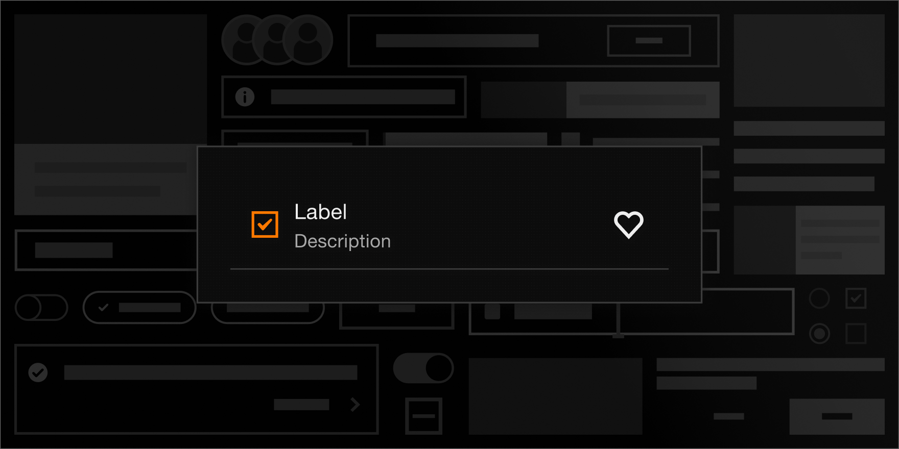

## Anatomy

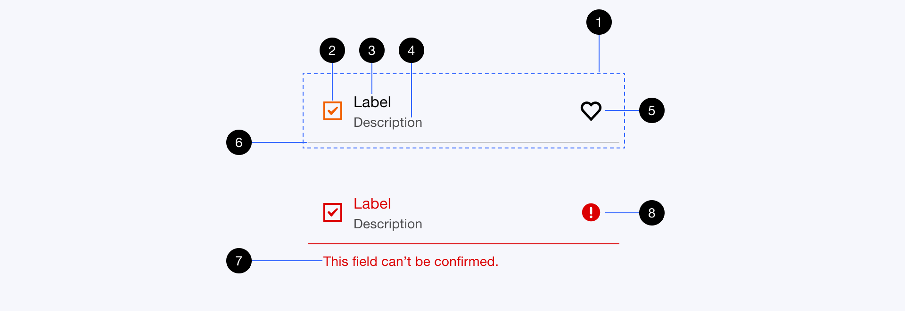

| # | Element | Purpose | Optional |
|---|---------|---------|----------|
| 1 | Container | The row that holds the checkbox indicator, the texts, the optional icon and the bottom border. | No |
| 2 | Checkbox indicator | Visually indicates the state of the checkbox (unchecked, checked, indeterminate). Unchecked by default. | No |
| 3 | Label | Primary text that describes the selectable option. Should be short and easy to scan. | No |
| 4 | Description | Optional supporting text that provides additional context or instructions for the option. | Yes |
| 5 | Icon | Optional decorative or functional icon used to visually reinforce the meaning of the option. | Yes |
| 6 | Bottom border | Separator line used when multiple checkbox items are grouped together. | Yes |
| 7 | Error text | Text message explaining why the field is in an error state. Displayed when validation fails. | Yes |
| 8 | Error icon | Visual indicator that highlights the error state of the component. | No |

## Definition

A **checkbox item** is a UI element shaped like a row that allows users to select multiple options from a set of mutually non-exclusive choices.

Unlike the checkbox, the checkbox item accommodates a broader range of contexts by enabling the toggling of visibility of additional text labels and icon assets.

## Selection status

<!-- zh-row -->

**`Unselected`** By default, a checkbox is often in this state.  
This state indicates that the user has not selected the associated option.

**`Selected`** Indicates that the user has selected the option.  
This often corresponds to an action or validation.

**`Indeterminate`** Often used when the checkbox represents a partial selection. For example, in a nested (hierarchical) list, a parent checkbox can be indeterminate if some but not all sub-options are checked.  
This is not a state the user directly selects but is calculated by the system.

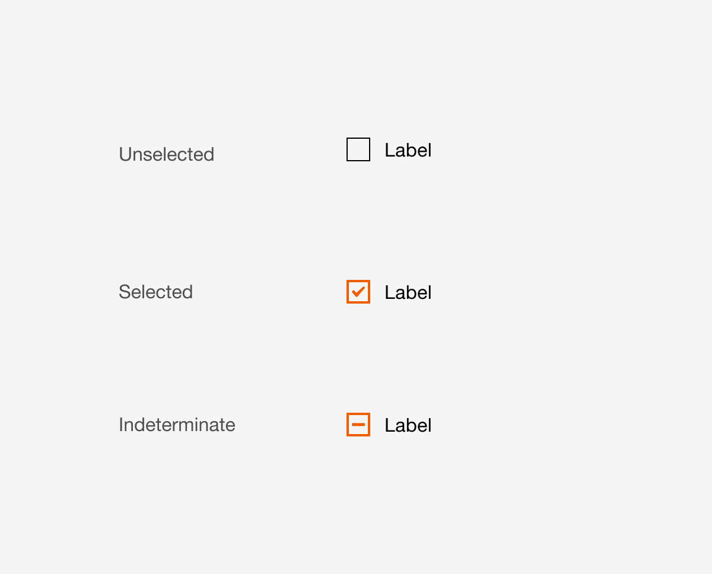

## Error

<!-- zh-row -->

**`False`** Used when the checkbox is unchecked but required.  
Example: user must agree to terms, but didn’t check the box.

**`True`** Used when the checkbox is checked but still invalid.  
Example: the selection conflicts with another field or fails validation.

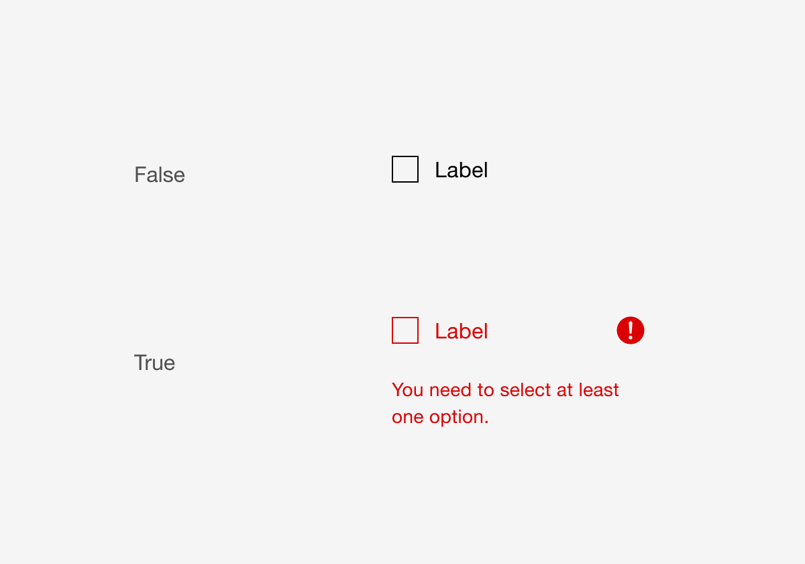

**Do:** Write specific, actionable error messages that tell users exactly what went wrong and how to fix it

**Don't:** Use generic error messages like "Invalid input" or "Error"—they don't help users understand the problem

## Reverse

<!-- zh-row -->

**`False`** This is the default layout of the component.  
From left to right, the order of the elements is as follows: checkbox / text / icon.

**`True`** As its name suggests, this layout is the reversed mirror of the "Default" template.  
From left to right, the order of the elements is as follows: icon / text / checkbox. This variant is necessary for RTL mode and certain mobile use cases.

## Other boolean options

<!-- zh-row -->

**`Description`** It is possible to display or hide accompanying text for the main label.

**`Icon`** It is possible to display or hide an icon. If displayed, this option includes functionality to choose any Solaris icon.

**`Divider`** It is possible to display or hide a dividing element (line).

**`Error message`** In the context where the component is in its "Error" true option, the error message can be displayed.

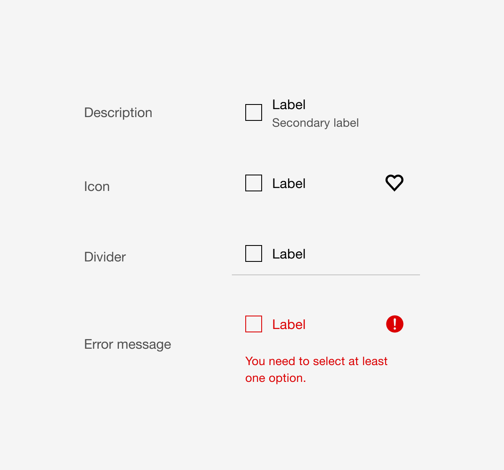

## ⚠️ Mandatory field indication

<!-- zh-row -->

**If all fields are mandatory (several fields present):**
1. Display the message "All fields are mandatory." at the top.
2. Do not use an asterisk (*) at the end of each field label, nor the word "mandatory."

**If not all fields are mandatory (and there are several fields present):**
1. Display the message "All fields marked with an * are mandatory." at the top.
2. Use an asterisk (*) at the end of each mandatory field label.  
   **⚠️ Important:**
   * In Figma, the asterisk must be entered manually by designers in the label text. UI rendering of the asterisk: **font-weight-bold + color-content-negative (red)**.
   * Technically, for web/iOS/Android, the asterisk is positioned in a dedicated container after the label text. Spacing between label and asterisk: 4px
3. Either the technology allows a 'required' attribute to be managed on the fields (usually in Web), in which case any asterisks must be hidden from users using assistive technologies, Or the technology does not allow the mandatory nature of the field to be indicated. In this case, the asterisk must be vocalised as well as a 'mandatory' mention. Please refer to the technical documentations for more information.
4. Depending on the use case, an 'optional' label can be added to non-mandatory fields.

**Indication of mandatory status for a group of control items:**  
When a group of control items (Radio Button, Checkbox, or Switch item) is mandatory, the indication of requirement must be carried only by the group title.  
The asterisk (*) must be placed at the end of the group title and must not be repeated in the labels of the individual items.  
This rule avoids visual redundancy, clarifies that the requirement applies to the group rather than each option, and improves information hierarchy and form readability.

**If there is only one field in the form, or if the mandatory nature is obvious (such as login/password), no mention is necessary since the fields are essential to the form's functionality.**

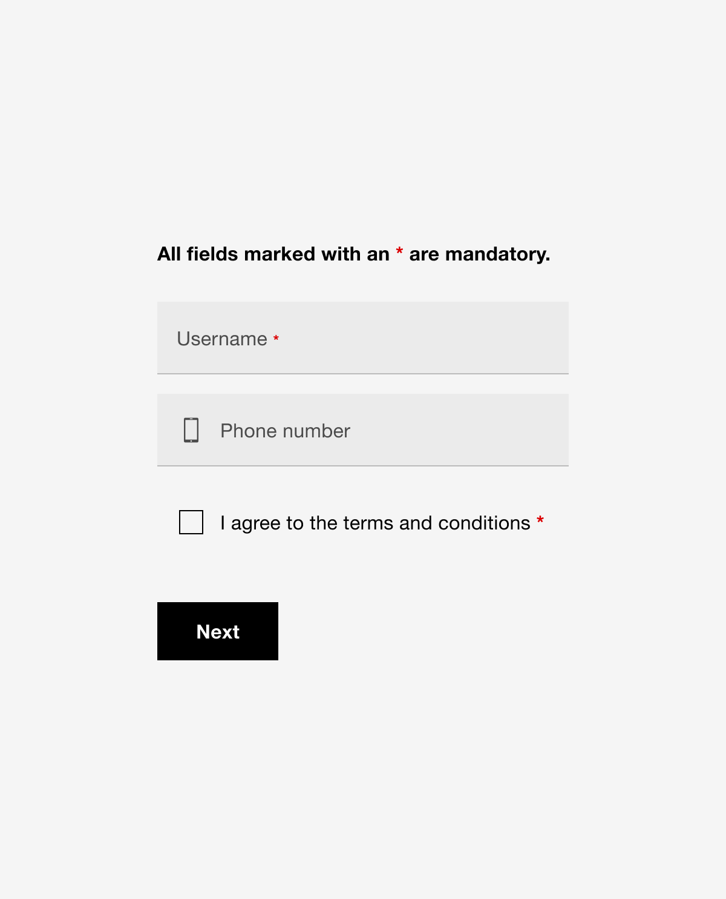

## Multiline and responsiveness

<!-- zh-row -->

### Multiline
This component allows multi-line text editing. Although the number of lines is not technically limited, it is recommended not to exceed 2 lines of text. In its "Text + icon" variant, if the label spans multiple lines, the label remains centred.

&nbsp;

### Max-width vs full-width
For greater flexibility, this component doesn't have a default max-width. To avoid exceeding a width that would degrade readability and the perception of a compact interactive element, we recommend applying **a max-width of around 480px.**  
For mobile or tablet use (or if the component is positioned inside a specific container), it is possible to set this component to use the full available width (of the screen or the container).  
Please note that this behavior is not the default rule; it may be preferred if the template allows it (to improve user comfort or for better page structure/hierarchy).

&nbsp;

### User zoom in/out
The behavior of the text during user zoom in/out must follow a fundamental principle: the text must remain readable, accessible, and must never break the structure or lose information.
* The text must always scale proportionally with user zoom. Text resizing must never be blocked.
* Zooming must never cause text to be truncated or hidden. The component must expand vertically to allow line wrapping.
* The component's height and width must be flexible, never fixed, in order to automatically adapt its dimensions according to the level of zoom.
* In order to preserve the minimun interactive area during user zoom out, this component have a min-width **of 160px** and a min-height **of 52px**.
* Even if, the component has a max-height or a max-width for resizing control purposes, technically, during user zoom in, these limitations are not fixed but must be scalable in order to adapt to the user's zoom level.
* As the control item and error icon are functional, they must follow the same rules as text.
* In order to preserve the same display rendering as the component's error state, even if the icons is purely decorative, the icons follow the same rules as the text.

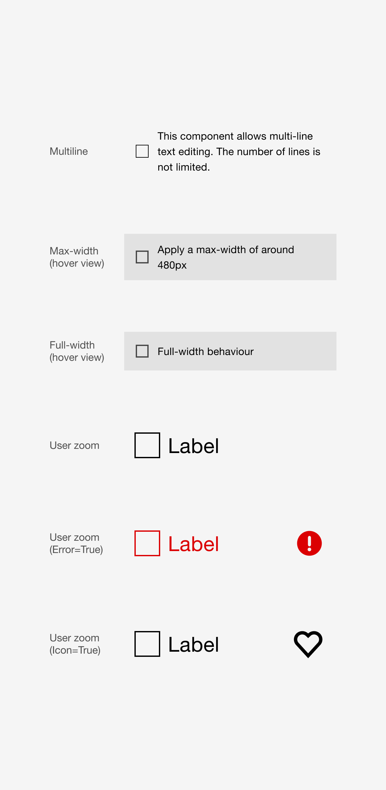

## Technical layout adjustments

<!-- zh-row -->

Even though, in Figma, the component structure is unique (for easier use by designers), technically the versions differ in order to respect best practices for each environment (paradigm shift between the web "Container" vs. the native "Edge-to-Edge"):

&nbsp;

### Web (mobile, tablet, and desktop)
The component is contained within the browser window and has "safety margins." It therefore cannot appear in the area corresponding to the margin grid.  
The component has internal padding-inline, and its display position must be between several columns (which varies depending on the number of containers used on a horizontal row).

&nbsp;

### Native app (Android, iOS, Flutter)
The display position of the component corresponds to the entire screen display area (edge to edge).  
Its internal padding-inline is therefore replaced by the grid-margin tokens.

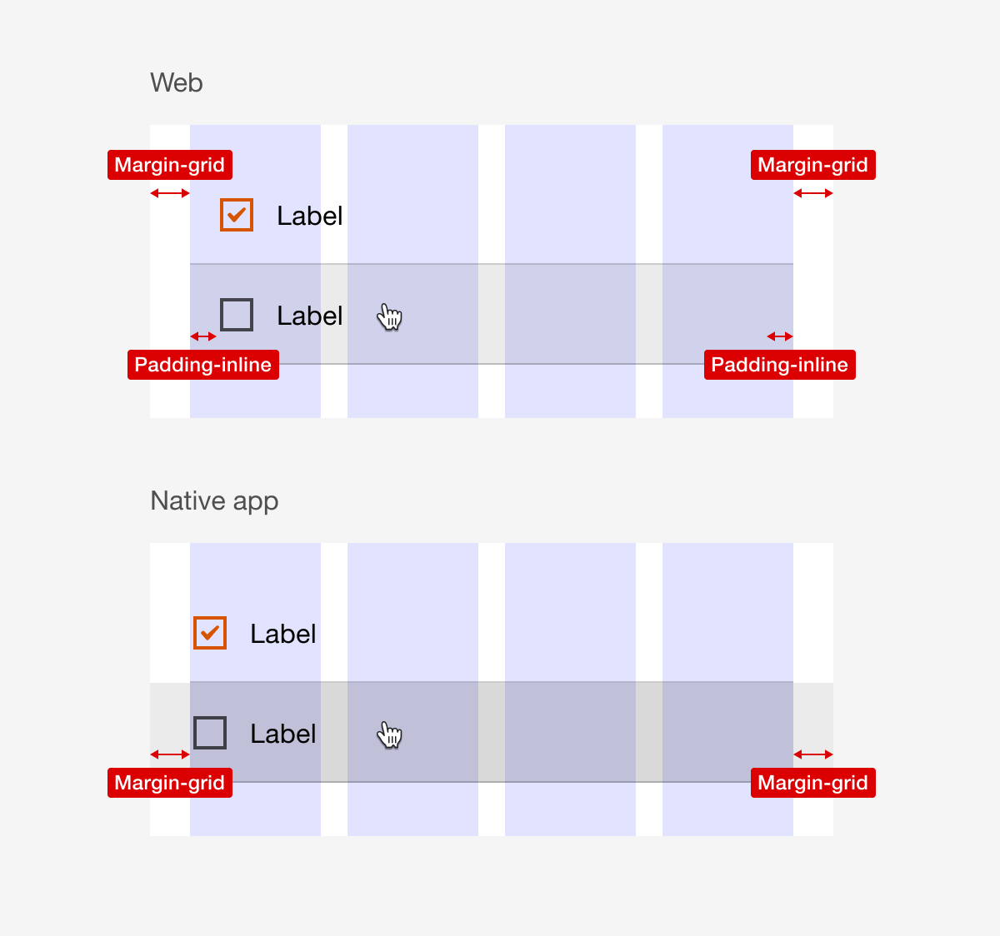

## Rich text

<!-- zh-row -->

### Strong text
* Strong text can be used sparingly to highlight key information within the content. Text is allowed using the corresponding "Strong" token (e.g. Label/Medium/Strong).
* No other text styles or custom font weights should be used.

&nbsp;

### ⚠️ Underline text
* Underlined text must not be applied manually (e.g. in error message), as it is commonly associated with hyperlinks and may mislead users.

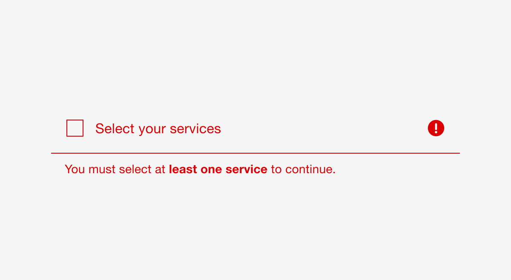

# Specs

## Layout and spacing

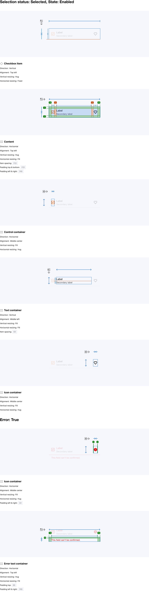

## States

<!-- zh-row -->

**`Enabled`** The status of the checkbox before a user has interacted with it, or other content affects it.

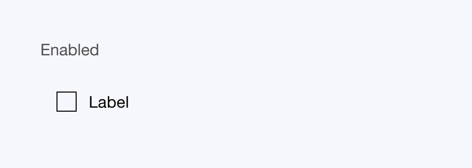

<!-- zh-row -->

**`Hover`** When a user places a pointing device over a checkbox, but has not yet taken action on it.

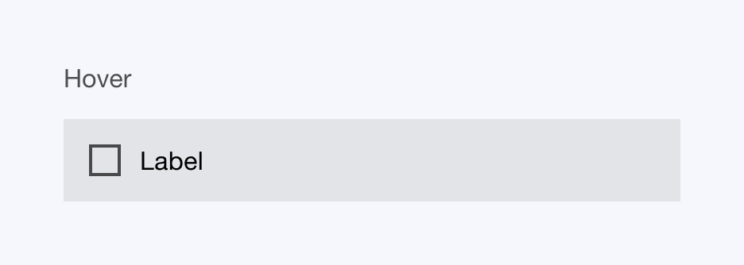

<!-- zh-row -->

**`Focus`** When a user selects a checkbox via keyboard or voice command, but has not yet taken action on it.  
Mirrors the "Hover" state but includes an additional border.

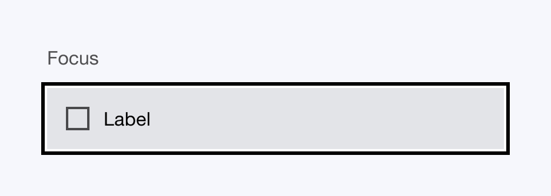

<!-- zh-row -->

**`Pressed`** An intermediate state that communicates a user has taken action on a checkbox, and that it is in the process of navigating to a destination, triggering logic, or transmitting data.

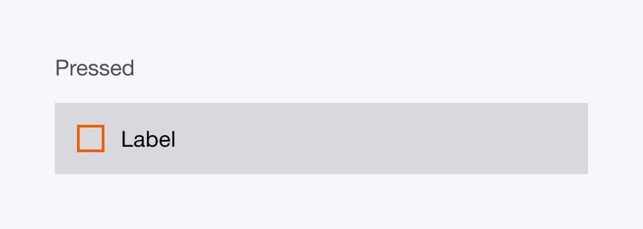

<!-- zh-row -->

**`Read only`** The checkbox is displayed in a specific state (selected or unselected), but the user cannot modify it.

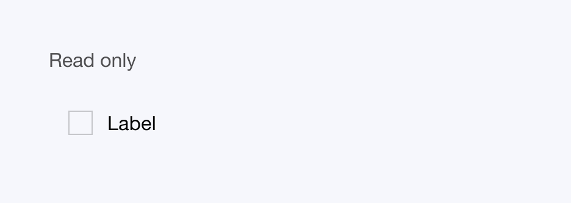

<!-- zh-row -->

**`Disabled`** Used to indicate an option that cannot be selected.

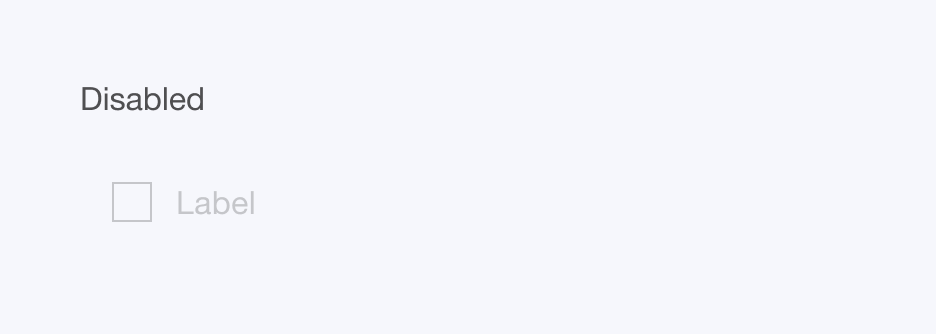

<!-- zh-row -->

**`Skeleton`** Improves the perceived loading time by providing a visual cue of where checkbox will appear once fully loaded.  
Uses the "Skeleton" component, variant “Security marge=True”.

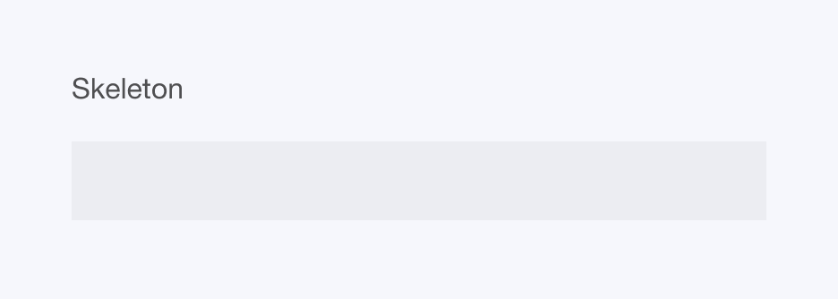

# Accessibility

## Behaviour and accessibility

### Semantics and Structure

Always use the native HTML <input type="checkbox"> element, as it is inherently accessible and recognized by assistive technologies (e.g., screen readers).  
Associate each checkbox with a clear and descriptive label using the <label> element.

### Text and Labels

Each checkbox must have a visible and explicit label. Avoid empty or ambiguous labels.  
If an icon or standalone text does not sufficiently describe the checkbox, provide additional information using aria-describedby.

### State Management

If a checkbox is disabled, use the disabled attribute to indicate it is not interactive.  
Interactive states (checked, unchecked, indeterminate) must be managed correctly:  
The checked attribute indicates whether the checkbox is selected.  
Use the indeterminate property in JavaScript to manage a mixed state (useful for checkbox groups).

### Visible Focus

When users navigate via the keyboard (using the Tab key), the checkbox must display a visible focus style (e.g., a border or highlight).

### Keyboard Navigation

Users must be able to navigate to and interact with the checkbox using only the keyboard:  
Use Tab to navigate to the checkbox.  
Use Space to toggle its state (check/uncheck).

### Screen Reader Compatibility

Screen readers must clearly identify the checkbox and its state (checked, unchecked, or indeterminate). Native HTML elements handle this automatically.  
If the checkbox belongs to a group or triggers a specific action, provide additional context:  
Use aria-checked to indicate a custom state if creating a custom checkbox.  
Associate a description using aria-labelledby or aria-describedby as needed.

### Checkbox Groups

When checkboxes belong to a group (e.g., in a form), provide clear context with a group title:  
Use a <legend> element inside a <fieldset> for the group title.  
Screen readers will read the legend before navigating through the checkboxes.

### Custom Checkboxes

If styling the checkbox (e.g., adding icons or visual effects), ensure its native functionality remains intact:  
Hide the <input> element (e.g., using opacity: 0 or visibility: hidden), but keep it in the DOM for assistive technologies.  
Synchronize interactions and states with JavaScript as needed.

### User Feedback

If a checkbox triggers a specific action (e.g., submitting a form), provide clear feedback to the user:  
Show a visible message or notification.  
Use aria-live to notify screen readers of changes.

# Develop

## OUDS Web

[Components/Checkboxes › Checkboxes 0](https://web.unified-design-system.orange.com/storybook/?path=/story/components-checkboxes--checkboxes-0)

[Components/Checkboxes › Checkboxes 14](https://web.unified-design-system.orange.com/storybook/?path=/story/components-checkboxes--checkboxes-14)

## Developer documentation

| Platform | Developer documentation |
|---|---|
| OUDS Web | [S-ouds-web-checkbox-item](https://r.orange.fr/r/S-ouds-web-checkbox-item) |
| OUDS Android | [S-ouds-android-checkbox-item](https://r.orange.fr/r/S-ouds-android-checkbox-item) |
| OUDS iOS | [S-ouds-ios-checkbox-item](https://r.orange.fr/r/S-ouds-ios-checkbox-item) |
| OUDS Flutter | [S-ouds-flutter-checkbox-item](https://r.orange.fr/r/S-ouds-flutter-checkbox-item) |

# Changelog

## Availability

| Platform | Resource | Status | Version |
|---|---|---|---|
| Figma | [Checkbox item component](https://r.orange.fr/r/S-ouds-design-checkbox-item) | Live | 2.4.0 |
| OUDS Web (former Boosted) | [Web dev documentation](https://r.orange.fr/r/S-ouds-web-checkbox-item) | Live | 2.4.0 |
| OUDS Android - Jetpack Compose | [Android dev documentation](https://r.orange.fr/r/S-ouds-android-checkbox-item) | Live | 2.4.0 |
| OUDS iOS - Swift | [iOS dev documentation](https://r.orange.fr/r/S-ouds-ios-checkbox-item) | Live | 2.4.0 |
| OUDS Flutter | [Flutter dev documentation](https://r.orange.fr/r/S-ouds-flutter-checkbox-item) | Live | 2.4.0 |

## Design changelog

| Date | Number | Notes |
|------|--------|-------|
| Nov 16, 2026 | - | <ul><li>Documentation update: Checkbox item Overview separation<ul><li>Created a dedicated Overview for Checkbox item, focusing on its properties, supporting content, layout behavior, and accessibility guidelines.</ul></ul> |
| Apr 8, 2026 | - | <ul><li>Documentation writing: Rich text</ul> |
| Mar 16, 2026 | - | <ul><li>Documentation writing:<ul><li>Mandatory field indication<li>Multiline and responsiveness<li>Technical layout adjustments</ul></ul> |
| Jan 6, 2026 | - | <ul><li>Documentation writing: Definition update</ul> |
| Nov 7, 2025 | 2.4.0 | <ul><li>A new Read-only variant has been added for the .Checkbox.Indicator component, supporting three states – Selected, Unselected, and Indeterminate. This variant introduces two new color tokens: <ul><li>ouds/color/action/read-only-primary – used for the indicator (shape) <li>ouds/color/action/read-only-secondary – used for the stroke</ul> <li>The new Read-only variant has been integrated into the Read-only variant of both the Checkbox and Checkbox Itemcomponents. <li>We replaced the token in Error text container ouds-control-text-input-space-padding-block-top-helper-text with ouds-control-control-item-space-padding-block-top-error-text. <li>"Helper text" is now called "Description".</ul> |
| Oct 20, 2025 | 2.3.0 | <ul><li>The "Selection status" variant has been restructured from six options (Selected / Selected error / Unselected / Unselected error / Indeterminate / Indeterminate error) into three base variants: <ul><li>Selected <li>Unselected <li>Indeterminate</ul> <li>Each variant now includes a boolean property to control the Error state (Error = True/False). <li>The divider color is now functional in the Error state – it changes dynamically according to the component status. <li>The icon in the Error state is fixed to .Component/alert/important; its color changes together with the divider depending on the component's status. <ul><li>The new token $control-control-item-size-error-icon is used for the icon size. <li>The new token $control-text-input-space-padding-inline-error-icon is used for the error icon container.</ul> 🆕 Both tokens are now available in the latest release of the Token Library 2.1.0. <li>Added Error text (from the Input component) – it follows the same padding-inline as control-item (16px) and uses $control-text-input-space-padding-block-top-helper-text for block padding. By default, the Error text adapts automatically to match the component status: <ul><li>Selected → displays the corresponding default error message for the selected state. <li>Unselected → displays the corresponding default error message for the unselected state. <li>Indeterminate → displays the corresponding default error message for the indeterminate state.</ul> <li>The "Read only" state has been updated to replace disabled control items with the Tag → Text only → Mutedcomponent: <ul><li>Positive with label "Selected" <li>Negative with label "Unselected" <li>Caution with label "Indeterminate"</ul> <li>Harmonisation of spacing across the control-item family We've unified sizing tokens across the entire control-item family (previously they were defined per component) to align spacing with other control items such as Text input. Replacement note: instead of the single token padding inset 12, use the following tokens: <ul><li>ouds/_control/control-item/space/padding-inline → 16 <li>ouds/_control/control-item/space/padding-block → 12</ul> Additionally, for the control-item family: <ul><li>ouds/_control/control-item/space/column-gap → 12 <li>ouds/_control/control-item/size/max-width → 480</ul></ul> |
| Sep 19, 2025 | 2.2.0 | <ul><li>In the initial settings, the 'Divider' variant is now hidden.</ul> |
| Jul 21, 2025 | 2.1.0 | <ul><li>The name of the family to which this component belongs is changing: Input → Control. As a result, the token naming convention is being updated. <li>Following the renaming of the 'Control' category, the name of the token sub-family 'control-item' is now becoming 'item'."</ul> |
| Fev 13, 2025 | 2.0.0 | <ul><li>Restructuring the component to optimize its factoring. <li>Creation of the nested component ".CheckboxItem.Control." <li>The component is now divided into two distinct components: <ul><li>Checkbox <li>Checkbox item</ul></ul> |
| Jan 17, 2025 | 1.0.0 | <ul><li>Component creation</ul> |
