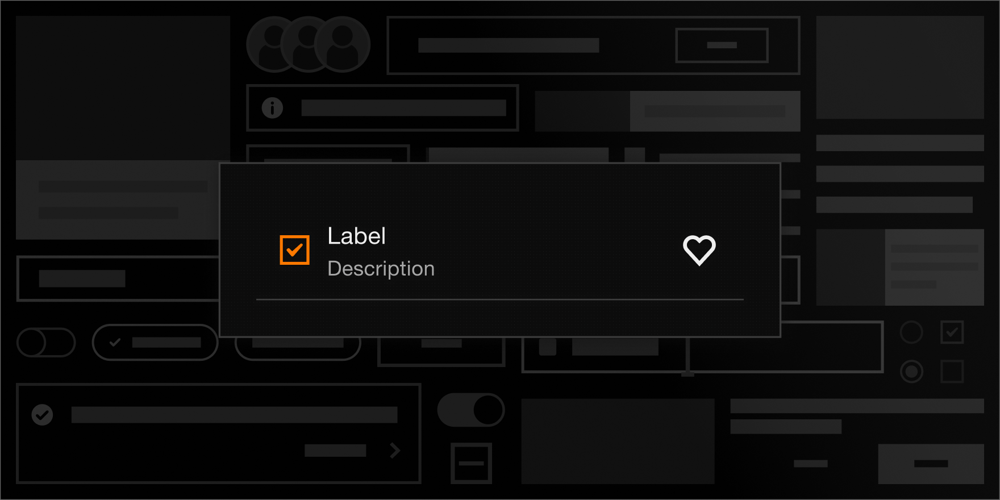
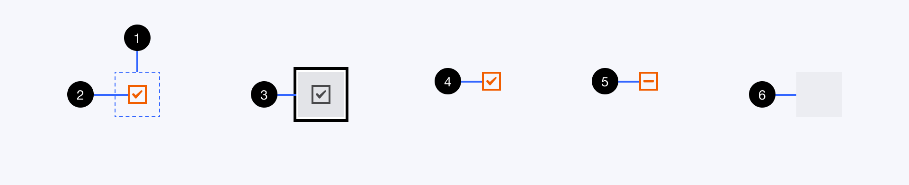
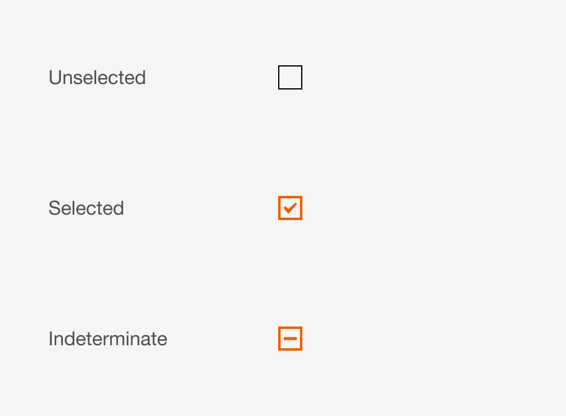
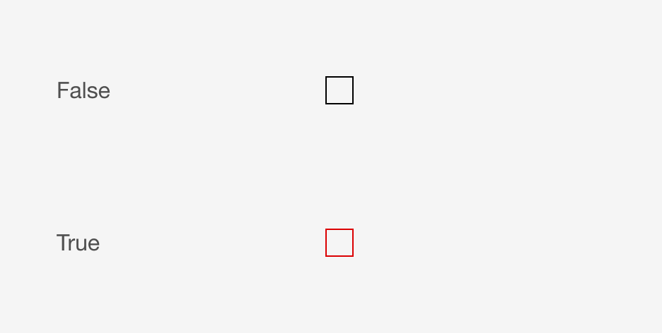
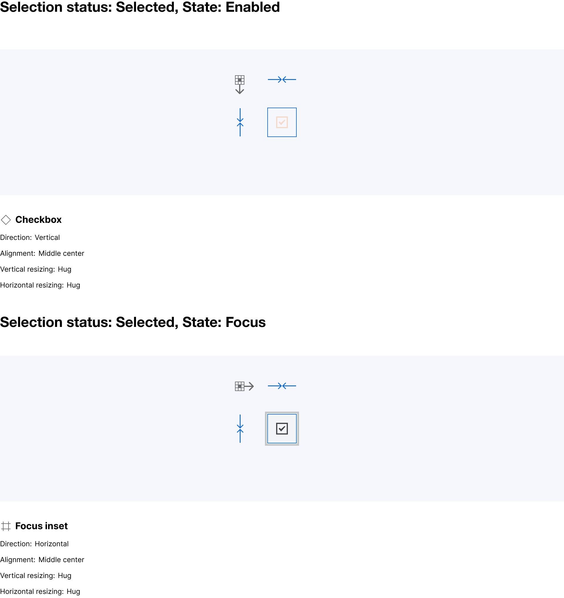

# Checkbox

A checkbox is a UI element that enables users to select multiple options from a set of mutually non-exclusive choices.

# Guideline

## When to use

✅ When users need to select one or more options from a set

✅ When selections are independent and can be combined freely

✅ For bulk actions, filters, and preferences that do not require immediate commitment

✅ When options represent a persistent or saved state, not a temporary choice

## Anatomy

| # | Element | Purpose | Optional |
|---|---------|---------|----------|
| 1 | Container | The interactive area of the control (48 × 48 px) that holds the indicator. | No |
| 2 | Indicator | The box that shows the selection status: unselected, selected or indeterminate. | No |
| 3 | Focus inset | Inner line of the focus indicator that keeps it visible on any surface. | Yes |
| 4 | Selected indicator | The check mark shown in the indicator when the checkbox is selected. | Yes |
| 5 | Indeterminate indicator | The dash shown in the indicator when the selection is partial. | Yes |
| 6 | Skeleton | Placeholder shown while the control is loading. | Yes |

## Definition

A **checkbox** is a UI element that enables users to select multiple options from a set of mutually non-exclusive choices.

The checkbox, that lacks an additional icon asset or text label, offers greater flexibility when designing other components that incorporate a checkbox.

## Selection status

<!-- zh-row -->

**`Unselected`** By default, a checkbox is often in this state.  
This state indicates that the user has not selected the associated option.

**`Selected`** Indicates that the user has selected the option.  
This often corresponds to an action or validation.

**`Indeterminate`** Often used when the checkbox represents a partial selection. For example, in a nested (hierarchical) list, a parent checkbox can be indeterminate if some but not all sub-options are checked.  
This is not a state the user directly selects but is calculated by the system.

## Error

<!-- zh-row -->

**`False`** Used when the checkbox is unchecked but required.  
Example: user must agree to terms, but didn’t check the box.

**`True`** Used when the checkbox is checked but still invalid.  
Example: the selection conflicts with another field or fails validation.

# Specs

## Layout and spacing

## States

<!-- zh-row -->

**`Enabled`** The status of the checkbox before a user has interacted with it, or other content affects it.

<!-- zh-row -->

**`Hover`** When a user places a pointing device over a checkbox, but has not yet taken action on it.

<!-- zh-row -->

**`Focus`** When a user selects a checkbox via keyboard or voice command, but has not yet taken action on it.  
Mirrors the "Hover" state but includes an additional border.

<!-- zh-row -->

**`Pressed`** An intermediate state that communicates a user has taken action on a checkbox, and that it is in the process of navigating to a destination, triggering logic, or transmitting data.

<!-- zh-row -->

**`Read only`** The checkbox is displayed in a specific state (selected or unselected), but the user cannot modify it.

<!-- zh-row -->

**`Disabled`** Used to indicate an option that cannot be selected.

<!-- zh-row -->

**`Skeleton`** Improves the perceived loading time by providing a visual cue of where checkbox will appear once fully loaded.  
Uses the "Skeleton" component, variant “Security marge=True”.

# Accessibility

## Behaviour and accessibility

### Accessible labeling

The standalone Checkbox does not include a built-in visible label. However, it must always have a clear accessible name, provided through an associated label or an appropriate programmatic association.  
The Checkbox must remain keyboard-accessible, expose its selection state to assistive technologies, and provide visible focus feedback.

# Develop

## OUDS Web

[Components/Checkboxes › Checkboxes 0](https://web.unified-design-system.orange.com/storybook/?path=/story/components-checkboxes--checkboxes-0)

[Components/Checkboxes › Checkboxes 14](https://web.unified-design-system.orange.com/storybook/?path=/story/components-checkboxes--checkboxes-14)

## Developer documentation

| Platform | Developer documentation |
|---|---|
| OUDS Web | [S-ouds-web-checkbox](https://r.orange.fr/r/S-ouds-web-checkbox) |
| OUDS Android | [S-ouds-android-checkbox](https://r.orange.fr/r/S-ouds-android-checkbox) |
| OUDS iOS | [S-ouds-ios-checkbox](https://r.orange.fr/r/S-ouds-ios-checkbox) |
| OUDS Flutter | [S-ouds-flutter-checkbox](https://r.orange.fr/r/S-ouds-flutter-checkbox) |

# Changelog

## Availability

| Platform | Resource | Status | Version |
|---|---|---|---|
| Figma | [Checkbox component](https://r.orange.fr/r/S-ouds-design-checkbox) | Live | 2.4.0 |
| OUDS Web (former Boosted) | [Web dev documentation](https://r.orange.fr/r/S-ouds-web-checkbox) | Live | 2.4.0 |
| OUDS Android - Jetpack Compose | [Android dev documentation](https://r.orange.fr/r/S-ouds-android-checkbox) | Live | 2.4.0 |
| OUDS iOS - Swift | [iOS dev documentation](https://r.orange.fr/r/S-ouds-ios-checkbox) | Live | 2.4.0 |
| OUDS Flutter | [Flutter dev documentation](https://r.orange.fr/r/S-ouds-flutter-checkbox) | Live | 2.4.0 |

## Design changelog

| Date | Number | Notes |
|------|--------|-------|
| Nov 16, 2026 | - | <ul><li>Documentation update: Checkbox Overview separation<ul><li>Created a dedicated Overview for the standalone Checkbox component, separating its properties, states, and usage guidelines from the Checkbox item documentation.</ul></ul> |
| Apr 8, 2026 | - | <ul><li>Documentation writing: Rich text</ul> |
| Mar 16, 2026 | - | <ul><li>Documentation writing:<ul><li>Mandatory field indication<li>Multiline and responsiveness<li>Technical layout adjustments</ul></ul> |
| Jan 6, 2026 | - | <ul><li>Documentation writing: Definition update</ul> |
| Nov 7, 2025 | 2.4.0 | <ul><li>A new Read-only variant has been added for the .Checkbox.Indicator component, supporting three states – Selected, Unselected, and Indeterminate. This variant introduces two new color tokens: <ul><li>ouds/color/action/read-only-primary – used for the indicator (shape) <li>ouds/color/action/read-only-secondary – used for the stroke</ul> <li>The new Read-only variant has been integrated into the Read-only variant of both the Checkbox and Checkbox Itemcomponents. <li>We replaced the token in Error text container ouds-control-text-input-space-padding-block-top-helper-text with ouds-control-control-item-space-padding-block-top-error-text. <li>"Helper text" is now called "Description".</ul> |
| Oct 20, 2025 | 2.3.0 | <ul><li>The "Selection status" variant has been restructured from six options (Selected / Selected error / Unselected / Unselected error / Indeterminate / Indeterminate error) into three base variants: <ul><li>Selected <li>Unselected <li>Indeterminate</ul> <li>Each variant now includes a boolean property to control the Error state (Error = True/False). <li>The divider color is now functional in the Error state – it changes dynamically according to the component status. <li>The icon in the Error state is fixed to .Component/alert/important; its color changes together with the divider depending on the component's status. <ul><li>The new token $control-control-item-size-error-icon is used for the icon size. <li>The new token $control-text-input-space-padding-inline-error-icon is used for the error icon container.</ul> 🆕 Both tokens are now available in the latest release of the Token Library 2.1.0. <li>Added Error text (from the Input component) – it follows the same padding-inline as control-item (16px) and uses $control-text-input-space-padding-block-top-helper-text for block padding. By default, the Error text adapts automatically to match the component status: <ul><li>Selected → displays the corresponding default error message for the selected state. <li>Unselected → displays the corresponding default error message for the unselected state. <li>Indeterminate → displays the corresponding default error message for the indeterminate state.</ul> <li>The "Read only" state has been updated to replace disabled control items with the Tag → Text only → Mutedcomponent: <ul><li>Positive with label "Selected" <li>Negative with label "Unselected" <li>Caution with label "Indeterminate"</ul> <li>Harmonisation of spacing across the control-item family We've unified sizing tokens across the entire control-item family (previously they were defined per component) to align spacing with other control items such as Text input. Replacement note: instead of the single token padding inset 12, use the following tokens: <ul><li>ouds/_control/control-item/space/padding-inline → 16 <li>ouds/_control/control-item/space/padding-block → 12</ul> Additionally, for the control-item family: <ul><li>ouds/_control/control-item/space/column-gap → 12 <li>ouds/_control/control-item/size/max-width → 480</ul></ul> |
| Sep 19, 2025 | 2.2.0 | <ul><li>In the initial settings, the 'Divider' variant is now hidden.</ul> |
| Jul 21, 2025 | 2.1.0 | <ul><li>The name of the family to which this component belongs is changing: Input → Control. As a result, the token naming convention is being updated. <li>Following the renaming of the 'Control' category, the name of the token sub-family 'control-item' is now becoming 'item'."</ul> |
| Fev 13, 2025 | 2.0.0 | <ul><li>Restructuring the component to optimize its factoring. <li>Creation of the nested component ".CheckboxItem.Control." <li>The component is now divided into two distinct components: <ul><li>Checkbox <li>Checkbox item</ul></ul> |
| Jan 17, 2025 | 1.0.0 | <ul><li>Component creation</ul> |
