# Phone number input

A phone number input is a UI element that captures and validates telephone numbers in an international format.

# Guideline

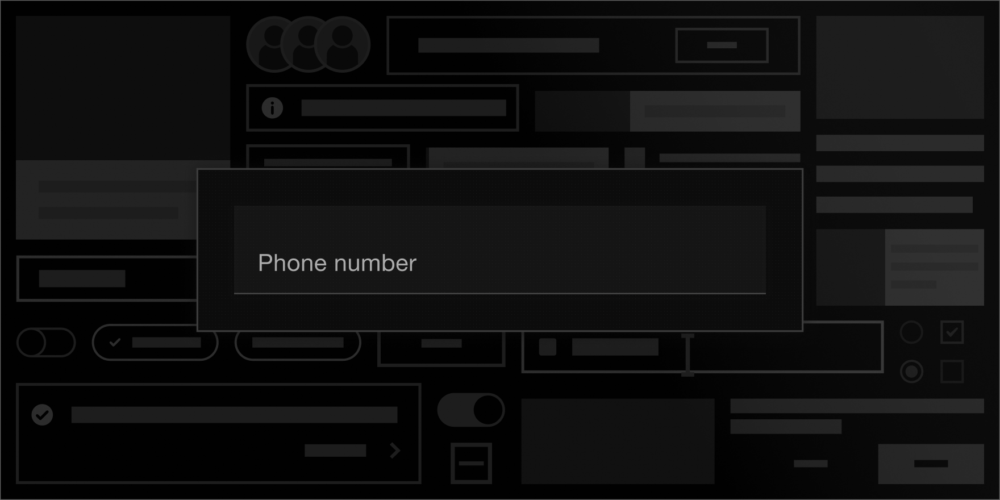

## When to use

✅ To capture and validate phone numbers in international format

✅ When country selection and automatic dial code insertion are required

✅ In registration, profile, or two-factor authentication forms

## Anatomy

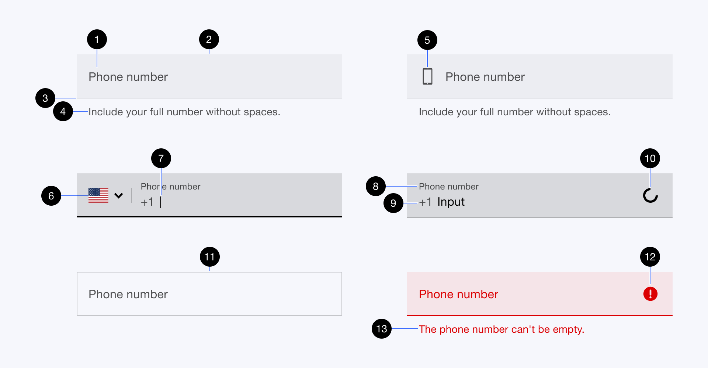

| # | Element | Purpose | Optional |
|---|---------|---------|----------|
| 1 | Label | Tells users what information to enter | Yes |
| 2 | Input container | Holds and aligns all parts of the field (label, value, icons, etc.). | No |
| 3 | Bottom border | Providing visual boundary for a non-outlined style. | No |
| 4 | Helper text | Adds extra guidance, examples, or formatting instructions. | Yes |
| 5 | Leading icon | Provides a visual cue about the field type (phone number). | Yes |
| 6 | Country selector | Lets users choose country/region so the correct calling code can be applied. | Yes |
| 7 | Text cursor | Indicates where the next character will be inserted while typing. | No |
| 8 | Label | Moves above the input when focused or filled, so the field stays identifiable. | Yes |
| 9 | Dial code | Shows the country calling prefix before the phone number (e.g., +1). | Yes |
| 10 | Loading indicator | Shows progress while validation or authentication is in progress. | No |
| 11 | Outlined container | Alternative visual style using a boxed input. | No |
| 12 | Error icon | Highlights the field’s error state to improve visibility and feedback. | Yes |
| 13 | Error text | Explains what’s wrong and how to fix it when validation fails. | Yes |

## Definition

A phone number input is a UI element that captures and validates telephone numbers in an international format.

The phone number Input includes a country selector, enabling users to choose their country and automatically apply the corresponding dialing code (e.g., +33 for France). The dialing code appears as a non-editable prefix within the field to guide users and ensure consistent formatting. It also features real-time formatting or masking to enhance readability during input, along with validation rules tailored to the number structure of the selected country.

## Outlined

**`False`** An input with a subtle background fill and un visible bottom border, creating a softer and more contained look. Best suited for dense layouts or to enhance visibility.

**`True`** A minimalist input with a transparent background and a visible stroke outlining the field.

This style may be interesting for contexts other than form pages:
* When inputs need to feel lightweight and unobtrusive
* In a header (search field)
* In a selection/filtering feature in a product catalog

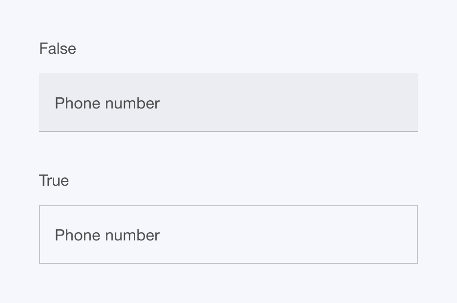

## Rounded corner

Even though in Figma this rendering option is available and editable from the properties of each input component, the configuration of this rendering option is actually transversal across the entire product/service in which the component is used. It is therefore impossible to have one input component set to Rounded corner=True and another set to Rounded corner=False within the same product/service.

**`False`** The square rendering corresponds to Orange's historical style. It conveys the brand's sense of seriousness, robustness and utility-driven. It remains the default style for our digital interface components.

**`True`** The rounded rendering offers flexibility without sacrificing the attribution to the brand. It helps anchoring the service in a reality where the visual codes of the mobile area tends to rub off on all interfaces. Use rounded corners for a softer, more approachable, friendly and tactile feel.

This option is technically not available for all brand themes. Here's the list of rounded corners availability by brand theme:

| Brand theme | Status |
|---|---|
| Orange | ✅ Available |
| Orange Compact | ✅ Available |
| Sosh | ❌ Unavailable |
| Wireframe | ❌ Unavailable |

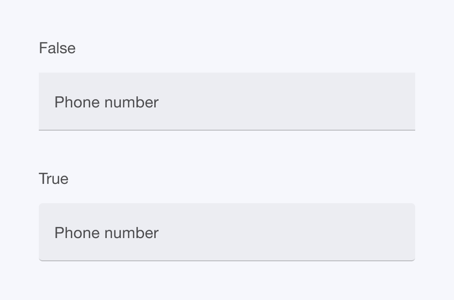

## Input status

**`Empty`** The Empty state indicates that the phone number input is blank with no content or placeholder, a neutral starting point.

**`Empty (Placeholder)`** The Empty with Placeholder state provides a hint or guidance inside the field to suggest expected input.

**`Filled`** The Filled state shows that the user has entered valid content into the field, replacing any placeholder.

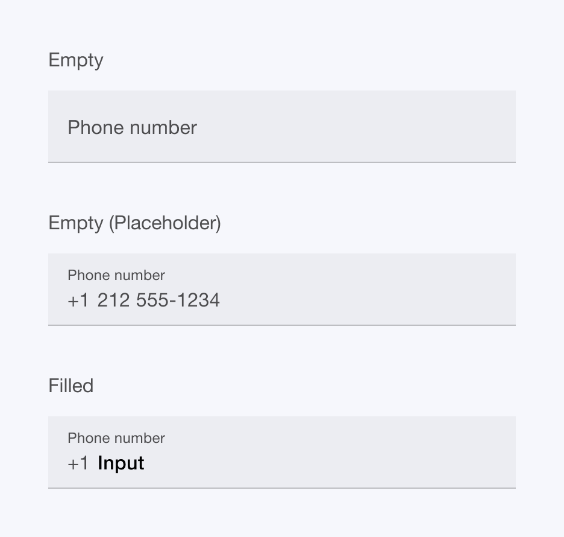

**Do:** Display empty state to clearly invite interaction with appropriate visual affordances.

**Don't:** Display placeholder text that could be mistaken for pre-filled user data.

## Error

The Error status indicates that the user input does not meet validation rules or expected formatting. It provides immediate visual feedback, typically through a red border, error icon, and a clear, accessible error message positioned below the input (mandatory). This state helps users quickly identify and correct mistakes by explaining what went wrong and, when possible, how to fix it. The input remains editable, encouraging users to revise their input without starting over.

&nbsp;

### ⚠️ Error message vs helper text

The error message is not the same element as the helper text, it is independent. If a helper text accompanies the text input, it is replaced by the error message. The helper text must not be displayed simultaneously.

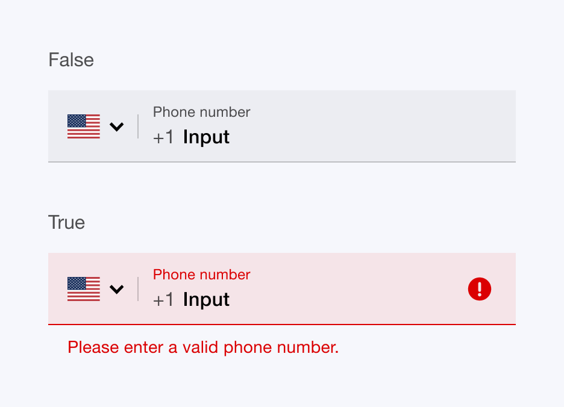

**Do:** Provide specific, actionable error messages explaining exactly what needs correction

**Don't:** Display generic errors that don't help users understand the problem.

## Leading icon

Helps indicate the purpose of the input (magnifying glass for search, envelope for email, phone device for phone number). Only use a leading icon if it adds clear functional or contextual value.

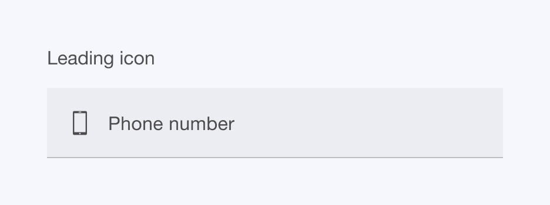

**Do:** Use a recognizable phone icon that reinforces the input's purpose at a glance.

**Don't:** Use decorative or ambiguous icons that don't clearly relate to phone number entry.

**Do:** Consider omitting the icon when the country selector flag already provides visual context.

**Don't:** Stack multiple icons (leading icon + flag) creating visual clutter.

## Country selector

The country selector allows users to choose their country before entering a phone number. It automatically adjusts the international dialing code (+33 for France) and helps format the input accordingly.

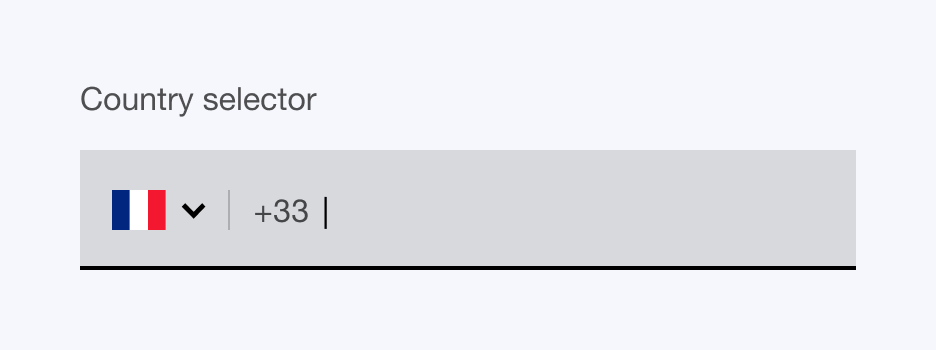

**Do:** Default the country selector to the user's detected geolocation when available.

**Don't:** Force users to manually select a country when their location can be automatically detected.

**Do:** Preserve the entered phone number if the user changes the country selection.

**Don't:** Clear the phone number field when users switch countries, forcing re-entry.

## Label

Describes the purpose of the input. Why hide a phone number input label?

In some UI contexts, especially when space is limited or when the input is part of a compact layout (search bars, filters, inline forms), visually hiding the label can help maintain a clean and uncluttered interface. However, hiding the label should only be done if:
* The purpose of the input remains clear thanks to a placeholder or contextual icon.
* The label is still accessible to screen readers (using aria-label, aria-labelledby, or visually hidden text).

Hiding a label is a design choice that must balance visual simplicity and clarity of intent, without compromising inclusiveness or form guidance.

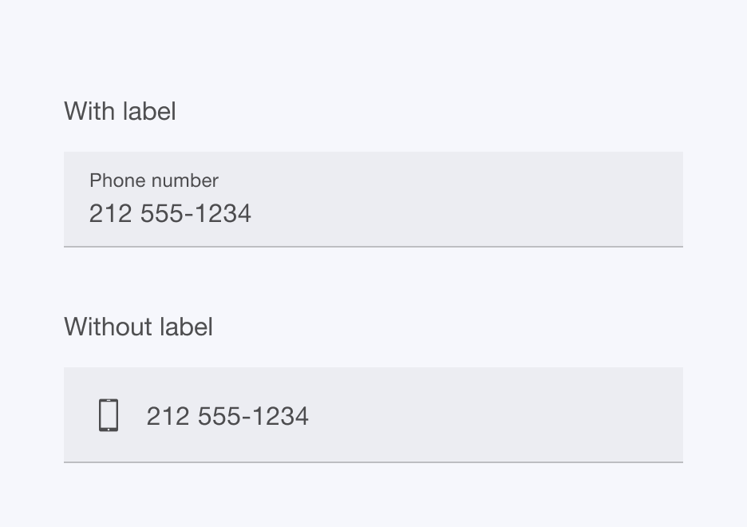

**Do:** Keep labels concise and descriptive

**Don't:** Use overly verbose labels like "Please enter your telephone number here."

## Other boolean options

**`Dial code`** Displaying the dial code (+XX) as a prefix helps users understand the expected phone number format and reinforces the international nature of the input.

**`Helper text`** Supporting text conveys additional information about the input field, such as how it will be used. It should ideally only take up a single line, though may wrap to multiple lines if required, and be either persistently visible or visible only on focus.

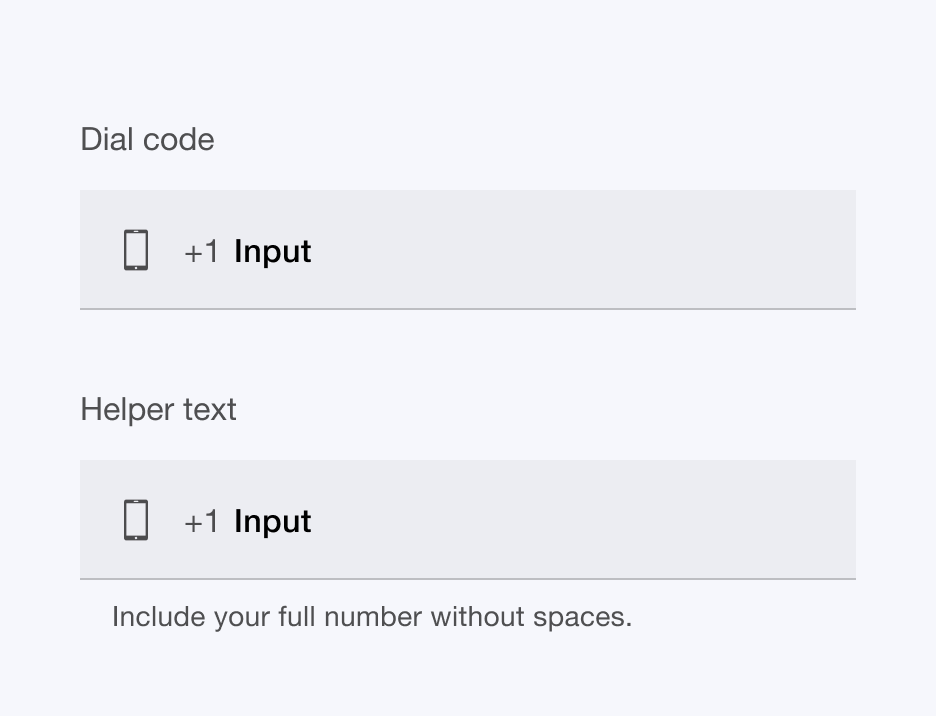

**Do:** Use helper text to clarify format expectations before errors occur.

**Don't:** Display helper text that duplicates information already visible in the placeholder.

**Do:** Keep helper text brief—one line maximum—to avoid overwhelming the form layout.

**Don't:** Use long and multiline helper text

## Mandatory field indication

**If all fields are mandatory (several fields present):**
* Display the message "All fields are mandatory." at the top.
* Do not use an asterisk (*) at the end of each field label, nor the word "mandatory."

**If not all fields are mandatory (and there are several fields present):**
* Display the message "All fields marked with an * are mandatory." at the top.
* Use an asterisk (*) at the end of each mandatory field label.

**⚠️ Important:**
* In Figma, the asterisk must be entered manually by designers in the label text. UI rendering of the asterisk: **font-weight-bold** + **color-content-negative (red)**.
* Technically, for web/iOS/Android, the asterisk is positioned in a dedicated container after the label text. Spacing between label and asterisk:
  * Empty state → 4px
  * Other states (reduced label) → 3px
* If the label is truncated due to a large amount of text, the asterisk must remain visible at the end of the field.
* Either the technology allows a 'required' attribute to be managed on the fields (usually in Web), in which case any asterisks must be hidden from users using assistive technologies, Or the technology does not allow the mandatory nature of the field to be indicated. In this case, the asterisk must be vocalised as well as a 'mandatory' mention. Please refer to the technical documentations for more information.
* Depending on the use case, an 'optional' label can be added to non-mandatory fields.

**If there is only one field in the form, or if the mandatory nature is obvious (such as login/password), no mention is necessary since the fields are essential to the form's functionality.**

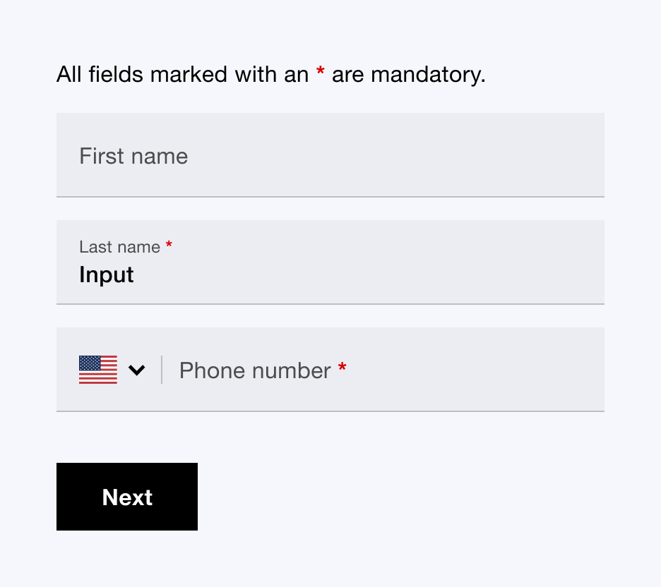

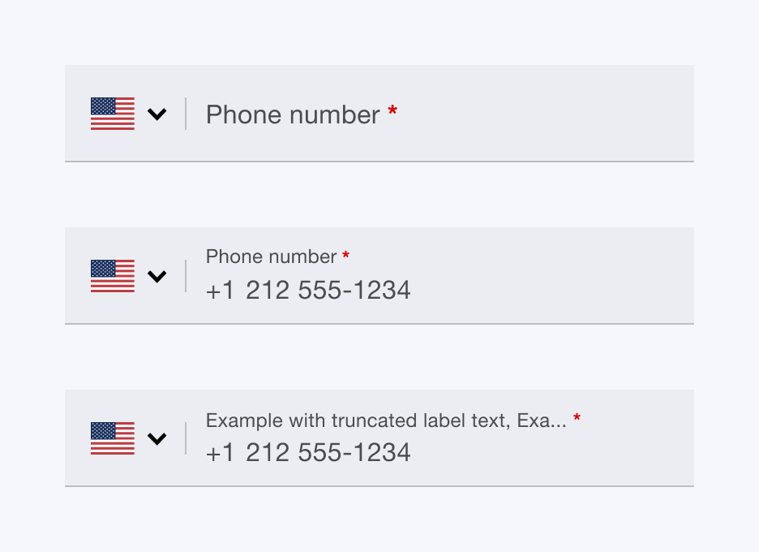

## Truncated input area

**When losing focus, the truncation behavior of the input area differs depending on the technical environment. It's important to respect the native behaviors designed to handle truncation:**

* On web, by default (even if the project retains control over this setting), if the text volume exceeds the visible width of the field, the input displays the end of the text (right-aligned) and the beginning of the text becomes invisible (masked on the left). There should be no visual truncation indicator (...). This choice is intentional because, for many fields, showing the end often makes it easier to identify the value (file names, paths, emails).
* On Android, by default (even if the project retains control over this setting), the behavior is the same as on the web.
* On iOS, it is the opposite: the input area truncates the value on the right with a visual truncation indicator (...).

**⚠️ In all cases:** the entire text must remain accessible when the field regains focus:

* Either by refocusing the field, the text becomes horizontally scrollable again (the blinking cursor is visible).
* Or via a tooltip on hover in certain desktop contexts.

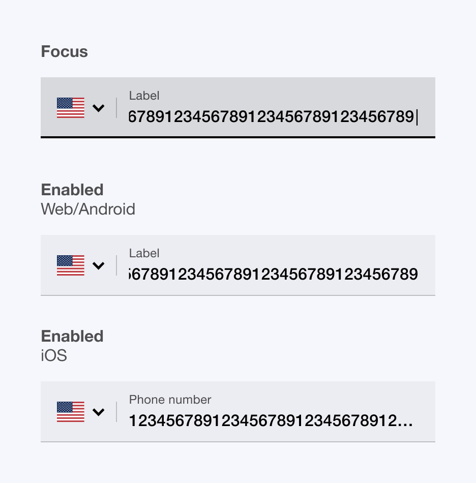

## Multiline and responsiveness

### Multiline

In its "Empty" state (without a placeholder), the label of this component allows two lines of text editing. However, it is recommended not to exceed one line of text.

Apart from the case described above, this component doesn't allow multi-line text editing (whether for the label, placeholder or input).

As a result, and in order to maintain a consistent and uniform height across multiple components, the presence of an excessive amount of text (in the label, placeholder, or input) will cause the text to be truncated so that only a single line remains visible for each element.

Additionally, allowing multi-line text editing would create confusion with the "Text area" component.

&nbsp;

### Max-width vs full-width

For greater flexibility, this component doesn't have a default max-width. To avoid exceeding a width that would degrade readability and the perception of a compact interactive element, we recommend applying **a max-width of around 480px.**

For mobile or tablet use (or if the component is positioned inside a specific container), it is possible to set this component to use the full available width (of the screen or the container).

Please note that this behavior is not the default rule; it may be preferred if the template allows it (to improve user comfort or for better page structure/hierarchy).

&nbsp;

### User zoom in/out

The behavior of the text during user zoom in/out must follow a fundamental principle: the text must remain readable, accessible, and must never break the structure or lose information.

However, "Text input" components present an exception regarding the loss of textual information following the activation of user zoom, since text truncation (label, placeholder, input text) is exceptionally allowed and enabled.

* The text must always scale proportionally with user zoom. Text resizing must never be blocked.
* The component's height and width must be flexible, never fixed, in order to automatically adapt its dimensions according to the level of zoom.
* In order to preserve the minimun interactive area during user zoom out, this component have a min-width **of 240px** and a min-height **of 60px**.
* Even if, the component has a max-height or a max-width for resizing control purposes, technically, during user zoom in, these limitations are not fixed but must be scalable in order to adapt to the user's zoom level.
* In its "Leading icon" variant, user zoom in/out doesn't affect the size of the icons; they remain fixed in size (decorative use).
* As the country selector and error icon are functional, they must follow the same rules as text.

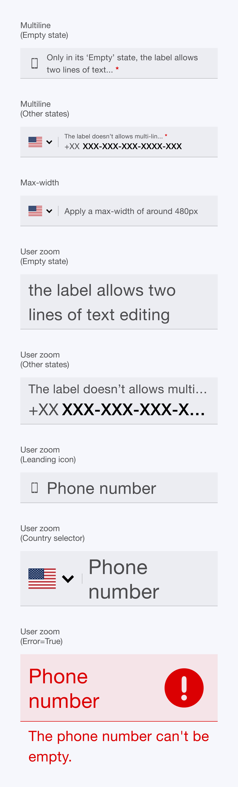

## Rich text

### Strong text
* Strong text can be used sparingly to highlight key information within the content. Text is allowed using the corresponding "Strong" token (e.g. Label/Medium/Strong and Label/Large/Strong) depending on the selected text style.
* No other text styles or custom font weights should be used.

&nbsp;

### ⚠️ Underline text
* Underlined text must not be applied manually (e.g. in helper text), as it is commonly associated with hyperlinks and may mislead users.

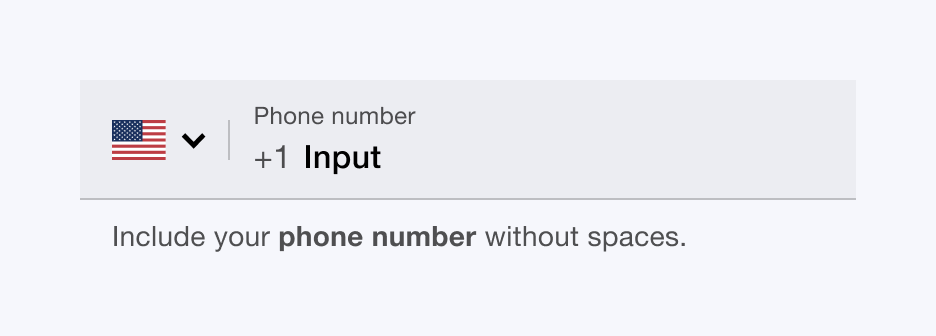

# Specs

## Layout and spacing

## States

**`Enabled`** Neutral appearance, whether empty or filled. It allows users to click, focus, and type freely without restrictions.

**`Hover`** Slight visual contrast or border color change.

**`Focus`** The phone number input is focused and ready to receive user input. It visually highlights the field to indicate that it's currently editable and interactive. This state typically appears after a user clicks or taps into the field.

**`Loading`** The Loading state indicates that the system is processing or retrieving data related to the phone number input. A progress indicator appears to inform the user that an action is in progress. During this state, the input may be temporarily disabled to prevent further interaction.

**`Read only`** Text visible but not editable (often with a muted or different background).

**`Disabled`** The field is non-interactive and grayed out to indicate it cannot be changed. The helper text is muted.

**`Skeleton`** Improves the perceived loading time by providing a visual cue of where field will appear once fully loaded. Uses the "Skeleton" component, variant "Security marge=False".

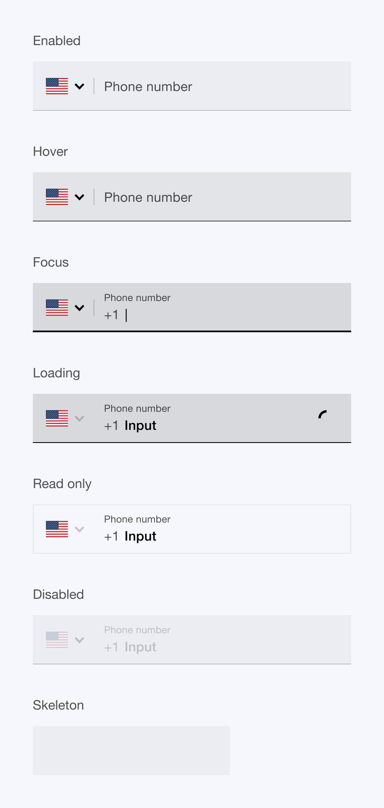

# Accessibility

Work is in progress to deliver this content.

# Develop

## Developer documentation

| Platform | Developer documentation |
|---|---|
| OUDS Web | Not available yet |
| OUDS Android | Not available yet |
| OUDS iOS | Not available yet |
| OUDS Flutter | [S-ouds-flutter-phone-number-input](https://r.orange.fr/r/S-ouds-flutter-phone-number-input) |

# Changelog

## Availability

Design status: **DEV**

| Platform | Resource | Status | Version |
|---|---|---|---|
| Figma | [Phone number input component](https://r.orange.fr/r/S-ouds-design-phone-number-input) | Done | 1.3.1 |
| OUDS Web (former Boosted) | Not available yet | To do | – |
| OUDS Android - Jetpack Compose | Not available yet | To do | – |
| OUDS iOS - Swift | Not available yet | To do | – |
| OUDS Flutter | [Flutter dev documentation](https://r.orange.fr/r/S-ouds-flutter-phone-number-input) | Done | 1.3.1 |

## Design changelog

| Date | Number | Notes |
|------|--------|-------|
| May 22, 2026 | 1.3.1 | **Version 2.6 of the design tokens is required for the development of this update.** For "Loading" state:<ul><li>The loader frame has been renamed to Circular progress indicator. It now contains the new Circular Progress Indicator component.</li><li>The following tokens are removed: action-button-border-radius-default</li><li>Absolute positioning has been removed and replaced with Auto Layout.<ul><li>The container now uses: ouds/button/space/inset/icon-only-default</li></ul></li></ul> | Maxime Tonnerre Anton Astafev |
| Apr 22, 2026 | 1.3.0 | <ul><li>The input text reference changes from a regular weight (font-weight-label-default) to a medium weight (font-weight-label-moderate).</li><li>Removal of the component's max-width to avoid blocking certain layouts and to provide greater flexibility of use. The max-width values remain available in the design documentation.</li><li>Add spacing tokens between the label and the asterisk:<ul><li>control-text-input-space-column-gap-📄_label-asterisk</li><li>control-text-input-space-column-gap-📄_label-small-asterisk</li></ul></li></ul> | Anton Astafev |
| Apr 8, 2026 | - | • Documentation writing: Rich text | Anton Astafev |
| Mar 16, 2026 | - | Documentation writing:<ul><li>Rounded corners brand theme availability</li><li>Mandatory field indication</li><li>Truncated input area</li><li>Multiline and responsiveness</li></ul> | Maxime Tonnerre |
| Jan 21, 2026 | - | • Documentation writing: Rounded corners update | Cyriaque Billard |
| Jan 6, 2026 | - | <ul><li>Documentation writing: Definition update</ul> |
| Sep 30, 2025 | 1.2.0 | • The name of the "Style" variant has been replaced to "Outlined" with true/false variant |
| Jul 29, 2025 | 1.1.0 | • Several design token updates: [Component tokens changelog 1.5.0](https://www.figma.com/design/Co2t6wHMf4GB9NJVGs2Hes/-OUDS-Core-Lib--Design-tokens?m=auto&node-id=9280-2568&t=HLVB4jOd35DWr8Bj-1) |
| Jun 30, 2025 | 1.0.0 | • Component creation |
