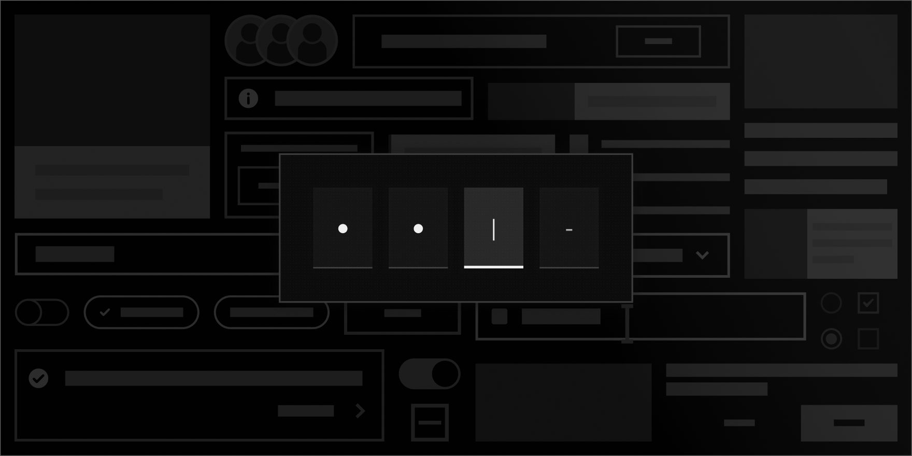
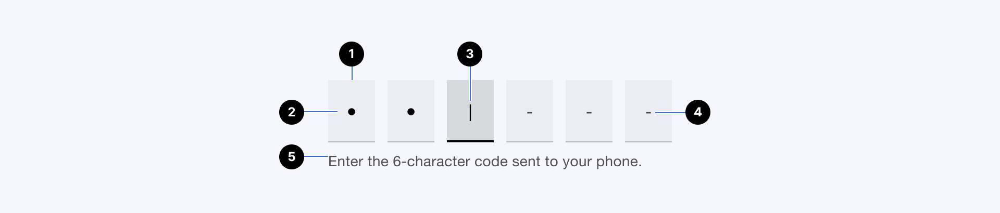
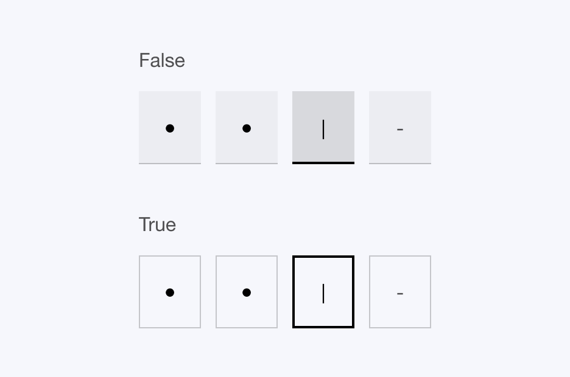
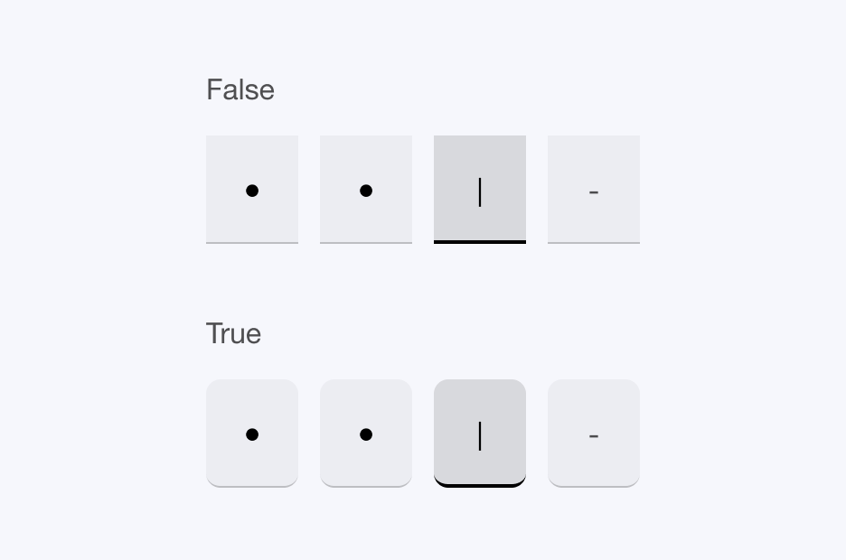
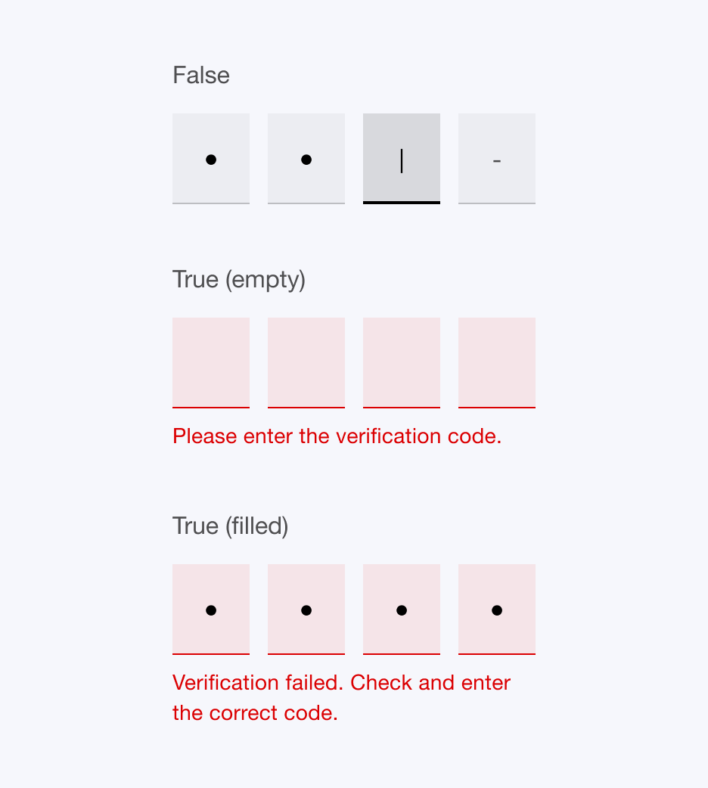
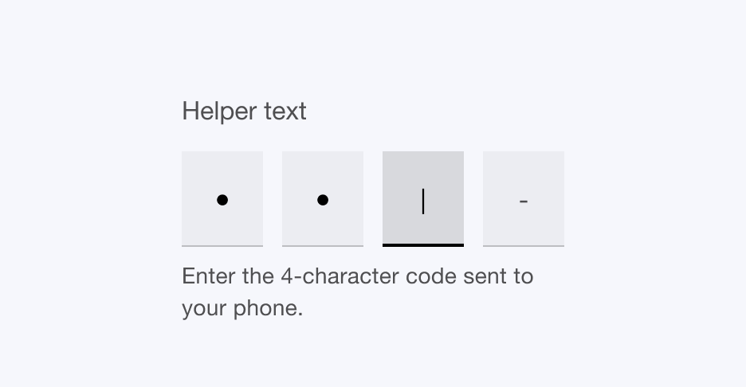
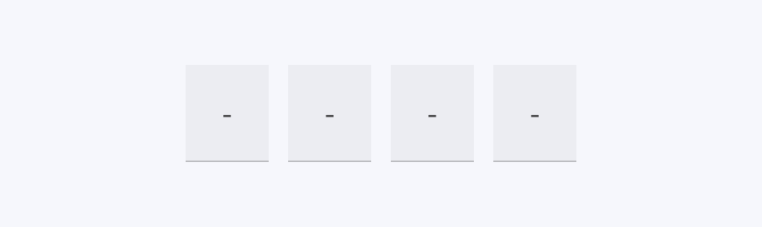
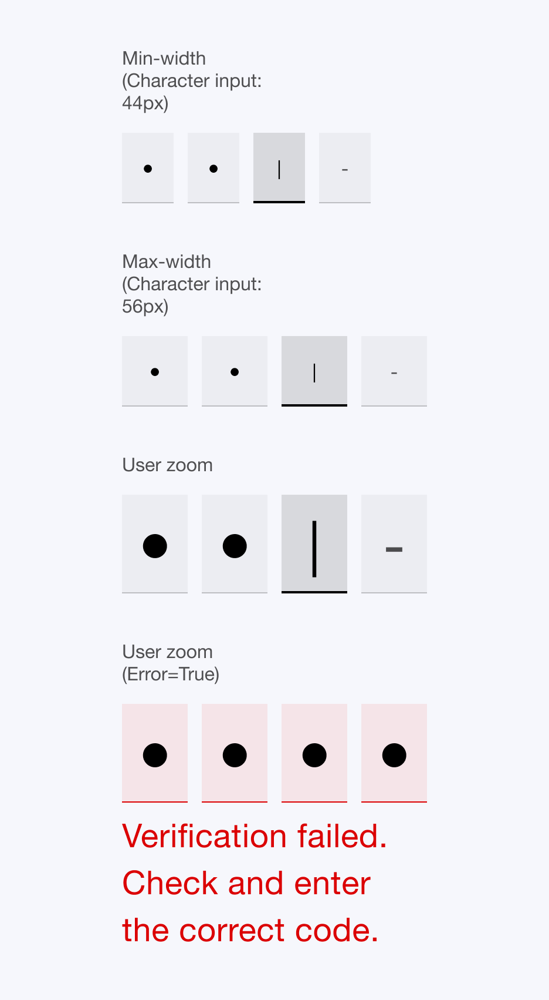
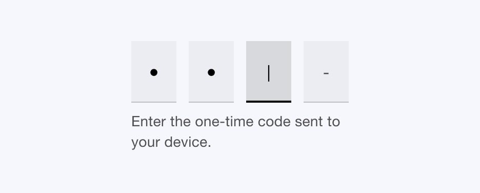
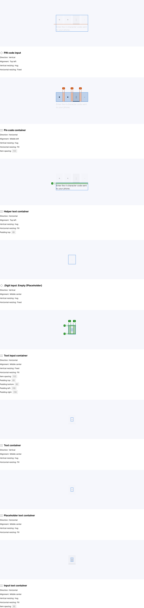

# PIN code input

A PIN code input is a UI element that captures short, fixed-length numeric codes, typically used for authentication or confirmation, such as a four, six, or eight-character personal identification number (PIN).

# Guideline

## When to use

✅ To enter short, fixed-length numeric codes

✅ In verification or identity confirmation

✅ When fast input and automatic focus management are required

✅ Mobile-first flows where numeric keypad input is preferred

✅ For one-time codes delivered via SMS, email, or an app

## Anatomy

| # | Element | Purpose | Optional |
|---|---------|---------|----------|
| 1 | Single character input | Holds one character of the code. The PIN code input shows one input per character of the code (4, 6 or 8). | No |
| 2 | Filled character value | Shows an entered character while keeping the actual value hidden for security. | No |
| 3 | Active character input | Shows the active slot and the text cursor, indicating where the next character will be inserted while typing. | No |
| 4 | Empty character input | Shows an empty slot to indicate where a character should be entered. | No |
| 5 | Helper text | Adds extra guidance, examples, or formatting instructions. | Yes |

## Definition

A PIN code input is a UI element that captures short, fixed-length numeric codes, typically used for authentication or confirmation, such as a four, six, or eight-character personal identification number (PIN).

The PIN code input is displayed as a series of individual fields or boxes, each representing a single character. This design improves readability and encourages accurate input, while also supporting smooth keyboard navigation and secure input masking when necessary.

## Outlined

<!-- zh-row -->

**`False`** An input with a subtle background fill and un visible bottom border, creating a softer and more contained look. Best suited for dense layouts or to enhance visibility.

**`True`** A minimalist input with a transparent background and a visible stroke outlining the field.  
This style may be interesting for contexts other than form pages:
* When inputs need to feel lightweight and unobtrusive
* In a header (search field)
* In a selection/filtering feature in a product catalog

## Rounded corner

<!-- zh-row -->

Even though in Figma this rendering option is available and editable from the properties of each input component, the configuration of this rendering option is actually transversal across the entire product/service in which the component is used. It is therefore impossible to have one input component set to Rounded corner=True and another set to Rounded corner=False within the same product/service.

**`False`** The square rendering corresponds to Orange's historical style. It conveys the brand's sense of seriousness, robustness and utility-driven. It remains the default style for our digital interface components.

**`True`** The rounded rendering offers flexibility without sacrificing the attribution to the brand. It helps anchoring the service in a reality where the visual codes of the mobile area tends to rub off on all interfaces. Use rounded corners for a softer, more approachable, friendly and tactile feel.

This option is technically not available for all brand themes. Here's the list of rounded corners availability by brand theme:

| Brand theme | Status |
|---|---|
| Orange | ✅ Available |
| Orange Compact | ✅ Available |
| Sosh | ❌ Unavailable |
| Wireframe | ❌ Unavailable |

## Error

<!-- zh-row -->

The Error status indicates that the user input does not meet validation rules or expected formatting. It provides immediate visual feedback, typically through a red border, error icon, and a clear, accessible error message positioned below the input (mandatory).

This state helps users quickly identify and correct mistakes by explaining what went wrong and, when possible, how to fix it.  
The input remains editable, encouraging users to revise their input without starting over.

The error state must be triggered by an explicit validation (submission, API response), and not in real time with each keystroke. This can occur either because the entered code does not match the expected code, because the user entered an expired or already used code, or finally if the maximum number of attempts has been exceeded.

⚠️ **Alert:** In the context of a PIN code input, in addition to the input's "Error" UI rendering, it is essential to also include an "Alert" component (also in its "Error" status) in the interface.

## Other boolean options

<!-- zh-row -->

**`Helper text`** Supporting text conveys additional information about the input field, such as how it will be used. It should ideally only take up a single line, though may wrap to multiple lines if required, and be either persistently visible or visible only on focus.

## Mandatory field indication

<!-- zh-row -->

If there is only one field in the form, or if the mandatory nature is obvious (such as login/password), no mention is necessary since the fields are essential to the form's functionality.

## Multiline and responsiveness

<!-- zh-row -->

### Multiline

This component doesn't allows multi-line text editing.

&nbsp;

### Min-width and max-width

This component has a min-width and a max-width. To avoid exceeding or reducing a width that would degrade readability and the perception of a compact interactive element, we applyied, for each character input **a min-width of 44px and a max-width of 56px.**

&nbsp;

### User zoom in/out

The behavior of the text during user zoom in/out must follow a fundamental principle: the text must remain readable, accessible, and must never break the structure or lose information.

However, "Text input" components present an exception regarding the loss of textual information following the activation of user zoom in, since text truncation (label, placeholder, input text) is exceptionally allowed and enabled.

* The text must always scale proportionally with user zoom. Text resizing must never be blocked.
* The component's height and width must be flexible, never fixed, in order to automatically adapt its dimensions according to the level of zoom.
* In order to preserve the minimun interactive area during user zoom out, each character input have a min-width **of 44px** and a min-height **of 60px**.
* Even if, the component has a max-height or a max-width for resizing control purposes, technically, during user zoom in, these limitations are not fixed but must be scalable in order to adapt to the user's zoom level.

## Rich text

<!-- zh-row -->

### Strong text
* Strong text can be used sparingly to highlight key information within the content. Text is allowed using the corresponding "Strong" token (e.g. Label/Medium/Strong) depending on the selected text style.
* No other text styles or custom font weights should be used.

&nbsp;

### ⚠️ Underline text
* Underlined text must not be applied manually (e.g. in helper text), as it is commonly associated with hyperlinks and may mislead users.

# Specs

## Layout and spacing

# Accessibility

Work is in progress to deliver this content.

# Develop

## Developer documentation

| Platform | Developer documentation |
|---|---|
| OUDS Web | Not available yet |
| OUDS Android | [S-ouds-android-pin-code-input](https://r.orange.fr/r/S-ouds-android-pin-code-input) |
| OUDS iOS | [S-ouds-ios-pin-code-input](https://r.orange.fr/r/S-ouds-ios-pin-code-input) |
| OUDS Flutter | [S-ouds-flutter-pin-code-input](https://r.orange.fr/r/S-ouds-flutter-pin-code-input) |

# Changelog

## Availability

| Platform | Resource | Status | Version |
|---|---|---|---|
| Figma | [PIN code input component](https://r.orange.fr/r/S-ouds-design-pin-code-input) | Live | 1.4.0 |
| OUDS Web (former Boosted) | Not available yet | To do | – |
| OUDS Android - Jetpack Compose | [Android dev documentation](https://r.orange.fr/r/S-ouds-android-pin-code-input) | Live | 1.3.0 |
| OUDS iOS - Swift | [iOS dev documentation](https://r.orange.fr/r/S-ouds-ios-pin-code-input) | Live | 1.4.0 |
| OUDS Flutter | [Flutter dev documentation](https://r.orange.fr/r/S-ouds-flutter-pin-code-input) | Live | 1.4.0 |

## Design changelog

| Date | Number | Notes |
|------|--------|-------|
| Sep 29, 2026 | 1.4.0 | The “Hidden password” option is now called “hidden character”. |
| Apr 22, 2026 | 1.3.0 | Version 2.4 of the design tokens is required for the development of this update. • The input text reference changes from a regular weight (font-weight-label-default) to a medium weight (font-weight-label-moderate). | Anton Astafev |
| Apr 8, 2026 | - | • Documentation writing: Rich text | Anton Astafev |
| Mar 16, 2026 | - | • Documentation writing: • Mandatory field indication • Multiline and responsiveness | Maxime Tonnerre |
| Jan 21, 2026 | - | • Documentation writing: Rounded corners update | Cyriaque Billard |
| Jan 6, 2026 | - | <ul><li>Documentation writing: Definition update</ul> |
| Sep 30, 2025 | 1.2.0 | • The name of the "Style" variant has been replaced to "Outlined" with true/false variant |
| Jul 29, 2025 | 1.1.0 | • Several design token updates: [Component tokens changelog 1.5.0](https://www.figma.com/design/Co2t6wHMf4GB9NJVGs2Hes/-OUDS-Core-Lib--Design-tokens?m=auto&node-id=9280-2568&t=HLVB4jOd35DWr8Bj-1) |
| Jun 30, 2025 | 1.0.0 | • Component creation |
