# Switch

A switch is a UI element that toggles between two states, typically "On" and "Off," and is used to enable or disable features, options, or settings.

# Guideline

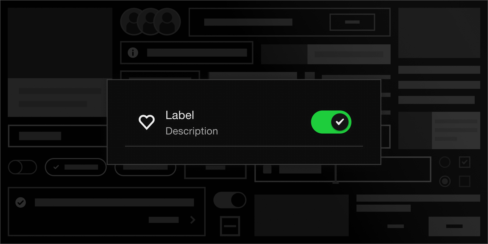

## Anatomy

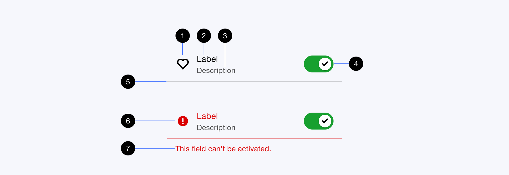

| # | Element | Purpose | Optional |
|---|---------|---------|----------|
| 1 | Icon | Icon representing the selection or context of the switch. | Yes |
| 2 | Label | Text describing the switch’s purpose. | No |
| 3 | Description | Additional supporting text that provides more context or clarification. | Yes |
| 4 | Switch indicator | Indicates the current state of the switch (on/off). | No |
| 5 | Divider | Separator line for multiple items. | Yes |
| 6 | Error icon | Visual indicator that reinforces the error state of the option. | No |
| 7 | Error text | Displays validation or error messaging related to the option. | Yes |

## Definition

A **switch** is a UI element that toggles between two states, typically "On" and "Off," and is used to enable or disable features, options, or settings.

The switch, that lacks an additional icon asset or text label, provides greater flexibility when creating other components that require a switch.

A **switch item** is a UI element shaped like a row that toggles between two states, typically "On" and "Off," and is used to enable or disable features, options, or settings.

Unlike the switch, the switch item accommodates a broader range of contexts by enabling the toggling of visibility of additional text labels and icon assets.

## Selected

Typically, a switch has two main states: Selected and Unselected.

**`False`** The switch is off — the option or feature is disabled. Used as the default state before activation.

**`True`** The switch is on — the option or feature is enabled. Indicates that the setting or action is currently active.

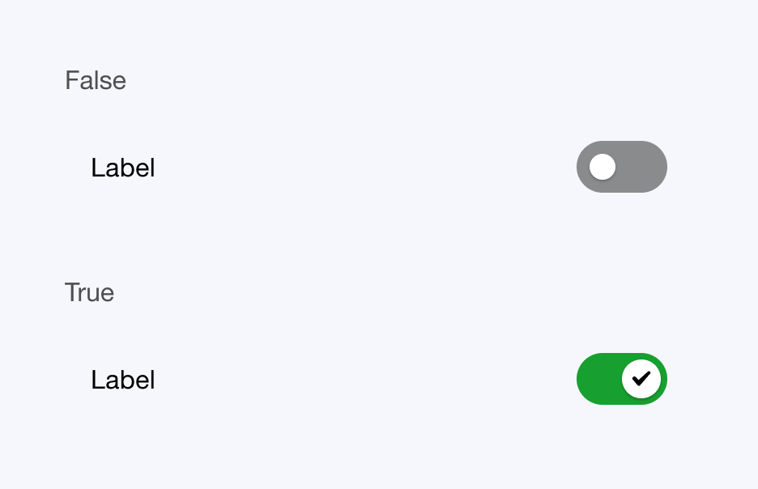

## Error

**`False`** The switch is unselected or turned off, but this value is invalid. Used when a required action hasn't been completed or an active state is expected.

**`True`** The switch holds a value, but it does not meet logical or validation requirements. Used when the current state (on or off) causes a conflict or violates form rules.

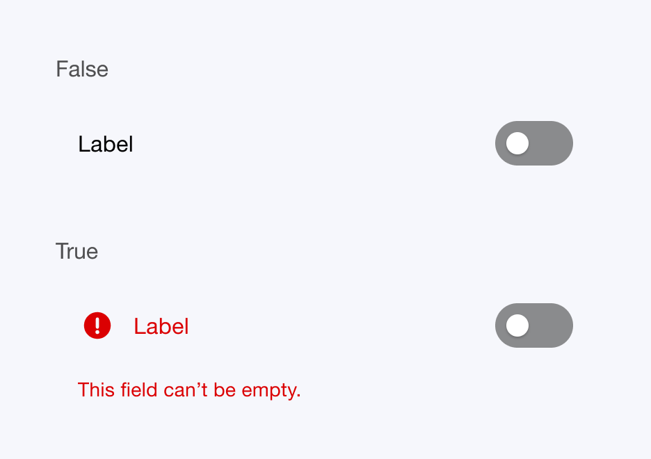

**Do:** Write specific, actionable error messages that tell users exactly what went wrong and how to fix it

**Don't:** Use generic error messages like "Invalid input" or "Error"—they don't help users understand the problem

## Reverse

**`False`** This is the default layout of the component. From left to right, the order of the elements is as follows: icon / text / switch.

**`True`** As its name suggests, this layout is the reversed mirror of the "Default" template. From left to right, the order of the elements is as follows: switch / text / icon. This variant is necessary for RTL mode and certain mobile use cases.

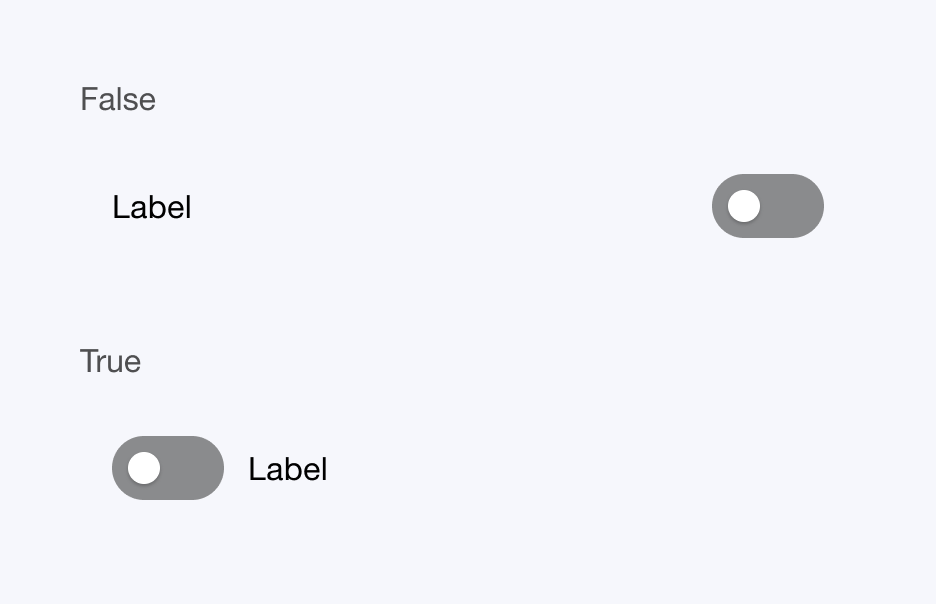

## Other boolean options

**`Description`** It is possible to display or hide accompanying text for the main label.

**`Icon`** It is possible to display or hide an icon. If displayed, this option includes functionality to choose any Solaris icon.

**`Divider`** It is possible to display or hide a dividing element (line).

**`Error message`** In the context where the component is in its "Error" true option, the error message can be displayed.

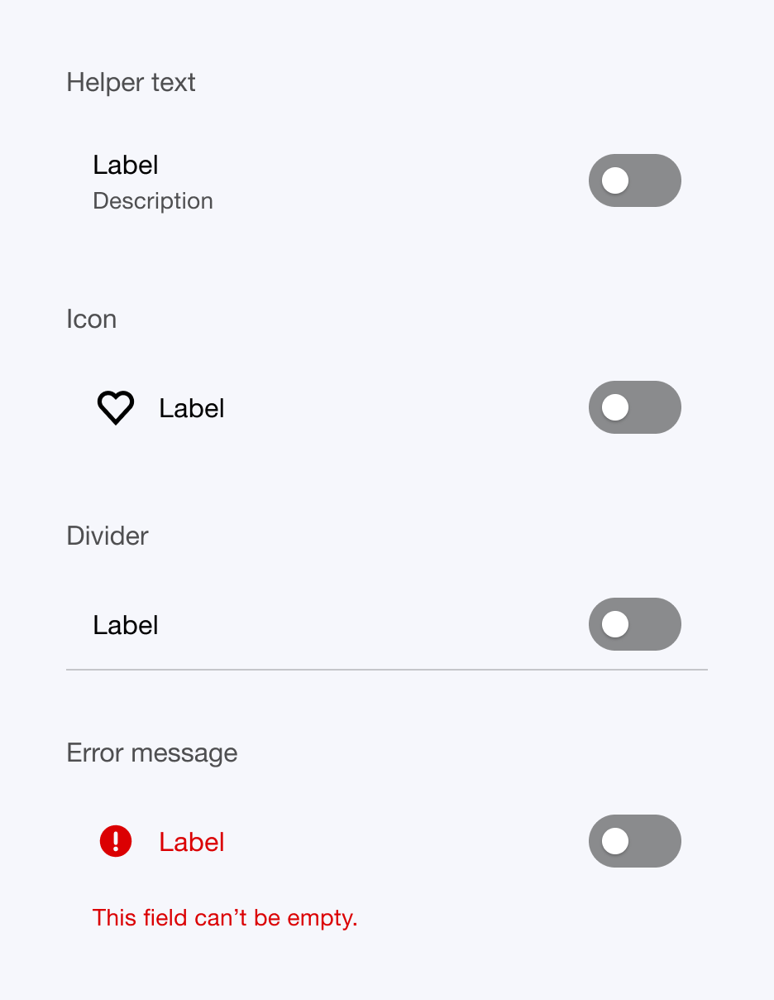

## Mandatory field indication

**If all fields are mandatory (several fields present):**
1. Display the message "All fields are mandatory." at the top.
2. Do not use an asterisk (*) at the end of each field label, nor the word "mandatory."

**If not all fields are mandatory (and there are several fields present):**
1. Display the message "All fields marked with an * are mandatory." at the top.
2. Use an asterisk (*) at the end of each mandatory field label.  
   **⚠️ Important:**
   * In Figma, the asterisk must be entered manually by designers in the label text. UI rendering of the asterisk: **font-weight-bold** + **color-content-negative (red)**.
   * Technically, for web/iOS/Android, the asterisk is positioned in a dedicated container after the label text. Spacing between label and asterisk: 4px
3. Either the technology allows a 'required' attribute to be managed on the fields (usually in Web), in which case any asterisks must be hidden from users using assistive technologies, or the technology does not allow the mandatory nature of the field to be indicated. In this case, the asterisk must be vocalised as well as a 'mandatory' mention. Please refer to the technical documentations for more information.
4. Depending on the use case, an 'optional' label can be added to non-mandatory fields.

**Indication of mandatory status for a group of control items:**  
When a group of control items (Radio Button, Checkbox, or Switch item) is mandatory, the indication of requirement must be carried only by the group title.  
The asterisk (*) must be placed at the end of the group title and must not be repeated in the labels of the individual items.  
This rule avoids visual redundancy, clarifies that the requirement applies to the group rather than each option, and improves information hierarchy and form readability.

**If there is only one field in the form, or if the mandatory nature is obvious (such as login/password), no mention is necessary since the fields are essential to the form's functionality.**

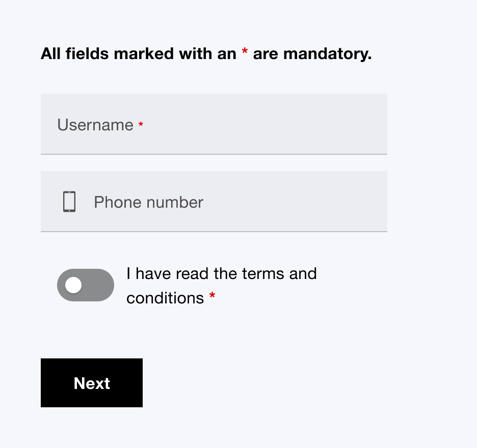

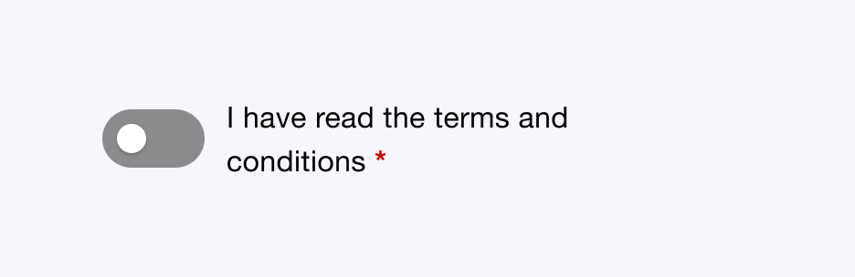

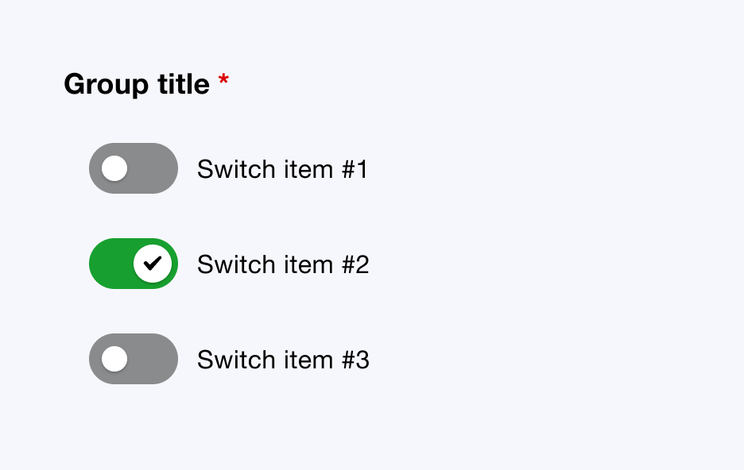

## Multiline and responsiveness

### Multiline
This component allows multi-line text editing. Although the number of lines is not technically limited, it is recommended not to exceed 2 lines of text. In its "Text + icon" variant, if the label spans multiple lines, the label remains centred.

&nbsp;

### Max-width vs full-width
For greater flexibility, this component doesn't have a default max-width. To avoid exceeding a width that would degrade readability and the perception of a compact interactive element, we recommend applying **a max-width of around 480px.**  
For mobile or tablet use (or if the component is positioned inside a specific container), it is possible to set this component to use the full available width (of the screen or the container).  
Please note that this behavior is not the default rule; it may be preferred if the template allows it (to improve user comfort or for better page structure/hierarchy).

&nbsp;

### User zoom in/out
The behavior of the text during user zoom in/out must follow a fundamental principle: the text must remain readable, accessible, and must never break the structure or lose information.
* The text must always scale proportionally with user zoom. Text resizing must never be blocked.
* Zooming must never cause text to be truncated or hidden. The component must expand vertically to allow line wrapping.
* The component's height and width must be flexible, never fixed, in order to automatically adapt its dimensions according to the level of zoom.
* In order to preserve the minimun interactive area during user zoom out, this component have a min-width **of 160px** and a min-height **of 52px**.
* Even if, the component has a max-height or a max-width for resizing control purposes, technically, during user zoom in, these limitations are not fixed but must be scalable in order to adapt to the user's zoom level.
* As the control item and error icon are functional, they must follow the same rules as text.
* In order to preserve the same display rendering as the component's error state, even if the icons is purely decorative, the icons follow the same rules as the text.

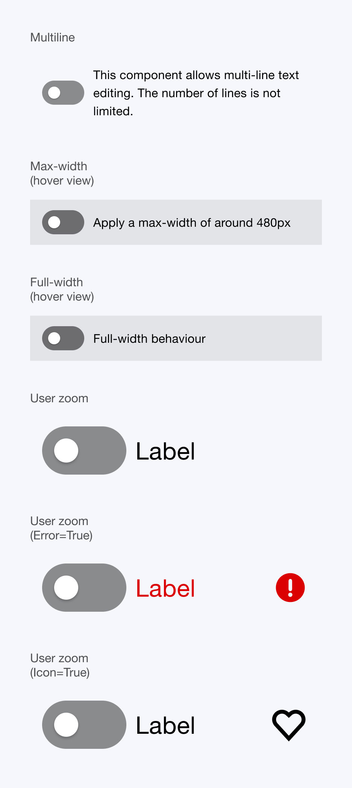

## Technical layout adjustments

Even though, in Figma, the component structure is unique (for easier use by designers), technically the versions differ in order to respect best practices for each environment (paradigm shift between the web "Container" vs. the native "Edge-to-Edge"):

&nbsp;

### Web (mobile, tablet, and desktop)
The component is contained within the browser window and has "safety margins." It therefore cannot appear in the area corresponding to the margin grid.  
The component has internal padding-inline, and its display position must be between several columns (which varies depending on the number of containers used on a horizontal row).

&nbsp;

### Native app (Android, iOS, Flutter)
The display position of the component corresponds to the entire screen display area (edge to edge).  
Its internal padding-inline is therefore replaced by the grid-margin tokens.

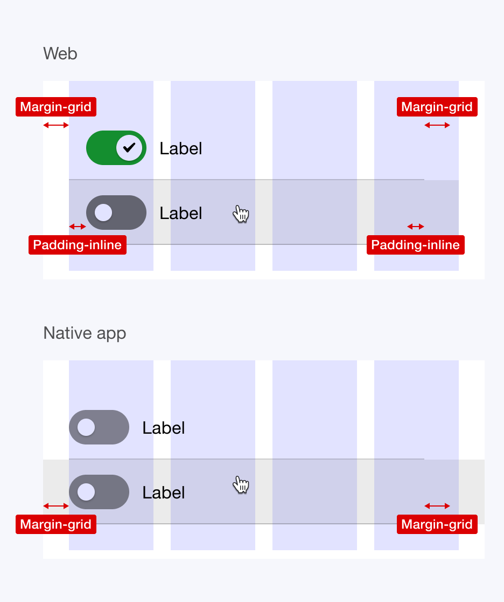

## Rich text

### Strong text
* Strong text can be used sparingly to highlight key information within the content. Text is allowed using the corresponding "Strong" token (e.g. Label/Medium/Strong).
* No other text styles or custom font weights should be used.

&nbsp;

### ⚠️ Underline text
* Underlined text must not be applied manually (e.g. in error message), as it is commonly associated with hyperlinks and may mislead users.

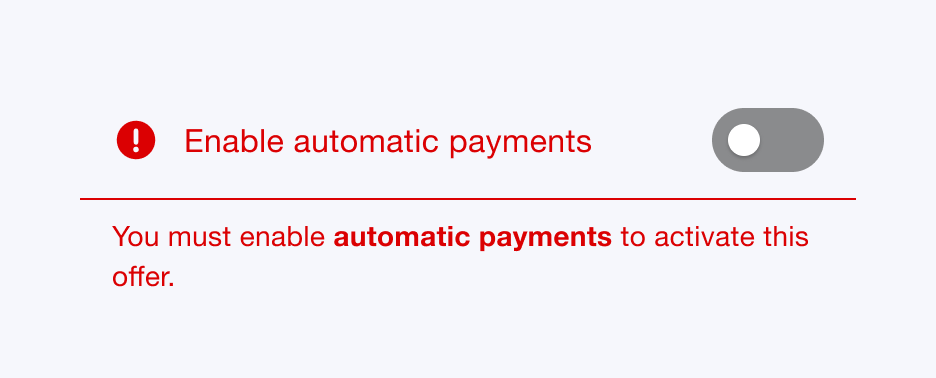

# Specs

## Layout and spacing

## States

**`Enabled`** The status of the switch before a user has interacted with it, or other content affects it.

**`Hover`** When a user places a pointing device over a switch, but has not yet taken action on it.

**`Focus`** When a user selects a switch via keyboard or voice command, but has not yet taken action on it. Mirrors the "Hover" state but includes an additional border.

**`Pressed`** An intermediate state that communicates a user has taken action on a switch, and that it is in the process of navigating to a destination, triggering logic, or transmitting data.

**`Read only`** The switch is displayed in a specific state (true or false), but the user cannot modify it.

**`Disabled`** Used to indicate an option that cannot be selected.

**`Skeleton`** Improves the perceived loading time by providing a visual cue of where switch will appear once fully loaded. Uses the "Skeleton" component, variant "Security marge=True".

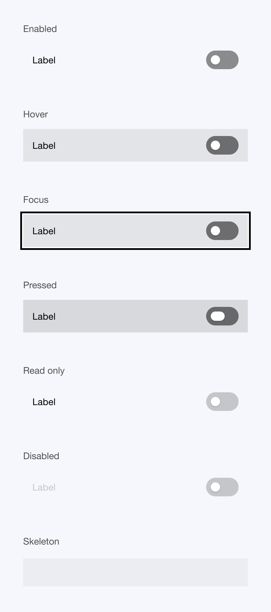

# Accessibility

## Motion & Animation accessibility rules

In terms of animation, there are accessibility criteria to consider: “Animation from Interactions” and “Pause, Stop, Hide.”  
These two main criteria address different issues:

&nbsp;

### Pause, Stop, Hide - WCAG 2.2.2
This concerns moving, blinking, scrolling, or automatically updating content.  
The question to ask is: does the animation start automatically and meet the criterion’s conditions?  
When a relevant animation lasts more than 5 seconds, users must be able to pause, stop, or hide it.  
The two criteria should therefore be evaluated independently.

&nbsp;

### Reduced Motion (Animation from Interactions) - WCAG 2.3.3
This primarily concerns motion-based animations triggered by user interaction.  
The question to ask is: is the movement essential to the functionality or to the information being conveyed?  
If not, the animation should be removed, reduced, or replaced when the user has enabled Reduced Motion.

ℹ️ The reduced motion preference can be configured by the user at the operating system level and is available to websites through the CSS prefers-reduced-motion media feature.

Concrete application to the Switch:

&nbsp;

### Pause, Stop, Hide
The animation of a switch is triggered by a user action and therefore does not generally fall within the scope of this criterion.  
If the state change triggers additional animation or automatically moving content that meets the conditions of the criterion, that content must be evaluated separately.

&nbsp;

### Reduced Motion
The animation applied when a switch changes state is generally not essential to its functionality or to understanding its state.  
When Reduced Motion is enabled, the animation should therefore be removed or replaced with an instantaneous transition.  
The state of the switch must remain clearly identifiable without relying on animation.  
Default: animated state change  
Reduced Motion: instantaneous state change

# Develop

## OUDS Web

[Components/Switches › Switches 0](https://web.unified-design-system.orange.com/storybook/?path=/story/components-switches--switches-0)

[Components/Switches › Switches 13](https://web.unified-design-system.orange.com/storybook/?path=/story/components-switches--switches-13)

## Developer Documentation

| Platform | Developer documentation |
|---|---|
| OUDS Web | [S-ouds-web-switch](https://r.orange.fr/r/S-ouds-web-switch) |
| OUDS Android | [S-ouds-android-switch](https://r.orange.fr/r/S-ouds-android-switch) |
| OUDS iOS | [S-ouds-ios-switch](https://r.orange.fr/r/S-ouds-ios-switch) |
| OUDS Flutter | [S-ouds-flutter-switch](https://r.orange.fr/r/S-ouds-flutter-switch) |

# Changelog

## Availability

Design status: **LIVE**

| Platform | Resource | Status | Version |
|---|---|---|---|
| Figma | [Switch component](https://r.orange.fr/r/S-ouds-design-switch) | Done | 1.5.0 |
| OUDS Web (former Boosted) | [Web dev documentation](https://r.orange.fr/r/S-ouds-web-switch) | Done | 1.5.0 |
| OUDS Android - Jetpack Compose | [Android dev documentation](https://r.orange.fr/r/S-ouds-android-switch) | Done | 1.5.0 |
| OUDS iOS - Swift | [iOS dev documentation](https://r.orange.fr/r/S-ouds-ios-switch) | Done | 1.5.0 |
| OUDS Flutter | [Flutter dev documentation](https://r.orange.fr/r/S-ouds-flutter-switch) | Done | 1.5.0 |

## Design changelog

| Date | Number | Notes |
|------|--------|-------|
| Sep 1, 2026 | - | <ul><li>Documentation writing: Motion & Animation accessibility rules.</ul> |
| Apr 8, 2026 | - | <ul><li>Documentation writing: Rich text</ul> |
| Mar 16, 2026 | - | <ul><li>Documentation writing:<ul><li>Mandatory field indication<li>Multiline and responsiveness<li>Technical layout adjustments</ul></ul> |
| Jan 6, 2026 | - | <ul><li>Documentation writing: Definition update</ul> |
| Nov 7, 2025 | 1.5.0 | • A new Read-only variant has been added for the .Switch.Indicator component, supporting two boolean variants — Selected = True/False. This variant introduces two new color tokens: &nbsp;&nbsp;&nbsp;&nbsp;• ouds/color/action/read-only-primary &nbsp;&nbsp;&nbsp;&nbsp;• ouds/color/action/read-only-secondary • The new Read-only variant has been integrated into the Read-only variant of both the Switch and Switch Item components. • We replaced the token in Error text container ouds-control-text-input-space-padding-block-top-helper-text with ouds-control-control-item-space-padding-block-top-error-text. • "Helper text" is now called "Description". |
| Oct 20, 2025 | 1.4.0 | • The Switch item has been split into two boolean variants: Error = True/False, Selected = True/False • The divider color is now functional in the Error state — it changes dynamically according to the component status. • The icon in the Error state is fixed to .Component/alert/important; its color changes together with the divider depending on the component's status. → The new token $control-control-item-size-error-icon is used for the icon size. → The new token $control-text-input-space-padding-inline-error-icon is used for the error icon container. 🆕 Both tokens are now available in the latest release of the Token Library 2.1.0. • Added Error text (from the Input component) — it follows the same padding-inline as control-item (16px) and uses → $control-text-input-space-padding-block-top-helper-text for block padding. By default, the Error text adapts automatically to match the component status: → Selected → displays the corresponding default error message for the selected state. → Unselected → displays the corresponding default error message for the unselected state. • The "Read only" state will be updated with the goal of replacing the control items (in their "disabled" states), whether selected or unselected, with the component Tag → Text only → Muted: → Positive with a label text "Selected" if status selected=True → Negative with a label text "Unselected" if status selected=False  • Harmonisation of spacing across the control-item family We've unified sizing tokens across the entire control-item family (previously they were defined per component) to align spacing with other control items such as Text input. Replacement note: instead of the single token padding inset 12, use the following tokens: → ouds/_control/control-item/space/padding-inline → 16 → ouds/_control/control-item/space/padding-block → 12 Additionally, for the control-item family: → ouds/_control/control-item/space/column-gap → 12 → ouds/_control/control-item/size/max-width → 480 |
| Sep 19, 2025 | 1.3.0 | • In the initial settings, the 'Divider' variant is now hidden. |
| Jul 21, 2025 | 1.2.0 | • The name of the family to which this component belongs is changing: Input → Control. • Following the renaming, the token sub-family 'control-item' is now becoming 'item'. |
| Jun 16, 2025 | 1.1.0 | • Modification of the minimum height of the frame containing the component "Switch" to increase the interactive area (48px). Component token: $ouds-input-switch-size-min-height-interactive-area  • Application of a border radius token to the "Focus" and "Focus inset" frames. The UI rendering of the focus state stroke of the component is now rounded like the rest of the component. Component token: $ouds-input-switch-border-radius-track • Application of a border radius token to the "Content" frame. The UI rendering of the skeleton state stroke of the component is now rounded like the rest of the component. Component token: $ouds-input-switch-border-radius-track |
| Mar 6, 2025 | 1.0.0 | • Component creation |
