# Alert message

An alert message is a UI element that provides system feedback, indicates status changes, or prompts required actions through clear, prominent, persistent, and actionable communication.

# Guideline

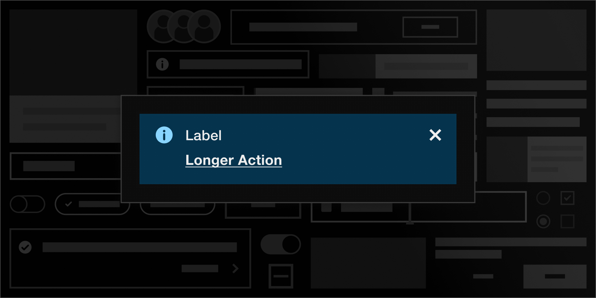

## Anatomy

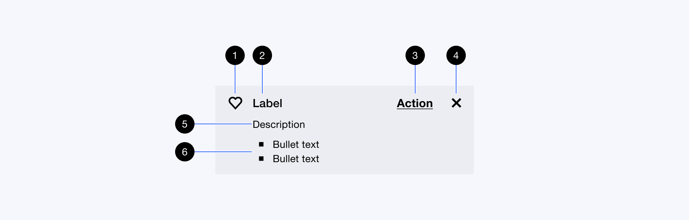

| # | Element | Purpose | Optional |
|---|---------|---------|----------|
| 1 | Icon | Indicates the alert type (error, warning, info, success) or a decorative brand/icon for non-functional alerts such as neutral or accent messages.. Required for functional alerts. | Yes / No* |
| 2 | Label | Main message. Short, clear, and readable at a glance. | No |
| 3 | Action link | Optional inline link for secondary action (ex: “Retry”, “Learn more”). | Yes |
| 4 | Close button | Allows user to dismiss the alert if dismissal is permitted. | Yes |
| 5 | Description | Additional explanation or context when needed. | Yes |
| 6 | Bullet list | Used for multiple detailed points instead of long text. | Yes |

## Definition

An alert message is a UI element that provides system feedback, indicates status changes, or prompts required actions through clear, prominent, persistent, and actionable communication.

The alert message features a functional icon and a semantic colour, and may also include a close button or an action link. The alert message does not disappear automatically and stays visible until the user dismisses or resolves it.

## Layout

Alerts can be displayed with or without an action.  
The placement of the action depends on the amount of content and the available screen space.  
For action elements, we use the Link component with the "Text only" layout. This approach maintains visual consistency and aligns with our design system guidelines.

**🔗 Link style used as a button:** In this context, the link style is purely visual, it does not indicate navigation.
* Use <a> elements for navigation.
* Use <button> elements with the link visual style for in-app actions.

**⚠️ Non-navigational usage:** A link can be used to trigger an action rather than navigation (for example, opening a modal, revealing additional content, or executing a function). This pattern should only be applied when the link appearance is preferred, while ensuring the component remains accessible and its intent is clear.

**`None`** Used when no user action is required. Ideal for informational alerts that simply convey status or feedback without any interaction.

**`Trailing`** Used when the action is positioned to the right of the message. Best suited for wider layouts or short, single-line alerts where horizontal alignment keeps content compact and balanced.

**`Bottom`** Used when the action is placed below the main message content. **Recommended for mobile** or narrow layouts, or when the text spans multiple lines. This vertical structure improves clarity and ensures the action remains visible after the message is read.

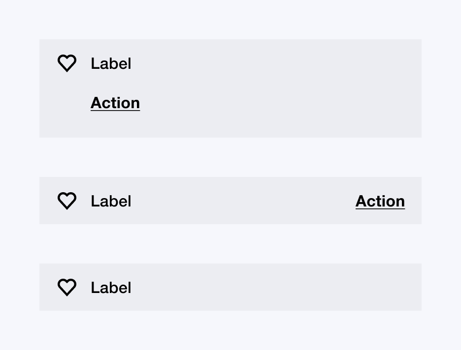

## Status

### Non-functional
Non-functional alerts are informational or decorative. They provide context or highlight content without implying a specific state, system event, or user action. These alerts are not tied to UX patterns such as success, error, or warning, and may use contextual or brand-related icons to enhance recognition or storytelling.

**`Neutral`** Used as a generic informative alert without semantic meaning or colour association.  
Suitable for a wide range of contexts – such as tips, general information, or descriptive labels – where no specific feedback or urgency is required.  
Appropriate for help sections, dashboards, or onboarding flows.

**`Accent`** Uses brand colours to draw attention to promotional or highlighted information while remaining non-critical.  
Ideal for marketing content, announcements, or feature highlights, where you want to subtly engage users without introducing functional semantics.  
Ideal for promotional banners, product updates, or customer engagement moments.

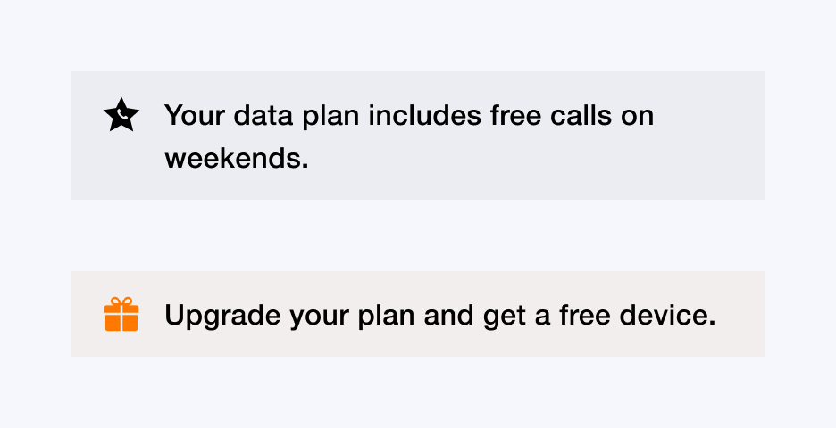

### Functional
Functional alerts communicate specific system statuses, results, or user feedback.  
Each variant conveys a clear semantic meaning – such as success, warning, or error – and must always be paired with its dedicated functional icon to ensure clarity and accessibility.  
Other icons should not be substituted, as the semantic pairing between icon, colour, and message is essential for recognition and consistency.

Use functional alerts to inform users about state changes, confirmations, or issues that are directly connected to system logic or user actions. These messages carry functional meaning and help guide user response or acknowledgment.

**`Negative`** Communicates a critical issue or error that prevents the user from proceeding until it is resolved.  
These alerts remain visible until the problem is fixed or dismissed by the user.

**`Positive`** Indicates that a task or process has been completed successfully.  
These alerts reassure users and confirm that no further action is needed.

**`Info`** Used to share neutral system information or service updates that do not require immediate action.  
Ideal for background processes or status messages where users simply need to stay informed.

**`Warning`** Used to draw attention to potential issues or upcoming changes that might affect the user's service or experience.  
Warnings encourage awareness but typically do not block actions.

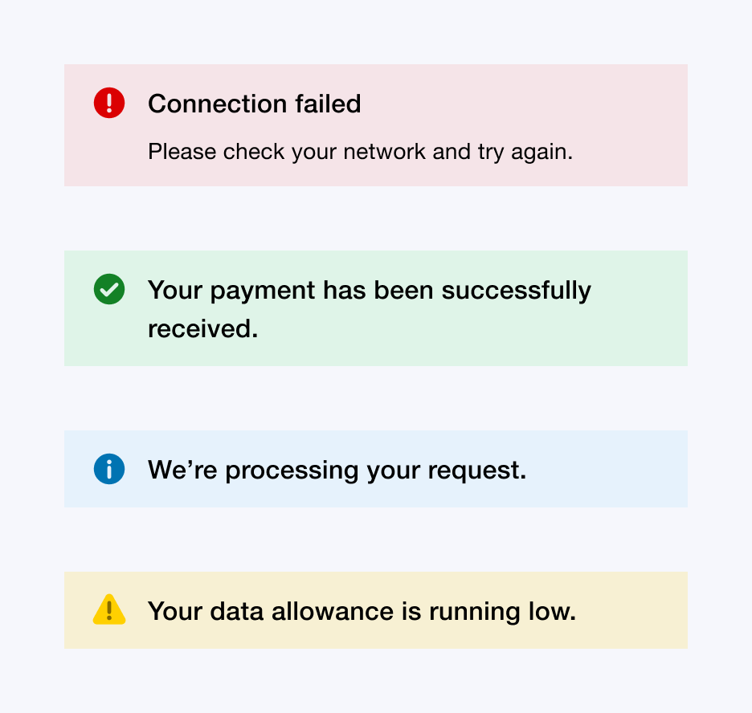

## Rounded corner

Even though in Figma this rendering option is available and editable from the properties of each alert component, the configuration of this rendering option is actually transversal across the entire product/service in which the component is used. It is therefore impossible to have one alert component set to Rounded corner=True and another set to Rounded corner=False within the same product/service.

**`False`** The square rendering corresponds to Orange's historical style. It conveys the brand's sense of seriousness, robustness and utility-driven. It remains the default style for our digital interface components.

**`True`** The rounded rendering offers flexibility without sacrificing the attribution to the brand. It helps anchoring the service in a reality where the visual codes of the mobile area tends to rub off on all interfaces. Use rounded corners for a softer, more approachable, friendly and tactile feel.

This option is technically not available for all brand themes. Here's the list of rounded corners availability by brand theme:

| Brand theme | Status |
|---|---|
| Orange | ✅ Available |
| Orange Compact | ✅ Available |
| Sosh | ❌ Unavailable |
| Wireframe | ❌ Unavailable |

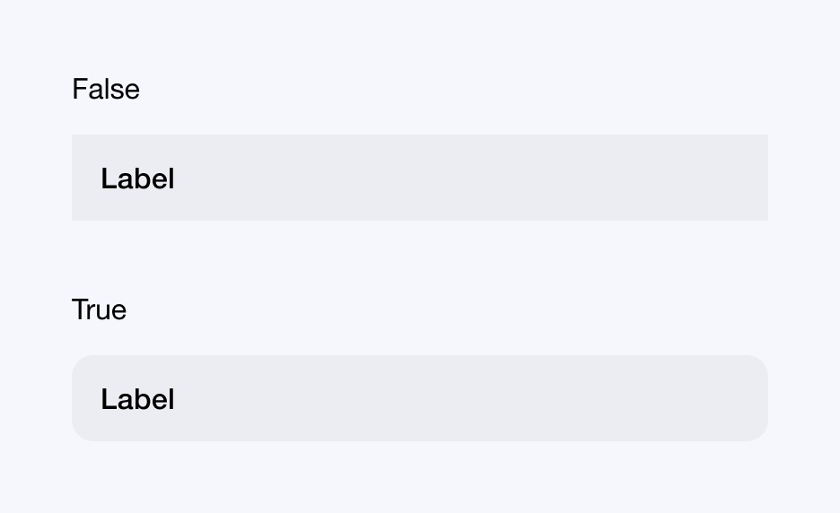

## Close button

The close (dismiss) button controls whether a user can remove the alert message from view.  
Depending on the purpose of the alert, it may either be dismissible (True) or persistent (False).  
Some alerts must remain visible to ensure users are aware of important information; others can be closed to reduce visual clutter.

**`False`** The alert does not include a close button, and therefore remains visible until the context changes (e.g., the issue is resolved, the page is refreshed, or the user completes a related task).  
Example:  
• The message is critical or mandatory (e.g., service disruption, required action) and must not be ignored.  
• The alert reflects a state that the user must see for the duration of a task or journey. (A network outage notification that remains until connectivity is restored.)

**`True`** The alert includes a close button, allowing the user to dismiss it when they have acknowledged the message.  
Example:  
• The message is informational and does not require further action from the user.  
• Allowing dismissal improves UX by reducing persistent visual noise.  
For example, a tip "New feature launched" that the user may choose to hide.  
Not all informational alerts must have close buttons, but this offers user control when appropriate.

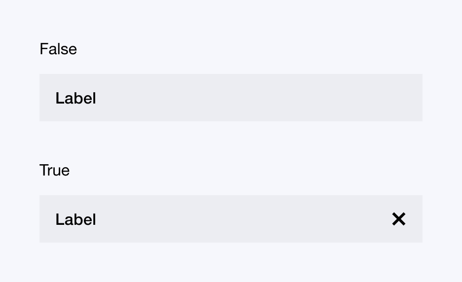

## Icon

**(for Neutral and Accent only)**  
Alert messages can include an icon to enhance recognition or remain icon-free when visual simplicity is preferred.  
Icons help communicate context and tone but are optional for Non-functional alerts (Neutral and Accent).

**⚠️ Note:**  
Functional alerts (Negative, Positive, Info, Warning) must always include a dedicated functional icon that reflects their semantic meaning.  
This ensures clarity, accessibility, and consistency across all user interfaces.

**`False`** Used when the alert should appear without an icon.  
Recommended for minimalist layouts or when the message content is already self-explanatory.  
Works well in neutral contexts where no additional visual cue is required.

**`True`** Used when the alert includes a decorative or contextual icon to support recognition or strengthen the visual identity.  
Icons can vary depending on the alert's content – for example, informational, promotional, or illustrative.

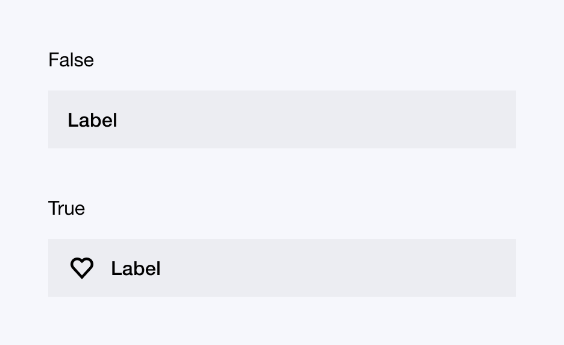

## Description

Description is the optional supplementary text in an Alert Message. Use only when additional detail or guidance is needed beyond the label. It should remain short, clear and scannable, helping the user understand what happened and what they can do next.

* If you can express the message fully in the label, omit body text.
* When body text is included, limit it to one or two short sentences. This aligns with practices from major design systems: for example, the Red Hat design system recommends **1-2 sentences for the message body**. [Red Hat design system](https://ux.redhat.com/elements/alert/guidelines/?utm_source=chatgpt.com)
* **Avoid long text blocks or "long-reads" within alerts** – for detailed explanations, direct users to another view or modal. The ServiceNow "Horizon" system states that an alert message shows two lines by default, and if it exceeds two lines, provide a "Show More" link. [Horizon Design System](https://horizon.servicenow.com/workspace/components/now-alert?utm_source=chatgpt.com)
* Use plain language consistent with Orange's tone: friendly, clear, service-oriented. Avoid jargon or complex sentences. The US Web Design System emphasises "concise, human-readable language; avoid jargon and computer code." [U.S. Web Design System (USWDS)](https://designsystem.digital.gov/components/alert/?utm_source=chatgpt.com)
* Provide next-step guidance if the alert requires user action: e.g., "Try again", "Check your settings", "Contact support". If no action is required, the body text can simply explain the state.

**`False`** Label alone conveys message cleary  
Example: "Payment successful."

**`True`** Label plus body text to clarify or guide – e.g., "Connection lost. Please reconnect your device to resume service."

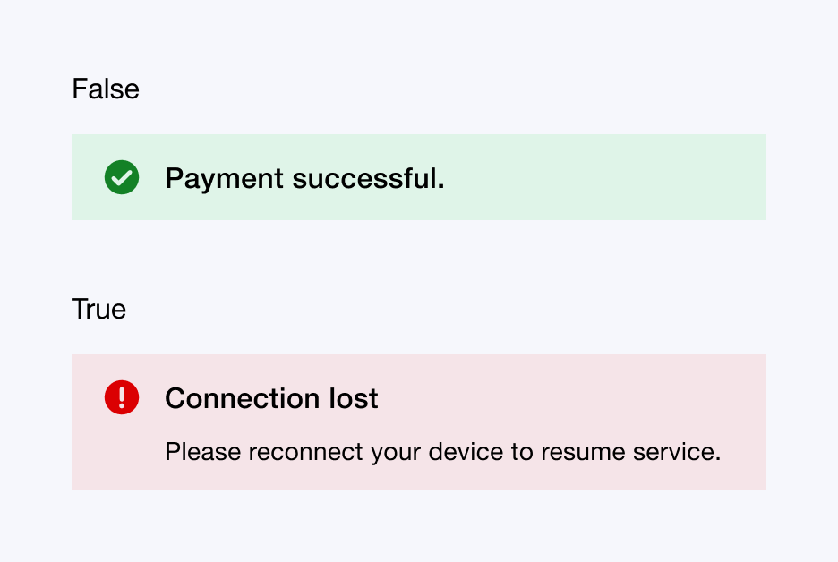

## Bullet list

Some alerts may include a bulleted list to present multiple related points or actions clearly, rather than a single sentence or paragraph.  
This boolean option (True / False) controls whether the list is shown.

* Use a bullet list when you need to present multiple items that are of equal importance, not in a specific sequential order. For example: "You need to complete all of the following:" then a list. This follows the guidance from the U.S. Web Design System for bulleted lists (use unordered lists when order isn't important). [design.va.gov+1](https://design.va.gov/content-style-guide/bulleted-lists?utm_source=chatgpt.com)
* Limit the number of items: if you have more than ~5-7 items, consider splitting the content or linking to a detailed page. Long lists reduce scannability. [design.va.gov+1](https://design.va.gov/content-style-guide/bulleted-lists?utm_source=chatgpt.com)
* Introduce the list with a lead-in sentence that contextualises the items (e.g., "You can do the following:" or "Please check these items:"). Don't start the list without context. [design.va.gov](https://design.va.gov/content-style-guide/bulleted-lists?utm_source=chatgpt.com)
* Each bullet item should be short, sentence fragment or brief statement, not full paragraphs. The goal is quick scanning. [design.cms.gov+1](https://design.cms.gov/components/alert/?utm_source=chatgpt.com)
* Do not use a bullet list for only a single item; in that case, prefer a simple sentence.

&nbsp;

### Guidelines
* Use up to 3–5 bullet items for optimal readability.
* Each item should be concise and parallel in structure (start with the same part of speech).
* If more detail is needed, link to a page or modal instead of overloading the alert.
* Avoid combining bullet lists with multiple paragraphs – alerts should remain brief and focused.

**`False`** The alert displays a single concise message without additional listed content.  
Use this state when one clear sentence (label or body text) is enough to convey the information.  
Ideal for short, self-contained alerts such as confirmations or simple feedback messages.

**`True`** The alert includes a bullet list following the label (and optional body text).  
Use this state when you need to highlight multiple points, such as service features, plan details, or next steps.  
Each bullet should be short and written as a clear phrase or fragment – avoid long sentences or complex structures.

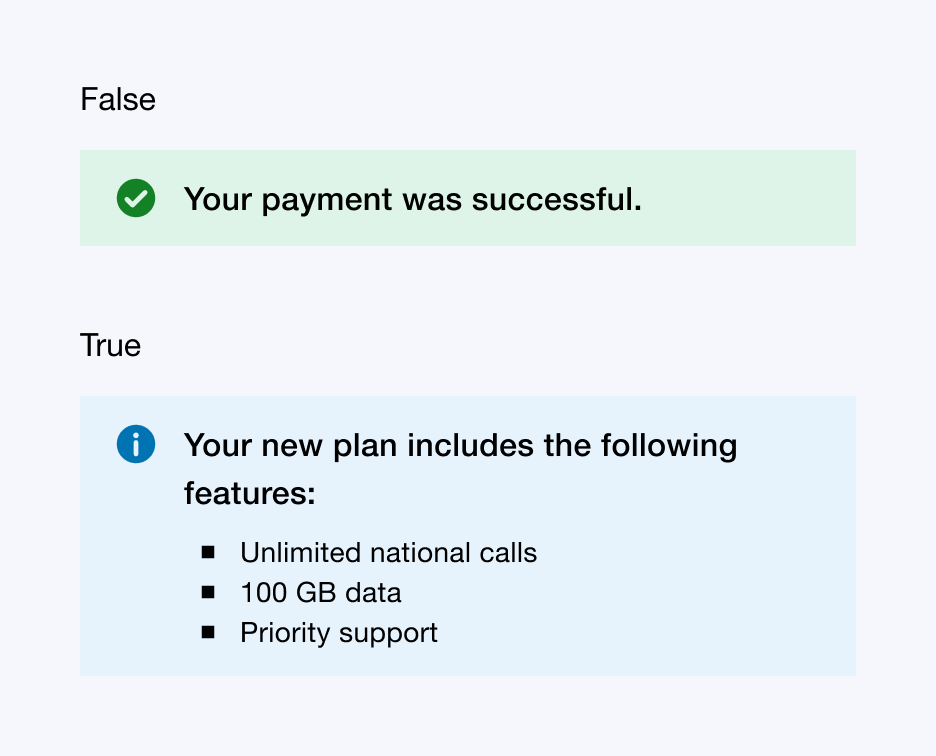

## Multiline and responsiveness

### Multiline
This component allows multi-line text editing. The number of lines is not limited.

&nbsp;

### Max-width vs full-width
For greater flexibility, this component doesn't have a default max-width. The max-width is applied to the text within the component.  
As a result, if it is positioned across the full available width (of the screen or the container), the component's background will stretch across the entire available surface, but the text may be limited to its max-width if the display width is larger.

&nbsp;

### User zoom in/out
The behavior of the text during user zoom in/out must follow a fundamental principle: the text must remain readable, accessible, and must never break the structure or lose information.
* The text must always scale proportionally with user zoom. Text resizing must never be blocked.
* Zooming must never cause text to be truncated or hidden. The component must expand vertically to allow line wrapping.
* The component's height and width must be flexible, never fixed, in order to automatically adapt its dimensions according to the level of zoom.
* In order to preserve the minimun interactive area during user zoom out, this component have a min-width **of 160px** and a min-height **of 100px**.
* If the component doesn't contain any interactive elements, it's not necessary to maintain the minimum interactive area during user zooms out.
* Even if, the component has a max-height or a max-width for resizing control purposes, technically, during user zoom in, these limitations are not fixed but must be scalable in order to adapt to the user's zoom level.
* Icons must always scale proportionally with user zoom. Icon resizing must never be blocked.
* The behaviors of the other subcomponents during user zoom are available in the corresponding documentation.

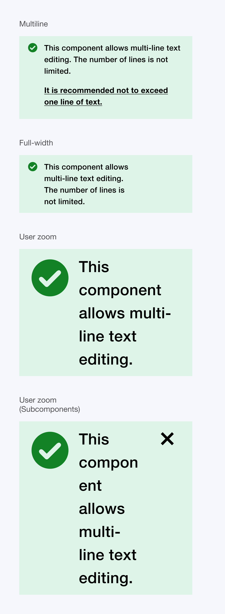

## Rich text

### Strong text
* Strong text can be used sparingly within alert messages to highlight key information. Rich text must use the **Label/Medium/Strong** token only.
* No other text styles or custom font weights should be used.

&nbsp;

### Underlined text and hyperlink
* Underlined text must not be used for emphasis, as it is commonly associated with links.
* If a **hyperlink** is needed within the content, the typographic reference **Label/Medium/Underline** must be used.

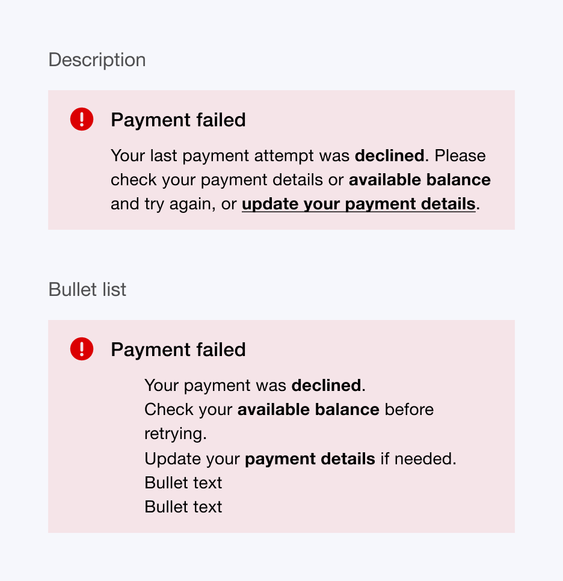

# Specs

## Layout and spacing

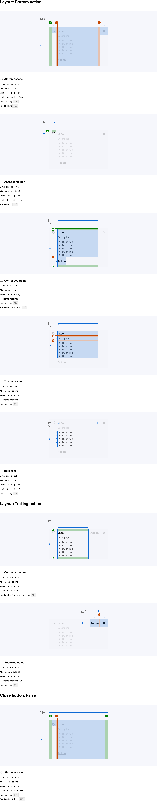

## States

**`Enabled`** The normal interactive/display state of the Alert Message component, when actual content (message text, optional icon or action) is present, and the component is fully styled and active.

**`Skeleton`** A placeholder state of the Alert Message component used when the content is not yet available (e.g., while loading). The component shows the correct visual structure but with placeholder elements (grey or shimmering blocks) instead of actual content.  
Uses the "Skeleton" component, variant "Security marge=False".

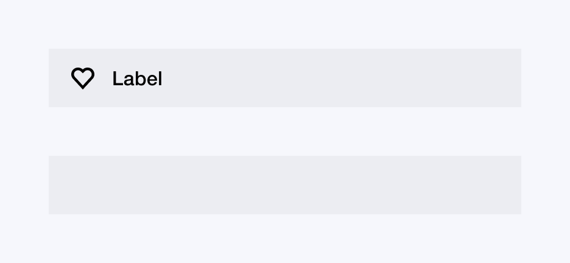

# Accessibility

## Use case

Alerts must be readable and perceivable for every user — including people using screen readers, color-blind users, and users who navigate using only the keyboard. Alerts announce status changes, so their accessibility is not optional — it’s a core part of the component.

## Interaction and style

- All text, icons, and buttons must maintain a minimum contrast ratio of 4.5:1 against their background across all component states, in both light and dark themes.
- Use semantic color and icon pairs (not color alone) for users with low vision or color blindness.

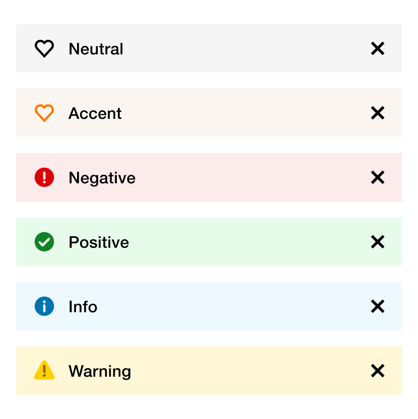

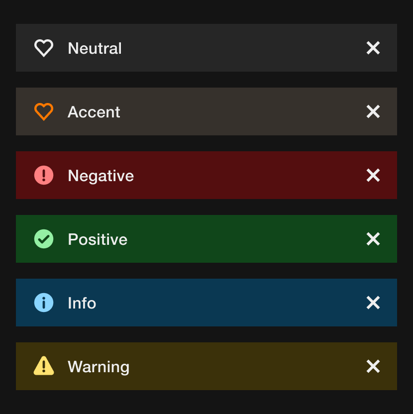

## Icon requirement

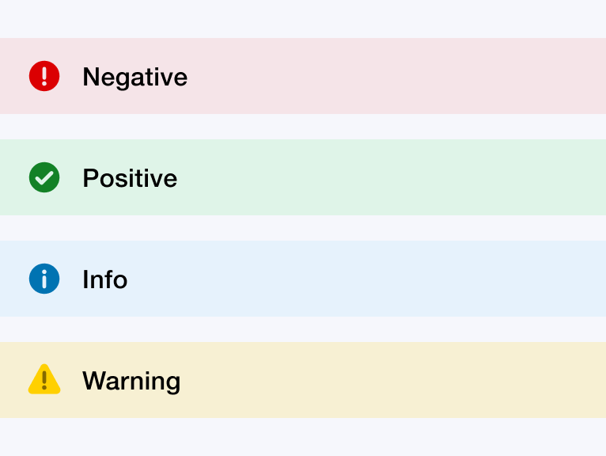

## Keyboard and focus behavior

Alerts must not take focus unless the user must resolve them before proceeding.

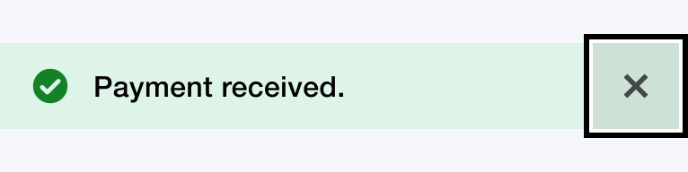

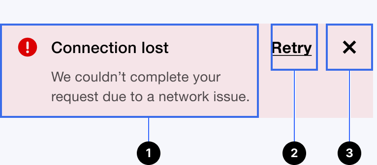

## Touch target sizing

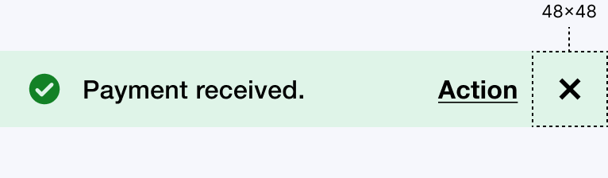

# Develop

## OUDS-Web example

[Components/Alerts › Alerts 2](https://web.unified-design-system.orange.com/storybook/?path=/story/components-alerts--alerts-2)

[Components/Alerts › Alerts 4](https://web.unified-design-system.orange.com/storybook/?path=/story/components-alerts--alerts-4)

[Components/Alerts › Alerts 14](https://web.unified-design-system.orange.com/storybook/?path=/story/components-alerts--alerts-14)

## Developer documentation

| Platform | Developer documentation |
|---|---|
| OUDS Web | [S-ouds-web-alert-message](https://r.orange.fr/r/S-ouds-web-alert-message) |
| OUDS Android | [S-ouds-android-alert-message](https://r.orange.fr/r/S-ouds-android-alert-message) |
| OUDS iOS | [S-ouds-ios-alert-message](https://r.orange.fr/r/S-ouds-ios-alert-message) |
| OUDS Flutter | [S-ouds-flutter-alert-message](https://r.orange.fr/r/S-ouds-flutter-alert-message) |

# Changelog

## Availability

Design status: **LIVE**

| Platform | Resource | Status | Version |
|---|---|---|---|
| Figma | [Alert message component](https://r.orange.fr/r/S-ouds-design-alert-message) | Done | 1.2.0 |
| OUDS Web (former Boosted) | [Web dev documentation](https://r.orange.fr/r/S-ouds-web-alert-message) | Done | 1.2.0 |
| OUDS Android - Jetpack Compose | [Android dev documentation](https://r.orange.fr/r/S-ouds-android-alert-message) | Done | 1.2.0 |
| OUDS iOS - Swift | [iOS dev documentation](https://r.orange.fr/r/S-ouds-ios-alert-message) | Done | 1.2.0 |
| OUDS Flutter | [Flutter dev documentation](https://r.orange.fr/r/S-ouds-flutter-alert-message) | Done | 1.2.0 |

## Design changelog

| Date | Number | Notes |
|------|--------|-------|
| Apr 23, 2026 | 1.1.1 | <ul><li>Renamed "Layout" to "Action layout" and aligned values (Bottom, Trailing, None)</ul> |
| Apr 8, 2026 | - | <ul><li>Documentation writing: Rich text</ul> |
| Mar 17, 2026 | 1.1.0 | Text color update:<ul><li>For the neutral alert, the text color now uses: ouds-color-content-default</li><li>For all status variants, the text color now uses the corresponding semantic tokens:<ul><li>Accent status: ouds-color-content-on-status-accent-muted</li><li>Positive status: ouds-color-content-on-status-positive-muted</li><li>Negative status: ouds-color-content-on-status-negative-muted</li><li>Info status: ouds-color-content-on-status-info-muted</li><li>Warning status: ouds-color-content-on-status-warning-muted</li></ul></li></ul> |
| Mar 16, 2026 | - | <ul><li>Documentation writing:<ul><li>Rounded corners brand theme availability<li>Multiline and responsiveness</ul></ul> |
| Jan 21, 2026 | - | <ul><li>Documentation writing: Rounded corners update</ul> |
| Jan 6, 2026 | - | <ul><li>Documentation writing: Definition update</ul> |
| Oct 14, 2025 | 1.0.0 | • Component creation |
