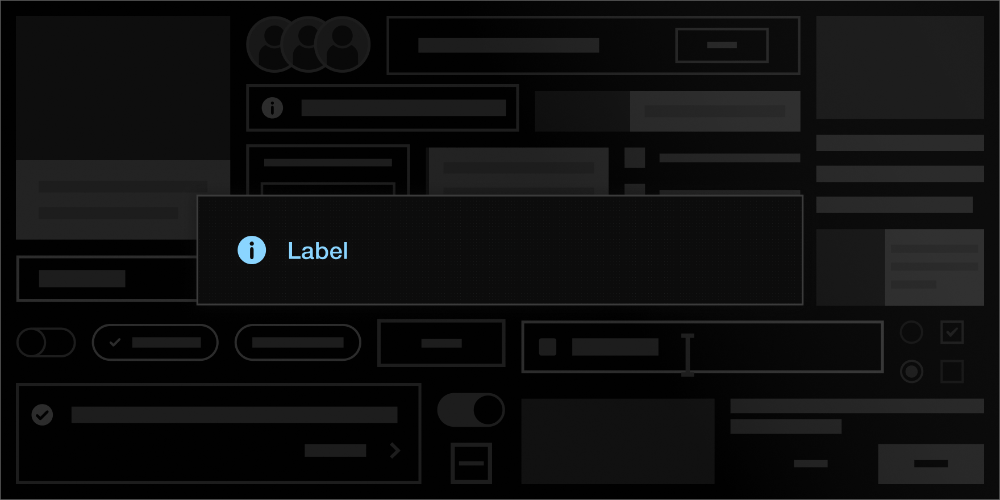
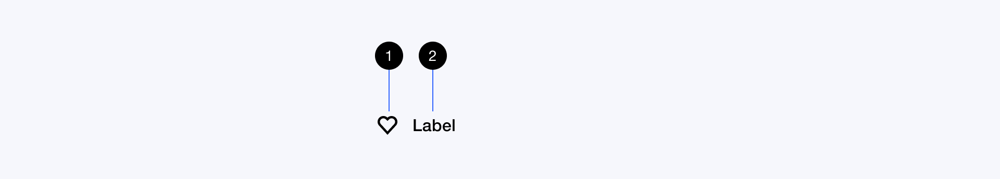
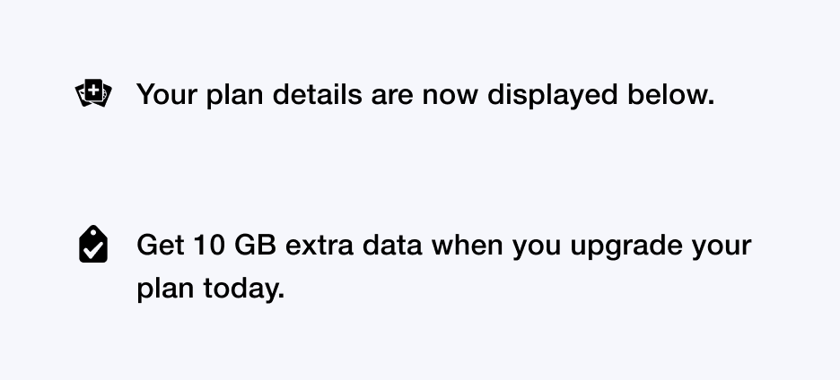
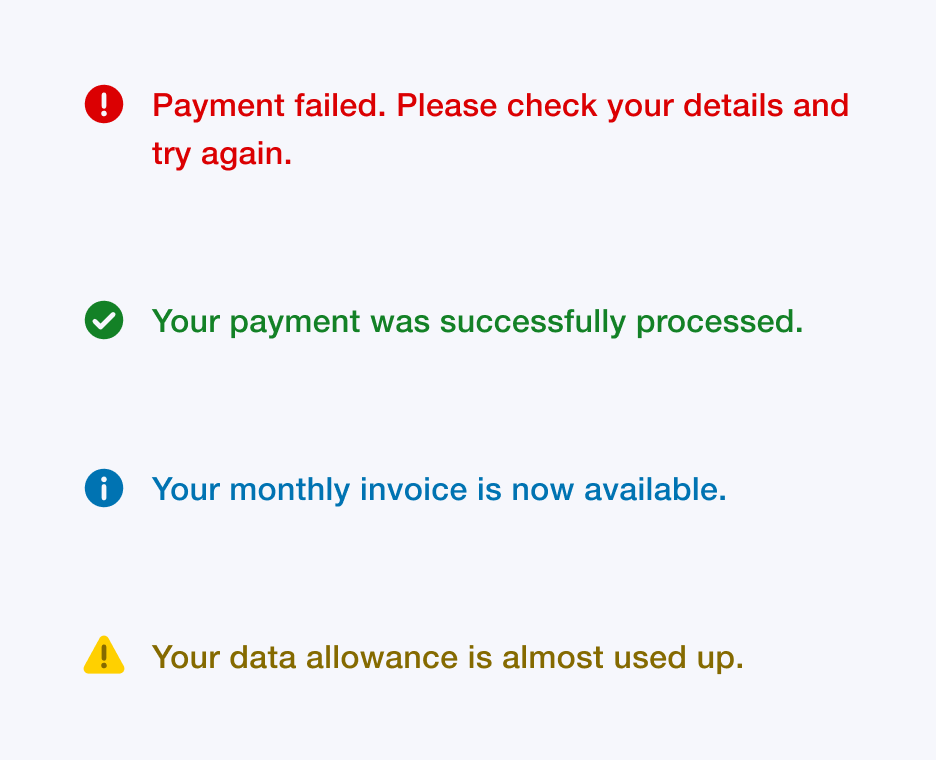
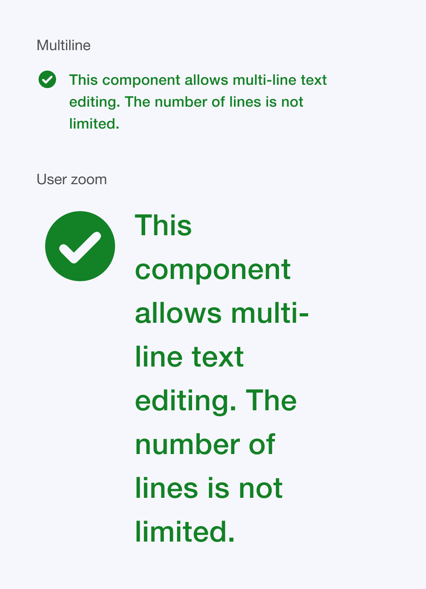
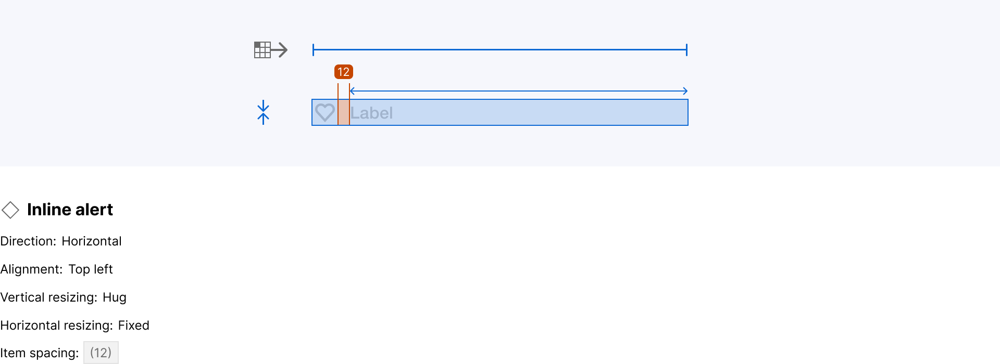
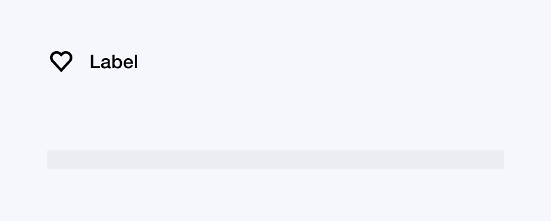
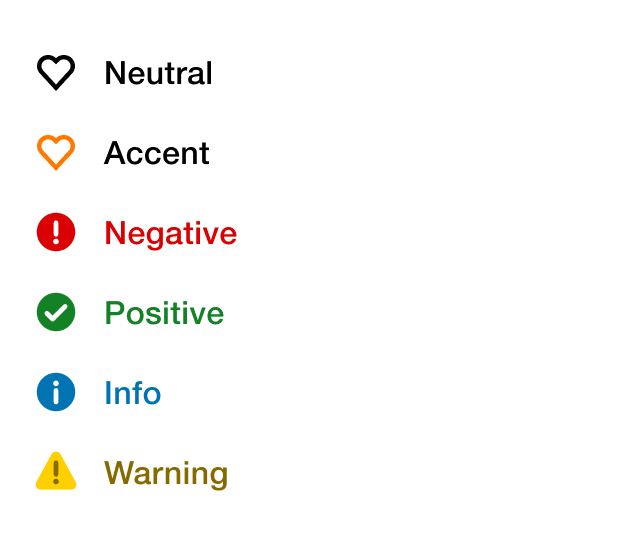
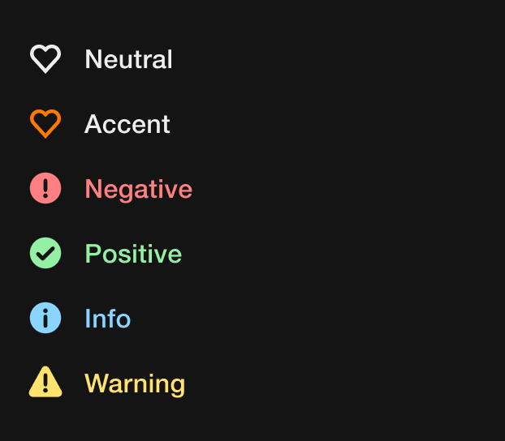

# Inline alert

An inline alert is a lightweight UI element integrated into the content flow. It conveys information, system feedback, and status changes through short, prominent, persistent, and non-actionable messages.

# Guideline

## Anatomy

| # | Element | Purpose | Optional |
|---|---------|---------|----------|
| 1 | Icon | Indicates the alert type. Uses a functional icon for status-based alerts (error, warning, info, success), or a decorative brand/icon for non-functional alerts such as neutral or accent messages. | No |
| 2 | Label | Main message. Short, clear, and readable at a glance. | No |

## Definition

An inline alert is a lightweight UI element integrated into the content flow. It conveys information, system feedback, and status changes through short, prominent, persistent, and non-actionable messages.

The inline alert includes a functional icon and a semantic colour, but does not have a close button or an action link. The inline alert remains visible and does not disappear.

## Status

### Non-functional
Used for informational or decorative messages not tied to system logic. They are flexible in tone and visual expression, allowing the use of custom or brand-related (decorative) icons depending on context. These alerts help highlight content or support communication in a subtle, branded way.

**⚠️ Note:** Icons in non-functional alerts can be changed or customized depending on the message context.

**`Neutral`** Used for generic informational messages that provide context but carry no semantic meaning. Ideal for subtle notices, contextual help, or content highlights within pages.

**`Accent`** Uses brand colors and can include decorative icons to draw attention to key marketing or communication content. Perfect for promotional, inspirational, or brand-driven highlights that engage the user positively.

### Functional
Used to communicate system statuses, results, or warnings tied directly to UX logic or user actions. These alerts follow strict semantic conventions for icon, color, and tone — ensuring clear, accessible communication across all digital products.

**⚠️ Note:** Icons in functional alerts must never be replaced or customized. Each type has a dedicated, standardized icon that expresses its meaning clearly.

**`Negative`** Indicates a failure, error, or blocking issue that needs user attention. Uses the red "error" color and must include the standardized error icon.

**`Positive`** Confirms that an action was completed successfully. Uses a green color and the standard success icon.

**`Info`** Provides neutral information or updates about the system or account status. Uses blue for neutrality and clarity.

**`Warning`** Draws attention to potential issues or upcoming changes. Uses yellow to signal caution while remaining non-blocking.

## Multiline and responsiveness

### Multiline
This component allows multi-line text editing. The number of lines is not limited.

&nbsp;

### Max-width vs full-width
The max-width is applied to the text within the component.

&nbsp;

### User zoom in/out
The behavior of the text during user zoom in/out must follow a fundamental principle: the text must remain readable, accessible, and must never break the structure or lose information.
* The text must always scale proportionally with user zoom. Text resizing must never be blocked.
* Zooming must never cause text to be truncated or hidden. The component must expand vertically to allow line wrapping.
* The component's height and width must be flexible, never fixed, in order to automatically adapt its dimensions according to the level of zoom.
* Even if, the component has a max-height or a max-width for resizing control purposes, technically, during user zoom in, these limitations are not fixed but must be scalable in order to adapt to the user's zoom level.
* Icons must always scale proportionally with user zoom. Icon resizing must never be blocked.

# Specs

## Layout and spacing

## States

**`Enabled`** Displayed when the inline alert is active and content is available. Shows an icon and short text message to provide immediate, contextual feedback within the interface.

**`Skeleton`** Used as a placeholder while the alert content is loading or being retrieved. Maintains layout stability by showing the structure of the component without readable text.

# Accessibility

## Interaction and style

- Inline alerts use color + icon to stand out inside a content block.
- All text/icons must meet 4.5:1 contrast against the alert background.
- Never rely on color-only signals (e.g. “red text” alone).

# Develop

## OUDS-Web example

[Components/Alerts › Alerts 17](https://web.unified-design-system.orange.com/storybook/?path=/story/components-alerts--alerts-17)

[Components/Alerts › Alerts 16](https://web.unified-design-system.orange.com/storybook/?path=/story/components-alerts--alerts-16)

## Developer documentation

| Platform | Developer documentation |
|---|---|
| OUDS Web | [S-ouds-web-inline-alert](https://r.orange.fr/r/S-ouds-web-inline-alert) |
| OUDS Android | [S-ouds-android-inline-alert](https://r.orange.fr/r/S-ouds-android-inline-alert) |
| OUDS iOS | [S-ouds-ios-inline-alert](https://r.orange.fr/r/S-ouds-ios-inline-alert) |
| OUDS Flutter | [S-ouds-flutter-inline-alert](https://r.orange.fr/r/S-ouds-flutter-inline-alert) |

# Changelog

## Availability

Design status: **LIVE**

| Platform | Resource | Status | Version |
|---|---|---|---|
| Figma | [Inline alert component](https://r.orange.fr/r/S-ouds-design-inline-alert) | Done | 1.0.0 |
| OUDS Web (former Boosted) | [Web dev documentation](https://r.orange.fr/r/S-ouds-web-inline-alert) | Done | 1.0.0 |
| OUDS Android - Jetpack Compose | [Android dev documentation](https://r.orange.fr/r/S-ouds-android-inline-alert) | Done | 1.0.0 |
| OUDS iOS - Swift | [iOS dev documentation](https://r.orange.fr/r/S-ouds-ios-inline-alert) | Done | 1.0.0 |
| OUDS Flutter | [Flutter dev documentation](https://r.orange.fr/r/S-ouds-flutter-inline-alert) | Done | 1.0.0 |

## Design changelog

| Date | Number | Notes |
|------|--------|-------|
| Mar 16, 2026 | - | <ul><li>Documentation writing: Multiline and responsiveness</ul> |
| Jan 6, 2026 | - | <ul><li>Documentation writing: Definition update</ul> |
| Oct 14, 2025 | 1.0.0 | • Component creation |
