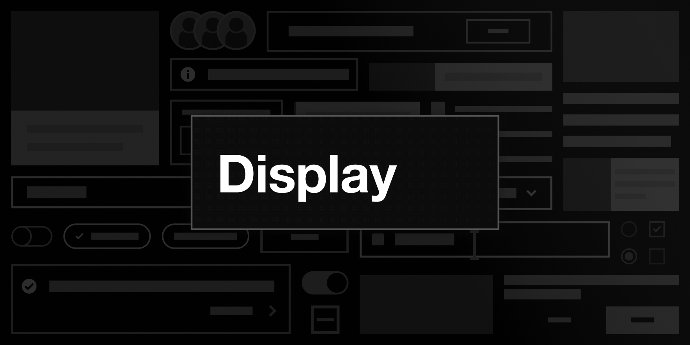
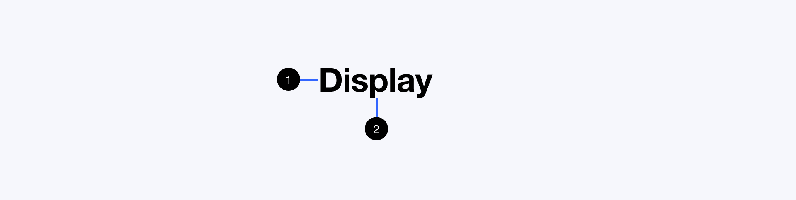
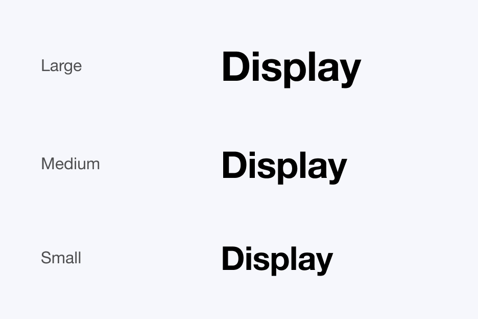
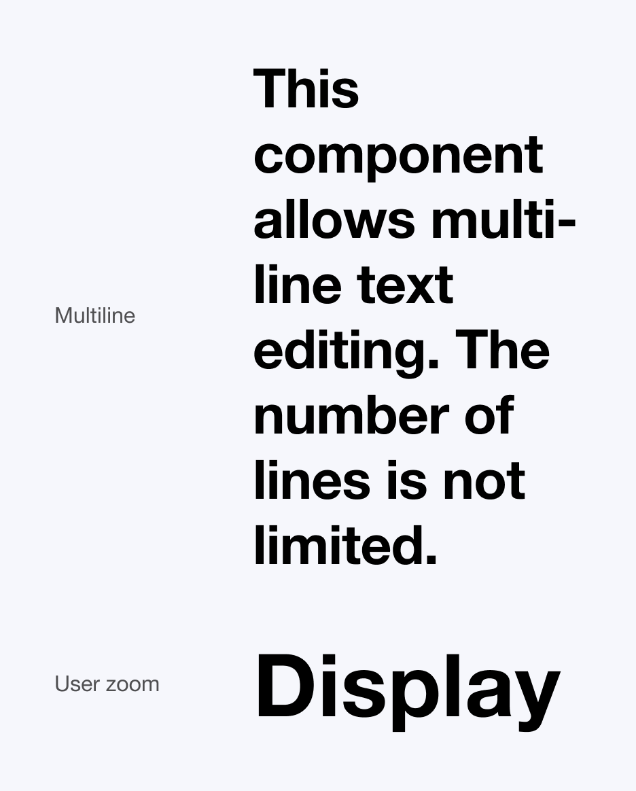
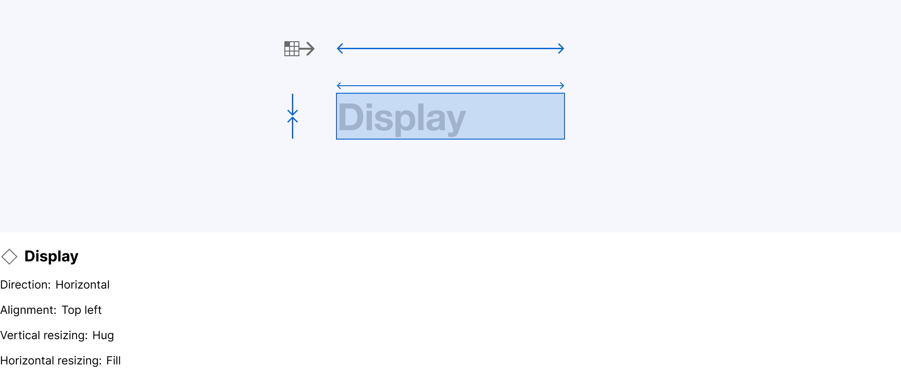

# Display

A display is a UI element that styles typography for impactful content like landing pages, marketing campaigns, and key messages.

# Guideline

## Anatomy

| # | Element | Purpose | Optional |
|---|---------|---------|----------|
| 1 | Display container | The component: the text block whose width and alignment are set by its container | No |
| 2 | Display text | The text itself, styled with the Display type scale | No |

## Definition

A display is a UI element that styles typography for impactful content like landing pages, marketing campaigns, and key messages.

The display features large type sizes that capture attention and create strong visual emphasis. Variants automatically adjust across breakpoints to maintain a consistent visual hierarchy on all screen sizes. Use it sparingly to preserve its impact and effectiveness.

## Size

<!-- zh-row -->

**`Large`** The largest Display size, intended for maximum visual impact. Use it for hero sections, key messages, and high-priority content that requires immediate attention.

**`Medium`** A prominent Display size that provides strong emphasis while maintaining a more balanced visual presence. Suitable for major content areas and featured messages.

**`Small`** The most compact Display size, offering visual impact in space-constrained layouts. Use it when a display style is needed without overwhelming surrounding content.

## Multiline and responsiveness

<!-- zh-row -->

### Multiline
This component allows multi-line text editing. The number of lines is not limited.

&nbsp;

### Max-width vs full-width
This component has a default max-width.  
For the “Display large” variant, the global max-width token will be: size-max-width-display-large  
For the “Display medium” variant, the global max-width token will be: size-max-width-display-medium  
For the “Display small” variant, the global max-width token will be: size-max-width-display-small

&nbsp;

### User zoom in/out
The behavior of the text during user zoom in/out must follow a fundamental principle: the text must remain readable, accessible, and must never break the structure or lose information.  
  • The text must always scale proportionally with user zoom. Text resizing must never be blocked.  
  • Zooming must never cause text to be truncated or hidden. The component must expand vertically to allow line wrapping.  
  • The component’s height and width must be flexible, never fixed, in order to automatically adapt its dimensions according to the level of zoom.  
  • Even if, the component has a max-height or a max-width for resizing control purposes, technically, during user zoom in, these limitations are not fixed but must be scalable in order to adapt to the user’s zoom level.

# Specs

## Layout and spacing

# Accessibility

Work is in progress to deliver this content.

# Develop

## OUDS-Web example

[Components/Typography › Typography 0](https://web.unified-design-system.orange.com/storybook/?path=/story/components-typography--typography-0)

## Developer documentation

| Platform | Developer documentation |
|---|---|
| OUDS Web | [S-ouds-web-typography-display](https://r.orange.fr/r/S-ouds-web-typography-display) |
| OUDS Android | [S-ouds-android-typography-display](https://r.orange.fr/r/S-ouds-android-typography-display) |
| OUDS iOS | [S-ouds-ios-typography-display](https://r.orange.fr/r/S-ouds-ios-typography-display) |
| OUDS Flutter | [S-ouds-flutter-typography-display](https://r.orange.fr/r/S-ouds-flutter-typography-display) |

# Changelog

## Availability

| Platform | Resource | Status | Version |
|---|---|---|---|
| Figma | [Display component](https://r.orange.fr/r/S-ouds-design-typography-display) | Live | 1.0.0 |
| OUDS Web (former Boosted) | [Web dev documentation](https://r.orange.fr/r/S-ouds-web-typography-display) | Live | 1.0.0 |
| OUDS Android - Jetpack Compose | [Android dev documentation](https://r.orange.fr/r/S-ouds-android-typography-display) | Live | 1.0.0 |
| OUDS iOS - Swift | [iOS dev documentation](https://r.orange.fr/r/S-ouds-ios-typography-display) | Live | 1.0.0 |
| OUDS Flutter | [Flutter dev documentation](https://r.orange.fr/r/S-ouds-flutter-typography-display) | Live | 1.0.0 |

## Design changelog

| Date | Number | Notes |
|------|--------|-------|
| Jun 16, 2026 | 1.0.0 | <ul><li>Component creation</ul> |
