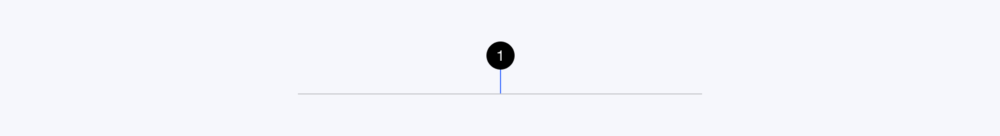
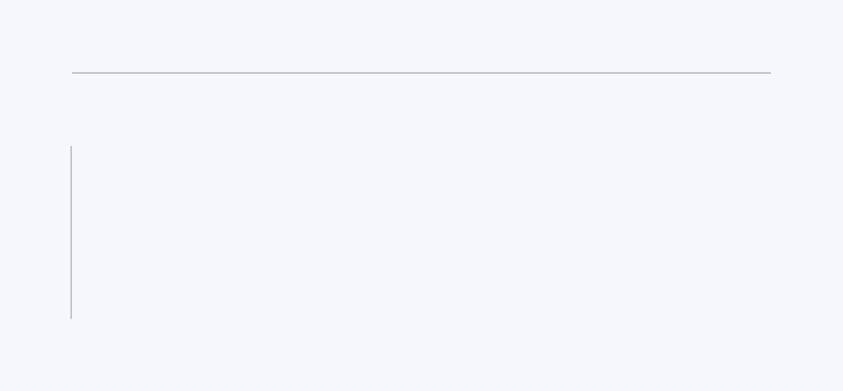
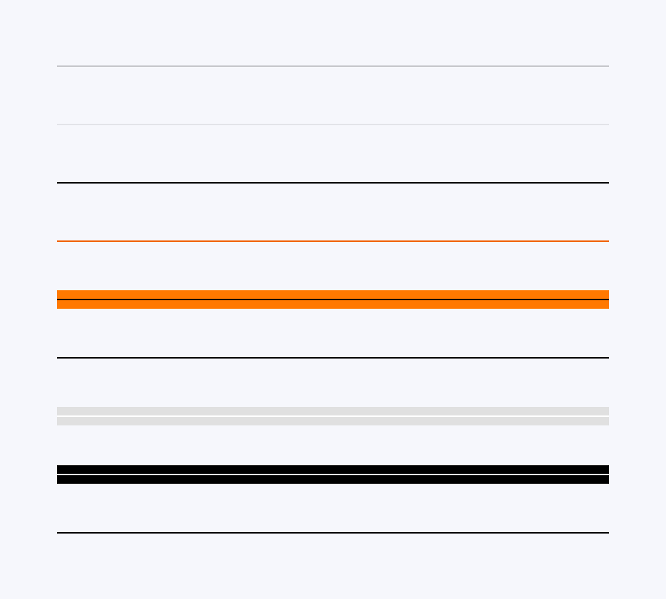
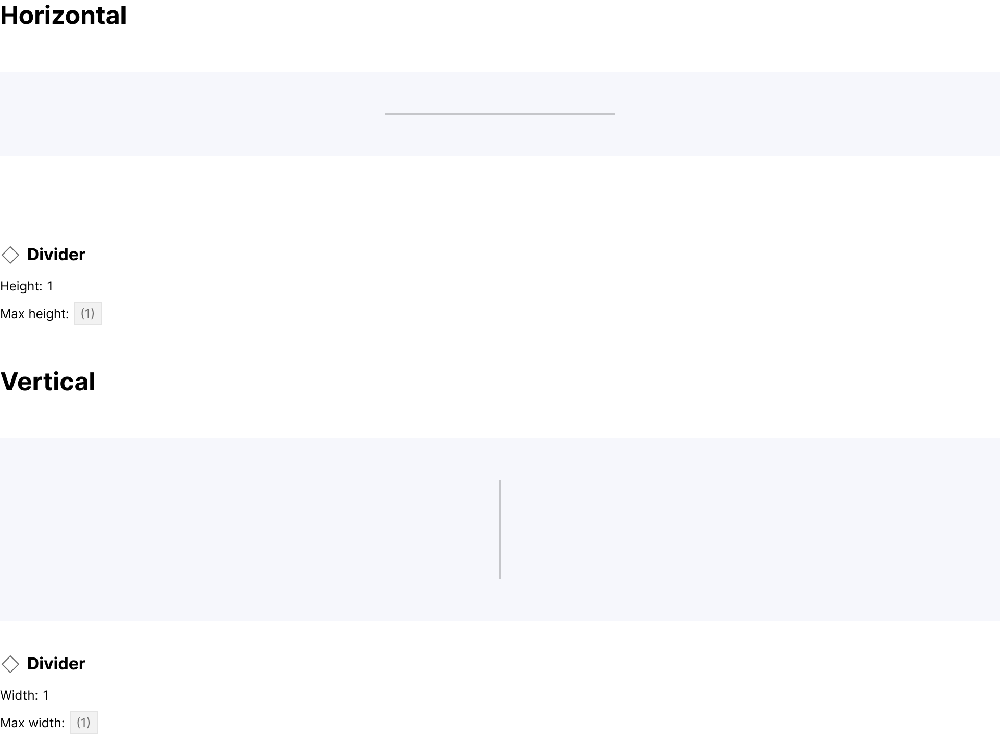

# Divider

A divider is a UI element that structures content by visually separating different areas.

# Guideline

## Anatomy

| # | Element | Purpose | Optional |
|---|---------|---------|----------|
| 1 | Divider | Neutral coloured horizontal or vertical line placed either horizontally or vertically between elements | No |

## Definition

A divider is a UI element that structures content by visually separating different areas.

The divider enhances readability and organises content without creating a stronger visual hierarchy, such as a heading or container.

## Orientation

<!-- zh-row -->

**`Horizontal`** Separates stacked vertical sections. Example use case: Between main content and a footer.

**`Vertical`** Separates horizontally aligned elements. Example use case: Between two columns in a layout.

## Authorized colors

<!-- zh-row -->

• color-border-default  
• color-border-muted  
• color-border-emphasized  
• color-border-brand-primary (secondary/tertiary)  
• color-border-on-brand-primary (secondary/tertiary)  
• color-always-black  
• color-always-white  
• color-always-on-black  
• color-always-on-white

# Specs

## Layout and spacing

# Accessibility

### Semantics and Structure
Use the `
` (Horizontal Rule) tag when the separator has semantic meaning, i.e., when it represents a topic change or a significant transition in the content.  
Use a styled `
` if the divider is purely decorative, ensuring it is hidden from assistive technologies (e.g., `aria-hidden="true"`).

&nbsp;

### Compatibility with Assistive Technologies
If `
` is used, provide a textual alternative if necessary via `aria-label` or `aria-labelledby` to specify its role (e.g., `
`).  
If the divider is decorative, ensure it is not perceived as content by screen readers (`role="presentation"` or `aria-hidden="true"`).

&nbsp;

### Size and Spacing
A divider that is too thin may be invisible on some screens, so favor a thickness of at least 1px to 2px.  
Maintain sufficient margin around the divider to prevent visual clutter and improve readability (e.g., `margin: 16px 0;`).

&nbsp;

### Keyboard Accessibility and Interactions
A divider should not be focusable (`tabindex="-1"`) unless it has an interactive role (which is rare).  
If the divider is part of an interactive component (e.g., dropdown menu, accordion panel), ensure it does not interfere with keyboard navigation.

# Develop

## OUDS-Web example

[Components/Divider › Divider 3](https://web.unified-design-system.orange.com/storybook/?path=/story/components-divider--divider-3)

## Developer documentation

| Platform | Developer documentation |
|---|---|
| OUDS Web | [S-ouds-web-divider](https://r.orange.fr/r/S-ouds-web-divider) |
| OUDS Android | [S-ouds-android-divider](https://r.orange.fr/r/S-ouds-android-divider) |
| OUDS iOS | [S-ouds-ios-divider](https://r.orange.fr/r/S-ouds-ios-divider) |
| OUDS Flutter | [S-ouds-flutter-divider](https://r.orange.fr/r/S-ouds-flutter-divider) |

# Changelog

## Availability

| Platform | Resource | Status | Version |
|---|---|---|---|
| Figma | [Divider component](https://r.orange.fr/r/S-ouds-design-divider) | Live | 1.0.0 |
| OUDS Web (former Boosted) | [Web dev documentation](https://r.orange.fr/r/S-ouds-web-divider) | Live | 1.0.0 |
| OUDS Android - Jetpack Compose | [Android dev documentation](https://r.orange.fr/r/S-ouds-android-divider) | Live | 1.0.0 |
| OUDS iOS - Swift | [iOS dev documentation](https://r.orange.fr/r/S-ouds-ios-divider) | Live | 1.0.0 |
| OUDS Flutter | [Flutter dev documentation](https://r.orange.fr/r/S-ouds-flutter-divider) | Live | 1.0.0 |

## Design changelog

| Date | Number | Notes |
|------|--------|-------|
| Jan 6, 2026 | - | <ul><li>Documentation writing: Definition update</ul> |
| Mar 14, 2025 | 1.0.0 | • Component creation |
