# Filter chip expand

A filter chip expand is a UI element that allows users to control the selection or deselection of a choice from a defined list of options, frequently used to capture filtering decisions.

# Guideline

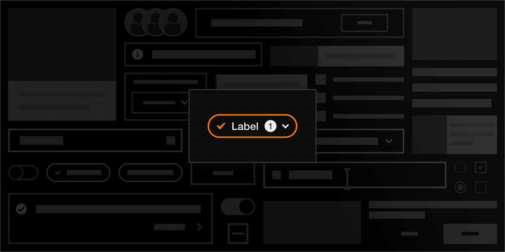

## Anatomy

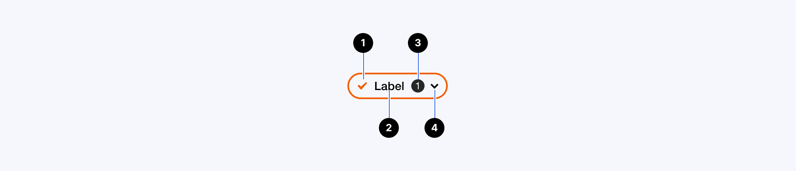

| # | Element | Purpose | Optional |
|---|---------|---------|----------|
| 1 | Tick | A tick indicating selection status. | No |
| 2 | Label | Information about the chip description. | No |
| 3 | Counter | The counter indicates the number of selected options. | Yes |
| 4 | Dropdown indicator | The dropdown icon indicates that selecting the chip will open a menu or list of options, signaling interactivity and available choices. | No |

## Definition

A filter chip expand is a UI element that allows users to control the selection or deselection of a choice from a defined list of options, frequently used to capture filtering decisions.

The filter chip expand feature is displayed through a dropdown with selectable values, making it ideal for filters with multiple or dynamic options while providing clarity and saving space in the interface.

## Selection Status

<!-- zh-row -->

**`Selected`** Visually differentiated to show an active filter. The chip changes color and displays a tick and counter to indicate it has been selected.

**`Unselected`** Maintains a neutral appearance, indicating an available filter option.

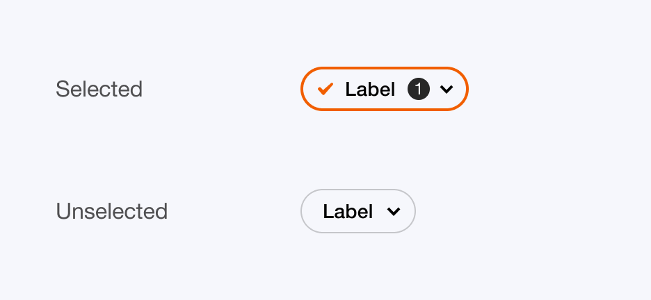

### Clear selection indicator

**Do:** Use a checkmark to clearly indicate selection.  
Relying on color alone is not accessible for users who can’t distinguish certain colors, so the checkmark provides a reliable and universally understood confirmation of an active filter.

**Don't:** Don’t depend solely on color changes to show selection.  
Without an additional indicator, users with color-vision limitations may not notice that the filter is active.

### Count Indicator

**Do:** Use a counter only when multiple sub-options are selected.  
This helps users understand how many values are currently applied.

**Don't:** Don’t show a counter when the chip is not selected.  
A “0” or empty counter adds unnecessary visual noise.

## Expanded

<!-- zh-row -->

The "Expanded" state allows the filter chip to be dynamically edited via a dropdown component.

**`True`** When a Filter chip is in the "Expanded" state, it:
 - Displays a contextual dropdown containing a menu or controls to modify the associated filter values.
 - Remains visually attached to the source chip (often below or overlapping).
 - Allows the user to select multiple options or apply a new value.  
The component can remain in the "Expanded" state until a user action (click or key press) closes it. Chevron icon points up.

**`False`** The "Collapsed" state is the default or "resting" state of the filter chip, in which it simply displays a filter value, without any visible complex interaction. Chevron icon points down.

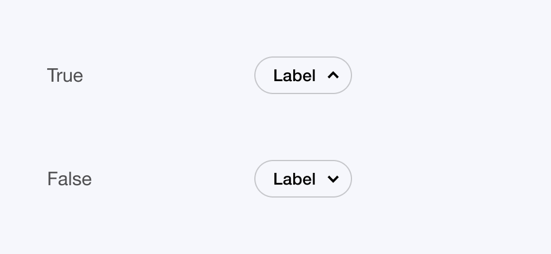

## Multiline and responsiveness

<!-- zh-row -->

### Multiline
Depending on the use case, permissions for editing multi-line text vary:
- In a "chips bar" context (the chips are positioned one after another in a horizontal carousel with no width limit), this component doesn't allow multi-line text editing.
- In a "Quick Replies" context (the chips are used as action and disambiguation elements in a conversational interface), this component allows multi-line text editing.

This is a design recommendation, technically, and for several reasons (responsive behavior, user zoom, etc.), multiline remains possible.

&nbsp;

### Max-width vs full-width
For greater flexibility, this component doesn't have a default max-width. To avoid exceeding a width that would degrade readability and the perception of a compact interactive element, we recommend applying **a max-width of around 200px.**  
It is not possible to set this component to use the full available width (of the screen or the container).

&nbsp;

### User zoom in/out
The behavior of the text during user zoom in/out must follow a fundamental principle: the text must remain readable, accessible, and must never break the structure or lose information.
* The text must always scale proportionally with user zoom. Text resizing must never be blocked.
* Zooming must never cause text to be truncated or hidden. The component must expand vertically to allow line wrapping.
* The component's height and width must be flexible, never fixed, in order to automatically adapt its dimensions according to the level of zoom.
* In order to preserve the minimun interactive area during user zoom out, this component have a min-width **of 52px** and a min-height **of 48px**.
* Even if, the component has a max-height or a max-width for resizing control purposes, technically, during user zoom in, these limitations are not fixed but must be scalable in order to adapt to the user's zoom level.
* As the tick and the chevron icon are functional, they must follow the same rules as text.
* [Learn more about the behavior of the badge count component.](https://www.figma.com/design/QtOWrH1m3RHOAkfyy0XFil?node-id=92884-9275)

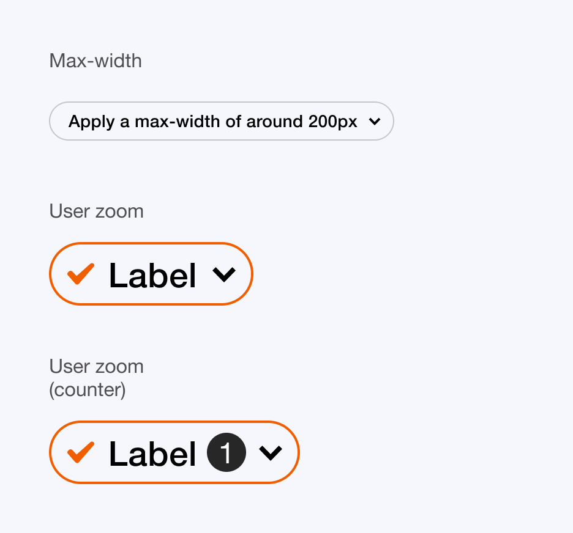

# Specs

## Layout and spacing

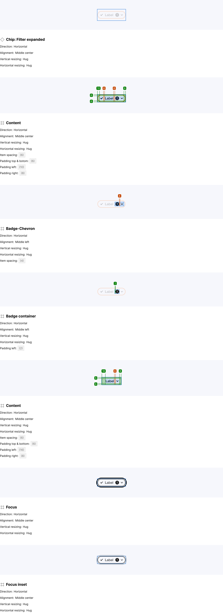

## States

<!-- zh-row -->

**`Enabled`** The chip is active and available for interaction.  
It is displayed in its standard style without additional effects.

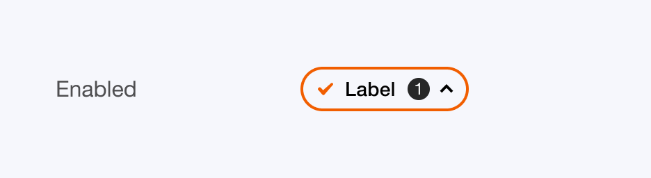

<!-- zh-row -->

**`Hover`** The appearance of the chip changes when the cursor hovers over it.  
This includes a color change for the border and the chip's content.

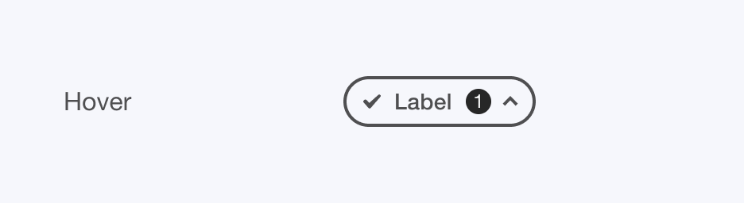

<!-- zh-row -->

**`Pressed`** The active state when the chip is being pressed.  
Accompanied by a color change in the content and border.

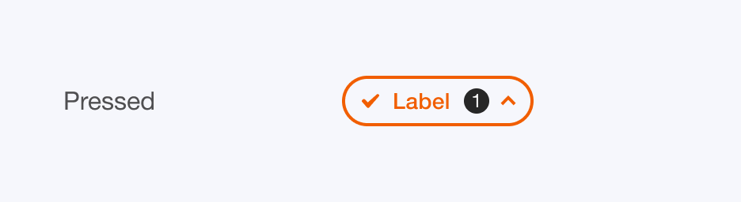

<!-- zh-row -->

**`Disabled`** The chip is unavailable for interaction.  
It is visually represented with a muted color change in the content and border (reduced brightness and contrast).

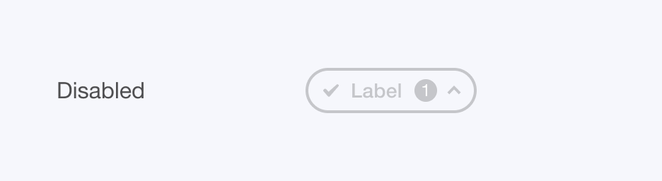

<!-- zh-row -->

**`Focus`** The state when the chip receives focus (during keyboard navigation).  
It features a triple contrasting border to indicate the active element.

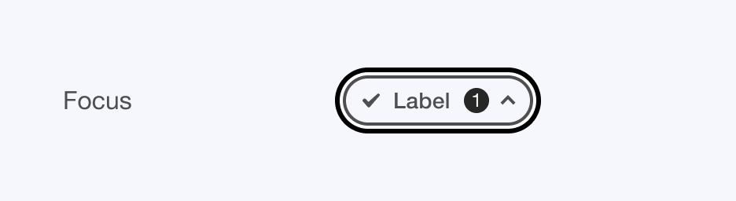

<!-- zh-row -->

**`Skeleton`** Displays a placeholder chip while the content is loading.  
It appears as a semi-transparent gray block without content.

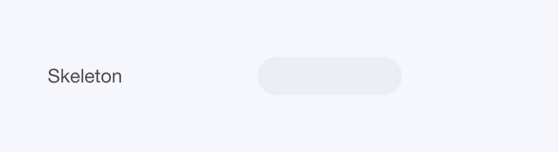

# Accessibility

## Use case

Users should be able to:

- Open an expanded filter using the keyboard or assistive technologies
- Understand that the chip is in an expanded state through screen reader announcements and the chevron direction
- Navigate through the dropdown options sequentially without losing focus
- Select one or multiple values in the expanded list using keyboard or switch input
- Close the expanded filter manually — using the keyboard, screen reader commands, or other input devices

## Interaction and style

The text on the chip must have at least a 4.5:1 contrast ratio against its background when the chip is in the enabled state. High contrast helps differentiate chips clustered together

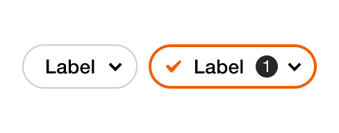

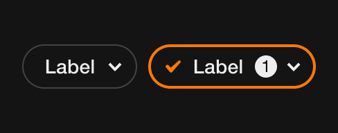

## Screen reader behavior

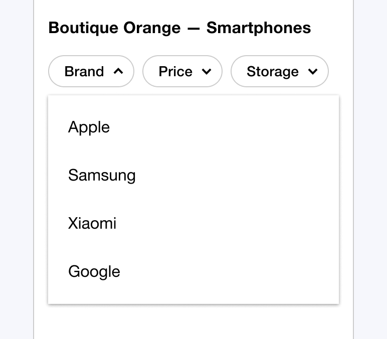

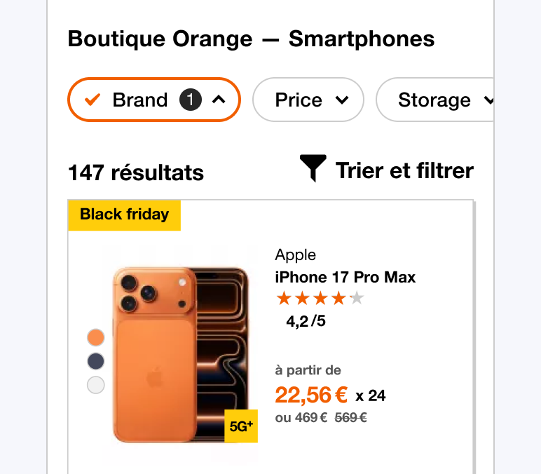

## How suggestion chips are read aloud

Suggestion chips announce two key pieces of information:

1. label
2. available action (“double-tap to select”)

# Develop

## Developer documentation

| Platform | Developer documentation |
|---|---|
| OUDS Web | Not available yet |
| OUDS Android | Not available yet |
| OUDS iOS | Not available yet |
| OUDS Flutter | Not available yet |

# Changelog

## Availability

| Platform | Resource | Status | Version |
|---|---|---|---|
| Figma | [Chips component](https://r.orange.fr/r/S-ouds-design-expand-filter-chip) | Live | 1.5.0 |
| OUDS Web (former Boosted) | Web dev documentation | To do | – |
| OUDS Android - Jetpack Compose | Android dev documentation | To do | – |
| OUDS iOS - Swift | iOS dev documentation | To do | – |
| OUDS Flutter | Flutter dev documentation | To do | – |

## Design changelog

| Date | Number | Notes |
|------|--------|-------|
| Jul 1, 2026 | 1.5.0 | <ul><li>The label text is no longer centred but left-aligned.</ul> |
| Apr 22, 2026 | 1.4.0 | <ul><li>Version 2.4 of the design tokens is required for the development of this update.<li>The text reference of the label changes from a bold weight (font-weight-label-strong) to a medium weight (font-weight-label-moderate).</ul> |
| Mar 16, 2026 | - | <ul><li>Documentation writing: Multiline and responsiveness</ul> |
| Jan 6, 2026 | - | <ul><li>Documentation writing: Definition update</ul> |
| Jul 21, 2025 | 1.3.0 | <ul><li>The name of the family to which this component belongs is changing: Input → Control. As a result, the token naming convention is being updated. <li>Several design token updates: [Component tokens changelog 1.3.0](https://www.figma.com/design/Co2t6wHMf4GB9NJVGs2Hes/-OUDS-Core-Lib--Design-tokens?m=auto&node-id=9280-2568&t=HLVB4jOd35DWr8Bj-1)</ul> |
| Jul 2, 2025 | 1.2.0 | <ul><li>Modification of the typographic alignment "Label text", the alignment is now centered.</ul> |
| Jun 13, 2025 | 1.1.0 | <ul><li>Modification of the minimum height of the frame containing the component to increase the interactive area (48px). Component token: $ouds-input-chip-size-min-height-interactive-area <li>Modification of the semantic token corresponding to the inline padding used when displaying an icon. Component token: $ouds-input-chip-space-padding-inline-icon Semantic token: $ouds-space-padding-inline-sm <li>Modification of the typographic alignment of the "Content" frame, the alignment is now centered.</ul> |
| Apr 9, 2025 | 1.0.0 | <ul><li>Component creation</ul> |
