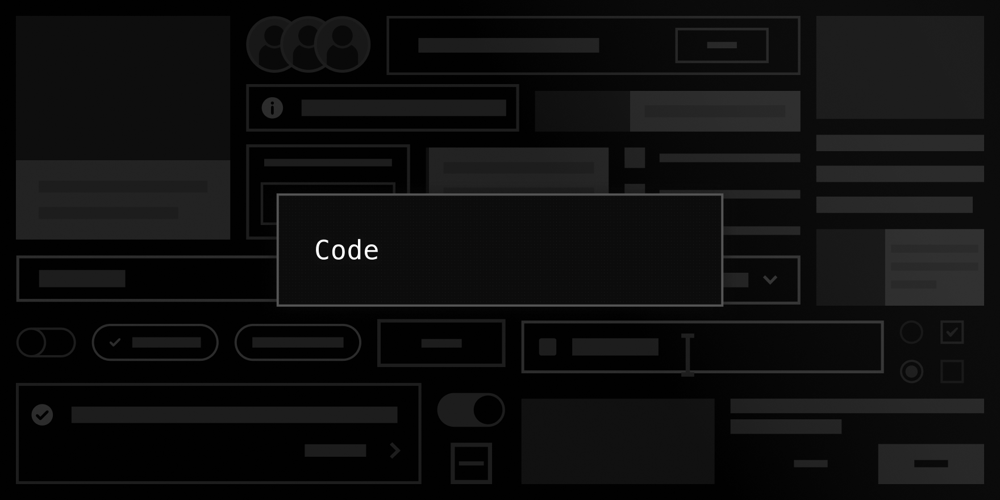
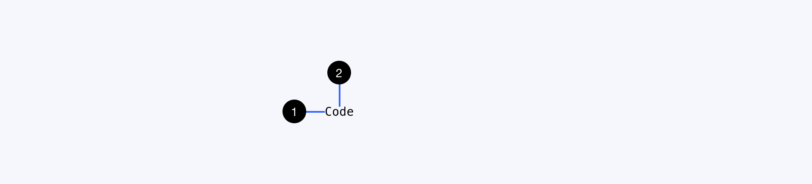
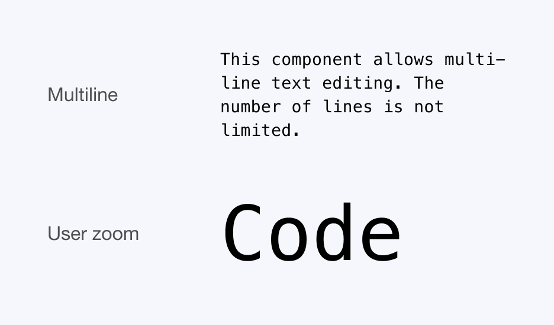
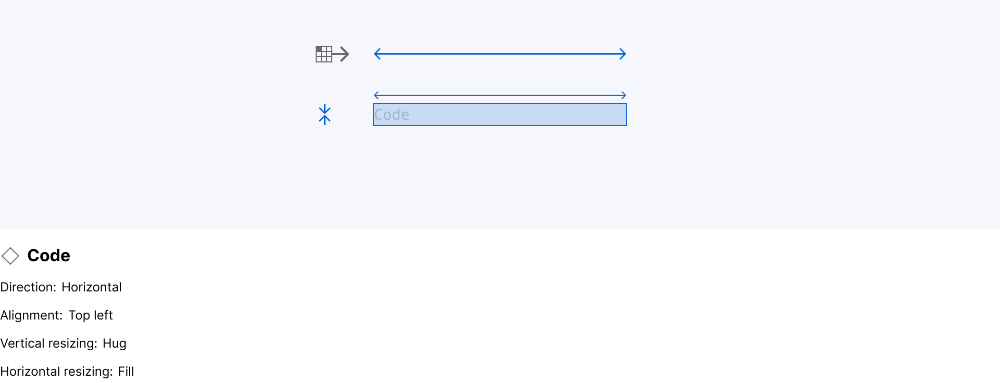

# Code

A code element is a UI element that styles typography for technical content like code snippets, commands, system values, and identifiers.

# Guideline

## Anatomy

| # | Element | Purpose | Optional |
|---|---------|---------|----------|
| 1 | Code container | The component: the text block whose width and alignment are set by its container | No |
| 2 | Code text | The text itself, styled with the monospace Code type scale | No |

## Definition

A code element is a UI element that styles typography for technical content like code snippets, commands, system values, and identifiers.

The code employs a monospace typeface to maintain character alignment and enhance the readability of structured content. Offered in one size, it ensures a uniform presentation of technical information across the product. Its application should be restricted to content that necessitates a precise code-like representation.

## Multiline and responsiveness

### Multiline
This component allows multi-line text editing. The number of lines is not limited.

&nbsp;

### Max-width vs full-width
This component has no maximum width by default.

&nbsp;

### User zoom in/out
The behavior of the text during user zoom in/out must follow a fundamental principle: the text must remain readable, accessible, and must never break the structure or lose information.  
  • The text must always scale proportionally with user zoom. Text resizing must never be blocked.  
  • Zooming must never cause text to be truncated or hidden. The component must expand vertically to allow line wrapping.  
  • The component’s height and width must be flexible, never fixed, in order to automatically adapt its dimensions according to the level of zoom.  
  • Even if, the component has a max-height or a max-width for resizing control purposes, technically, during user zoom in, these limitations are not fixed but must be scalable in order to adapt to the user’s zoom level.

# Specs

## Layout and spacing

# Accessibility

Work is in progress to deliver this content.

# Develop

## OUDS-Web example

[Components/Typography › Typography 6](https://web.unified-design-system.orange.com/storybook/?path=/story/components-typography--typography-6)

## Developer documentation

| Platform | Developer documentation |
|---|---|
| OUDS Web | [S-ouds-web-typography-code](https://r.orange.fr/r/S-ouds-web-typography-code) |
| OUDS Android | [S-ouds-android-typography-code](https://r.orange.fr/r/S-ouds-android-typography-code) |
| OUDS iOS | [S-ouds-ios-typography-code](https://r.orange.fr/r/S-ouds-ios-typography-code) |
| OUDS Flutter | [S-ouds-flutter-typography-code](https://r.orange.fr/r/S-ouds-flutter-typography-code) |

# Changelog

## Availability

Design status: **LIVE**

| Platform | Resource | Status | Version |
|---|---|---|---|
| Figma | Not available yet | Done | 1.0.0 |
| OUDS Web (former Boosted) | [Web dev documentation](https://r.orange.fr/r/S-ouds-web-typography-code) | Done | 1.0.0 |
| OUDS Android - Jetpack Compose | [Android dev documentation](https://r.orange.fr/r/S-ouds-android-typography-code) | Done | 1.0.0 |
| OUDS iOS - Swift | [iOS dev documentation](https://r.orange.fr/r/S-ouds-ios-typography-code) | Done | 1.0.0 |
| OUDS Flutter | [Flutter dev documentation](https://r.orange.fr/r/S-ouds-flutter-typography-code) | Done | 1.0.0 |

## Design changelog

| Date | Number | Notes | Designer |
|------|--------|-------|----------|
| Jun 16, 2026 | 1.0.0 | <ul><li>Component creation</ul> | Maxime Tonnerre Jérôme Regnier |
