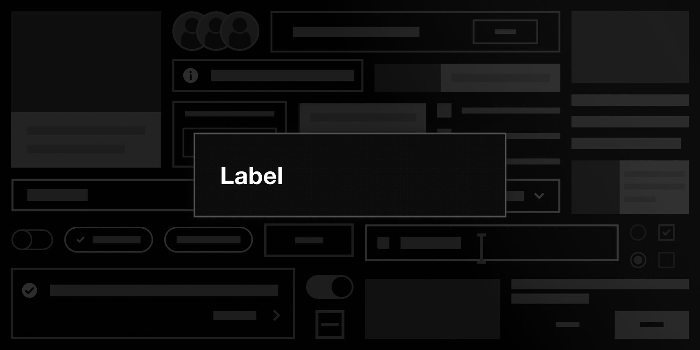
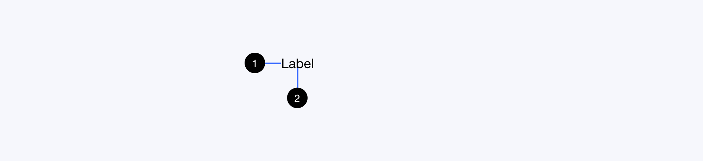
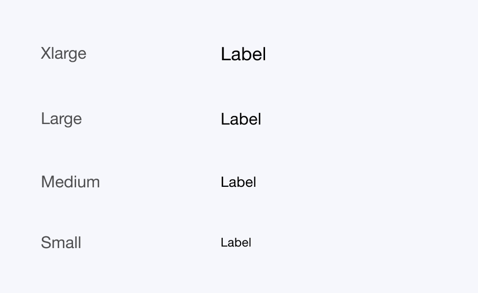
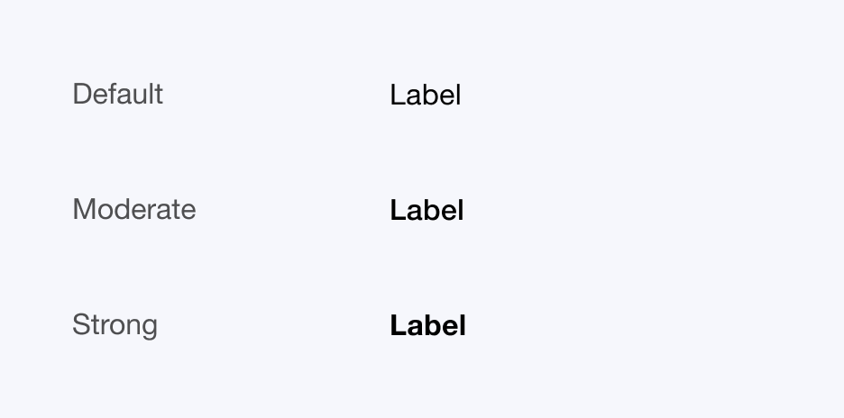
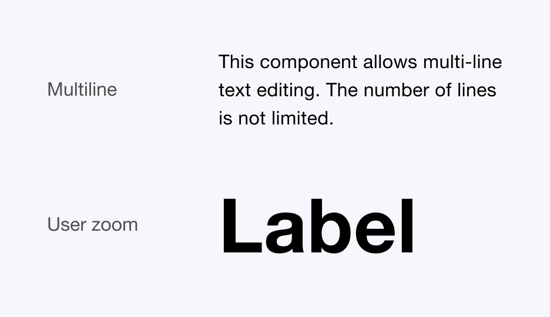
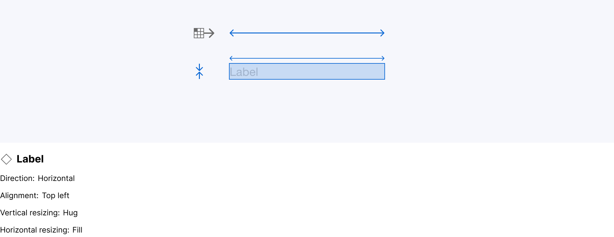

# Label

A label is a UI element that styles typography for compact interface components such as buttons, form fields, badges, and other small elements.

# Guideline

## Anatomy

| # | Element | Purpose | Optional |
|---|---------|---------|----------|
| 1 | Label container | The component: the text block whose width and alignment are set by its container | No |
| 2 | Label text | The text itself, styled with the Label type scale | No |

## Definition

A label is a UI element that styles typography for compact interface components such as buttons, form fields, badges, and other small elements.

The label is non-responsive and maintains a fixed size across all breakpoints. This ensures visual consistency and predictable behavior within space-constrained UI elements. Labels are preferred when content is displayed within small components.

## Size

<!-- zh-row -->

**`Xlarge`** The largest label size, intended for prominent UI controls and interface elements that require increased visibility and emphasis.

**`Large`** A highly readable label size suitable for key interactive components and larger interface patterns. It provides strong clarity while maintaining compactness.

**`Medium`** The default label size, designed for most interface components and controls. It offers a balanced combination of readability and space efficiency.

**`Small`** The most compact label size, optimized for dense interfaces and small UI components. Use it when space is limited while preserving legibility.

## Weight

<!-- zh-row -->

**`Default`** The default weight provides the standard level of typographic emphasis for Body and Label styles. It is designed for optimal readability and neutral hierarchy, making it the baseline for most interface content. Use it whenever no additional emphasis is required.

**`Moderate`** Moderate weight increases visual presence while remaining balanced and readable. It is used to reinforce hierarchy within Body and Label typography without introducing strong emphasis. Suitable for highlighting important information or improving scanability.

**`Strong`** Strong weight provides the highest level of emphasis for Body and Label styles. It is intended for critical information, key actions, or elements that must stand out within dense content. Use it sparingly to preserve its impact and avoid visual overload.

## Multiline and responsiveness

<!-- zh-row -->

### Multiline
This component allows multi-line text editing. The number of lines is not limited.

&nbsp;

### Max-width vs full-width
This component has a default max-width.  
For the “Label xlarge” variant, the global max-width token will be: size-max-width-label-xlarge  
• For the “Label large” variant, the global max-width token will be: size-max-width-label-large  
For the “Label medium” variant, the global max-width token will be: size-max-width-label-medium  
For the “Label small” variant, the global max-width token will be: size-max-width-label-small

&nbsp;

### User zoom in/out
The behavior of the text during user zoom in/out must follow a fundamental principle: the text must remain readable, accessible, and must never break the structure or lose information.  
  • The text must always scale proportionally with user zoom. Text resizing must never be blocked.  
  • Zooming must never cause text to be truncated or hidden. The component must expand vertically to allow line wrapping.  
  • The component’s height and width must be flexible, never fixed, in order to automatically adapt its dimensions according to the level of zoom.  
  • Even if, the component has a max-height or a max-width for resizing control purposes, technically, during user zoom in, these limitations are not fixed but must be scalable in order to adapt to the user’s zoom level.

# Specs

## Layout and spacing

# Accessibility

Work is in progress to deliver this content.

# Develop

## OUDS-Web example

[Components/Typography › Typography 5](https://web.unified-design-system.orange.com/storybook/?path=/story/components-typography--typography-5)

## Developer documentation

| Platform | Developer documentation |
|---|---|
| OUDS Web | [S-ouds-web-typography-label](https://r.orange.fr/r/S-ouds-web-typography-label) |
| OUDS Android | [S-ouds-android-typography-label](https://r.orange.fr/r/S-ouds-android-typography-label) |
| OUDS iOS | [S-ouds-ios-typography-label](https://r.orange.fr/r/S-ouds-ios-typography-label) |
| OUDS Flutter | [S-ouds-flutter-typography-label](https://r.orange.fr/r/S-ouds-flutter-typography-label) |

# Changelog

## Availability

| Platform | Resource | Status | Version |
|---|---|---|---|
| Figma | [Label component](https://r.orange.fr/r/S-ouds-design-typography-label) | Live | 1.0.0 |
| OUDS Web (former Boosted) | [Web dev documentation](https://r.orange.fr/r/S-ouds-web-typography-label) | Live | 1.0.0 |
| OUDS Android - Jetpack Compose | [Android dev documentation](https://r.orange.fr/r/S-ouds-android-typography-label) | Live | 1.0.0 |
| OUDS iOS - Swift | [iOS dev documentation](https://r.orange.fr/r/S-ouds-ios-typography-label) | Live | 1.0.0 |
| OUDS Flutter | [Flutter dev documentation](https://r.orange.fr/r/S-ouds-flutter-typography-label) | Live | 1.0.0 |

## Design changelog

| Date | Number | Notes | Designer |
|------|--------|-------|----------|
| Jun 16, 2026 | 1.0.0 | <ul><li>Component creation</ul> | Maxime Tonnerre Jérôme Regnier |
