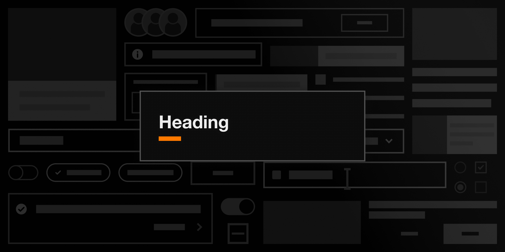
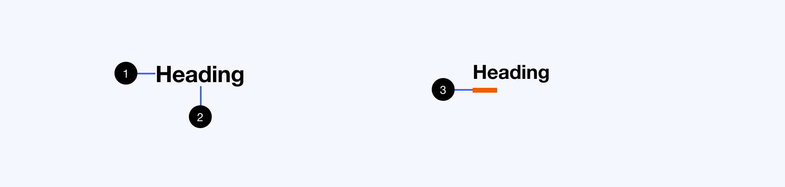
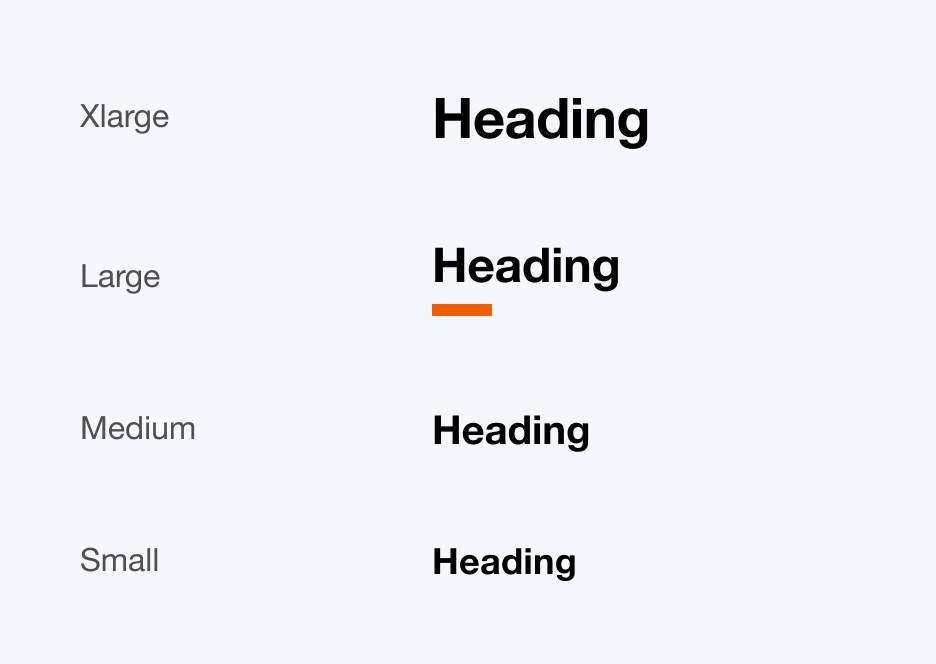
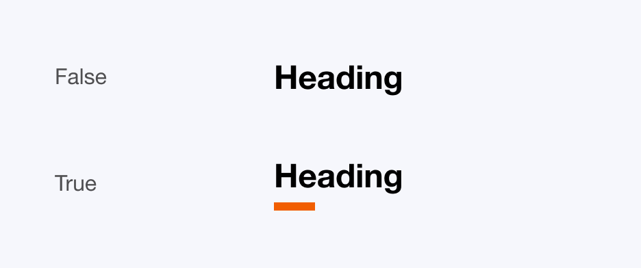
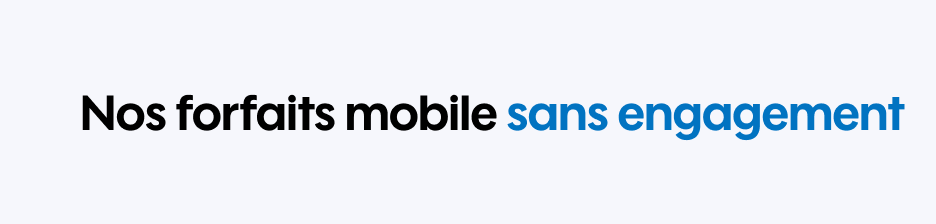
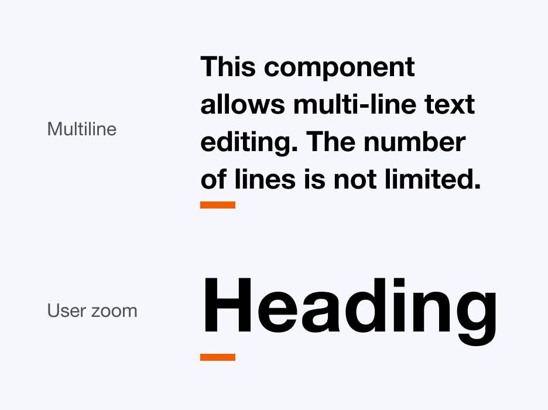
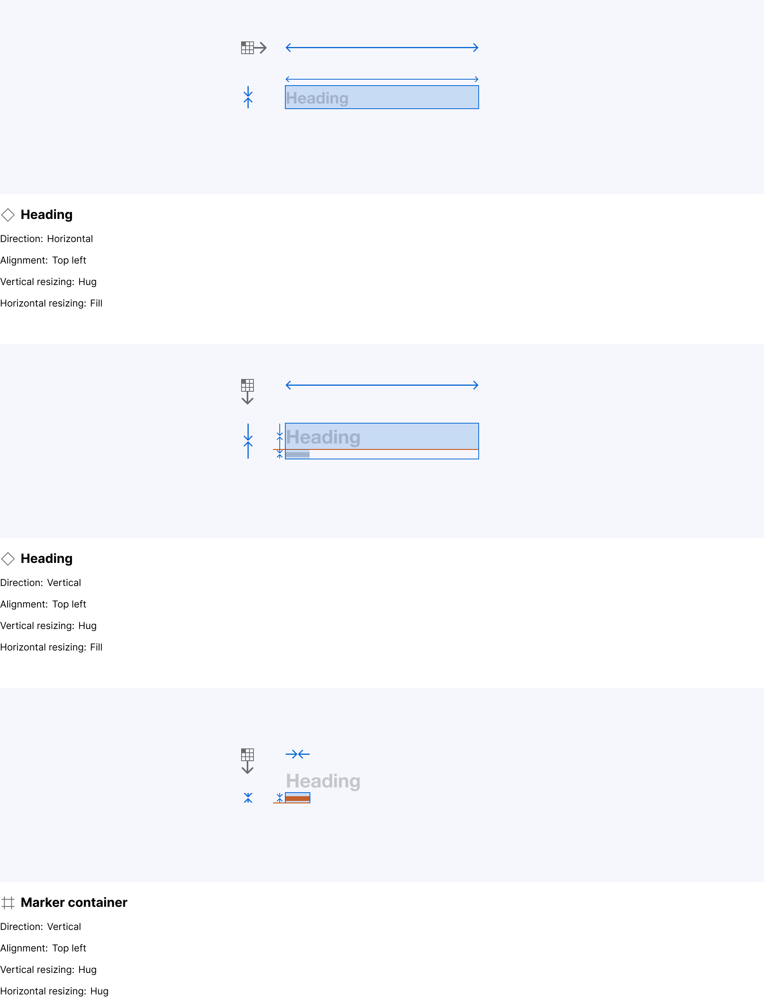

# Heading

A heading is a UI element that styles typography to structure content and define the hierarchy of information within an interface.

# Guideline

## Anatomy

| # | Element | Purpose | Optional |
|---|---------|---------|----------|
| 1 | Heading container | The component: the text block whose width and alignment are set by its container | No |
| 2 | Heading text | The text itself, styled with the Heading type scale | No |
| 3 | Marker | The brand accent bar displayed under the heading | Yes |

## Definition

A heading is a UI element that styles typography to structure content and define the hierarchy of information within an interface.

The heading features multiple sizes options, to help users quickly understand the organisation of a page or section. Variants automatically adjust across breakpoints to ensure optimal readability on all devices. Heading serve as the primary entry point for visual navigation.

## Size

<!-- zh-row -->

**`Xlarge`** The highest level of heading hierarchy, used to introduce major sections and establish clear content structure. It serves as the primary navigational anchor within a page or experience.

**`Large`** A high-emphasis heading used for important sections and content groupings. It helps organize information while maintaining strong visual hierarchy.

**`Medium`** A versatile heading size suitable for standard section titles and subsections. It provides a clear hierarchy while preserving content balance.

**`Small`** The most compact heading size, designed for minor sections and localized content organization. Use it where a heading is required within limited space.

## Marker

<!-- zh-row -->

When enabled, a brand-colored marker is displayed below the heading large to enhance its visual emphasis and reinforce information hierarchy. This optional decorative element helps highlight important sections and improve content scanability. Use it selectively to maintain its impact and avoid visual clutter.

**`False`** The marker is not visible

**`True`** The marker is visible

&nbsp;

### Brand theme availability
This option is technically not available for all brand themes. Here's the list of marker availability by brand theme:

| **Brand theme** | **Availability** |
|---|---|
| Orange | ✅ Available |
| Orange Compact | ✅ Available |
| Sosh | ❌ Unavailable |
| Wireframe | ✅ Available |

<!-- zh-row -->

### Sosh specifications
The Sosh brand has chosen not to use a marker, instead relying on the "color-content-brand-secondary" color to highlight one or more important words in a heading.  
A heading may also use just a single color token: "color-content-default" or "color-content-brand-secondary".

## Multiline and responsiveness

<!-- zh-row -->

### Multiline
This component allows multi-line text editing. The number of lines is not limited.

&nbsp;

### Max-width vs full-width
This component has a default max-width.  
For the “Heading xlarge” variant, the global max-width token will be: size-max-width-heading-xlarge  
For the “Heading large” variant, the global max-width token will be: size-max-width-heading-large  
For the “Heading medium” variant, the global max-width token will be: size-max-width-heading-medium  
For the “Heading small” variant, the global max-width token will be: size-max-width-heading-small

&nbsp;

### User zoom in/out
The behavior of the text during user zoom in/out must follow a fundamental principle: the text must remain readable, accessible, and must never break the structure or lose information.  
  • The text must always scale proportionally with user zoom. Text resizing must never be blocked.  
  • Zooming must never cause text to be truncated or hidden. The component must expand vertically to allow line wrapping.  
  • The component’s height and width must be flexible, never fixed, in order to automatically adapt its dimensions according to the level of zoom.  
  • Even if, the component has a max-height or a max-width for resizing control purposes, technically, during user zoom in, these limitations are not fixed but must be scalable in order to adapt to the user’s zoom level.  
  • As the marker isn’t functional, user zoom in/out doesn’t affect the size of the element; they remain fixed in size (decorative use).

# Specs

## Layout and spacing

# Accessibility

Work is in progress to deliver this content.

# Develop

## OUDS-Web example

[Components/Typography › Typography 1](https://web.unified-design-system.orange.com/storybook/?path=/story/components-typography--typography-1)

[Components/Typography › Typography 3](https://web.unified-design-system.orange.com/storybook/?path=/story/components-typography--typography-3)

## Developer documentation

| Platform | Developer documentation |
|---|---|
| OUDS Web | [S-ouds-web-typography-heading](https://r.orange.fr/r/S-ouds-web-typography-heading) |
| OUDS Android | [S-ouds-android-typography-heading](https://r.orange.fr/r/S-ouds-android-typography-heading) |
| OUDS iOS | [S-ouds-ios-typography-heading](https://r.orange.fr/r/S-ouds-ios-typography-heading) |
| OUDS Flutter | [S-ouds-flutter-typography-heading](https://r.orange.fr/r/S-ouds-flutter-typography-heading) |

# Changelog

## Availability

| Platform | Resource | Status | Version |
|---|---|---|---|
| Figma | [Heading component](https://r.orange.fr/r/S-ouds-design-typography-heading) | Live | 1.1.0 |
| OUDS Web (former Boosted) | [Web dev documentation](https://r.orange.fr/r/S-ouds-web-typography-heading) | Live | 1.1.0 |
| OUDS Android - Jetpack Compose | [Android dev documentation](https://r.orange.fr/r/S-ouds-android-typography-heading) | Live | 1.1.0 |
| OUDS iOS - Swift | [iOS dev documentation](https://r.orange.fr/r/S-ouds-ios-typography-heading) | Live | 1.1.0 |
| OUDS Flutter | [Flutter dev documentation](https://r.orange.fr/r/S-ouds-flutter-typography-heading) | Live | 1.1.0 |

## Design changelog

| Date | Number | Notes |
|------|--------|-------|
| Sep 7, 2026 | 1.1.0 | Version 2.7 of the design tokens is required for the development of this update. <ul><li>The marker color is now controlled by a component token:<ul><li>foundation-typography-color-content-marker-light<li>foundation-typography-color-content-marker-dark</ul><li>The marker’s vertical spacing tokens are replaced with raw values:<ul><li>foundation-typography-space-padding-block-top-heading-large-marker<li>foundation-typography-space-padding-block-bottom-heading-large-marker</ul></ul> |
| Jun 16, 2026 | 1.0.0 | Version 2.6 of the design tokens is required for the development of this update. <ul><li>Component creation</ul> |
