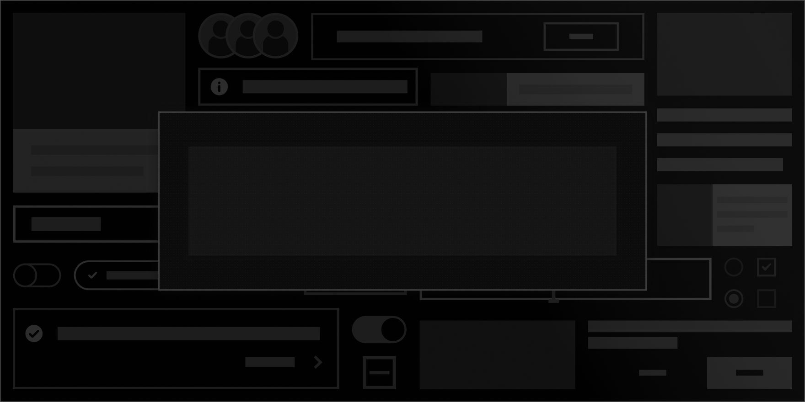
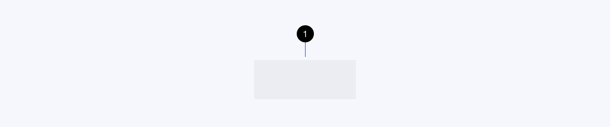
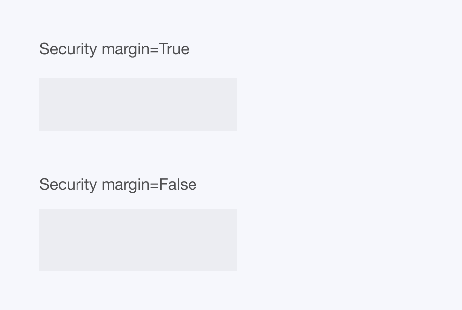
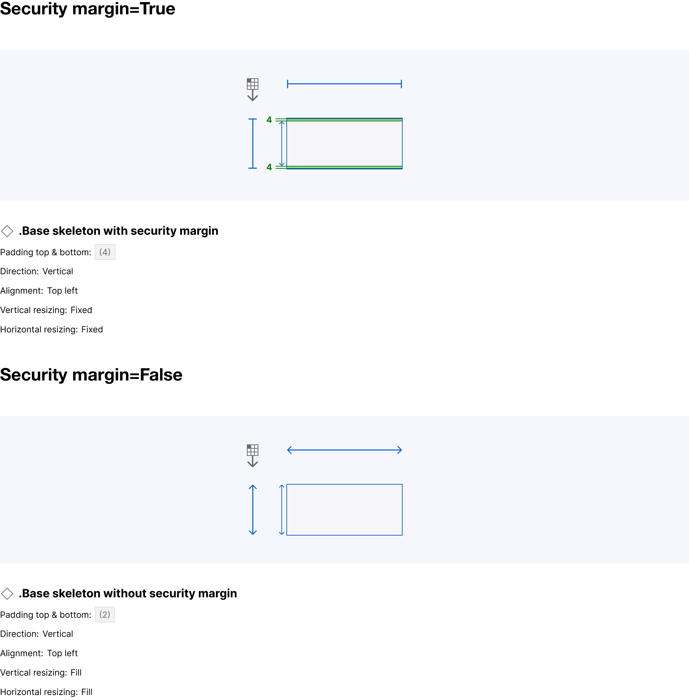

# Skeleton

A skeleton is a UI element that indicates when content is loading.

# Guideline

## Anatomy

| # | Element | Purpose | Optional |
|---|---------|---------|----------|
| 1 | Container | Defines the visual placeholder shape that represents the layout of the content being loaded | No |

## Definition

A skeleton is a UI element that indicates when content is loading.

The skeleton enhances user experience by temporarily replacing content with gray areas or animations that simulate the visual structure of the forthcoming content.

## Boolean options

**`Security margin`** Depending on the position of components in the Skeleton screen template, two variants are possible:  
• If a margin (spacing) is present between two or more components, apply the version "Security margin=False" to the affected components.  
• If no spacing is present between two or more components, apply the version "Security margin=True" to the affected components.

The "Security margin=True" variant includes transparent padding (with 0% opacity) at the top and bottom of the skeleton component. This padding prevents the creation of excessively large uniform surfaces, maintaining a visually balanced and structured layout.

# Specs

## Layout and spacing

# Accessibility

Mark the skeleton as a temporary element: Add aria-hidden="true" to indicate that the skeleton is not interactive or relevant for screen readers.  
  
Provide accessible loading messages: Use aria-live="polite" or aria-busy="true" on the main container to signal that content is being updated.

## Assistive technologies

Skeleton elements should not distract or draw attention from assistive technologies. Ensure assistive technologies announce when real content replaces the skeleton.

## Alt Text

Skeleton components themselves do not require alt text. Contextual alt text should be provided for the final loaded content.

## Keyboard Navigation

Skeleton elements should not be keyboard accessible: Ensure no tabbing (via the Tab key) is possible on these elements. This means Skeleton elements must not include interactive content or have a tab index attribute.

## Motion & Animation accessibility rules

In terms of animation, there are accessibility criteria to consider: “Animation from Interactions” and “Pause, Stop, Hide.”  
These two main criteria address different issues:

&nbsp;

### Pause, Stop, Hide - WCAG 2.2.2
This concerns moving, blinking, scrolling, or automatically updating content.  
The question to ask is: does the animation start automatically and meet the criterion’s conditions?  
When a relevant animation lasts more than 5 seconds, users must be able to pause, stop, or hide it.  
The two criteria should therefore be evaluated independently.

&nbsp;

### Reduced Motion (Animation from Interactions) - WCAG 2.3.3
This primarily concerns motion-based animations triggered by user interaction.  
The question to ask is: is the movement essential to the functionality or to the information being conveyed?  
If not, the animation should be removed, reduced, or replaced when the user has enabled Reduced Motion.

ℹ️ The reduced motion preference can be configured by the user at the operating system level and is available to websites through the CSS prefers-reduced-motion media feature.

Concrete application to the Skeleton:

&nbsp;

### Pause, Stop, Hide
When a skeleton uses an automatic shimmer animation, it is recommended to keep the animation short and avoid looping it indefinitely when this is not necessary.  
If the automatic animation meets the criterion's conditions, users must be able to pause, stop, or hide it.  
A recommended alternative is to play a single short animation, then keep the skeleton blocks in a static state until the content has loaded.

&nbsp;

### Reduced Motion
Skeleton animation is not essential to conveying the information that content is currently loading.  
When Reduced Motion is enabled, the skeleton animation should therefore be removed. The skeleton blocks should remain visible in a static state until the content has loaded.

# Develop

## OUDS-Web example

[Components/Skeleton › Skeleton 0](https://web.unified-design-system.orange.com/storybook/?path=/story/components-skeleton--skeleton-0)

[Components/Skeleton › Skeleton 7](https://web.unified-design-system.orange.com/storybook/?path=/story/components-skeleton--skeleton-7)

## Developer documentation

| Platform | Developer documentation |
|---|---|
| OUDS Web | [S-ouds-web-skeleton](https://r.orange.fr/r/S-ouds-web-skeleton) |
| OUDS Android | Not available yet |
| OUDS iOS | [S-ouds-ios-skeleton](https://r.orange.fr/r/S-ouds-ios-skeleton) |
| OUDS Flutter | [S-ouds-flutter-skeleton](https://r.orange.fr/r/S-ouds-flutter-skeleton) |

c

# Changelog

## Availability

Design status: **LIVE**

| Platform | Resource | Status | Version |
|---|---|---|---|
| Figma | [Skeleton component](https://r.orange.fr/r/S-ouds-design-skeleton) | Done | 1.1.0 |
| OUDS Web (former Boosted) | [Web dev documentation](https://r.orange.fr/r/S-ouds-web-skeleton) | Done | 1.0.0 |
| OUDS Android - Jetpack Compose | Not available yet | Done | 1.1.0 |
| OUDS iOS - Swift | [iOS dev documentation](https://r.orange.fr/r/S-ouds-ios-skeleton) | Done | 1.1.0 |
| OUDS Flutter | [Flutter dev documentation](https://r.orange.fr/r/S-ouds-flutter-skeleton) | Done | 1.0.0 |

## Design changelog

| Date | Number | Notes |
|------|--------|-------|
| Sep 1, 2026 | - | <ul><li>Documentation writing: Motion & Animation accessibility rules.</ul> |
| Jan 6, 2026 | - | <ul><li>Documentation writing: Definition update</ul> |
| Dec 5, 2024 | 1.0.0 | • Component creation |
