# Categorical tag

A categorical tag is a UI element that visually differentiates non-functional categories using distinct categorical colors.

# Guideline

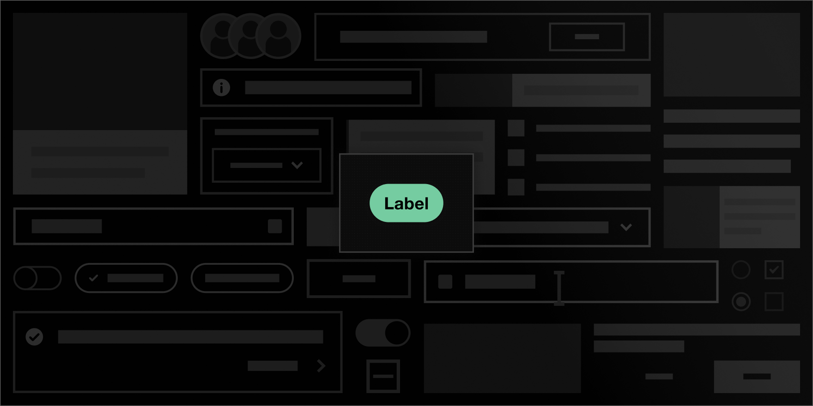

## Anatomy

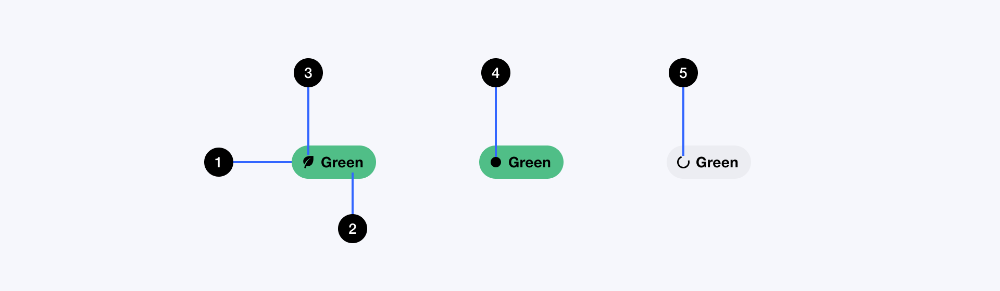

| # | Element | Purpose | Optional |
|---|---------|---------|----------|
| 1 | Container | The surface filled with one of the five categorical colours, with square or rounded corners | No |
| 2 | Label | The text that names the category | No |
| 3 | Icon | Reinforces the category named by the label (Text + Icon layout) | Yes |
| 4 | Bullet | A small marker that helps users scan categories (Text + Bullet layout) | Yes |
| 5 | Loading indicator | Replaces the icon or bullet while the category is being retrieved | Yes |

## Definition

A categorical tag is a UI element that visually differentiates non-functional categories using distinct categorical colors.

The categorical tag does not support any interaction. It can represent information such as promotions, events, benefits, or other locally defined categories.

## Category

The Category property defines the categorical colour used by the component.  
Categories are identified by numbers 1 to 5 because the actual colour may vary depending on the active theme, product or local market guidelines. The number identifies a reusable colour slot. It does not represent priority, hierarchy, severity or functional status.

**`1`** Uses categorical colour slot 1.

**`2`** Uses categorical colour slot 2.

**`3`** Uses categorical colour slot 3.

**`4`** Uses categorical colour slot 4.

**`5`** Uses categorical colour slot 5.

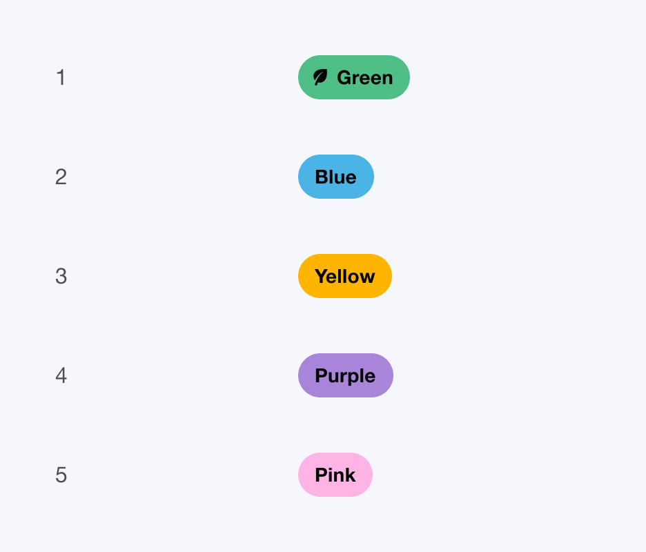

In some local guidelines, a green categorical colour may be reserved for environmental information such as Eco-friendly or Refurbished. When colors are assigned to categories, keep the same association within the same context to support recognition.

⚠️ Categorical colours do not represent success, warning, error or other functional meanings.

## Layouts

**`Text only`** Use Text only in most cases. It is recommended when the label alone is enough to identify the category.

**`Text + Bullet`** Use Text + Bullet when a small visual marker helps users scan or distinguish categories more quickly. The bullet supports visual categorisation only. It must not communicate a functional status by itself.

**`Text + Icon`** Use Text + Icon when an icon helps users recognise the category more quickly. The icon should reinforce the information already communicated by the label.

⚠️ Do not use functional icons for success, warning, error or information.  
⚠️ Do not add an icon only for decoration.

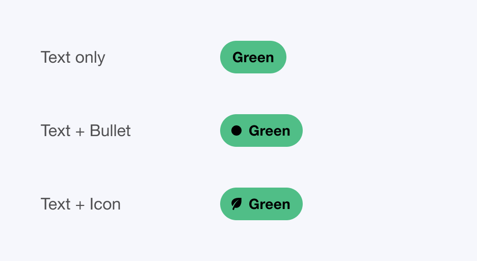

## Size

**`Default`** Use Default as the standard size.  
It is suitable when the Categorical tag needs clear visual presence or is used as the main categorical label in a component.

**`Small`** Use Small in compact or information-dense layouts.

Small is suitable for:  
• Product cards  
• Dense lists  
• Tables  
• Compact metadata  
• Secondary categorical information

⚠️ Use the same size for Categorical tags that have the same role within a group.

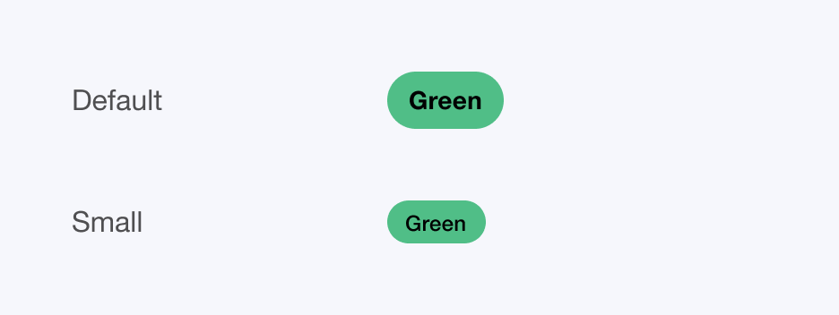

## Rounded corner

Rounded corner changes the visual style of the Categorical tag but does not change its meaning.  
Use the same corner style for comparable Categorical tags within the same context.

**`True`** Displays the Categorical tag with fully rounded corners.  
Use when rounded components are part of the visual language of the product or service.

**`False`** Displays the Categorical tag with square corners.  
Use when square components are part of the visual language of the product or service.

⚠️ Use the same corner style for comparable Categorical tags within the same context. Do not mix rounded and square tags only to create visual variety.

This option is available for all brand themes

| Brand theme | Status |
|---|---|
| Orange | ✅ Available |
| Orange Compact | ✅ Available |
| Sosh | ✅ Available |
| Wireframe | ✅ Available |

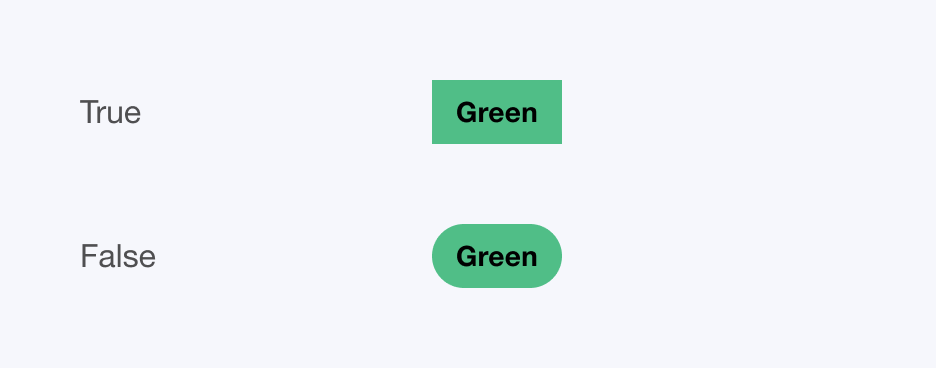

## Use cases

The use of tags depends on the local Art Direction of each country, brand or product.

&nbsp;

### ⚠️ Important
Do not use Categorical tags only to make content more colourful or visually prominent.  
Use them only when their categories and colour meanings are explicitly defined in the Art Direction or brand guidelines of the country or product. Introducing Categorical tags into an identity where they are not defined can create inconsistency and make users interpret colours as meaningful when they are not.

### Categorical tag
• Some identities use Categorical tags as part of their Art Direction.  
• Colours can be linked to specific categories defined by the brand, for example green for environmental content.

⚠️ Use them only when this colour logic is documented in the local guidelines, not simply as a visual accent.

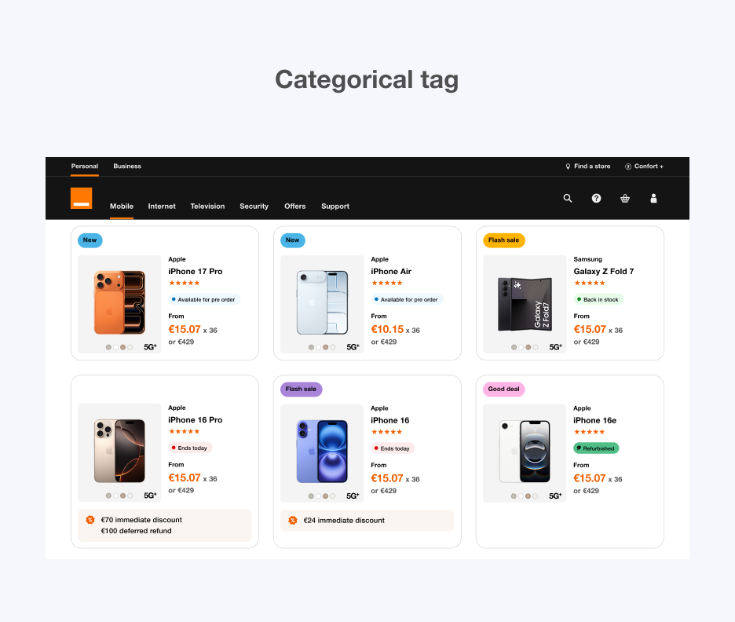

### ⚠️ Orange France
• Orange France uses the standard Tag in its Art Direction.  
• For promotional content, mainly Neutral and Yellow tags are used, always with square corners. Yellow can also be used for the Warning semantic style.

• Do not replace these tags with Categorical tags. Follow the existing Orange France Art Direction to keep promotional experiences consistent.

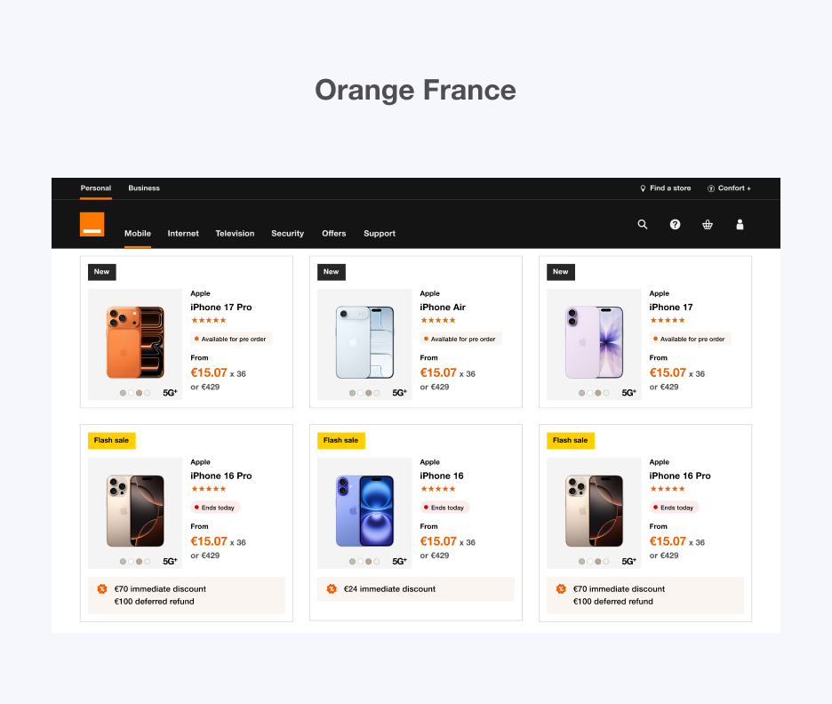

### ⚠️ Orange Belgium
• Orange Belgium also uses the standard Tag, but with a different local Art Direction.  
• Tags use rounded corners, and promotional content can use an Orange accent tag instead of the Yellow style used by Orange France.

• Corner style and colour should always follow the rules defined by the local Art Direction. The component itself supports both rounded and square styles depending on the visual language of the product or service.

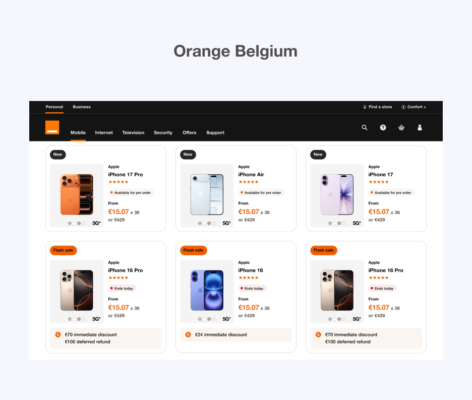

## Multiline and responsiveness

### Multiline
This component doesn’t allows multi-line text editing. This is a design recommendation, technically, and for several reasons (responsive behavior, user zoom, etc.), multiline remains possible.

&nbsp;

### Max-width vs full-width
For greater flexibility, this component doesn’t have a default max-width. To avoid exceeding a width that would degrade readability and the perception of a compact interactive element, we recommend applying a max-width of around 200px.  
• In its “Rounded corner=True”, it’s not possible to set this component to use the full available width (of the screen or the container).  
• In its “Rounded corner=False”, it’s possible to set this component to use the full available width (of the screen or the container). As a result, the component’s background will stretch across the entire available surface, but the text must be limited to its number of characters.

&nbsp;

### User zoom in/out
The behavior of the text during user zoom in/out must follow a fundamental principle: the text must remain readable, accessible, and must never break the structure or lose information.  
• The text must always scale proportionally with user zoom. Text resizing must never be blocked.  
• Zooming must never cause text to be truncated or hidden. The component must expand vertically to allow line wrapping.  
• The component’s height and width must be flexible, never fixed, in order to automatically adapt its dimensions according to the level of zoom.  
• In order to preserve the minimum visible area during user zoom out, this component have:  
  • Default size: a min-width of 48px and a min-height of 32px  
  • Small size: a min-width of 44px and a min-height of 24px  
• Even if, the component has a max-height or a max-width for resizing control purposes, technically, during user zoom in, these limitations are not fixed but must be scalable in order to adapt to the user’s zoom level.  
• Icons, bullets or loader must always scale proportionally with user zoom. Icon resizing must never be blocked.

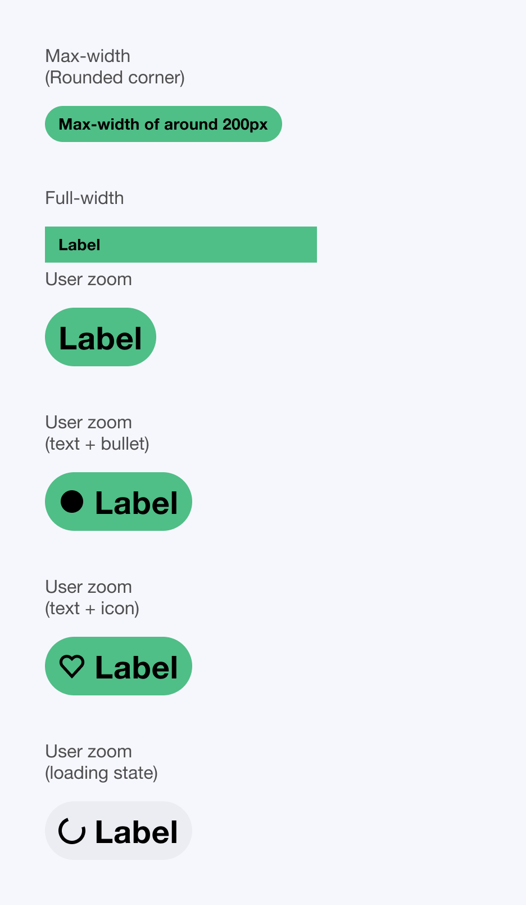

# Specs

## Layout and spacing

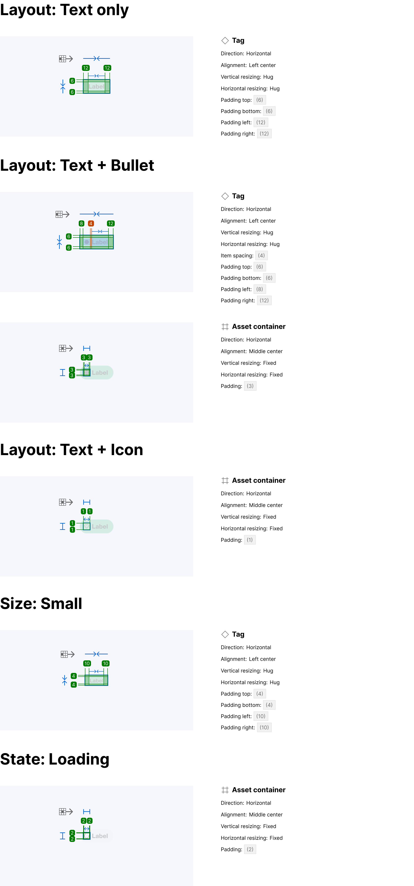

## States

**`Enabled`** Enabled is the default state.  
Use it when the categorical information is available and current.  
Because the Categorical tag is non-interactive, Enabled does not introduce hover, pressed or focus behaviour.

**`Loading`** Use Loading while the final categorical information is being retrieved or updated. The loading indicator communicates processing only.  
It does not make the Categorical tag interactive.

Use case:  
• Displaying status before API data is available. For example, while the system fetches the real value, the tag shows "Loading".  
• Data updates or filtering. When a table or list is being updated (applying filters or refreshing data), the tag temporarily shows loading and is then replaced with the actual value.

**`Disabled`** Use Disabled when the represented information is no longer available or applicable. Disabled describes the state of the information, not the availability of an action.

Use case:  
• Used when a status is no longer valid (an order is canceled and the tag is no longer meaningful).  
• When the tag is part of a status system but currently has no value to display.

⚠️ Do not use Disabled only to reduce visual emphasis.

**`Skeleton`** Use Skeleton while the final Categorical tag content is not yet available.  
Replace it with the final label as soon as the content is loaded.

Use case:  
• Used to display the structure of the interface while waiting for data.  
• Helps avoid abrupt interface changes and provides a smoother experience.

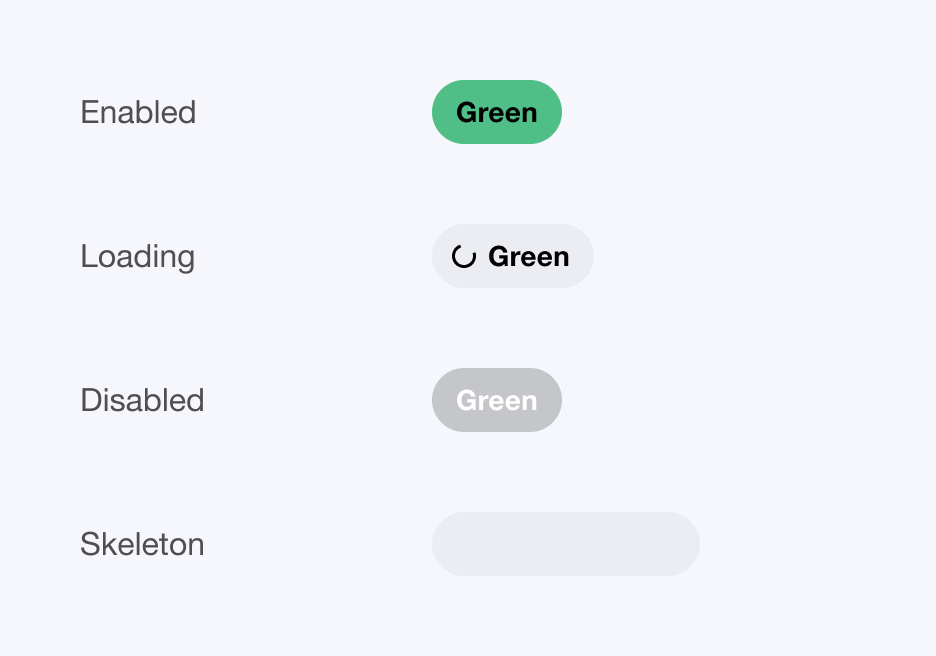

# Accessibility

Work is in progress to deliver this content.

# Develop

## OUDS-Web example

[Components/Tags › Tags 15](https://web.unified-design-system.orange.com/storybook/?path=/story/components-tags--tags-15)

## Developer documentation

| Platform | Developer documentation |
|---|---|
| OUDS Web | [S-ouds-web-categorical-tag](https://r.orange.fr/r/S-ouds-web-categorical-tag) |
| OUDS Android | Not available yet |
| OUDS iOS | [S-ouds-ios-categorical-tag](https://r.orange.fr/r/S-ouds-ios-categorical-tag) |
| OUDS Flutter | Not available yet |

# Changelog

## Availability

Design status: **DEV**

| Platform | Resource | Status | Version |
|---|---|---|---|
| Figma | [Categorical tag component](https://r.orange.fr/r/S-ouds-design-categorical-tag) | Done | 1.0.0 |
| OUDS Web (former Boosted) | [Web dev documentation](https://r.orange.fr/r/S-ouds-web-categorical-tag) | Done | 1.0.0 |
| OUDS Android - Jetpack Compose | Not available yet | To do | – |
| OUDS iOS - Swift | [iOS dev documentation](https://r.orange.fr/r/S-ouds-ios-categorical-tag) | Done | 1.0.0 |
| OUDS Flutter | Not available yet | To do | – |

## Design changelog

| Date | Number | Notes | Designer |
|------|--------|-------|----------|
| Sep 9, 2025 | 1.0.0 | **Version 2.7 of the design tokens is required for the development of this update.**<ul><li>Component creation</ul> | Anton Astafev |
