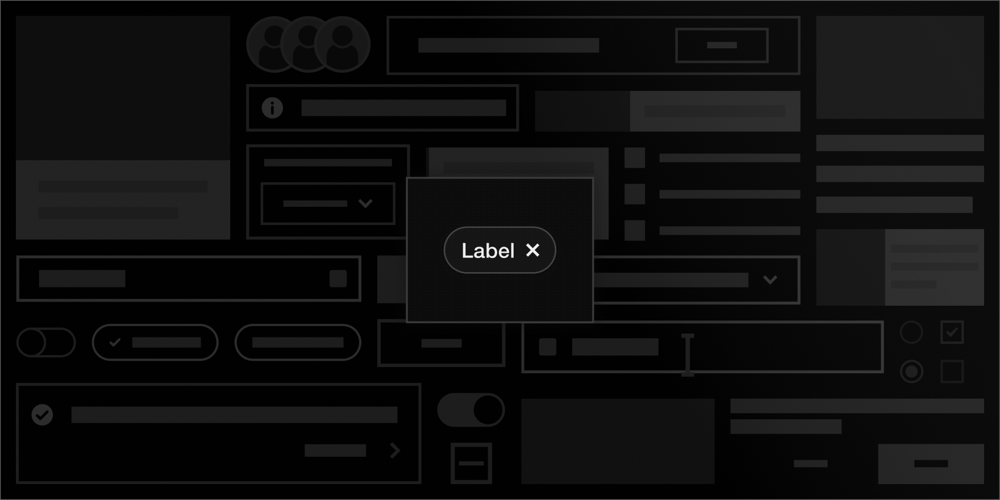
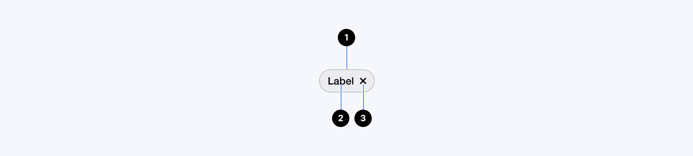
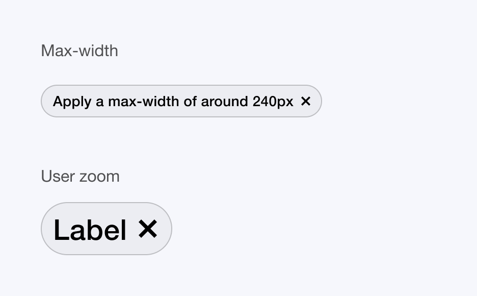
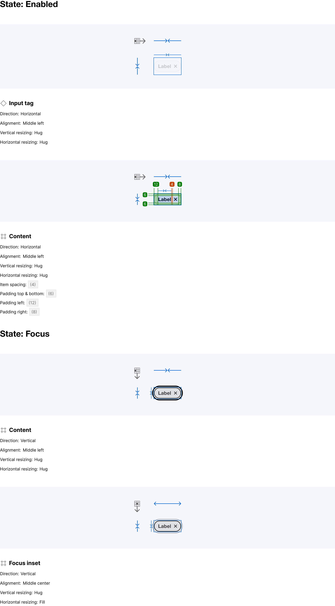
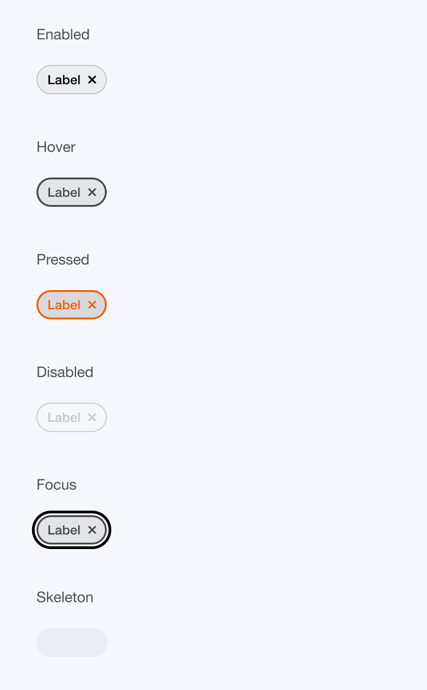

# Input tag

An input tag is a UI element that renders an entered value as a tag, allowing it to display brief information like a label, keyword, or category.

# Guideline

## Anatomy

| # | Element | Purpose | Optional |
|---|---------|---------|----------|
| 1 | Container | Provides the visual boundary with rounded pill shape and holds all tag elements | No |
| 2 | Label | Displays the user-entered value as readable text within the tag | No |
| 3 | Close icon | Enables users to remove the tag by clicking or tapping | No |

## Definition

An input tag is a UI element that renders an entered value as a tag, allowing it to display brief information like a label, keyword, or category.

The input tag allows users to type and submit values (typically by pressing enter, comma, or tab), transforming each value into a tag.

## Multiline and responsiveness

<!-- zh-row -->

### Multiline
This component doesn't allows multi-line text editing. This is a design recommendation, technically, and for several reasons (responsive behavior, user zoom, etc.), multiline remains possible.

&nbsp;

### Max-width vs full-width
For greater flexibility, this component doesn't have a default max-width. To avoid exceeding a width that would degrade readability and the perception of a compact interactive element, we recommend applying **a max-width of around 240px.**  
It is not possible to set this component to use the full available width (of the screen or the container).

&nbsp;

### User zoom in/out
The behavior of the text during user zoom in/out must follow a fundamental principle: the text must remain readable, accessible, and must never break the structure or lose information.
- The text must always scale proportionally with user zoom. Text resizing must never be blocked.
- Zooming must never cause text to be truncated or hidden. The component must expand vertically to allow line wrapping.
- The component's height and width must be flexible, never fixed, in order to automatically adapt its dimensions according to the level of zoom.
- In order to preserve the minimun interactive area during user zoom out, this component have a min-width and a min-height.
- Even if, the component has a max-height or a max-width for resizing control purposes, technically, during user zoom in, these limitations are not fixed but must be scalable in order to adapt to the user's zoom level.
- As the close icon is functional, it must follow the same rules as text.

# Specs

## Layout and spacing

## States

<!-- zh-row -->

**`Enabled`** The default state of the Input tag. The tag is fully interactive, allowing users to read the label and remove the tag if needed.

**`Hover`** Displayed when a user hovers the cursor over the tag. Visual cues (such as a highlighted border) indicate that the tag is interactive and can be removed.

**`Pressed`** Shown when the tag is actively being clicked or tapped. The tag appears pressed or highlighted, providing feedback that the action is being performed.

**`Disabled`** Indicates that the tag is non-interactive. The tag appears faded or greyed out, and users cannot interact with it or remove it.

**`Focus`** Appears when the tag is focused, typically via keyboard navigation or screen reader. A distinct outline or highlight indicates that the tag is in focus, supporting accessibility.

**`Skeleton`** A placeholder state displayed while content is loading. The tag appears as a simplified, greyed-out shape without label text, indicating to users that tags will soon be available.

# Accessibility

Work is in progress to deliver this content.

# Develop

## OUDS-Web example

[Components/Tags › Tags 25](https://web.unified-design-system.orange.com/storybook/?path=/story/components-tags--tags-25)

## Developer documentation

| Platform | Developer documentation |
|---|---|
| OUDS Web | [S-ouds-web-input-tag](https://r.orange.fr/r/S-ouds-web-input-tag) |
| OUDS Android | [S-ouds-android-input-tag](https://r.orange.fr/r/S-ouds-android-input-tag) |
| OUDS iOS | [S-ouds-ios-input-tag](https://r.orange.fr/r/S-ouds-ios-input-tag) |
| OUDS Flutter | [S-ouds-flutter-input-tag](https://r.orange.fr/r/S-ouds-flutter-input-tag) |

# Changelog

## Availability

| Platform | Resource | Status | Version |
|---|---|---|---|
| Figma | [Input tag component](https://r.orange.fr/r/S-ouds-design-input-tag) | Live | 1.2.0 |
| OUDS Web (former Boosted) | [Web dev documentation](https://r.orange.fr/r/S-ouds-web-input-tag) | Live | 1.2.0 |
| OUDS Android - Jetpack Compose | [Android dev documentation](https://r.orange.fr/r/S-ouds-android-input-tag) | Live | 1.2.0 |
| OUDS iOS - Swift | [iOS dev documentation](https://r.orange.fr/r/S-ouds-ios-input-tag) | Live | 1.2.0 |
| OUDS Flutter | [Flutter dev documentation](https://r.orange.fr/r/S-ouds-flutter-input-tag) | Live | 1.2.0 |

## Design changelog

| Date | Number | Notes |
|------|--------|-------|
| Apr 22, 2026 | 1.2.0 | <b>Version 2.4 of the design tokens is required for the development of this update.</b> <ul><li>The text reference of the label changes from a bold weight (font-weight-label-strong) to a medium weight (font-weight-label-moderate).</ul> |
| Mar 16, 2026 | - | <ul><li>Documentation writing: Multiline and responsiveness</ul> |
| Jan 6, 2026 | - | <ul><li>Documentation writing: Definition update</ul> |
| Jul 21, 2025 | 1.1.0 | • Several design token updates: [Component tokens changelog 1.3.0](https://www.figma.com/design/Co2t6wHMf4GB9NJVGs2Hes/-OUDS-Core-Lib--Design-tokens?m=auto&node-id=9280-2568&t=HLVB4jOd35DWr8Bj-1) |
| Mai 20, 2025 | 1.0.0 | • Component creation |
