# Tag

A tag is a UI element that shows brief information, such as a label, keyword, or category.

# Guideline

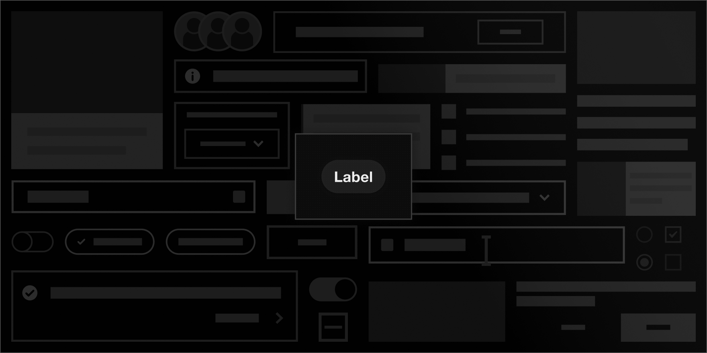

## Anatomy

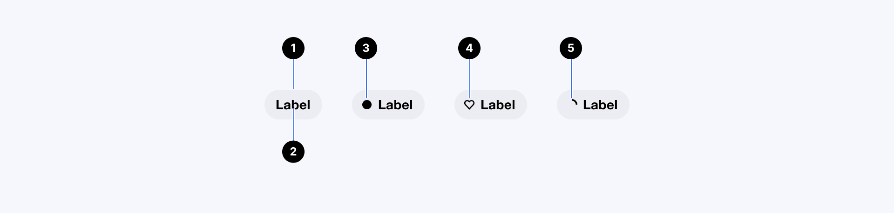

| # | Element | Purpose | Optional |
|---|---------|---------|----------|
| 1 | Container | Provides the visual boundary and background color for the tag | No |
| 2 | Label | Displays the primary information or status text | No |
| 3 | Bullet indicator | Shows status or presence with a small circular element | Yes |
| 4 | Leading icon | Reinforces meaning with a visual symbol before the text | Yes |
| 5 | Loader | Indicates loading state with a spinning animation | Yes |

## Definition

A tag is a UI element that shows brief information, such as a label, keyword, or category.

The tag assist users in quickly finding, grouping, or understanding content. They can remain in place or be removed and may include icons or actions such as “close” or “edit.”

## Status

Tags have status depending on the context of the information they represent. Each state is designed to convey a specific meaning and ensure clarity in communication.

&nbsp;

### Non-functional
Non-functional tags are used to display categories, default states, or to draw attention without carrying a specific functional meaning (unlike functional tags such as success, info, warning, and error).  
Icons related to the tag's context can be used to enhance recognition.

**`Neutral`** Default or inactive state. Used for standard labels, categories, or when no specific status needs to be communicated.

**`Accent`** Used to draw attention to new features, recommendations, or content suggestions. Invites users to explore and engage with new offerings, creating an exciting and engaging experience.

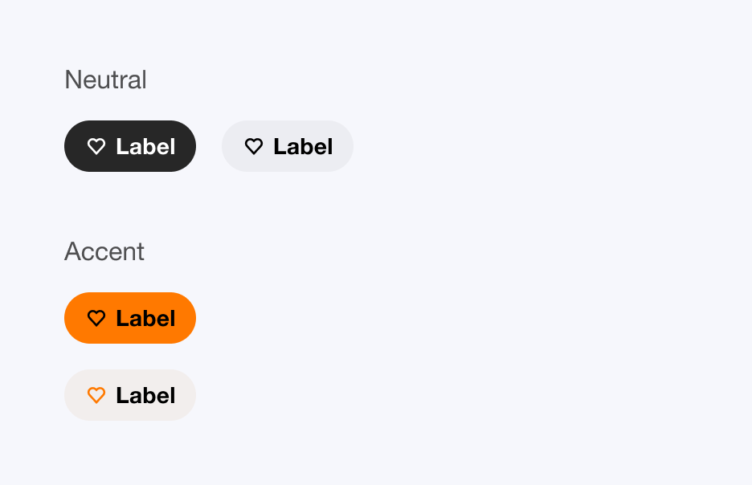

### Functional
Functional tags communicate specific statuses or system feedback (success, warning, error, information). Each tag must always be paired with its dedicated functional icon that matches the meaning of the tag.  
**Other icons must not be used.**

**`Positive`** Indicates a successful or confirmed status, such as completed tasks or active states.  
Always use the functional icon associated with success. ""

**`Warning`** Signals potential issues or actions that require user attention. Use with caution.  
Always use the functional icon associated with warning. ""

**`Negative`** Communicates errors, failed actions, or negative outcomes.  
Always use the functional icon associated with error. ""

**`Info`** Represents informational content, tips, or supportive context.  
Always use the functional icon associated with information. ""

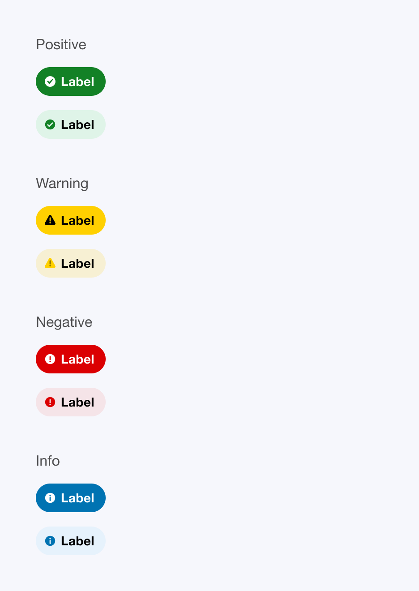

## Appearance

**`Muted`** A tag with a subtle, light, or semi-transparent background. Used for secondary or less prominent information. Muted tags blend more with the background, providing a softer visual emphasis compared to emphasized tags.

**`Emphasized`** A tag with a solid, high-contrast background. Used to draw strong attention to important labels or categories. Emphasized tags stand out prominently against the interface and are ideal for primary or high-priority information.

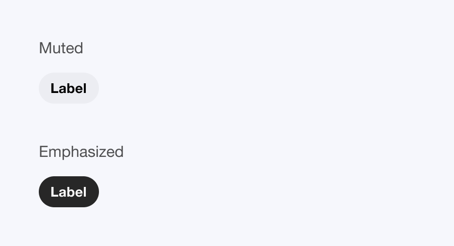

## Layouts

**`Text only`** A tag that displays only text. Used for simple labels, categories, or keywords without additional visual elements.

**`Text + Bullet`** A tag with a small indicator (bullet) alongside the text. Used to show status, presence, or activity next to the label.

**`Text + Icon`** A tag that includes an icon before the text. Used to visually reinforce the meaning of the tag, such as status, type, or action.

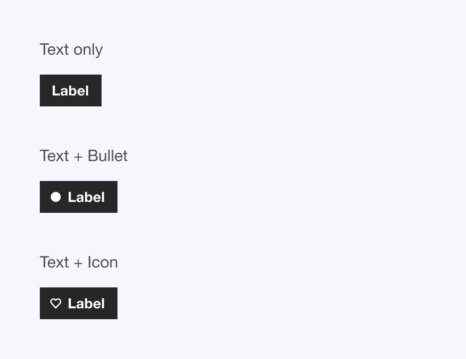

## Rounded corner

The configuration of this rendering option is not applied across an entire product/service. It is possible to have one tag component set to Rounded corner=True and another set to Rounded corner=False within the same product/service.

**`True`** A tag with fully rounded corners, creating a pill-shaped appearance. Rounded tags offer a softer and more approachable look, suitable for most modern interfaces.

**`False`** A tag with sharp, square corners. Squared tags provide a more formal, structured, or technical feel. They are often used in business contexts to label promotions, offers, or important notices.

This option is available for all brand themes. Here's the list of rounded corners availability by brand theme:

| Brand theme | Status |
|---|---|
| Orange | ✅ Available |
| Orange Compact | ✅ Available |
| Sosh | ✅ Available |
| Wireframe | ✅ Available |

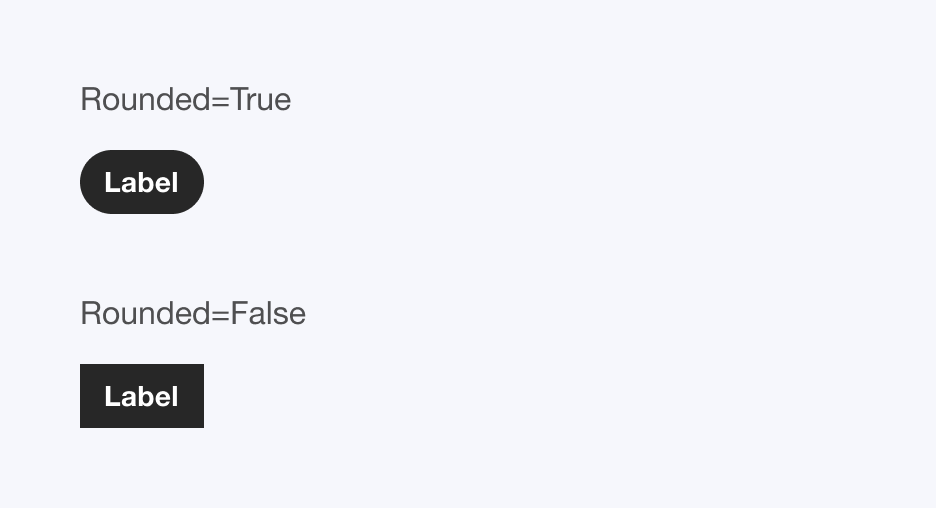

## Size

**`Default`** The standard tag size, using bold text to ensure strong visibility and readability.  
Commonly used for promotional content, highlights, or key information, where emphasis and clarity are important.

**`Small`** A compact tag with medium text, designed for tables or complex components where space efficiency matters.  
It helps maintain visual balance and prevents the interface from feeling overloaded with bold text.

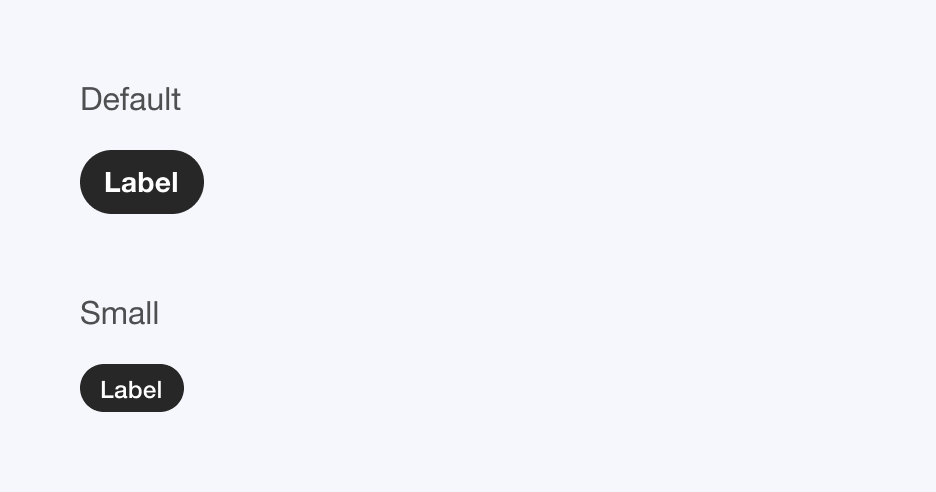

## Multiline and responsiveness

### Multiline
This component doesn't allows multi-line text editing. This is a design recommendation, technically, and for several reasons (responsive behavior, user zoom, etc.), multiline remains possible.

&nbsp;

### Max-width vs full-width
For greater flexibility, this component doesn't have a default max-width. To avoid exceeding a width that would degrade readability and the perception of a compact interactive element, we recommend applying **a max-width of around 200px.**
- In its "Rounded corner=True", it's not possible to set this component to use the full available width (of the screen or the container).
- In its "Rounded corner=False", it's possible to set this component to use the full available width (of the screen or the container). As a result, the component's background will stretch across the entire available surface, but the text must be limited to its number of characters.

&nbsp;

### User zoom in/out
The behavior of the text during user zoom in/out must follow a fundamental principle: the text must remain readable, accessible, and must never break the structure or lose information.
- The text must always scale proportionally with user zoom. Text resizing must never be blocked.
- Zooming must never cause text to be truncated or hidden. The component must expand vertically to allow line wrapping.
- The component's height and width must be flexible, never fixed, in order to automatically adapt its dimensions according to the level of zoom.
- In order to preserve the minimun visible area during user zoom out, this component have:
  - Default size: a min-width **of 48px** and a min-height **of 32px**
  - Small size: a min-width **of 44px** and a min-height **of 24px**
- Even if, the component has a max-height or a max-width for resizing control purposes, technically, during user zoom in, these limitations are not fixed but must be scalable in order to adapt to the user's zoom level.
- Icons, bullets or loader must always scale proportionally with user zoom. Icon resizing must never be blocked.

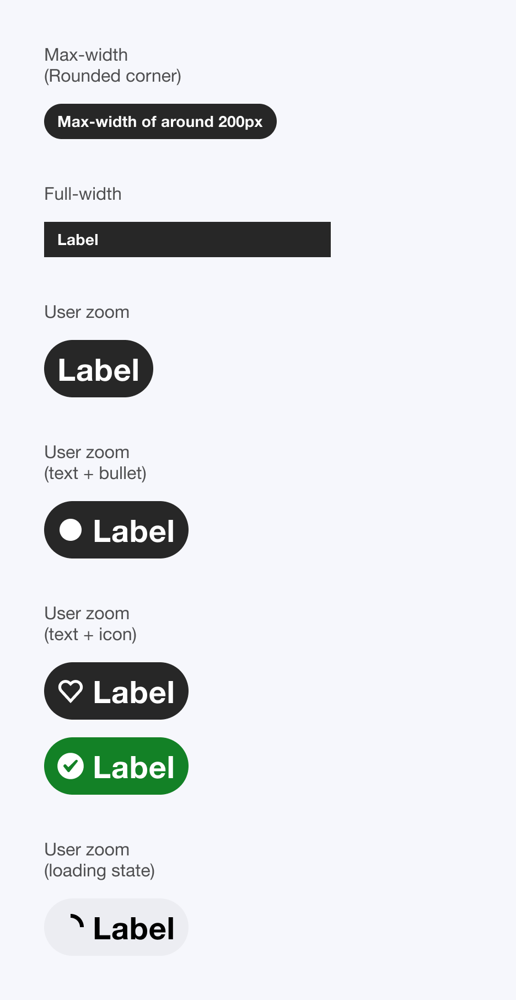

# Specs

## Layout and spacing

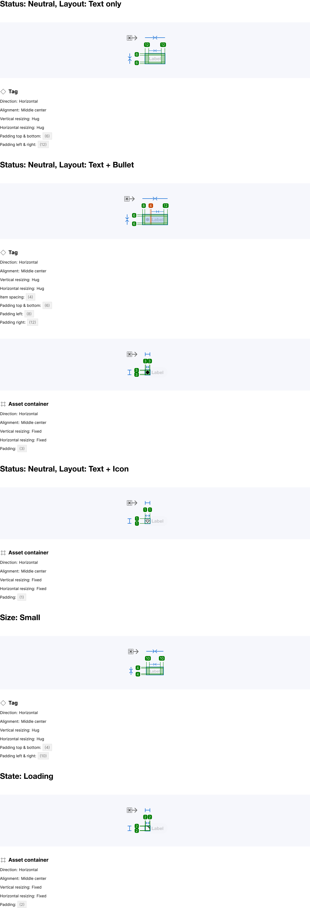

## States

Even though the Tag component is not interactive, it still includes several display states. This allows it to be flexible in different scenarios and ensures the user always sees the right visual feedback. The component supports four states: Enabled, Loading, Disabled, and Skeleton.

**`Enabled`** The default state of the tag, used to display the main information or status.

Use case:  
• Displaying a ready status or category (e.g., Shipped, Active, New).

**`Loading`** A state where the tag shows a loader together with text.

Use case:  
• Displaying status before API data is available. For example, while the system fetches the real value, the tag shows "Loading".  
• Data updates or filtering. When a table or list is being updated (applying filters or refreshing data), the tag temporarily shows loading and is then replaced with the actual value.

**`Disabled`** A non-active state of the tag. It appears "dimmed" to indicate that it is unavailable or not relevant.

Use case:  
• Used when a status is no longer valid (an order is canceled and the tag is no longer meaningful).  
• When the tag is part of a status system but currently has no value to display.

**`Skeleton`** A placeholder state shown before the actual data is loaded.

Use case:  
• Used to display the structure of the interface while waiting for data.  
• Helps avoid abrupt interface changes and provides a smoother experience.

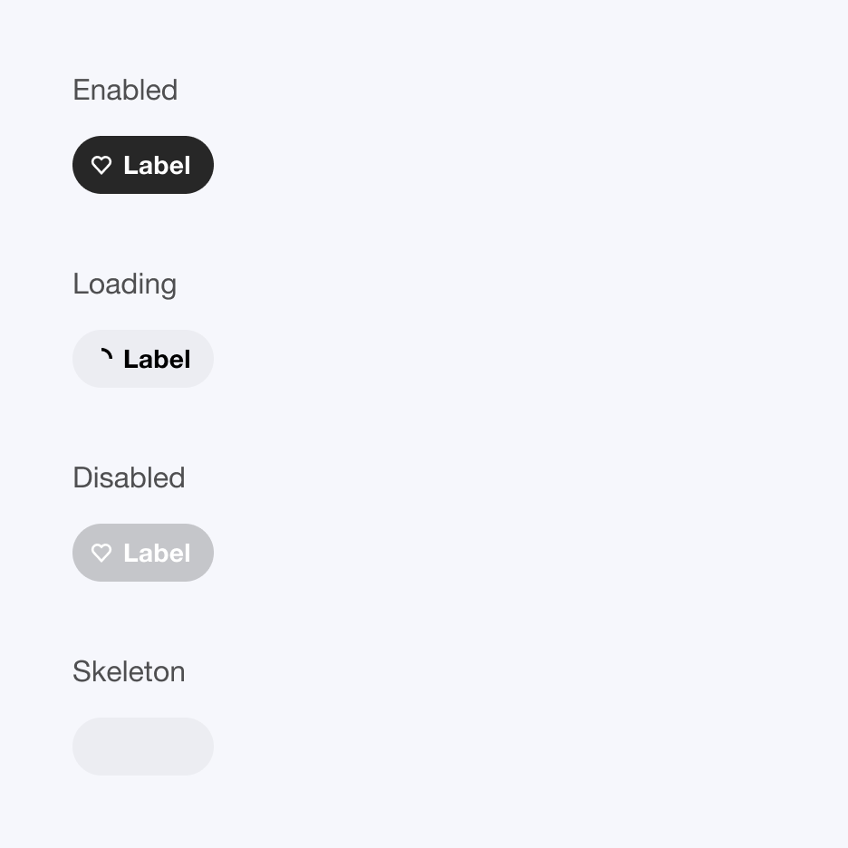

# Accessibility

Work is in progress to deliver this content.

# Develop

## OUDS-Web example

[Components/Tags › Tags 2](https://web.unified-design-system.orange.com/storybook/?path=/story/components-tags--tags-2)

[Components/Tags › Tags 3](https://web.unified-design-system.orange.com/storybook/?path=/story/components-tags--tags-3)

[Components/Tags › Tags 5](https://web.unified-design-system.orange.com/storybook/?path=/story/components-tags--tags-5)

[Components/Tags › Tags 4](https://web.unified-design-system.orange.com/storybook/?path=/story/components-tags--tags-4)

## Developer documentation

| Platform | Developer documentation |
|---|---|
| OUDS Web | [S-ouds-web-tag](https://r.orange.fr/r/S-ouds-web-tag) |
| OUDS Android | [S-ouds-android-tag](https://r.orange.fr/r/S-ouds-android-tag) |
| OUDS iOS | [S-ouds-ios-tag](https://r.orange.fr/r/S-ouds-ios-tag) |
| OUDS Flutter | [S-ouds-flutter-tag](https://r.orange.fr/r/S-ouds-flutter-tag) |

# Changelog

## Availability

Design status: **LIVE**

| Platform | Resource | Status | Version |
|---|---|---|---|
| Figma | [Tag component](https://r.orange.fr/r/S-ouds-design-tag) | Done | 1.5.0 |
| OUDS Web (former Boosted) | [Web dev documentation](https://r.orange.fr/r/S-ouds-web-tag) | Done | 1.5.0 |
| OUDS Android - Jetpack Compose | [Android dev documentation](https://r.orange.fr/r/S-ouds-android-tag) | Done | 1.5.0 |
| OUDS iOS - Swift | [iOS dev documentation](https://r.orange.fr/r/S-ouds-ios-tag) | Done | 1.5.0 |
| OUDS Flutter | [Flutter dev documentation](https://r.orange.fr/r/S-ouds-flutter-tag) | Done | 1.5.0 |

## Design changelog

| Date | Number | Notes |
|------|--------|-------|
| Apr 22, 2026 | 1.5.0 | <b>Version 2.4 of the design tokens is required for the development of this update.</b> <ul><li>For the small size, the text reference of the label changes from a bold weight (font-weight-label-strong) to a medium weight (font-weight-label-moderate). <li>By default, the content of the component is no longer centered but left-aligned. <li>Update of the min-width values for the 'default' and 'small' sizes.</ul> |
| Mar 16, 2026 | - | <ul><li>Documentation writing: <ul><li>Rounded corners brand theme availability <li>Multiline and responsiveness</ul></ul> |
| Jan 6, 2026 | - | <ul><li>Documentation writing: Definition update</ul> |
| Oct 10, 2025 | 1.4.0 | For the "Status neutral muted" variant: <ul><li>The content token "color-content-on-status-neutral-muted" has been replaced by the token "color-content-default" <li>The surface token "color-surface-status-neutral-muted" has been renamed "color-surface-secondary"</ul> For the "Status neutral emphasized" variant: <ul><li>The content token "color-content-on-status-neutral-emphasized" has been replaced by the token "color-content-inverse" <li>The surface token "color-surface-status-neutral-emphasized" has been replaced by the token "color-surface-inverse-high"</ul> |
| Oct 1, 2025 | 1.3.0 | <ul><li>Loading and Skeleton are no longer treated as separate tag statuses. Instead, they are now included as states alongside Enabled and Loading for each tag status. <li>Documentation has been updated and published in Zeroeight, with use case examples provided for every state. <li>The colors and background tokens for the functional states of the positive and info statuses have been changed. <li>The icon Warning has been replaced with a triangular shape, and for the muted Status it now uses two colors to enhance visual contrast for improved accessibility. <li>The minimum required contrast ratio has been corrected from 3:1 to 4.5:1 between text and background for both Muted and Emphasized variants, as well as for Tag: Input. <li>Updated information has been added for the use cases of Rounded Corner Tags and Square Corner Tags. <li>Functional tags (Positive, Warning, Negative, Info) differ from non-functional ones: in the layout text + iconconfiguration, they can only use functional icons, while non-functional icons are not supported. <li>The name of the "Hierarchy" variant has been replaced to "Apprearance"</ul> |
| Sep 8, 2025 | 1.2.0 | <ul><li>Modified version of the Text + Loader Tag component <li>For all variants Text + Loader Tag, the background color has been changed to **ouds/color/surface/status/neutral/muted**. <li>For all variants Text + Loader Tag, the content color has been changed to **ouds/color/content/default**. <li>Added use case description for this variant</ul> |
| Jul 21, 2025 | 1.1.0 | <ul><li>Several design token updates: [Component tokens changelog 1.3.0](https://www.figma.com/design/Co2t6wHMf4GB9NJVGs2Hes/-OUDS-Core-Lib--Design-tokens?m=auto&node-id=9280-2568&t=HLVB4jOd35DWr8Bj-1) <li>The "Shape" variant becomes "Rounded corner" with a boolean approach</ul> |
| Mai 20, 2025 | 1.0.0 | <ul><li>Component creation</ul> |
