# Interactive icon

An interactive icon is a UI element that triggers user interactions, such as opening a tooltip or dropdown, and includes defined interactive states.

# Guideline

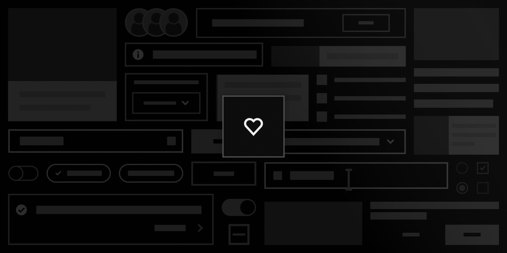

## Anatomy

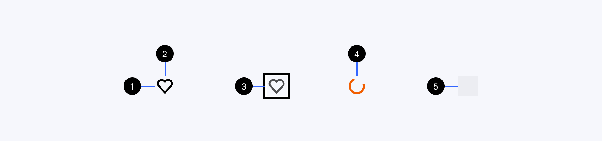

| # | Element | Purpose | Optional |
|---|---------|---------|----------|
| 1 | Container | The interactive container: the pointer and touch target that carries the states and holds the icon | No |
| 2 | Icon | The glyph communicating the action | No |
| 3 | Focus inset | The outline drawn inside the component on keyboard focus | No |
| 4 | Circular loading indicator | The spinner shown in place of the icon during the Loading state | Yes |
| 5 | Skeleton | The neutral placeholder shown before the icon has loaded | Yes |

## Definition

An interactive icon is a UI element that triggers user interactions, such as opening a tooltip or dropdown, and includes defined interactive states.

The interactive icon can be used alone or within other components. It works well in dense layouts with multiple elements.

## Interactive icon vs Button (icon only)

<!-- zh-row -->

**Although both components provide an icon-based interaction, they serve different purposes and should be selected according to the desired visual emphasis and layout constraints.**

A Button (icon only) includes a dedicated interactive container that can display a visible background, either in its default state or during state transitions such as hover, pressed, or selected. This additional visual layer reinforces the affordance of the component and makes it suitable for primary or clearly identifiable actions.

An Interactive icon, on the other hand, relies solely on the icon itself to communicate interactivity. It does not include any additional background or container. State changes are expressed exclusively through color transitions, resulting in a lighter visual footprint that integrates more naturally within surrounding content.

The two components also differ in their sizing approach. The Button (icon only) is designed around predefined dimensions (48px for the default size and 40px for the small size) to ensure consistent touch targets and alignment across interfaces. In contrast, the Interactive icon is not constrained to specific dimensions and can be used at any size required by the layout.

This flexibility allows an Interactive icon to be positioned closer to text or adjacent elements when a more compact and visually harmonious composition is needed, while still preserving its interactive behavior.

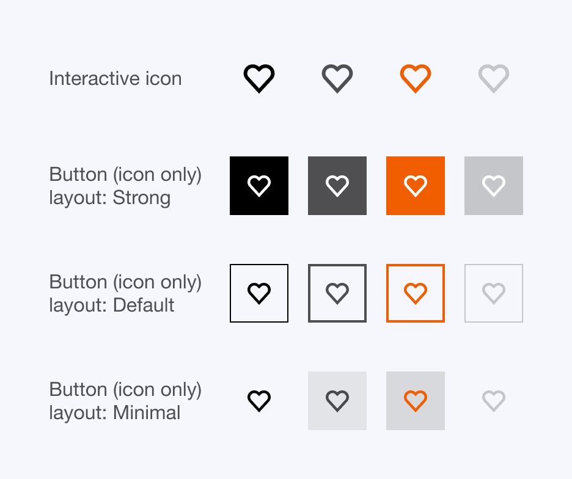

## Multiline and responsiveness

<!-- zh-row -->

### User zoom in/out
The component's height and width must be flexible, never fixed, in order to automatically adapt its dimensions according to the level of zoom (the icons follow the same rules as the text).  
In order to preserve the minimum interactive area during user zoom out, this component has a min-width and a min-height **of 28px**.

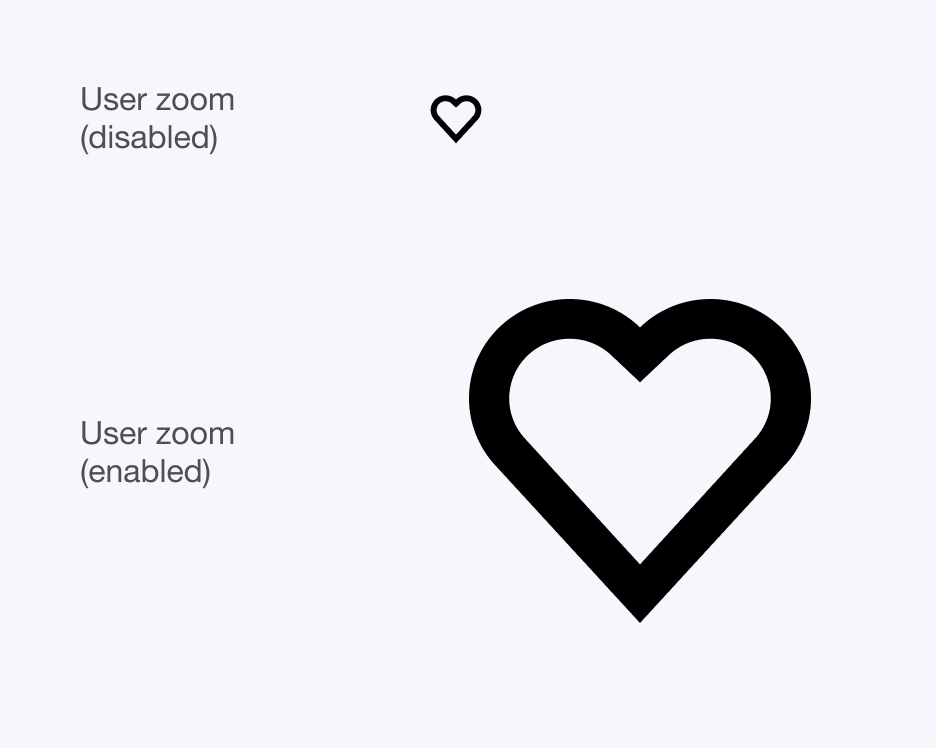

# Specs

## Layout and spacing

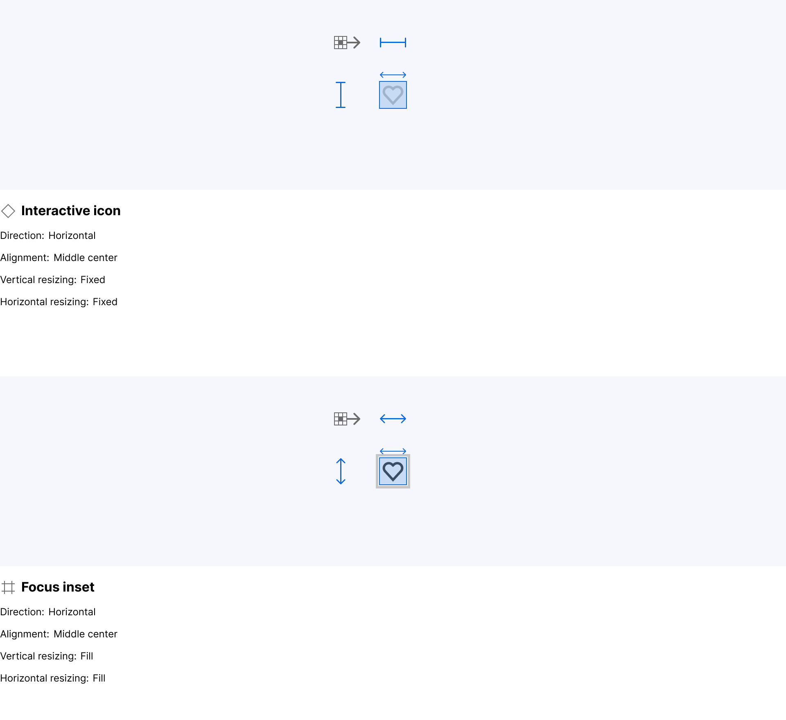

## States

<!-- zh-row -->

**`Enabled`** The status of the icon before a user has interacted with it, or other content affects it.

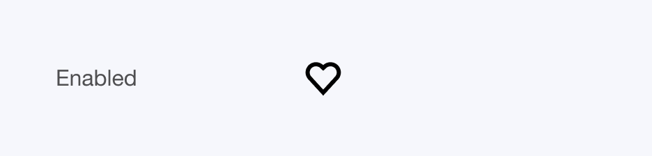

<!-- zh-row -->

**`Hover`** When a user places a pointing device over an icon, but has not yet taken action on it.

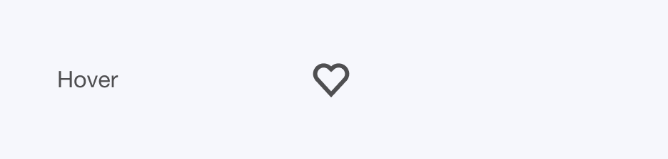

<!-- zh-row -->

**`Focus`** When a user selects an icon via keyboard or voice command, but has not yet taken action on it.  
Mirrors the "Hover" state but includes an additional border.

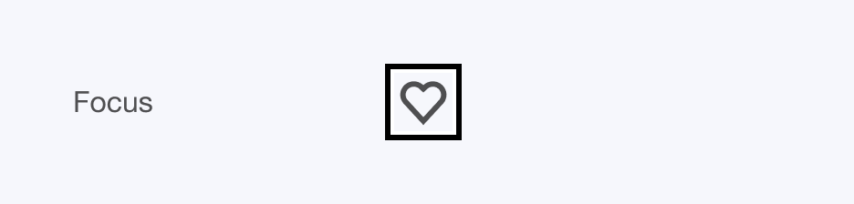

<!-- zh-row -->

**`Pressed`** An intermediate state that communicates a user has taken action on an icon, and that it is in the process of navigating to a destination, triggering logic, or transmitting data.

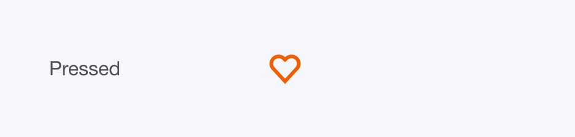

<!-- zh-row -->

**`Loading`** An icon is fetching data from another internal or external resource.  
Uses the "Loading indicator" component.

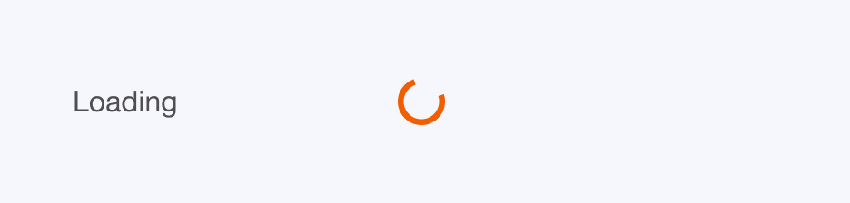

<!-- zh-row -->

**`Disabled`** Used to indicate an icon that cannot be selected.

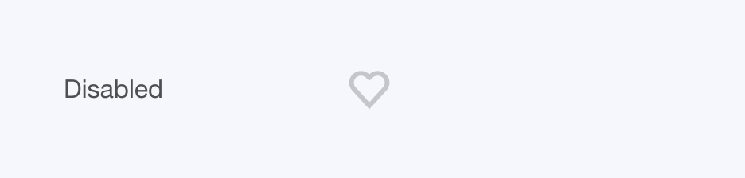

<!-- zh-row -->

**`Skeleton`** Improves the perceived loading time by providing a visual cue of where icon will appear once fully loaded.  
Uses the "Skeleton" component, variant "Security marge=False".

# Accessibility

Work is in progress to deliver this content.

# Develop

## OUDS-Web example

[Components/Icons › Icons 1](https://web.unified-design-system.orange.com/storybook/?path=/story/components-icons--icons-1)

## Developer documentation

| Platform | Developer documentation |
|---|---|
| OUDS Web | [S-ouds-web-interactive-icon](https://r.orange.fr/r/S-ouds-web-interactive-icon) |
| OUDS Android | Not available yet |
| OUDS iOS | Not available yet |
| OUDS Flutter | Not available yet |

# Changelog

## Availability

| Platform | Resource | Status | Version |
|---|---|---|---|
| Figma | [Interactive icon component](https://r.orange.fr/r/S-ouds-design-interactive-icon) | Live | 1.1.0 |
| OUDS Web (former Boosted) | [Web dev documentation](https://r.orange.fr/r/S-ouds-web-interactive-icon) | Live | 1.1.0 |
| OUDS Android - Jetpack Compose | Not available yet | To do | – |
| OUDS iOS - Swift | Not available yet | To do | – |
| OUDS Flutter | Not available yet | To do | – |

## Design changelog

| Date | Number | Notes |
|------|--------|-------|
| Aug 31, 2026 | 1.1.0 | <ul><li>Addition of a maximum width:<ul><li>Token: ouds/size/min-interactive-area-default</ul></ul> |
| Jun 8, 2026 | 1.0.0 | Version 2.6 of the design tokens is required for the development of this update.<ul><li>Component creation</ul> |
