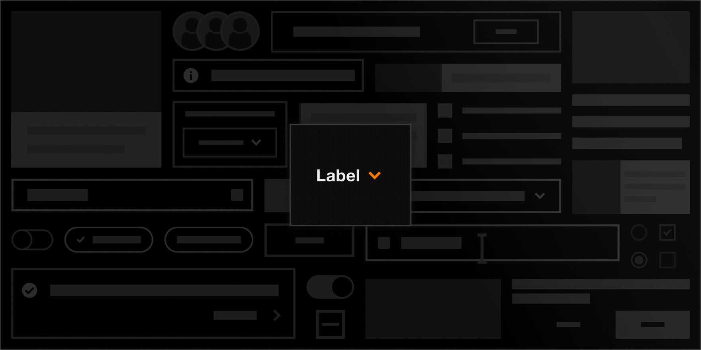
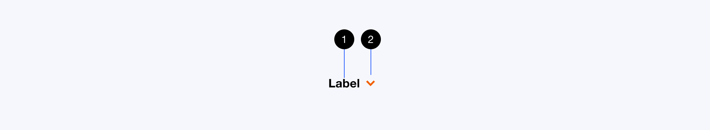
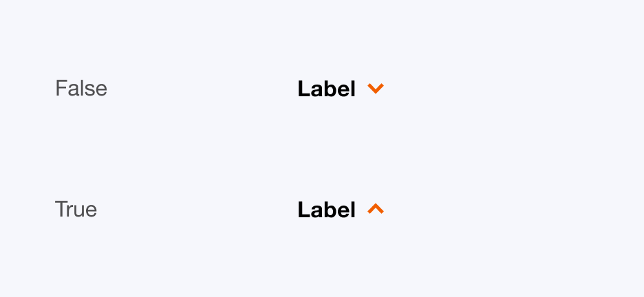
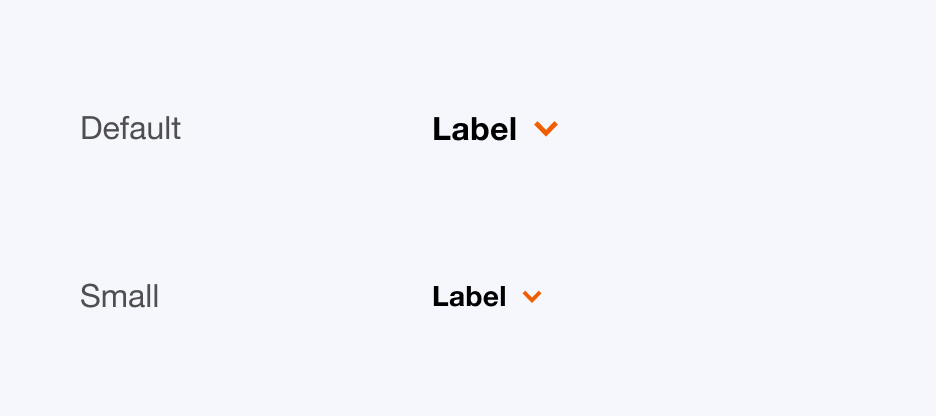
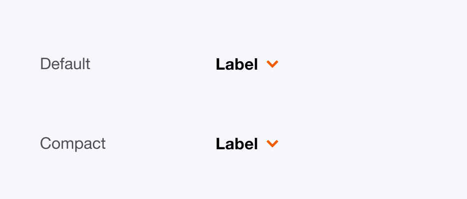
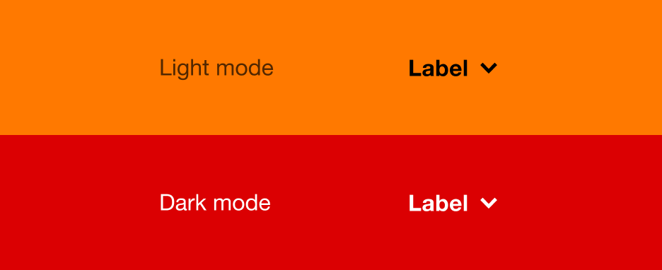
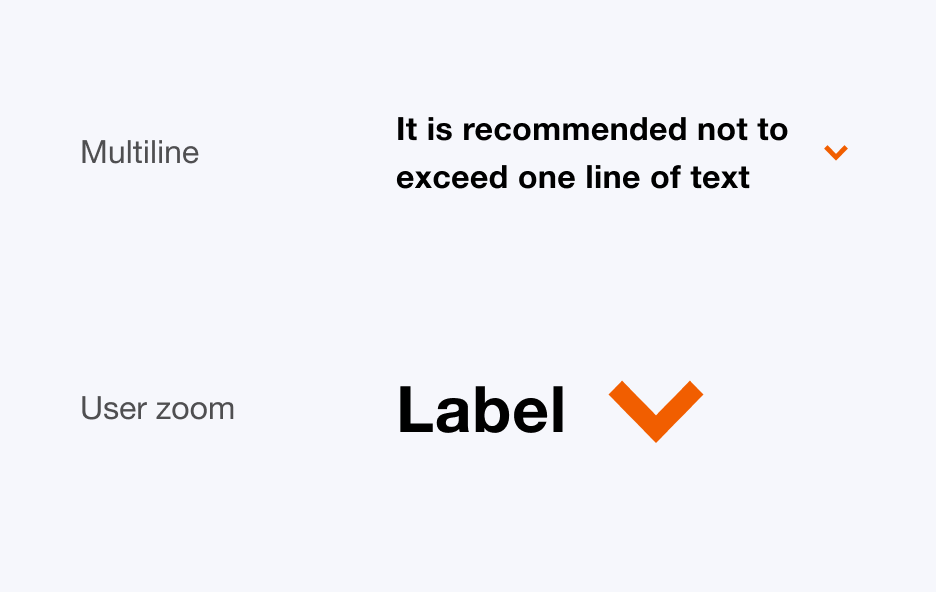
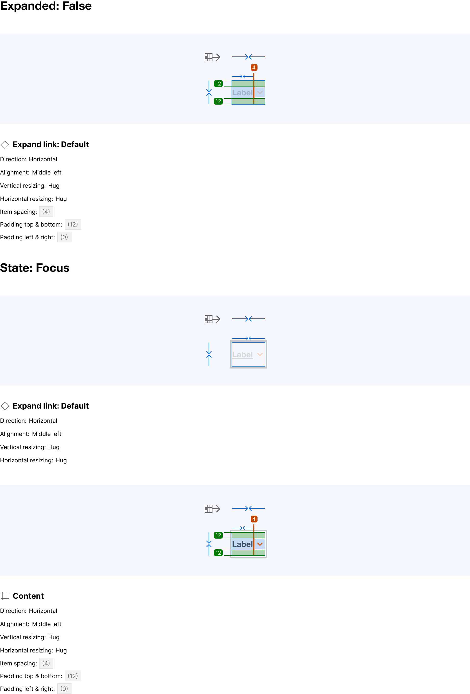
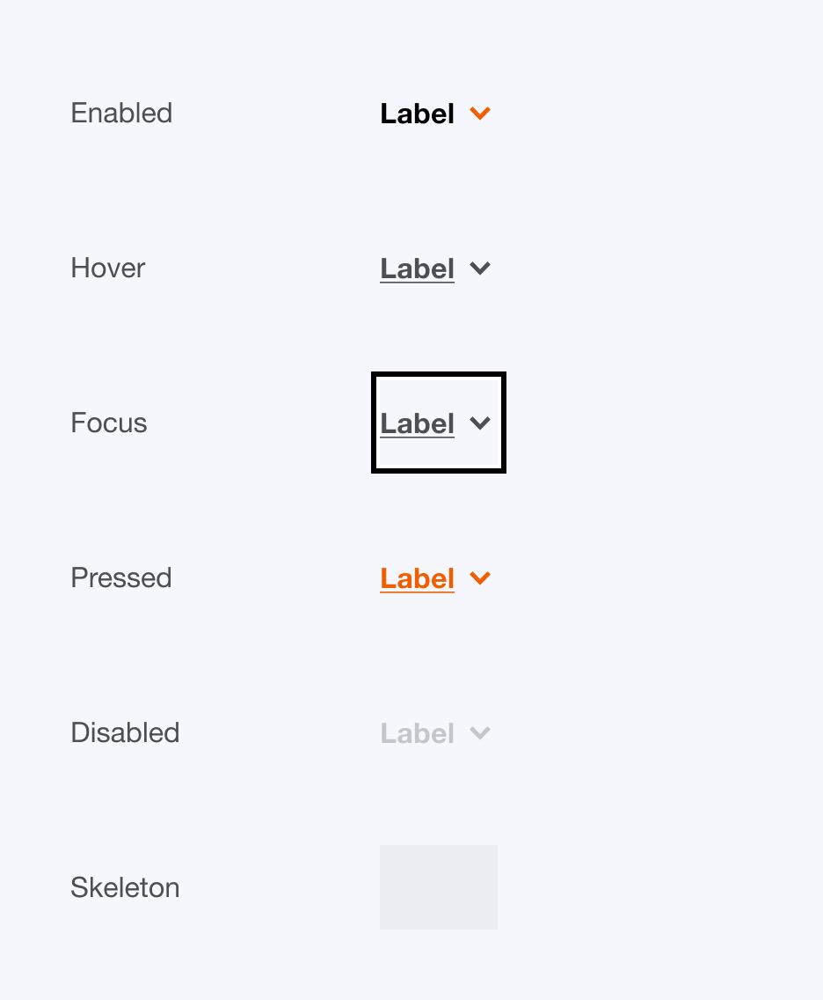

# Expand link

A link expand is a UI element that reveals or hides additional content through a text link.

# Guideline

## Anatomy

| # | Element | Purpose | Optional |
|---|---------|---------|----------|
| 1 | Label | Describes the content that can be expanded or collapsed | No |
| 2 | Chevron | Indicates the expandable state of the component (collapsed or expanded) | No |

## Definition

A link expand is a UI element that reveals or hides additional content through a text link.

The link expand feature is displayed through a dropdown with selectable values. It is ideal for inline contexts where minimal visual weight is needed, maintaining a clean layout while still providing access to additional information.

## Expanded

<!-- zh-row -->

**`False`** State indicates that the content linked to the expand control is currently hidden. The link should suggest that additional information can be revealed.

**`True`** State indicates that the content has been revealed. The link updates visually to indicate that the section is open and can be collapsed again.

## Sizes

<!-- zh-row -->

**`Default`** This is the default size of the component.  
This size is used for the vast majority of applications.

**`Small`** This size can be particularly useful in an information-dense interface or in the construction of a template or component requiring the use of small elements (in an "List item" component, for example).

## Density

<!-- zh-row -->

**`Default`** This is the default density of the component, recommended for most interfaces and primary navigation contexts.  
This density wich is used for the vast majority of applications, provides a comfortable touch target that meets accessibility recommendations.

**`Compact`** Reduces the vertical footprint while preserving the same interaction and visual behavior.  
Use in dense layouts where space is limited and a smaller touch target is acceptable (desktop or pointer-based contexts).

## Specific component: On colored bg

<!-- zh-row -->

This variant ensures a sufficiently high level of accessibility when the component is used on a background that is "out of control".

&nbsp;

### To invert color
* In light mode: For a black finish
* In dark mode: For a white finish

## Multiline and responsiveness

<!-- zh-row -->

### Multiline
This component allows multi-line text editing. Although the number of lines is not technically limited, it is recommended not to exceed one line of text.  
Nevertheless, if the label spans multiple lines, the chevron icon remains remains vertically centred.

&nbsp;

### Max-width vs full-width
The max-width is applied at the label level and depends on the max-width value assigned to the typographic reference used.  
Since the navigation indicator's position always remains close to the last letter of the text label (Reverse=False), it is not possible to use the "Expand link" component in a full-width context. The component cannot adapt to the parent container (or to the screen in a mobile context, for example) and occupy the full available width.  
In a full-width context, you should prioritize using the "Accordion list item" component (for "Next" or "Previous" layout).

&nbsp;

### User zoom in/out
The behavior of the text during user zoom in/out must follow a fundamental principle: the text must remain readable, accessible, and must never break the structure or lose information.
- The text must always scale proportionally with user zoom. Text resizing must never be blocked.
- Zooming must never cause text to be truncated or hidden. The component must expand vertically to allow line wrapping.
- The component's height and width must be flexible, never fixed, in order to automatically adapt its dimensions according to the level of zoom.
- In order to preserve the minimun interactive area during user zoom out, this component have:
  - Default size: a min-width and a min-height **of 48px**
  - Small size: a min-width and a min-height **of 44px**
- Even if, the component has a max-height or a max-width for resizing control purposes, technically, during user zoom in, these limitations are not fixed but must be scalable in order to adapt to the user's zoom level.
- As the chevron icon is functional, it must follow the same rules as text.

# Specs

## Layout and spacing

## States

<!-- zh-row -->

**`Enabled`** The default state when the link is available for interaction and displayed with a clear label.

**`Hover`** The state when a user hovers over the link. Provides a visual cue that the element is interactive.

**`Focus`** The state when the link is selected via keyboard or voice commands. Typically shown with an outline or highlight to ensure accessibility.

**`Pressed`** A transient state indicating that the user has clicked the link and the action is being executed.

**`Disabled`** The state when the link is not available for interaction, such as when expanding or collapsing is not possible at the moment.

**`Skeleton`** A placeholder state that indicates where the link will appear once fully loaded. Improves perceived performance by showing upcoming interactivity.

# Accessibility

Work is in progress to deliver this content.

# Develop

## OUDS-Web example

[Components/Links › Links 1](https://web.unified-design-system.orange.com/storybook/?path=/story/components-links--links-1)

## Developer documentation

| Platform | Developer documentation |
|---|---|
| OUDS Web | [S-ouds-web-expand-link](https://r.orange.fr/r/S-ouds-web-expand-link) |
| OUDS Android | Not available yet |
| OUDS iOS | Not available yet |
| OUDS Flutter | Not available yet |

c

# Changelog

## Availability

| Platform | Resource | Status | Version |
|---|---|---|---|
| Figma | [Expand link component](https://r.orange.fr/r/S-ouds-design-expand-link) | Live | 2.5.0 |
| OUDS Web (former Boosted) | [Web dev documentation](https://r.orange.fr/r/S-ouds-web-expand-link) | Live | 2.5.0 |
| OUDS Android - Jetpack Compose | Not available yet | To do | – |
| OUDS iOS - Swift | Not available yet | To do | – |
| OUDS Flutter | Not available yet | To do | – |

## Design changelog

| Date | Number | Notes |
|------|--------|-------|
| Jul 22, 2026 | 2.5.0 | This version does not require any token updates.<ul><li>Addition of a new "Reverse" property:<ul><li>For the "Reverse=True" variant, users can now choose an alternative icon.</ul><li>Throughout the entire component, the frame named "chevron" has been renamed "Expanding indicator".<li>This update applies to the "Expand link", "Expand link - On colored bg", and ".Expand link - On colored bg // Mode control" components.</ul> |
| Jul 1, 2026 | 2.4.0 | Version 2.6 of the design tokens is required for the development of this update.<ul><li>The height of the "Small" variant has been reduced from 44px to 40px:<ul><li>Added a new token: navigation/link/space/padding-block-small<li>Updated the token: navigation/link/size/min-height-small</ul><li>Addition of a new "Density" property:<ul><li>Existing elements correspond to the "Density: Default" option<li>New "Density: Compact" elements have been added (32px high)</ul><li>For all variants, the minimum width has been increased to 32px:<ul><li>Token: navigation/link/size/min-width</ul><li>Application of new component color tokens to the "Chevron" icons in their states: Hover/Focus/Pressed:<ul><li>navigation-link-color-chevron-hover → navigation-link-color-content-hover<li>navigation-link-color-chevron-focus → navigation-link-color-content-focus<li>navigation-link-color-chevron-pressed → navigation-link-color-content-pressed</ul></ul> |
| Mar 16, 2026 | - | <ul><li>Documentation writing: Multiline and responsiveness</ul> |
| Jan 21, 2026 | - | <ul><li>Documentation writing: Dedicated component: On coloured bg</ul> |
| Jan 6, 2026 | - | <ul><li>Documentation writing: Definition update</ul> |
| Oct 10, 2025 | 2.3.0 | The specific component "On colored bg" has been split into two distinct components: <ul><li>A public version offering traditional management of dark and light modes <li>A private version (allowing the core team to nest the component with other components) offering customized mode management with four possible configurations: <ul><li>Always in light mode <li>Always in dark mode <li>Light to dark mode <li>Dark to light mode</ul> <li>Consequently, for the private version, the name of the "Inverted color" variant has been replaced to "Mode control".</ul> |
| Sep 28, 2025 | 2.2.0 | <ul><li>Add a leading icon and a hidden boolean property for multi-theme management <li>Add 2 new component tokens for managing the show/hide visibility of the icon: [Component tokens changelog 1.6.0](https://www.figma.com/design/Co2t6wHMf4GB9NJVGs2Hes/-OUDS-Core-Lib--Design-tokens?m=auto&node-id=9280-2568&t=HLVB4jOd35DWr8Bj-1)</ul> |
| Jul 21, 2025 | 2.1.0 | <ul><li>Several design token updates: [Component tokens changelog 1.3.0](https://www.figma.com/design/Co2t6wHMf4GB9NJVGs2Hes/-OUDS-Core-Lib--Design-tokens?m=auto&node-id=9280-2568&t=HLVB4jOd35DWr8Bj-1)</ul> |
| Apr 19, 2025 | 2.0.0 | <ul><li>Creation of "On colored bg" variant</ul> |
| Dec 3, 2024 | 1.0.0 | <ul><li>Component creation</ul> |
