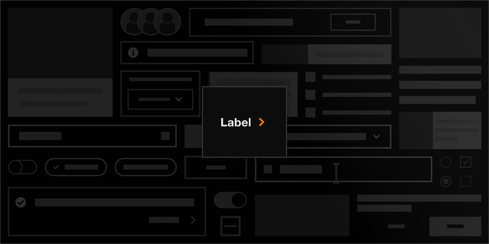
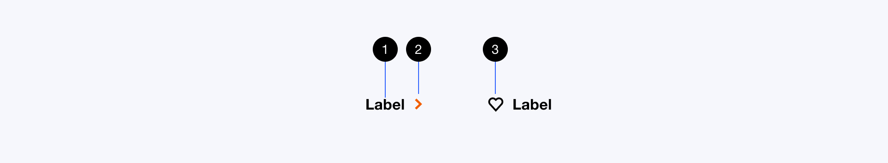
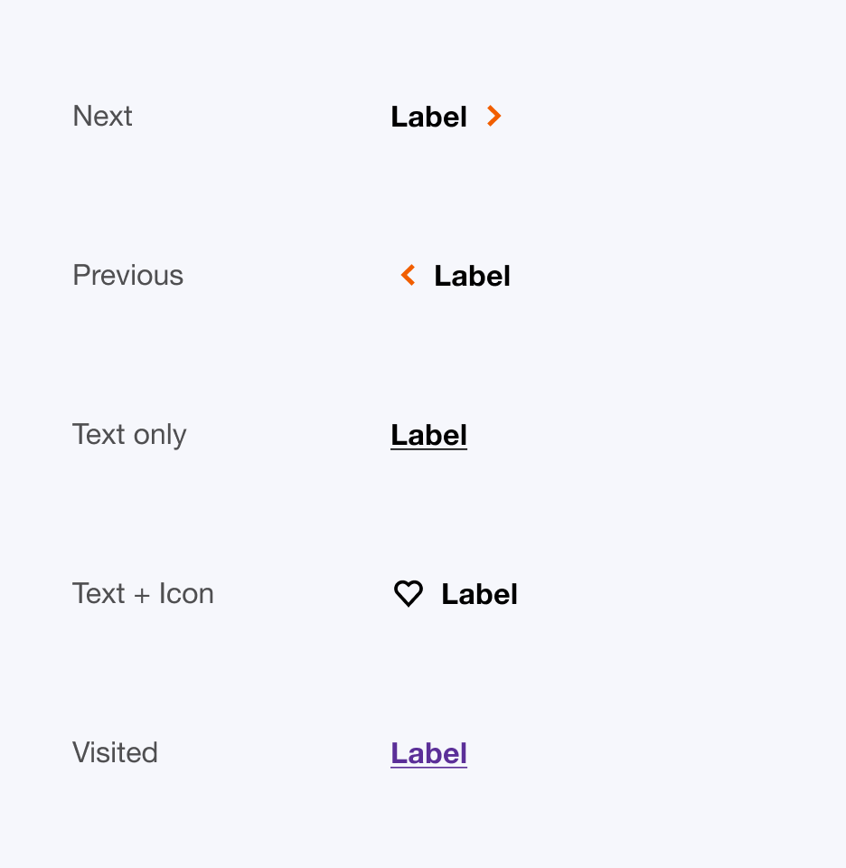
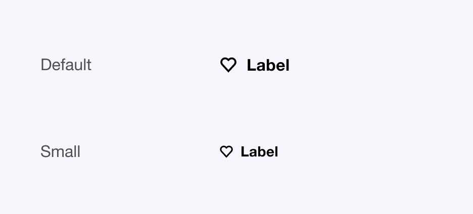
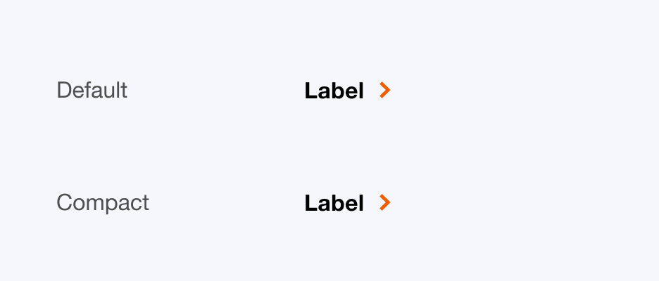
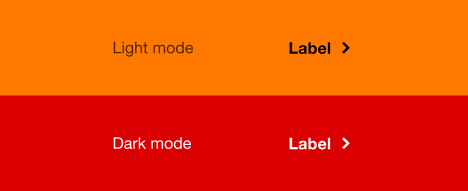
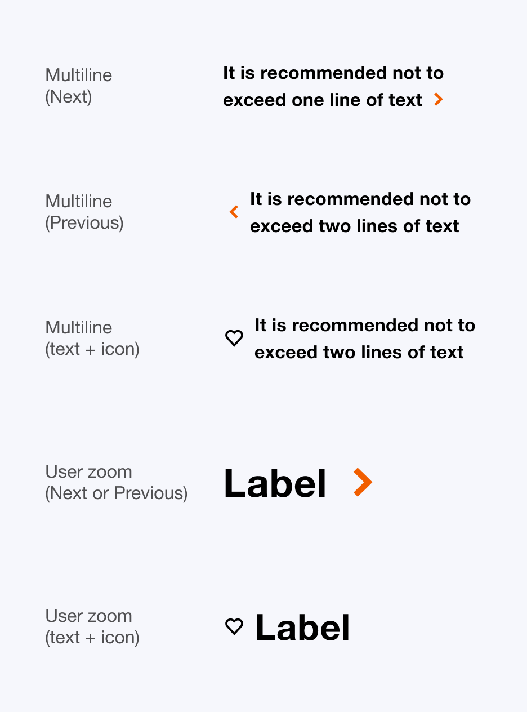
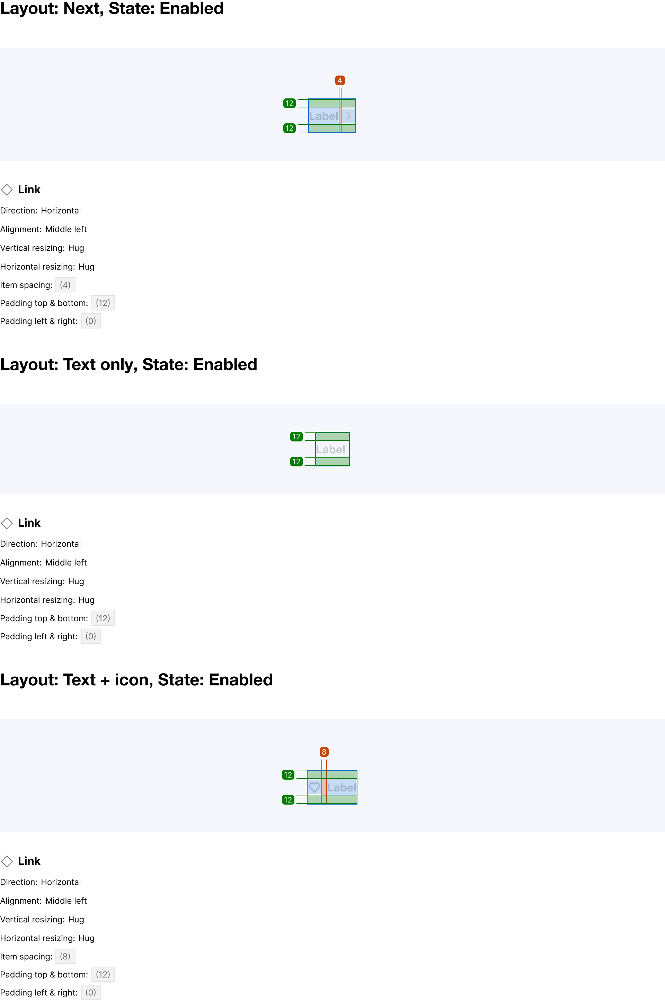
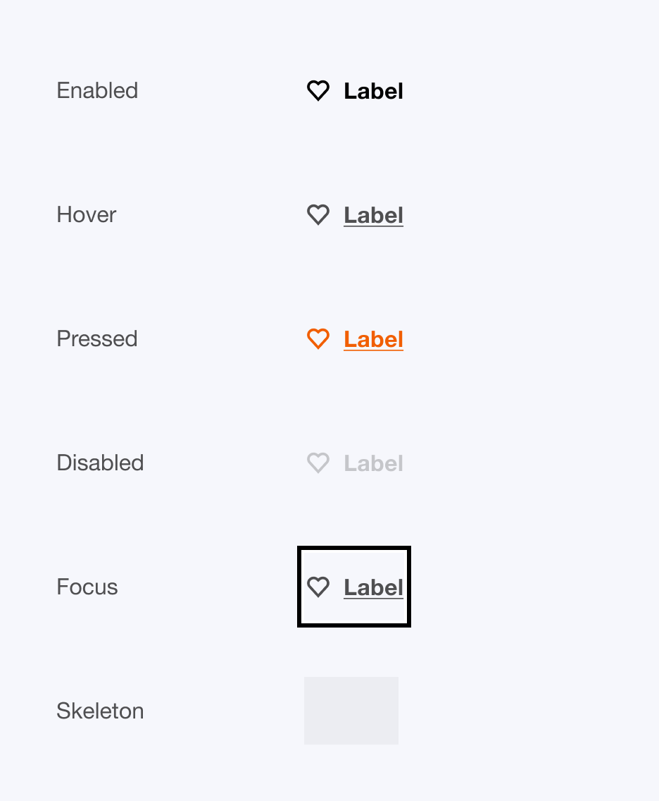

# Link

A link is a UI element that allows to navigate from one location to another, either within the same page or across different pages in the same resource, or to an external resource.

# Guideline

## Anatomy

| # | Element | Purpose | Optional |
|---|---------|---------|----------|
| 1 | Label text | Communicates the destination or action associated with the navigation | No |
| 2 | Chevron (Next/Back) | Indicates navigation direction (forward or backward) and reinforces the navigational intent | Yes |
| 3 | Icon | Provides additional visual context to support or clarify the navigation action | Yes |

## Definition

A link is a UI element that allows to navigate from one location to another, either within the same page or across different pages in the same resource, or to an external resource.

The link’s main function is navigation, and it visually and semantically conveys its interactive nature.

## Layouts

<!-- zh-row -->

**`Next`** Used in a standard navigation context. Positioned after the label, it features a "chevron right" icon, which is not customizable.

**`Previous`** Used for "backward" navigation. Positioned before the label, it features a "chevron left" icon, which is not customizable.

**`Text only`** Can be used for navigation or actions within the same page. Whether placed in a text paragraph or as a standalone component, the interaction states remain consistent.

**`Text + icon`** This option includes functionality to choose any Solaris icon.  
Used for navigation or actions within the same page.
* When embedded in a text paragraph, its interaction states are the same as the "Text Only" variant.
* When used as a standalone component (like the "Next" variant), it adopts the same interaction states as the "Next" and "Previous" variants.
* Typically utilized in business or back-office interfaces, it is rarely standalone (usually part of a group of elements).

**`Visited`** Indicates to the user that the target URL has already been opened on the device.
* Take care, the visited variant is reserved for text links only and even more so in a specific context, such as: search results with suggested redirect links.

## Sizes

<!-- zh-row -->

**`Default`** This is the default size of the component.  
This size is used for the vast majority of applications.

**`Small`** This size can be particularly useful in an information-dense interface or in the construction of a template or component requiring the use of small elements (in an "List item" component, for example).

## Density

<!-- zh-row -->

**`Default`** This is the default density of the component, recommended for most interfaces and primary navigation contexts.  
This density wich is used for the vast majority of applications, provides a comfortable touch target that meets accessibility recommendations.

**`Compact`** Reduces the vertical footprint while preserving the same interaction and visual behavior.  
Use in dense layouts where space is limited and a smaller touch target is acceptable (desktop or pointer-based contexts).

## Specific component: On colored bg

<!-- zh-row -->

This variant ensures a sufficiently high level of accessibility when the component is used on a background that is "out of control".

&nbsp;

### To invert color
* In light mode: For a black finish
* In dark mode: For a white finish

## Multiline and responsiveness

<!-- zh-row -->

### Multiline
This component allows multi-line text editing. In standalone use, although the number of lines is not technically limited, it is recommended not to exceed one line of text.  
In its "Next" variant, if the label spans multiple lines, the chevron icon remains aligned at the bottom.  
In its "Text + icon" and "Previous" variants, if the label spans multiple lines, the icon remains vertically centred.

&nbsp;

### Max-width vs full-width
The max-width is applied at the label level and depends on the max-width value assigned to the typographic reference used.  
Since the navigation indicator's position always remains close to the last letter of the text label (Layout=Next), it is not possible to use the "Link" component in a full-width context. The component cannot adapt to the parent container (or to the screen in a mobile context, for example) and occupy the full available width.  
In a full-width context, you should prioritize using the "Navigation list item" component (for "Next" or "Previous" layout).

&nbsp;

### User zoom in/out
The behavior of the text during user zoom in/out must follow a fundamental principle: the text must remain readable, accessible, and must never break the structure or lose information.
- The text must always scale proportionally with user zoom. Text resizing must never be blocked.
- Zooming must never cause text to be truncated or hidden. The component must expand vertically to allow line wrapping.
- The component's height and width must be flexible, never fixed, in order to automatically adapt its dimensions according to the level of zoom.
- In order to preserve the minimun interactive area during user zoom out, this component have:
  - Default size: a min-width and a min-height **of 48px**
  - Small size: a min-width and a min-height **of 44px**
- Even if, the component has a max-height or a max-width for resizing control purposes, technically, during user zoom in, these limitations are not fixed but must be scalable in order to adapt to the user's zoom level.
- As the chevron icon is functional, it must follow the same rules as text.
- In its "Text + icon" variant, user zoom in/out doesn't affect the size of the icons; they remain fixed in size (decorative use).

# Specs

## Layout and spacing

## States

<!-- zh-row -->

**`Enabled`** The status of the link before a user has interacted with it, or other content affects it.  
Depending on the layout, the underline may or may not appear in this state.  
In cases without an underline, the orange chevron icon or a Solaris icon signals interactivity.

**`Hover`** When a user places a pointing device over a link, but has not yet taken action on it.  
The underline appears, with UI codes consistent across all components.

**`Pressed`** An intermediate state that communicates a user has taken action on a link, and that it is in the process of navigating to a destination, triggering logic, or transmitting data.  
The underline appears, with UI codes consistent across all components.

**`Disabled`** Used to indicate a link that cannot be selected.  
Depending on the layout, the underline may or may not appear in this state.

**`Focus`** When a user selects a link via keyboard or voice command, but has not yet taken action on it.  
Mirrors the "Hover" state but includes an additional border.

**`Skeleton`** Improves the perceived loading time by providing a visual cue of where link will appear once fully loaded.  
Uses the "Skeleton" component, variant "Security marge=False".

# Accessibility

Work is in progress to deliver this content.

# Develop

## OUDS-Web example

[Components/Links › Links 2](https://web.unified-design-system.orange.com/storybook/?path=/story/components-links--links-2)

[Components/Links › Links 5](https://web.unified-design-system.orange.com/storybook/?path=/story/components-links--links-5)

[Components/Links › Links 6](https://web.unified-design-system.orange.com/storybook/?path=/story/components-links--links-6)

## Developer Documentation

| Platform | Developer documentation |
|---|---|
| OUDS Web | [S-ouds-web-link](https://r.orange.fr/r/S-ouds-web-link) |
| OUDS Android | [S-ouds-android-link](https://r.orange.fr/r/S-ouds-android-link) |
| OUDS iOS | [S-ouds-ios-link](https://r.orange.fr/r/S-ouds-ios-link) |
| OUDS Flutter | [S-ouds-flutter-link](https://r.orange.fr/r/S-ouds-flutter-link) |

# Changelog

## Availability

| Platform | Resource | Status | Version |
|---|---|---|---|
| Figma | [Link component](https://r.orange.fr/r/S-ouds-design-link) | Live | 2.4.0 |
| OUDS Web (former Boosted) | [Web dev documentation](https://r.orange.fr/r/S-ouds-web-link) | Live | 2.3.0 |
| OUDS Android - Jetpack Compose | [Android dev documentation](https://r.orange.fr/r/S-ouds-android-link) | Live | 2.4.0 |
| OUDS iOS - Swift | [iOS dev documentation](https://r.orange.fr/r/S-ouds-ios-link) | Live | 2.3.0 |
| OUDS Flutter | [Flutter dev documentation](https://r.orange.fr/r/S-ouds-flutter-link) | Live | 2.4.0 |

## Design changelog

| Date | Number | Notes |
|------|--------|-------|
| Jul 20, 2026 | 2.4.0 | This version does not require any token updates.<ul><li>Within the "Link → Next" variant, enabling users to select an internal or external navigation indicator type. The frame named "chevron" has been renamed "Navigation indicator" for the "Link Next" and "Link Previous" variants.<li>Thise update affects the "Link", "Link - On colored bg", and ".Link - On colored bg // Mode control" components.</ul> |
| Jul 1, 2026 | 2.3.0 | Version 2.6 of the design tokens is required for the development of this update.<ul><li>The height of the "Small" variant has been reduced from 44px to 40px:<ul><li>Added a new token: navigation/link/space/padding-block-small<li>Updated the token: navigation/link/size/min-height-small</ul><li>Addition of a new "Density" property:<ul><li>Existing elements correspond to the "Density: Default" option<li>New "Density: Compact" elements have been added (32px high)</ul><li>For all variants, the minimum width has been increased to 32px:<ul><li>Token: navigation/link/size/min-width</ul><li>Application of new component color tokens to the "Chevron" icons in their states: Hover/Focus/Pressed:<ul><li>navigation-link-color-chevron-hover → navigation-link-color-content-hover<li>navigation-link-color-chevron-focus → navigation-link-color-content-focus<li>navigation-link-color-chevron-pressed → navigation-link-color-content-pressed</ul><li>Updated the variant name from "Back" to "Previous"</ul> |
| Mar 16, 2026 | - | <ul><li>Documentation writing: Multiline and responsiveness</ul> |
| Jan 21, 2026 | - | <ul><li>Documentation writing: Dedicated component: On coloured bg</ul> |
| Jan 6, 2026 | - | <ul><li>Documentation writing: Definition update</ul> |
| Oct 10, 2025 | 2.2.0 | The specific component "On colored bg" has been split into two distinct components: <ul><li>A public version offering traditional management of dark and light modes <li>A private version (allowing the core team to nest the component with other components) offering customized mode management with four possible configurations: <ul><li>Always in light mode <li>Always in dark mode <li>Light to dark mode <li>Dark to light mode</ul> <li>Consequently, for the private version, the name of the "Inverted color" variant has been replaced to "Mode control".</ul> |
| Jul 21, 2025 | 2.1.0 | <ul><li>Several design token updates: [Component tokens changelog 1.3.0](https://www.figma.com/design/Co2t6wHMf4GB9NJVGs2Hes/-OUDS-Core-Lib--Design-tokens?m=auto&node-id=9280-2568&t=HLVB4jOd35DWr8Bj-1)</ul> |
| Apr 19, 2025 | 2.0.0 | <ul><li>Creation of "On colored bg" variant</ul> |
| Dec 3, 2024 | 1.0.0 | <ul><li>Component creation</ul> |
