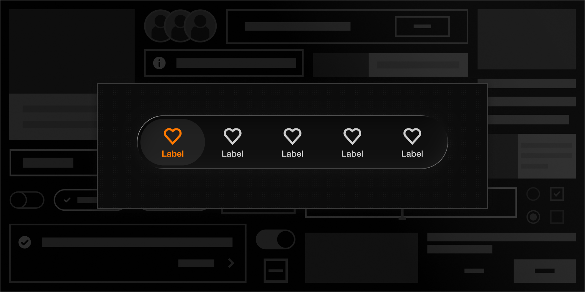
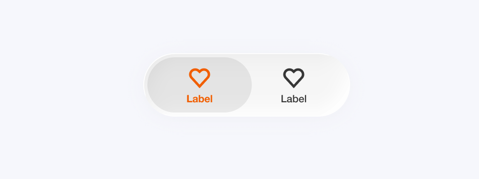
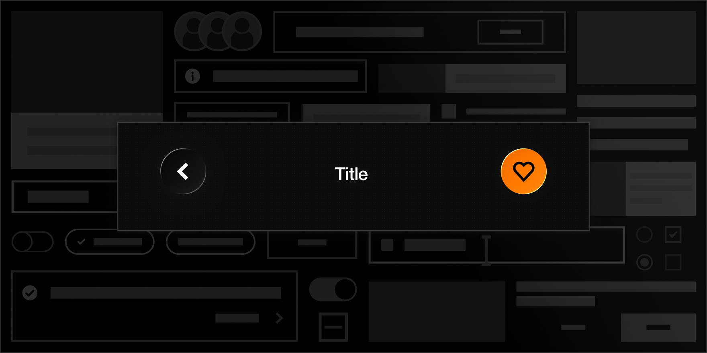
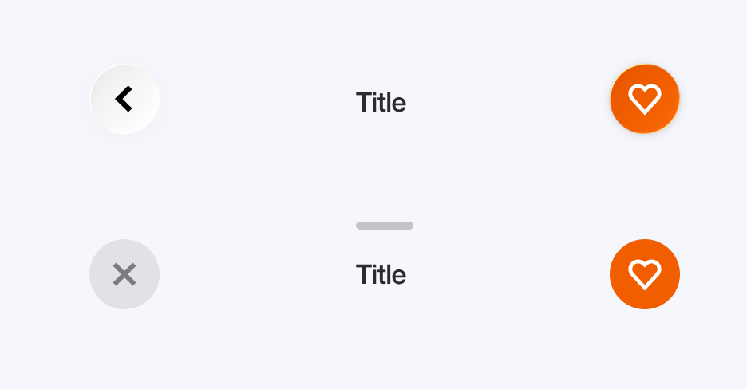
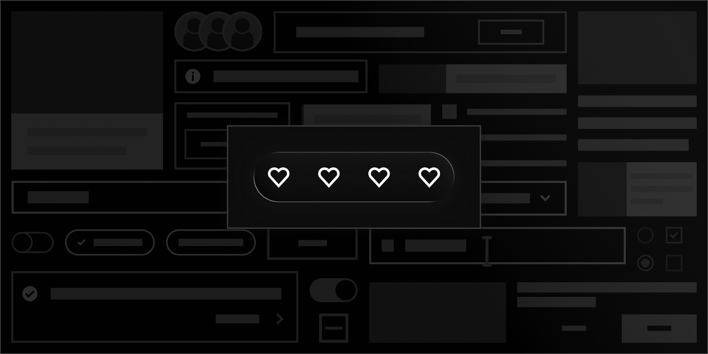
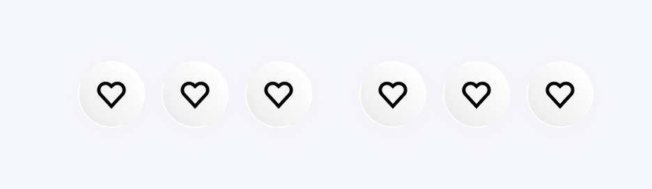
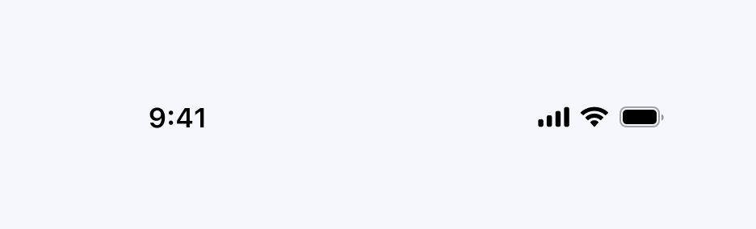
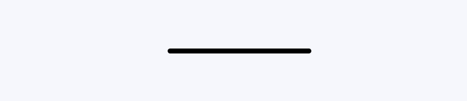

---
---

# iOS bars

The iOS bars component family groups all native mobile navigation components used to structure and orient the user within an application. It includes platform-specific patterns for iOS, such as Tab Bar, Toolbar top, Toolbar bottom, Status bar, and other system-level navigational UI elements.

This family provides the foundational structures that enable users to move across primary sections, access key actions, understand their current location in the app, and interact with the operating system’s native navigation paradigms.

# Tab bar

<!-- zh-row -->

**A tab bar on iOS** is a UI element that enables navigation to the primary destinations of a mobile application.

The tab bar is located at the bottom of the screen, with each destination represented by an icon and an optional text label, facilitating quick navigation between top-level sections.

## Develop

- [OUDS-iOS](https://r.orange.fr/r/S-ouds-ios-tab-bar) — Tab Bar documentation
- [OUDS-Flutter](https://r.orange.fr/r/S-ouds-flutter-bottom-navigation) — 

## Changelog

### Availability

|  | **Platform** | **Resource** | **Design ref. version** | **Status** |
|---|---|---|---|---|
|  | Figma | [Design component](https://r.orange.fr/r/S-ouds-design-bars) | v 1.0.0 |  |
|  | OUDS iOS - Swift | [iOS dev documentation](https://r.orange.fr/r/S-ouds-ios-tab-bar) | v 1.0.0 |  |
|  | OUDS Flutter | [Flutter dev documentation](https://r.orange.fr/r/S-ouds-flutter-bottom-navigation) | v 1.0.0 |  |

### Design changelog

| Date | Number | Notes |
|------|--------|-------|
| Sep 3, 2026 | 1.1.0 | • Toolbar top: For iOS and iPadOS 18 version, added an option to display a subtitle. |
| Nov 7, 2025 | 1.0.0 | • Component creation based on the official iOS Figma library: → [**iOS and iPadOS 26**](https://www.figma.com/community/file/1527721578857867021) → [**iOS and iPadOS 18**](https://www.figma.com/community/file/1385659531316001292) |

# Toolbar top

<!-- zh-row -->

**The Toolbar top (aka Navigation bar on iOS and iPadOS 18)** sits at the top of the screen and provides contextual information and controls related to the current view. It typically displays the page title, and may include navigation actions such as “Back,” as well as supplementary actions like search or menus.
  
For more information, we invite you to consult [**the official iOS Toolbar documentation**.](https://developer.apple.com/design/human-interface-guidelines/toolbars)

## Develop

- [OUDS-iOS](https://r.orange.fr/r/S-ouds-ios-tab-bar) — App Bar documentation
- [OUDS-Flutter](https://r.orange.fr/r/S-ouds-flutter-top-bar) — 

## Changelog

### Availability

|  | **Platform** | **Resource** | **Design ref. version** | **Status** |
|---|---|---|---|---|
|  | Figma | [Design component](https://r.orange.fr/r/S-ouds-design-bars) | v 1.0.0 |  |
|  | OUDS iOS - Swift | [iOS dev documentation](https://r.orange.fr/r/S-ouds-ios-tab-bar) | v 1.0.0 |  |
|  | OUDS Flutter | [Flutter dev documentation](https://r.orange.fr/r/S-ouds-flutter-top-bar) | v 1.0.0 |  |

### Design changelog

| Date | Number | Notes |
|------|--------|-------|
| Sep 3, 2026 | 1.1.0 | • Toolbar top: For iOS and iPadOS 18 version, added an option to display a subtitle. |
| Nov 7, 2025 | 1.0.0 | • Component creation based on the official iOS Figma library: → [**iOS and iPadOS 26**](https://www.figma.com/community/file/1527721578857867021) → [**iOS and iPadOS 18**](https://www.figma.com/community/file/1385659531316001292) |

# Toolbar bottom

<!-- zh-row -->

**The Toolbar bottom (aka Toolbar on iOS and iPadOS 18)** is a bottom-aligned component used to expose contextual actions specific to the current screen or selected content. Unlike the Tab bar, it does not drive top-level navigation but provides quick access to secondary or task-related actions.
  
For more information, we invite you to consult [**the official iOS Toolbar documentation**.](https://developer.apple.com/design/human-interface-guidelines/toolbars)

### Availability

|  | **Platform** | **Resource** | **Design ref. version** | **Status** |
|---|---|---|---|---|
|  | Figma | [Design component](https://r.orange.fr/r/S-ouds-design-bars) | v 1.0.0 |  |
|  | OUDS iOS - Swift | iOS dev documentation |  |  |
|  | OUDS Flutter | Flutter dev documentation |  |  |

### Design changelog

| Date | Number | Notes |
|------|--------|-------|
| Sep 3, 2026 | 1.1.0 | • Toolbar top: For iOS and iPadOS 18 version, added an option to display a subtitle. |
| Nov 7, 2025 | 1.0.0 | • Component creation based on the official iOS Figma library: → [**iOS and iPadOS 26**](https://www.figma.com/community/file/1527721578857867021) → [**iOS and iPadOS 18**](https://www.figma.com/community/file/1385659531316001292) |

# Status bar

<!-- zh-row -->

**The Status bar** is a system-level area at the very top of the screen that displays device-level information such as time, network connectivity, and battery level. Its appearance can be customized by apps but its structure is controlled by the OS.
  
For more information, we invite you to consult [**the official iOS Status bar documentation.**](https://developer.apple.com/design/human-interface-guidelines/status-bars)  
In addition, we invite you to consult [**the official iOS Menu bar documentation.**](https://developer.apple.com/design/human-interface-guidelines/the-menu-bar)

# Home Indicator

<!-- zh-row -->

**The Home Indicator** is a system gesture area displayed at the bottom of the screen on devices without a physical Home button. It provides visual guidance for system-wide gestures, such as returning to the Home screen or switching apps. Apps must respect this area to avoid obstructing system gestures.

