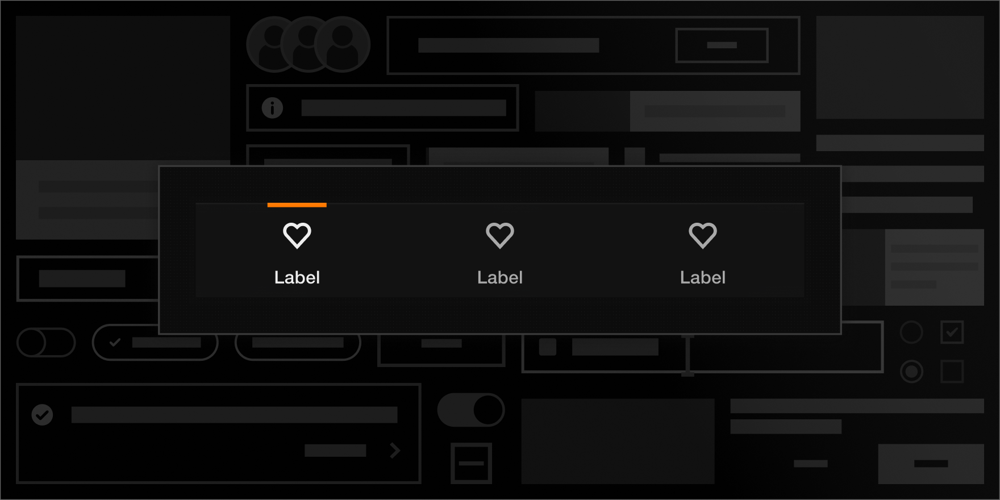
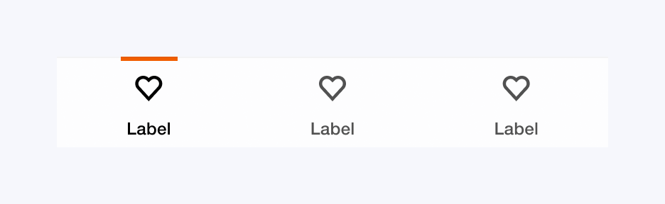
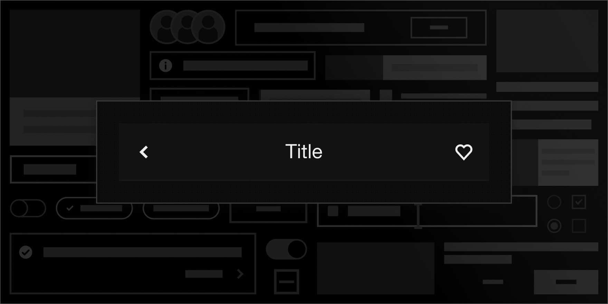
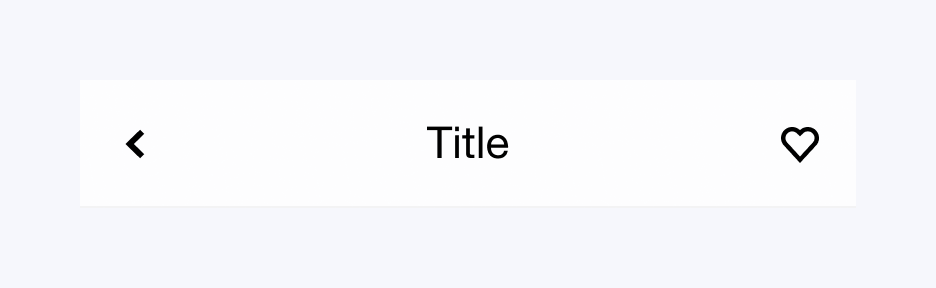
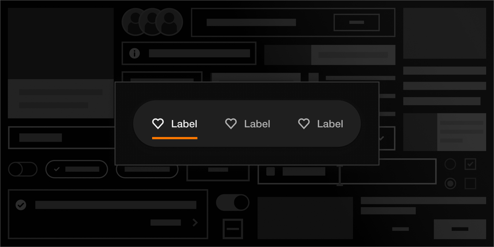
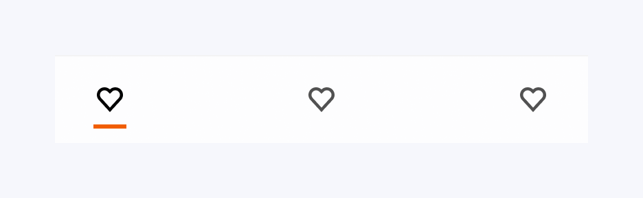
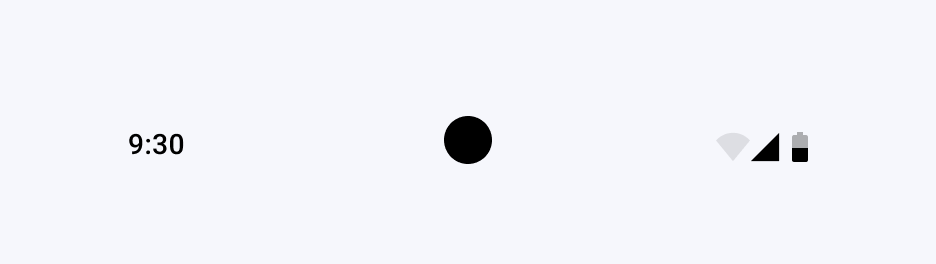
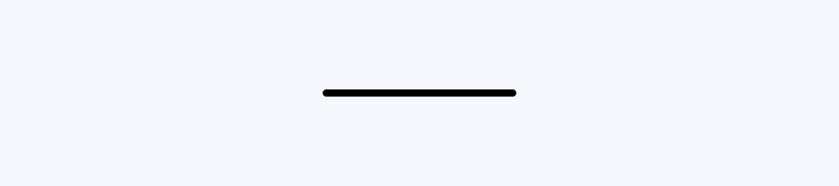

# Android bars

The Android bars component family groups all native mobile navigation components used to structure and orient the user within an application. It includes platform-specific patterns for Android, such as Navigation bar, App bar, Toolbar, Status bar, and other system-level navigational UI elements.

This family provides the foundational structures that enable users to move across primary sections, access key actions, understand their current location in the app, and interact with the operating system’s native navigation paradigms.

# Navigation bar

## Guideline

<!-- zh-row -->

**A navigation bar on Android** is a UI element that enables users to access the primary destinations of a mobile application through three to five persistent tabs.

The navigation bar is located at the bottom of the screen, with each destination represented by an icon and an optional text label to facilitate quick switching between top-level sections.

## Develop

- [OUDS-Android](https://r.orange.fr/r/S-ouds-android-navigation-bar) — Navigation Bar documentation
- [OUDS-Flutter](https://r.orange.fr/r/S-ouds-flutter-bottom-navigation) — 

## Changelog

### Availability

| Platform | Resource | Status | Version |
|---|---|---|---|
| Figma | [Design component](https://r.orange.fr/r/S-ouds-design-android-bars) | Live | 1.0.0 |
| OUDS Android - Jetpack Compose | [Android dev documentation](https://r.orange.fr/r/S-ouds-android-navigation-bar) | Live | 1.0.0 |
| OUDS Flutter | Flutter dev documentation | Live | 1.0.0 |

### Design changelog

| Date | Number | Notes |
|------|--------|-------|
| Nov 7, 2025 | 1.0.0 | • Component creation based on the official Android Figma library: → [**Material 3**](https://www.figma.com/community/file/1035203688168086460) → [**Material 2**](https://www.figma.com/community/file/778763161265841481) |

# App bar

## Guideline

<!-- zh-row -->

**The App bar (aka Top app bar on Material 2)** is a top-aligned component that displays the screen title and provides access to key actions and navigation elements. It may include an Up button, action icons, overflow menus, search, or tabs. It provides context and controls relevant to the current view.
  
For more information, we invite you to consult the official Android:

-   [**Material 3 App bar documentation**](https://m3.material.io/components/app-bars/overview)
    
-   [**Material 2 Top app bar documentation**](https://m2.material.io/components/app-bars-top)

## Develop

- [OUDS-Android](https://r.orange.fr/r/S-ouds-android-app-bar) — App Bar documentation
- [OUDS-Flutter](https://r.orange.fr/r/S-ouds-flutter-top-bar) — 

## Changelog

### Availability

| Platform | Resource | Status | Version |
|---|---|---|---|
| Figma | [Design component](https://r.orange.fr/r/S-ouds-design-android-bars) | Live | 1.0.0 |
| OUDS Android - Jetpack Compose | [Android dev documentation](https://r.orange.fr/r/S-ouds-android-app-bar) | Live | 1.0.0 |
| OUDS Flutter | [Flutter dev documentation](https://r.orange.fr/r/S-ouds-flutter-top-bar) | Live | 1.0.0 |

### Design changelog

| Date | Number | Notes |
|------|--------|-------|
| Nov 7, 2025 | 1.0.0 | • Component creation based on the official Android Figma library: → [**Material 3**](https://www.figma.com/community/file/1035203688168086460) → [**Material 2**](https://www.figma.com/community/file/778763161265841481) |

# Toolbar

## Guideline

<!-- zh-row -->

**The Toolbar (aka Bottom app bar on Material 2)** is a bottom-anchored container dedicated to contextual actions and navigation within a given screen. It can host action icons, a navigation drawer icon, or a floating action button (FAB) cutout. It is used for tasks rather than top-level navigation.
  
For more information, we invite you to consult the official Android:

-   [**Material 3 Toolbar documentation**](https://m3.material.io/components/toolbars/overview)
    
-   [**Material 2 Bottom app bar documentation**](https://m2.material.io/components/app-bars-bottom)

## Changelog

### Availability

| Platform | Resource | Status | Version |
|---|---|---|---|
| Figma | [Design component](https://r.orange.fr/r/S-ouds-design-android-bars) | Live | 1.0.0 |
| OUDS Android - Jetpack Compose | Android dev documentation | To do | – |
| OUDS Flutter | Flutter dev documentation | To do | – |

### Design changelog

| Date | Number | Notes |
|------|--------|-------|
| Nov 7, 2025 | 1.0.0 | • Component creation based on the official Android Figma library: → [**Material 3**](https://www.figma.com/community/file/1035203688168086460) → [**Material 2**](https://www.figma.com/community/file/778763161265841481) |

# Status bar

<!-- zh-row -->

**The Status bar** is a top system UI area displaying device information such as notifications, time, signal strength, and battery status. Its appearance (light/dark, transparent, etc.) can be influenced by the app but its content is controlled by the system.
  
For more information, we invite you to consult the official Android:

-   [**Material 3 Status bar documentation**](https://developer.android.com/design/ui/mobile/guides/foundations/system-bars)
    
-   [**Material 2 Status bar documentation**](https://m2.material.io/design/platform-guidance/android-bars.html#status-bar)

# System navigation bar

<!-- zh-row -->

**The System navigation bar** provides system-level navigation controls such as Back, Home, and Overview. Depending on the device or mode, it may appear as a 3-button layout or as a gesture navigation area. Apps must preserve this zone to avoid interfering with system navigation.
  
For more information, we invite you to consult the official Android:

-   [**Material 3 Navigation bar documentation**](https://developer.android.com/design/ui/mobile/guides/foundations/system-bars)
    
-   [**Material 2 Navigation bar documentation**](https://m2.material.io/design/platform-guidance/android-bars.html#status-bar)

