# Radio button item

A radio button item is a UI element shaped like a row, that allows users to select a single option from a set of mutually exclusive choices.

# Guideline

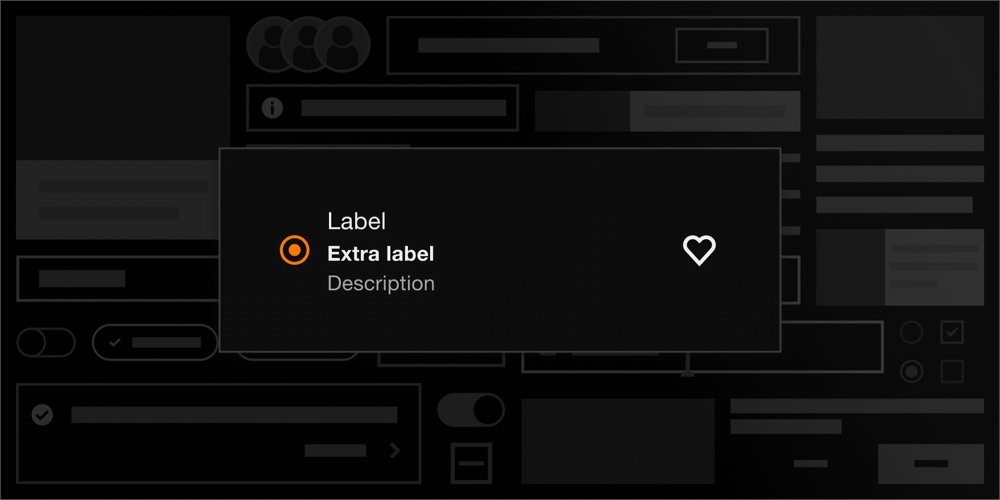

## Anatomy

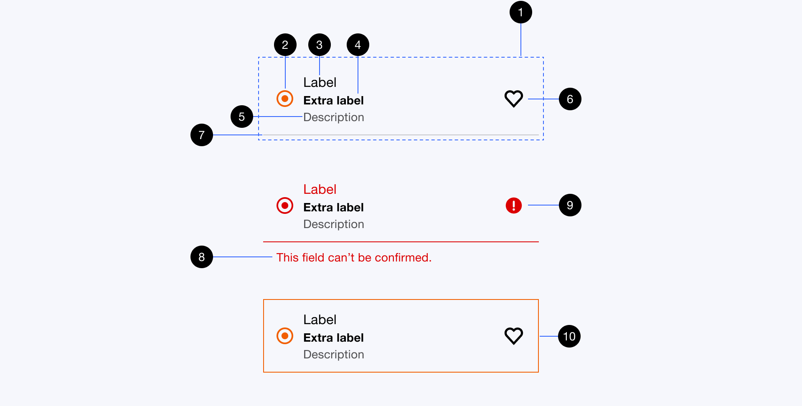

| # | Element | Purpose | Optional |
|---|---------|---------|----------|
| 1 | Container | The row that holds the radio button indicator, the texts, the optional icon and the divider. | No |
| 2 | Radio button indicator | Indicates the selection state of a radio option (selected or unselected). | No |
| 3 | Label | Primary text that describes the selectable option. | No |
| 4 | Extra label | Secondary label used to highlight critical or contextual information. | Yes |
| 5 | Description | Provides additional guidance or explanatory text for the option. | Yes |
| 6 | Icon | Solaris icon representing the option. | Yes |
| 7 | Divider | Visual separator used when multiple radio options are displayed in a list. | Yes |
| 8 | Error text | Displays validation or error messaging related to the radio option. | Yes |
| 9 | Error icon | Visual indicator that reinforces the error state of the option. | No |
| 10 | Outline | The outline that frames the item when Outlined is True. | Yes |

## Definition

A **radio button item** is a UI element shaped like a row, that allows users to select a single option from a set of mutually exclusive choices.

Unlike the radio button, the radio button item accommodates a broader range of contexts by enabling the toggling of visibility of additional text labels and icon assets.

## Selected

Typically, a radio button has two main states: Selected and Unselected.

<!-- zh-row -->

**`False`** The radio button is unselected. Used by default or when the user chooses another option in the group.

**`True`** The radio button is selected. Indicates the user's current active choice within the group.

## Error

<!-- zh-row -->

**`False`** No validation error is displayed. The radio button item may be selected or unselected.

**`True`** Applies the error appearance to the radio button item. When the Error message option is enabled, provide a clear validation message explaining the issue with the selection.

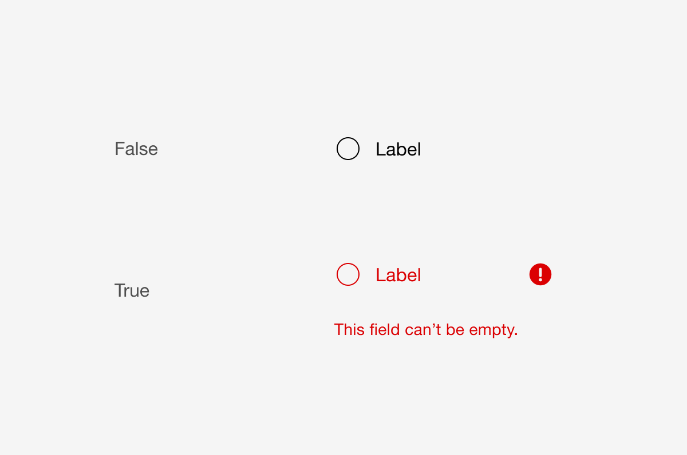

**Do:** Write specific, actionable error messages that tell users exactly what went wrong and how to fix it

**Don't:** Use generic error messages like "Invalid input" or "Error"—they don't help users understand the problem

## Outlined

<!-- zh-row -->

**`False`** This is the default layout of the component.

**`True`** Outlined radio buttons are designed to stand out and draw the user’s attention. They are often used to emphasize significant or impactful options that require careful consideration in the interface.

## Reverse

<!-- zh-row -->

**`False`** This is the default layout of the component.  
From left to right, the order of the elements is as follows: radio button / text / icon.

**`True`** As its name suggests, this layout is the reversed mirror of the "Default" template.  
From left to right, the order of the elements is as follows: icon / text / radio button. This variant is necessary for RTL mode and certain mobile use cases.

## Other boolean options

<!-- zh-row -->

**`Extra label`** It is possible to display or hide strong accompanying text for the main label.

**`Description`** It is possible to display or hide accompanying text for the main label.

**`Icon`** It is possible to display or hide an icon. If displayed, this option includes functionality to choose any Solaris icon.

**`Divider`** It is possible to display or hide a dividing element (line).

**`Error message`** In the context where the component is in its "Error" true option, the error message can be displayed.

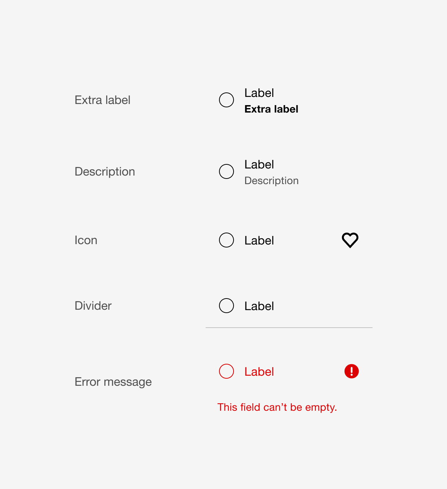

## ⚠️ Mandatory field indication

<!-- zh-row -->

**If all fields are mandatory (several fields present):**
1. Display the message "All fields are mandatory." at the top.
2. Do not use an asterisk (*) at the end of each field label, nor the word "mandatory."

**If not all fields are mandatory (and there are several fields present):**
1. Display the message "All fields marked with an * are mandatory." at the top.
2. Use an asterisk (*) at the end of each mandatory field label.  
   **⚠️ Important:**
   * In Figma, the asterisk must be entered manually by designers in the label text. UI rendering of the asterisk: **font-weight-bold + color-content-negative (red)**.
   * Technically, for web/iOS/Android, the asterisk is positioned in a dedicated container after the label text. Spacing between label and asterisk: 4px
3. Either the technology allows a 'required' attribute to be managed on the fields (usually in Web), in which case any asterisks must be hidden from users using assistive technologies, Or the technology does not allow the mandatory nature of the field to be indicated. In this case, the asterisk must be vocalised as well as a 'mandatory' mention. Please refer to the technical documentations for more information.
4. Depending on the use case, an 'optional' label can be added to non-mandatory fields.

**Indication of mandatory status for a group of control items:**  
When a group of control items (Radio Button, Checkbox, or Switch item) is mandatory, the indication of requirement must be carried only by the group title.  
The asterisk (*) must be placed at the end of the group title and must not be repeated in the labels of the individual items.  
This rule avoids visual redundancy, clarifies that the requirement applies to the group rather than each option, and improves information hierarchy and form readability.

**If there is only one field in the form, or if the mandatory nature is obvious (such as login/password), no mention is necessary since the fields are essential to the form's functionality.**

## Multiline and responsiveness

<!-- zh-row -->

### Multiline
This component allows multi-line text editing. Although the number of lines is not technically limited, it is recommended not to exceed 2 lines of text. In its "Text + icon" variant, if the label spans multiple lines, the label remains centred.

&nbsp;

### Max-width vs full-width
For greater flexibility, this component doesn't have a default max-width. To avoid exceeding a width that would degrade readability and the perception of a compact interactive element, we recommend applying **a max-width of around 480px.**  
For mobile or tablet use (or if the component is positioned inside a specific container), it is possible to set this component to use the full available width (of the screen or the container).  
Please note that this behavior is not the default rule; it may be preferred if the template allows it (to improve user comfort or for better page structure/hierarchy).

&nbsp;

### User zoom in/out
The behavior of the text during user zoom in/out must follow a fundamental principle: the text must remain readable, accessible, and must never break the structure or lose information.
* The text must always scale proportionally with user zoom. Text resizing must never be blocked.
* Zooming must never cause text to be truncated or hidden. The component must expand vertically to allow line wrapping.
* The component's height and width must be flexible, never fixed, in order to automatically adapt its dimensions according to the level of zoom.
* In order to preserve the minimun interactive area during user zoom out, this component have a min-width **of 160px** and a min-height **of 52px**.
* Even if, the component has a max-height or a max-width for resizing control purposes, technically, during user zoom in, these limitations are not fixed but must be scalable in order to adapt to the user's zoom level.
* As the control item and error icon are functional, they must follow the same rules as text.
* In order to preserve the same display rendering as the component's error state, even if the icons is purely decorative, the icons follow the same rules as the text.

## ⚠️ Technical layout adjustments

<!-- zh-row -->

Even though, in Figma, the component structure is unique (for easier use by designers), technically the versions differ in order to respect best practices for each environment (paradigm shift between the web "Container" vs. the native "Edge-to-Edge"):

&nbsp;

### Web (mobile, tablet, and desktop)
The component is contained within the browser window and has "safety margins." It therefore cannot appear in the area corresponding to the margin grid.  
The component has internal padding-inline, and its display position must be between several columns (which varies depending on the number of containers used on a horizontal row).

&nbsp;

### Native app (Android, iOS, Flutter)
The display position of the component corresponds to the entire screen display area (edge to edge).  
Its internal padding-inline is therefore replaced by the grid-margin tokens.

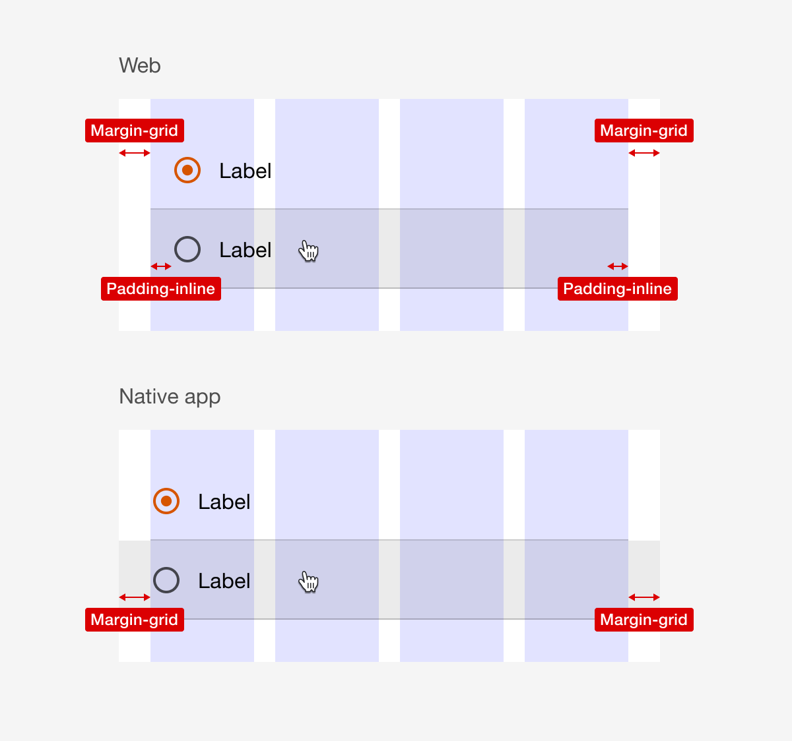

<!-- zh-row -->

For a card-type display (Outlined=True), no adaptation is made; the component structure remains the same between web and native.

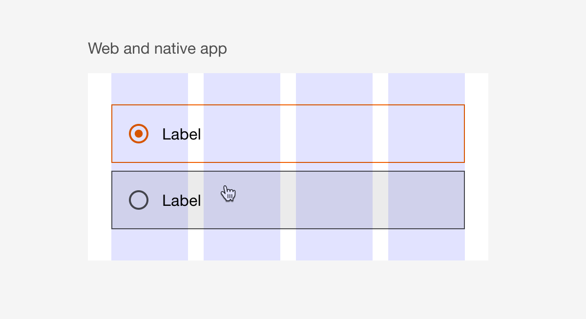

## Rich text

<!-- zh-row -->

### Strong text
* Strong text can be used sparingly to highlight key information within the content. Text is allowed using the corresponding "Strong" token (e.g. Label/Medium/Strong).
* No other text styles or custom font weights should be used.

&nbsp;

### ⚠️ Underline text
* Underlined text must not be applied manually (e.g. in error message), as it is commonly associated with hyperlinks and may mislead users.

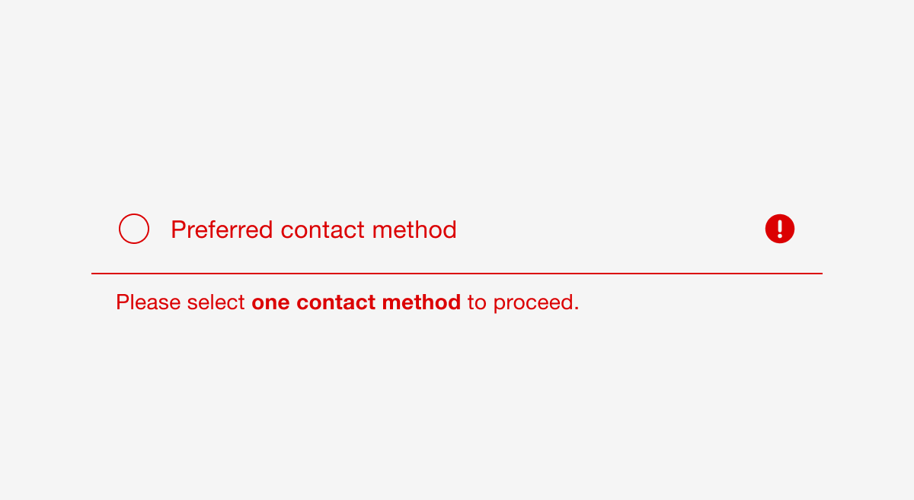

# Specs

## Layout and spacing

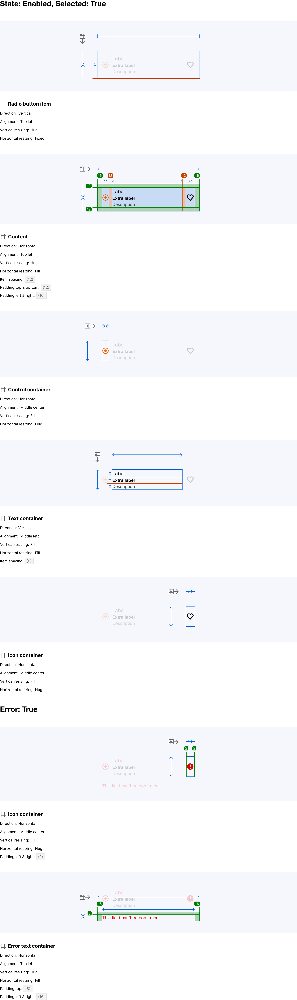

## States

<!-- zh-row -->

**`Enabled`** The default active state where the radio button is functional and selectable. It may show an unselected or selected style, with a label and helper text visible.

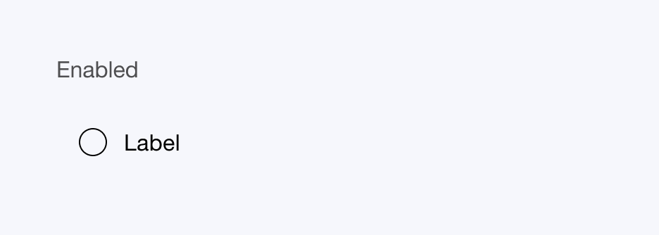

<!-- zh-row -->

**`Hover`** When a user places a pointing device over a radio button, but has not yet taken action on it. This includes a subtle visual indicator (highlighted background or color change) to show interactivity.

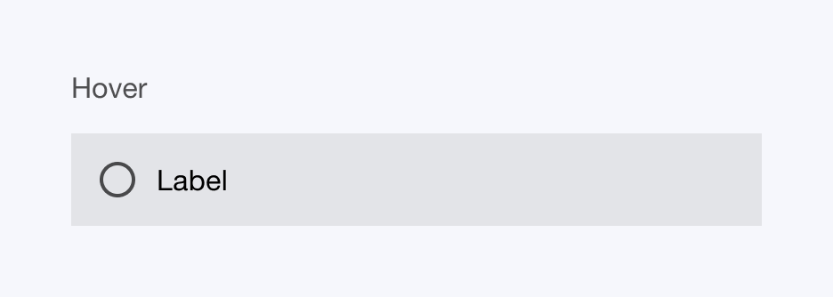

<!-- zh-row -->

**`Focus`** When a user selects a radio button via keyboard or voice command, but has not yet taken action on it.  
Mirrors the "Hover" state but includes an additional border.

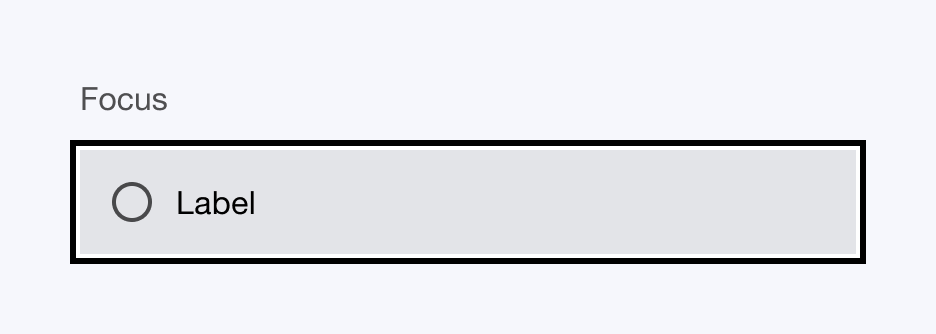

<!-- zh-row -->

**`Pressed`** An intermediate state that communicates a user has taken action on a radio button, and that it is in the process of navigating to a destination, triggering logic, or transmitting data.

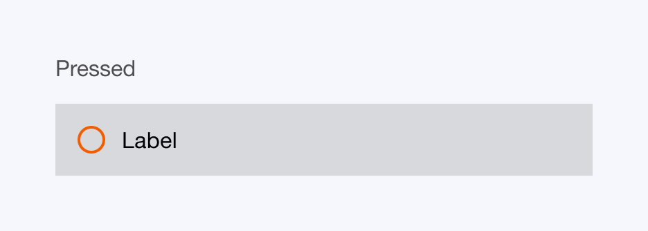

<!-- zh-row -->

**`Read only`** The radio button is displayed in a specific state (selected or unselected), but the user cannot modify it with a label and helper text visible.

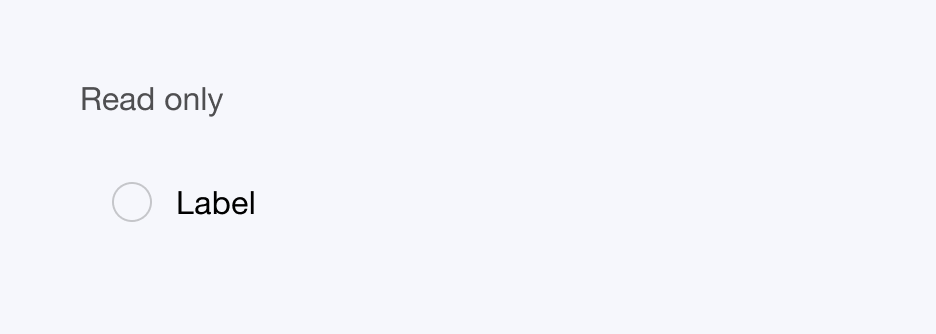

<!-- zh-row -->

**`Disabled`** The radio button is non-interactive and grayed out to indicate it cannot be selected or changed. The label and helper text are  muted.

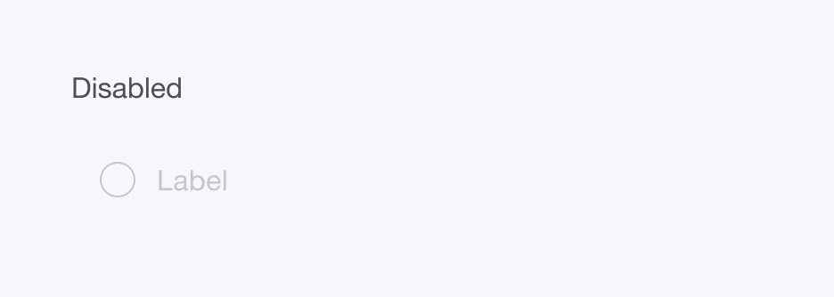

<!-- zh-row -->

**`Skeleton`** Improves the perceived loading time by providing a visual cue of where radio button will appear once fully loaded.  
Uses the "Skeleton" component, variant “Security marge=True”.

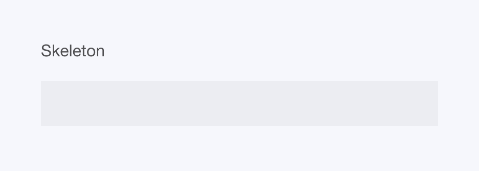

# Accessibility

## Behaviour and accessibility

### Semantics and Structure

Always use the native HTML <input type="radio"> element to ensure inherent accessibility.  
Associate each radio button with a clear and descriptive label using the <label> element.  
Group related radio buttons using the <fieldset> and <legend> elements for context.

### Text and Labels

Each radio button must have a visible and explicit label. Avoid empty or ambiguous labels.  
If the radio button’s purpose is not self-evident, provide additional information using aria-describedby.

### State Management

Use the checked attribute to indicate whether a radio button is selected.  
Ensure proper management of states:  
Selected: A single option within a group is selected.  
Unselected: All other options remain unselected.  
If a radio button is disabled, apply the disabled attribute to make it non-interactive.  
Avoid indeterminate states, as radio buttons are meant for single-selection use cases.

### Visible Focus

When navigating via keyboard (e.g., Tab key), radio buttons must display a visible focus style (e.g., a border or highlight).

### Keyboard Navigation

Users must be able to navigate and select radio buttons using the keyboard:  
Use Tab to move between groups or individual buttons.  
Use Arrow keys (Up/Down/Left/Right) to navigate between options in a group.  
Use Space to select an option.

### Screen Reader Compatibility

Screen readers must clearly identify each radio button and its state (selected or unselected).  
Use aria-checked to provide a custom state if you are building a custom radio button.  
Associate additional descriptions using aria-labelledby or aria-describedby as needed.  
Include group context (e.g., a <legend>) to help screen readers identify related options.

### Group Behavior

Radio buttons in the same group must be mutually exclusive (only one can be selected at a time).  
Provide group titles for clarity, especially for screen readers.

### Custom Radio-button

When customizing the appearance, such as adding icons or custom visuals, the native functionality should remain intact. The native <input> element can be hidden using CSS (e.g., opacity: 0 or visibility: hidden) while keeping it in the DOM to maintain accessibility. Interactions and states should be synchronized using JavaScript as necessary.

### User Feedback

If a radio-button triggers a specific action (e.g., submitting a form), provide clear feedback to the user:  
Show a visible message or notification.  
Use aria-live to notify screen readers of changes.

# Develop

## OUDS Web

[Components/RadioButtons › Radio Buttons 0](https://web.unified-design-system.orange.com/storybook/?path=/story/components-radiobuttons--radio-buttons-0)

[Components/RadioButtons › Radio Buttons 15](https://web.unified-design-system.orange.com/storybook/?path=/story/components-radiobuttons--radio-buttons-15)

## Developer documentation

| Platform | Developer documentation |
|---|---|
| OUDS Web | [S-ouds-web-radio-button-item](https://r.orange.fr/r/S-ouds-web-radio-button-item) |
| OUDS Android | [S-ouds-android-radio-button-item](https://r.orange.fr/r/S-ouds-android-radio-button-item) |
| OUDS iOS | [S-ouds-ios-radio-button-item](https://r.orange.fr/r/S-ouds-ios-radio-button-item) |
| OUDS Flutter | [S-ouds-flutter-radio-button-item](https://r.orange.fr/r/S-ouds-flutter-radio-button-item) |

# Changelog

## Availability

| Platform | Resource | Status | Version |
|---|---|---|---|
| Figma | [Radio button item component](https://r.orange.fr/r/S-ouds-design-radio-button-item) | Live | 1.4.0 |
| OUDS Web (former Boosted) | [Web dev documentation](https://r.orange.fr/r/S-ouds-web-radio-button-item) | Live | 1.4.0 |
| OUDS Android - Jetpack Compose | [Android dev documentation](https://r.orange.fr/r/S-ouds-android-radio-button-item) | Live | 1.4.0 |
| OUDS iOS - Swift | [iOS dev documentation](https://r.orange.fr/r/S-ouds-ios-radio-button-item) | Live | 1.4.0 |
| OUDS Flutter | [Flutter dev documentation](https://r.orange.fr/r/S-ouds-flutter-radio-button-item) | Live | 1.4.0 |

## Design changelog

| Date | Number | Notes |
|------|--------|-------|
| Nov 16, 2026 | - | <ul><li>Documentation update: Radio button item Overview separation<ul><li>Created a dedicated Overview for Radio button item, clarifying its properties, supporting content, layout behavior, and accessibility guidelines.</ul></ul> |
| Apr 8, 2026 | - | <ul><li>Documentation writing: Rich text</ul> |
| Mar 16, 2026 | - | <ul><li>Documentation writing:<ul><li>Mandatory field indication<li>Multiline and responsiveness<li>Technical layout adjustments</ul></ul> |
| Jan 6, 2026 | - | <ul><li>Documentation writing: Definition update</ul> |
| Nov 7, 2025 | 1.4.0 | <ul><li>A new Read-only variant has been added for the .Radiobutton.Indicator component, supporting two boolean variants — Selected = True/False. This variant introduces two new color tokens: <ul><li>ouds/color/action/read-only-primary — used for the indicator (shape) <li>ouds/color/action/read-only-secondary — used for the stroke</ul> <li>The new Read-only variant has been integrated into the Read-only variant of both the Radio button and Radio button Item components. <li>We replaced the token in Error text container ouds-control-text-input-space-padding-block-top-helper-text with ouds-control-control-item-space-padding-block-top-error-text. <li>"Helper text" is now called "Description". <li>"Additional label" is now called "Extra label".</ul> |
| Oct 20, 2025 | 1.3.0 | <ul><li>The Radio button item has been split into two boolean variants: → Error = True/False → Selected = True/False <li>The divider color is now functional in the Error state — it changes dynamically according to the component status. <li>The icon in the Error state is fixed to .Component/alert/important; its color changes together with the divider depending on the component's status. → The new token $control-control-item-size-error-icon is used for the icon size. → The new token $control-text-input-space-padding-inline-error-icon is used for the error icon container. 🆕 Both tokens are now available in the latest release of the Token Library 2.1.0. <li>Added Error text (from the Input component) — it follows the same padding-inline as control-item (16px) and uses → $control-text-input-space-padding-block-top-helper-text for block padding. By default, the Error text adapts automatically to match the component status: → Selected → displays the corresponding default error message for the selected state. → Unselected → displays the corresponding default error message for the unselected state. <li>The "Read only" state has been updated to replace control items (in their disabled states) — both selected and unselected — with the Tag → Text only → Muted component: → Positive with label "Selected" if selected = True → Negative with label "Unselected" if selected = False <li>Harmonisation of spacing across the control-item family We've unified sizing tokens across the entire control-item family (previously they were defined per component) to align spacing with other control items such as Text input. Replacement note: instead of the single token padding inset 12, use the following tokens: → ouds/_control/control-item/space/padding-inline → 16 → ouds/_control/control-item/space/padding-block → 12 Additionally, for the control-item family: → ouds/_control/control-item/space/column-gap → 12 → ouds/_control/control-item/size/max-width → 480</ul> |
| Sep 19, 2025 | 1.2.0 | <ul><li>In the initial settings, the 'Divider' variant is now hidden.</ul> |
| Jul 21, 2025 | 1.1.0 | <ul><li>The name of the family to which this component belongs is changing: Input → Control. As a result, the token naming convention is being updated. <li>Following the renaming of the 'Control' category, the name of the token sub-family 'control-item' is now becoming 'item'."</ul> |
| Jan 22, 2025 | 1.0.0 | <ul><li>Component creation</ul> |
