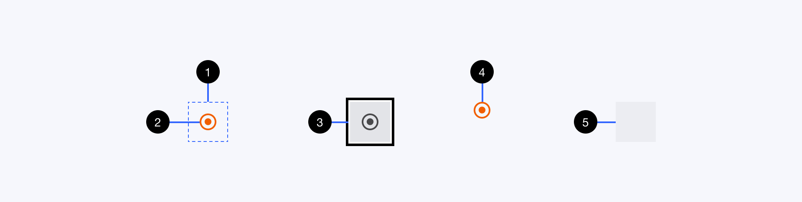
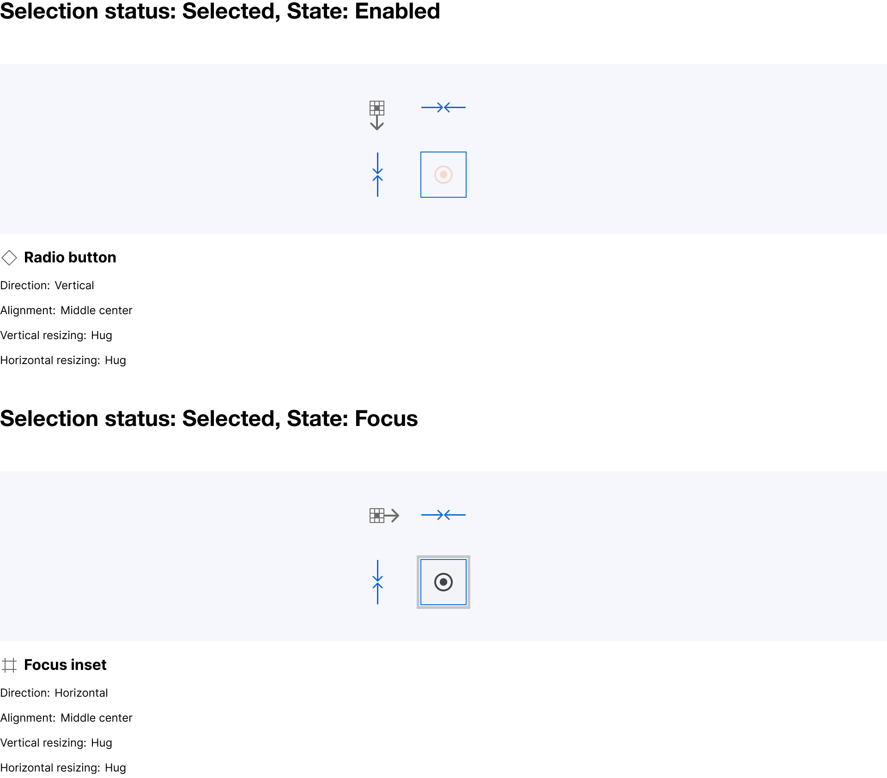

# Radio button

A radio button is a UI element that allows users to select a single option from a set of mutually exclusive choices.

# Guideline

## Anatomy

| # | Element | Purpose | Optional |
|---|---------|---------|----------|
| 1 | Container | The interactive area of the control (48 × 48 px) that holds the indicator. | No |
| 2 | Indicator | The circle that shows whether the option is selected. | No |
| 3 | Focus inset | Inner line of the focus indicator that keeps it visible on any surface. | Yes |
| 4 | Selected indicator | The dot shown in the indicator when the option is selected. | Yes |
| 5 | Skeleton | Placeholder shown while the control is loading. | Yes |

## Definition

A **radio button** is a UI element that allows users to select a single option from a set of mutually exclusive choices.

The radio button, that lacks an additional icon asset or text label, provides greater flexibility when designing other components that incorporate a radio button.

## Selected

<!-- zh-row -->

Typically, a radio button has two main states: Selected and Unselected.

**`False`** The radio button is unselected.  
Used by default or when the user chooses another option in the group.

**`True`** The radio button is selected.  
Indicates the user’s current active choice within the group.

## Error

<!-- zh-row -->

**`False`** No validation error is displayed. The radio button may be selected or unselected.

**`True`** Applies the error appearance to the standalone radio button. Any associated validation message must be provided by the parent component or selection group.

# Specs

## Layout and spacing

## States

<!-- zh-row -->

**`Enabled`** The default interactive state. The radio button can be either selected or unselected.

<!-- zh-row -->

**`Hover`** When a user places a pointing device over a radio button, but has not yet taken action on it. This includes a subtle visual indicator (highlighted background or color change) to show interactivity.

<!-- zh-row -->

**`Focus`** When a user selects a radio button via keyboard or voice command, but has not yet taken action on it.  
Mirrors the "Hover" state but includes an additional border.

<!-- zh-row -->

**`Pressed`** A temporary interaction state displayed while the user presses the radio button to select an option within its group.

<!-- zh-row -->

**`Read only`** The radio button displays its current selection state, but the user cannot modify it.

<!-- zh-row -->

**`Disabled`** The radio button cannot be selected or changed and is displayed using disabled-state styling.

<!-- zh-row -->

**`Skeleton`** Improves the perceived loading time by providing a visual cue of where radio button will appear once fully loaded.  
Uses the "Skeleton" component, variant “Security marge=True”.

# Accessibility

## Behaviour and accessibility

### Accessible labeling

The standalone Radio button does not include a built-in visible label. However, it must have a clear accessible name, provided through an associated label or an appropriate programmatic association.  
Radio buttons must be grouped according to their selection context. Only one option within a group can be selected at a time.  
The control must remain keyboard-accessible, expose its selection state to assistive technologies, and provide visible focus feedback.

# Develop

## OUDS Web

[Components/RadioButtons › Radio Buttons 0](https://web.unified-design-system.orange.com/storybook/?path=/story/components-radiobuttons--radio-buttons-0)

[Components/RadioButtons › Radio Buttons 15](https://web.unified-design-system.orange.com/storybook/?path=/story/components-radiobuttons--radio-buttons-15)

## Developer documentation

| Platform | Developer documentation |
|---|---|
| OUDS Web | [S-ouds-web-radio-button](https://r.orange.fr/r/S-ouds-web-radio-button) |
| OUDS Android | [S-ouds-android-radio-button](https://r.orange.fr/r/S-ouds-android-radio-button) |
| OUDS iOS | [S-ouds-ios-radio-button](https://r.orange.fr/r/S-ouds-ios-radio-button) |
| OUDS Flutter | [S-ouds-flutter-radio-button](https://r.orange.fr/r/S-ouds-flutter-radio-button) |

# Changelog

## Availability

| Platform | Resource | Status | Version |
|---|---|---|---|
| Figma | [Radio button component](https://r.orange.fr/r/S-ouds-design-radio-button) | Live | 1.4.0 |
| OUDS Web (former Boosted) | [Web dev documentation](https://r.orange.fr/r/S-ouds-web-radio-button) | Live | 1.4.0 |
| OUDS Android - Jetpack Compose | [Android dev documentation](https://r.orange.fr/r/S-ouds-android-radio-button) | Live | 1.4.0 |
| OUDS iOS - Swift | [iOS dev documentation](https://r.orange.fr/r/S-ouds-ios-radio-button) | Live | 1.4.0 |
| OUDS Flutter | [Flutter dev documentation](https://r.orange.fr/r/S-ouds-flutter-radio-button) | Live | 1.4.0 |

## Design changelog

| Date | Number | Notes |
|------|--------|-------|
| Nov 16, 2026 | - | <ul><li>Documentation update: Radio button Overview separation<ul><li>Created a dedicated Overview for the standalone Radio button, clarifying its properties, states, selection behavior, and accessibility requirements.</ul></ul> |
| Apr 8, 2026 | - | <ul><li>Documentation writing: Rich text</ul> |
| Mar 16, 2026 | - | <ul><li>Documentation writing:<ul><li>Mandatory field indication<li>Multiline and responsiveness<li>Technical layout adjustments</ul></ul> |
| Jan 6, 2026 | - | <ul><li>Documentation writing: Definition update</ul> |
| Nov 7, 2025 | 1.4.0 | <ul><li>A new Read-only variant has been added for the .Radiobutton.Indicator component, supporting two boolean variants — Selected = True/False. This variant introduces two new color tokens: <ul><li>ouds/color/action/read-only-primary — used for the indicator (shape) <li>ouds/color/action/read-only-secondary — used for the stroke</ul> <li>The new Read-only variant has been integrated into the Read-only variant of both the Radio button and Radio button Item components. <li>We replaced the token in Error text container ouds-control-text-input-space-padding-block-top-helper-text with ouds-control-control-item-space-padding-block-top-error-text. <li>"Helper text" is now called "Description". <li>"Additional label" is now called "Extra label".</ul> |
| Oct 20, 2025 | 1.3.0 | <ul><li>The Radio button item has been split into two boolean variants: → Error = True/False → Selected = True/False <li>The divider color is now functional in the Error state — it changes dynamically according to the component status. <li>The icon in the Error state is fixed to .Component/alert/important; its color changes together with the divider depending on the component's status. → The new token $control-control-item-size-error-icon is used for the icon size. → The new token $control-text-input-space-padding-inline-error-icon is used for the error icon container. 🆕 Both tokens are now available in the latest release of the Token Library 2.1.0. <li>Added Error text (from the Input component) — it follows the same padding-inline as control-item (16px) and uses → $control-text-input-space-padding-block-top-helper-text for block padding. By default, the Error text adapts automatically to match the component status: → Selected → displays the corresponding default error message for the selected state. → Unselected → displays the corresponding default error message for the unselected state. <li>The "Read only" state has been updated to replace control items (in their disabled states) — both selected and unselected — with the Tag → Text only → Muted component: → Positive with label "Selected" if selected = True → Negative with label "Unselected" if selected = False <li>Harmonisation of spacing across the control-item family We've unified sizing tokens across the entire control-item family (previously they were defined per component) to align spacing with other control items such as Text input. Replacement note: instead of the single token padding inset 12, use the following tokens: → ouds/_control/control-item/space/padding-inline → 16 → ouds/_control/control-item/space/padding-block → 12 Additionally, for the control-item family: → ouds/_control/control-item/space/column-gap → 12 → ouds/_control/control-item/size/max-width → 480</ul> |
| Sep 19, 2025 | 1.2.0 | <ul><li>In the initial settings, the 'Divider' variant is now hidden.</ul> |
| Jul 21, 2025 | 1.1.0 | <ul><li>The name of the family to which this component belongs is changing: Input → Control. As a result, the token naming convention is being updated. <li>Following the renaming of the 'Control' category, the name of the token sub-family 'control-item' is now becoming 'item'."</ul> |
| Jan 22, 2025 | 1.0.0 | <ul><li>Component creation</ul> |
