# Select input

A select input is a UI element that enables users to choose one or, in some cases, multiple options from a predefined list.

# Guideline

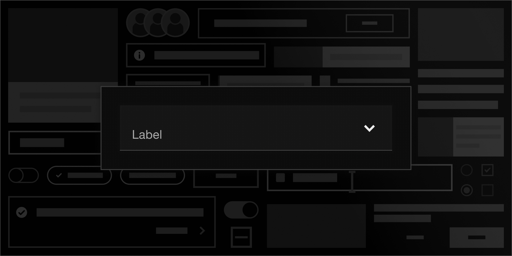

## When to use

✅ When users need to select one or multiple values from a predefined list

✅ If the set of options is limited, known in advance, and standardized

✅ Sorting or filtering content by a single criterion

✅ Mobile-optimized forms leveraging native device selectors

✅ To ensure data consistency and simplify decision-making

## Anatomy

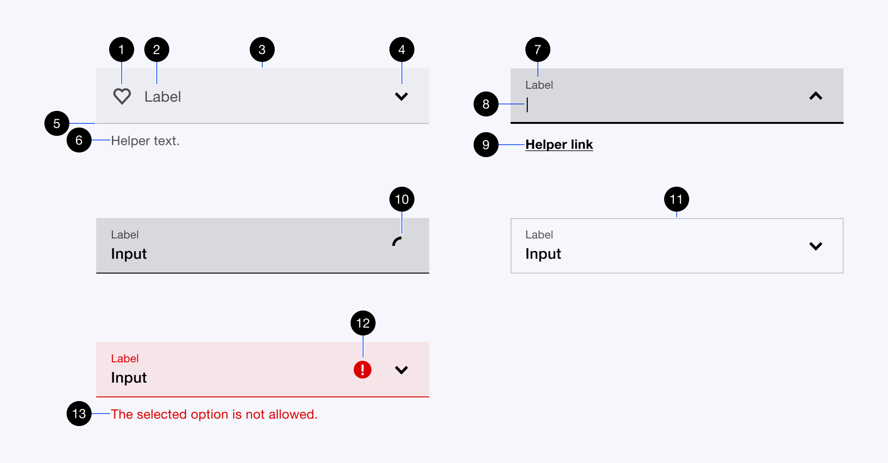

| # | Element | Purpose | Optional |
|---|---------|---------|----------|
| 1 | Leading icon | Provides a visual cue about the field type or context. | Yes |
| 2 | Label | Tells users what information to enter. | Yes |
| 3 | Input container | Holds and aligns all parts of the field (label, value, icons, etc.). | No |
| 4 | Trailing action | Opens the list of available options | No |
| 5 | Bottom border | The visible bottom border for the non-outlined style | Yes |
| 6 | Helper text | Adds extra guidance, examples, or formatting instructions. | Yes |
| 7 | Label | Moves above the input when focused or filled, so the field stays identifiable. | No |
| 8 | Text cursor | Indicates where the next character will be inserted while typing. | No |
| 9 | Helper link | Provides a link to supporting guidance or related information. | Yes |
| 10 | Loading indicator | Shows progress while validation or authentication is in progress. | Yes |
| 11 | Outlined container | Alternative visual style using a full border. | Yes |
| 12 | Error icon | Highlights the field’s error state to improve visibility and feedback | Yes |
| 13 | Error text | Explains what’s wrong and how to fix it when validation fails. | Yes |

## Definition

A select input is a UI element that enables users to choose one or, in some cases, multiple options from a predefined list.

The select input appears as a dropdown that shows available options. It is used when the number of choices is limited and known ahead of time, allowing users to select from controlled or standardised values.

## Outlined

<!-- zh-row -->

**`False`** An input with a subtle background fill and a visible bottom border, creating a softer and more contained look. Best suited for dense layouts or to enhance visibility.

**`True`** A minimalist input with a transparent background and a visible stroke outlining the field.

This style may be interesting for contexts other than form pages:
* When inputs need to feel lightweight and unobtrusive
* In a header (search field)
* In a selection/filtering feature in a product catalog

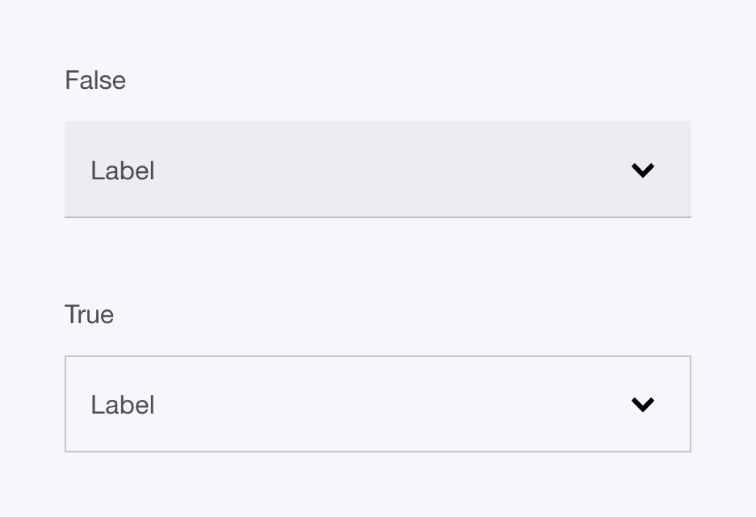

## Rounded corner

<!-- zh-row -->

Even though in Figma this rendering option is available and editable from the properties of each input component, the configuration of this rendering option is actually transversal across the entire product/service in which the component is used. It is therefore impossible to have one input component set to Rounded corner=True and another set to Rounded corner=False within the same product/service.

**`False`** The square rendering corresponds to Orange's historical style. It conveys the brand's sense of seriousness, robustness and utility-driven. It remains the default style for our digital interface components.

**`True`** The rounded rendering offers flexibility without sacrificing the attribution to the brand. It helps anchoring the service in a reality where the visual codes of the mobile area tends to rub off on all interfaces. Use rounded corners for a softer, more approachable, friendly and tactile feel.

This option is technically not available for all brand themes. Here's the list of rounded corners availability by brand theme:

| Brand theme | Status |
|---|---|
| Orange | ✅ Available |
| Orange Compact | ✅ Available |
| Sosh | ❌ Unavailable |
| Wireframe | ❌ Unavailable |

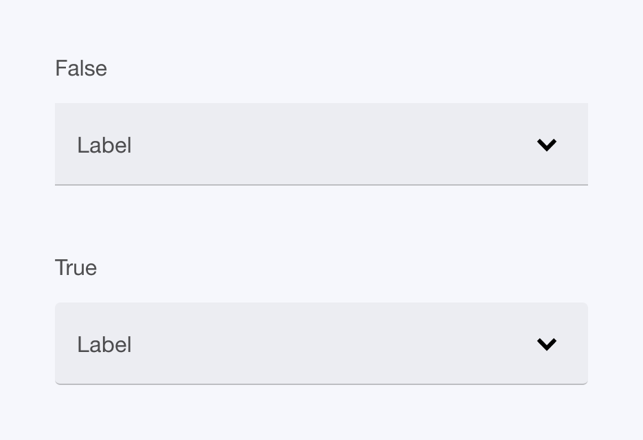

## Input status

<!-- zh-row -->

**`Empty`** The Empty state indicates that the select input is blank with no content or placeholder, a neutral starting point.

**`Filled`** The Filled state shows that the user has entered valid content into the field, replacing any placeholder.

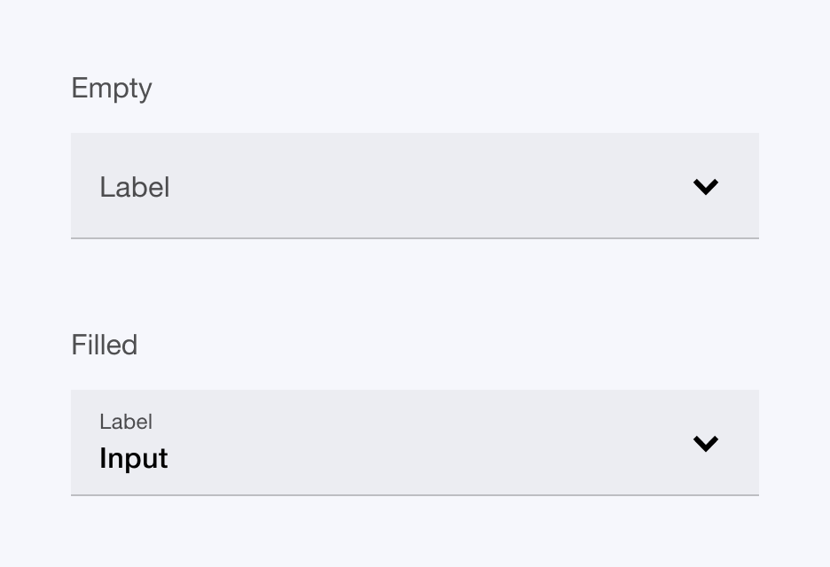

## Error

<!-- zh-row -->

The Error status indicates that the user input does not meet validation rules or expected formatting. It provides immediate visual feedback, typically through a red border, error icon, and a clear, accessible error message positioned below the input (mandatory).

This state helps users quickly identify and correct mistakes by explaining what went wrong and, when possible, how to fix it.

The input remains editable, encouraging users to revise their input without starting over.

In the context of the select field, if the user has correctly selected a value but an error message still appears, it often means that: the option has been deleted, blocked, or is invalid / the option does not comply with a business rule / the option is incompatible with the user's profile / the option is obsolete or expired / inconsistency with another value in the form / too many choices, limit exceeded / server issue or value rejected on the backend.

&nbsp;

### ⚠️ Error message vs helper text / link

The error message is not the same element as the helper text, it is independent. If a helper text accompanies the text input, it is replaced by the error message. The helper text must not be displayed simultaneously. However, a helper link must not be replaced and should remain positioned below the error message.

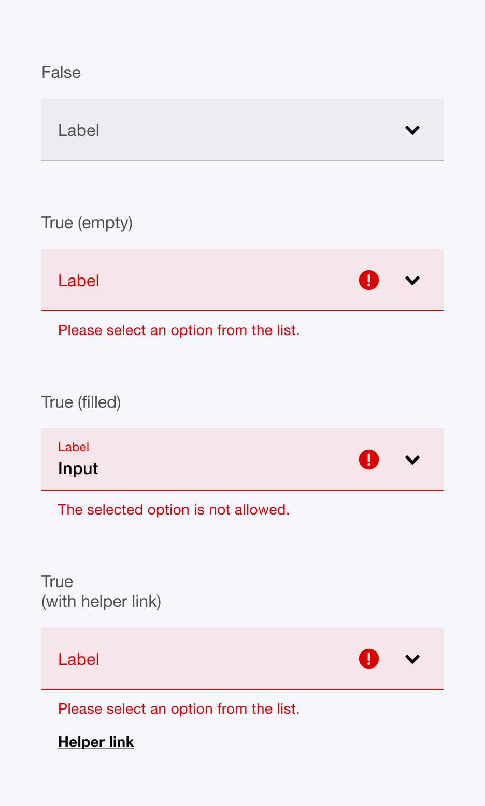

## Leading icon

<!-- zh-row -->

Helps indicate the purpose of the input.

Only use a leading icon if it adds clear functional or contextual value.

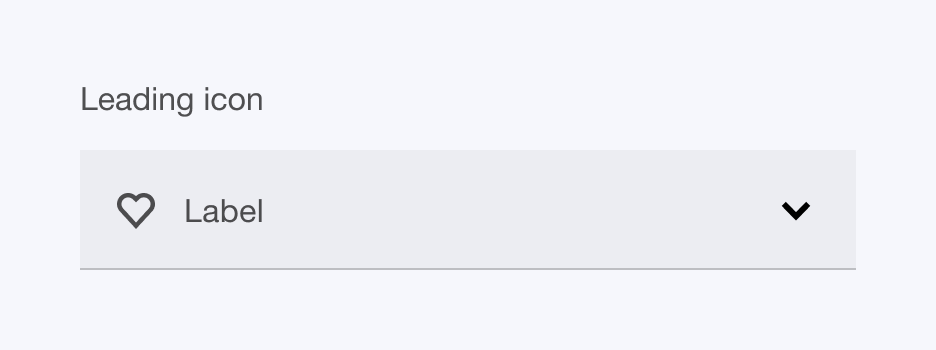

## Label

<!-- zh-row -->

Describes the purpose of the input. Why hide a select input label?  
In some UI contexts, especially when space is limited or when the input is part of a compact layout (filters, inline forms), visually hiding the label can help maintain a clean and uncluttered interface.  
However, hiding the label should only be done if:
* The purpose of the input remains clear thanks to a contextual icon.
* The label is still accessible to screen readers (using aria-label, aria-labelledby, or visually hidden text).

Hiding a label is a design choice that must balance visual simplicity and clarity of intent, without compromising inclusiveness or form guidance.

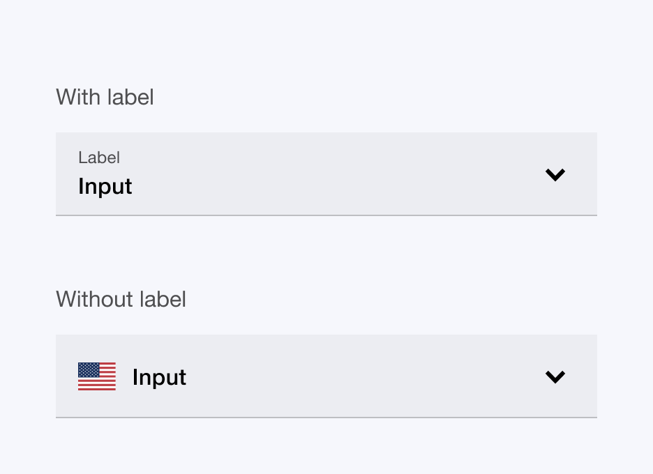

## Other boolean options

<!-- zh-row -->

**`Helper text`** Supporting text conveys additional information about the input field, such as how it will be used. It should ideally only take up a single line, though may wrap to multiple lines if required, and be either persistently visible or visible only on focus.

**`Helper link`** If the helper text is not sufficient (It can also be displayed on its own without helper text), it's possible to offer the user an additional help link (the link can be external or open a modal).

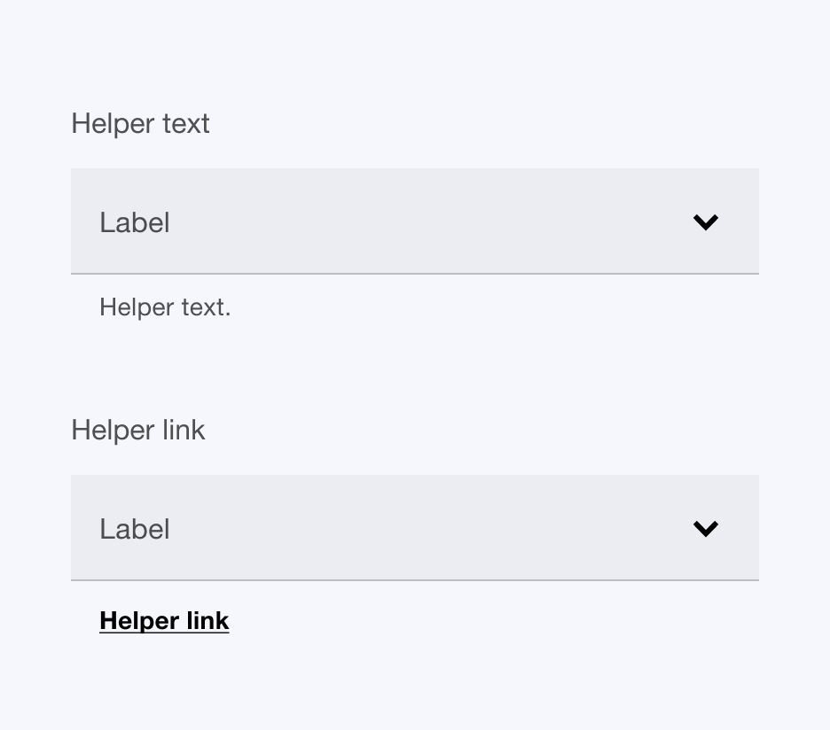

## Mandatory field indication

<!-- zh-row -->

**If all fields are mandatory (several fields present):**
1. Display the message "All fields are mandatory." at the top.
2. Do not use an asterisk (*) at the end of each field label, nor the word "mandatory."

**If not all fields are mandatory (and there are several fields present):**
1. Display the message "All fields marked with an * are mandatory." at the top.
2. Use an asterisk (*) at the end of each mandatory field label.  
   **⚠️ Important:**
   * In Figma, the asterisk must be entered manually by designers in the label text. UI rendering of the asterisk: **font-weight-bold** + **color-content-negative (red)**.
   * Technically, for web/iOS/Android, the asterisk is positioned in a dedicated container after the label text. Spacing between label and asterisk: Empty state → 4px / Other states (reduced label) → 3px. If the label is truncated due to a large amount of text, the asterisk must remain visible at the end of the field.
3. Either the technology allows a 'required' attribute to be managed on the fields (usually in Web), in which case any asterisks must be hidden from users using assistive technologies, or the technology does not allow the mandatory nature of the field to be indicated. In this case, the asterisk must be vocalised as well as a 'mandatory' mention. Please refer to the technical documentations for more information.
4. Depending on the use case, an 'optional' label can be added to non-mandatory fields.

**If there is only one field in the form, or if the mandatory nature is obvious (such as login/password), no mention is necessary since the fields are essential to the form's functionality.**

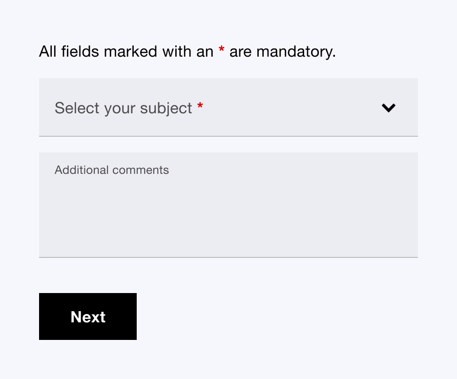

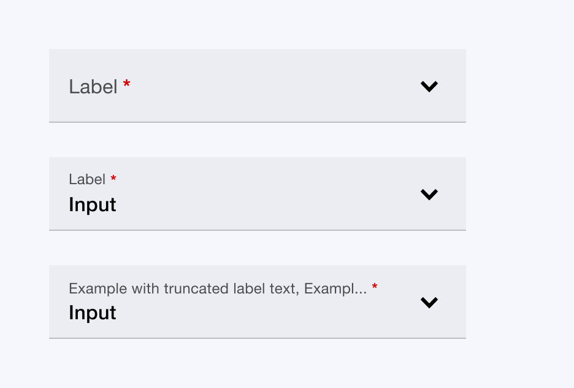

## Truncated input area

<!-- zh-row -->

**When losing focus, the truncation behavior of the input area differs depending on the technical environment. It's important to respect the native behaviors designed to handle truncation:**

For this component, if the text volume exceeds the visible width of the field, the input area truncates the value on the right with a visual truncation indicator (...).

**⚠️ In all cases:** the entire text must remain accessible when the field regains focus:

* Either by opening the dropdown (either by clicking on it or using the down arrow) in which the item is selected and thus seeing the text in its entirety.
* Or via a tooltip on hover in certain desktop contexts.

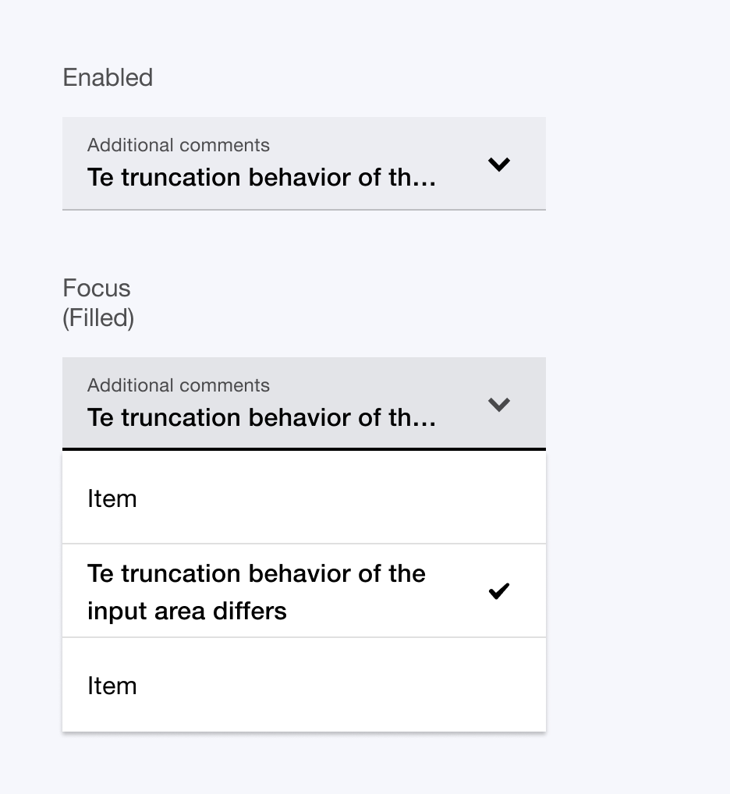

## Multiline and responsiveness

<!-- zh-row -->

### Multiline

In its "Empty" state, the label of this component allows two lines of text editing. However, it is recommended not to exceed one line of text.

Apart from the case described above, this component doesn't allow multi-line text editing (whether for the label or input).

As a result, and in order to maintain a consistent and uniform height across multiple components, the presence of an excessive amount of text (in the label or input) will cause the text to be truncated so that only a single line remains visible for each element.

Additionally, allowing multi-line text editing would create confusion with the "Text area" component.

&nbsp;

### Max-width vs full-width

For greater flexibility, this component doesn't have a default max-width. To avoid exceeding a width that would degrade readability and the perception of a compact interactive element, we recommend applying **a max-width of around 480px.**

For mobile or tablet use (or if the component is positioned inside a specific container), it is possible to set this component to use the full available width (of the screen or the container).

Please note that this behavior is not the default rule; it may be preferred if the template allows it (to improve user comfort or for better page structure/hierarchy).

&nbsp;

### User zoom in/out

The behavior of the text during user zoom in/out must follow a fundamental principle: the text must remain readable, accessible, and must never break the structure or lose information.

However, "Text input" components present an exception regarding the loss of textual information following the activation of user zoom, since text truncation (label, placeholder, input text) is exceptionally allowed and enabled.

* The text must always scale proportionally with user zoom. Text resizing must never be blocked.
* The component's height and width must be flexible, never fixed, in order to automatically adapt its dimensions according to the level of zoom.
* In order to preserve the minimun interactive area during user zoom out, this component have a min-width **of 96px** and a min-height **of 60px**.
* Even if, the component has a max-height or a max-width for resizing control purposes, technically, during user zoom in, these limitations are not fixed but must be scalable in order to adapt to the user's zoom level.
* In its "Leading icon" variant, user zoom in/out doesn't affect the size of the icons; they remain fixed in size (decorative use).
* As the chevron and error icon are functional, they must follow the same rules as text.

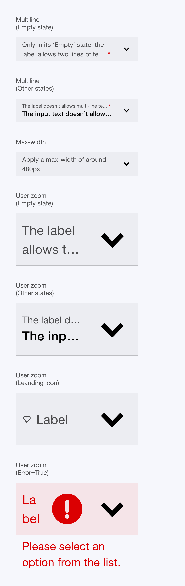

## Rich text

<!-- zh-row -->

### Strong text
* Strong text can be used sparingly to highlight key information within the content. Text is allowed using the corresponding "Strong" token (e.g. Label/Medium/Strong) depending on the selected text style.
* No other text styles or custom font weights should be used.

&nbsp;

### ⚠️ Underline text and Hyperlinks
* Underlined text must not be applied manually (e.g. in helper text), as it is commonly associated with hyperlinks and may mislead users.
* If a link is required, the dedicated helper link component must be used (e.g. **Compare plans**).

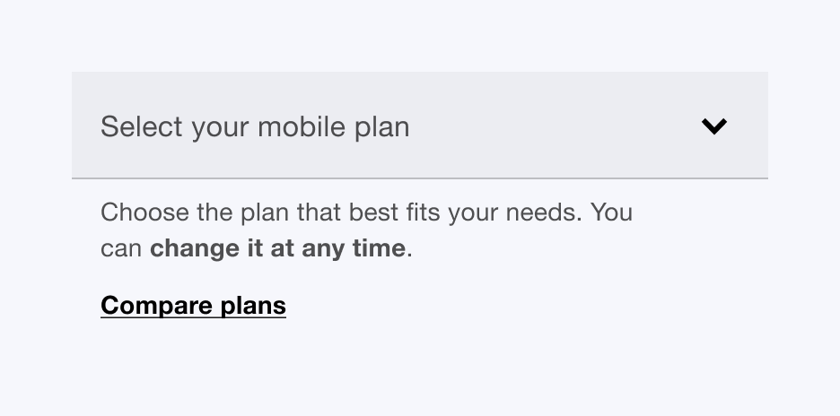

# Specs

## Layout and spacing

## States

<!-- zh-row -->

**`Enabled`** Neutral appearance, whether empty or filled. It allows users to click, focus, and type freely without restrictions.

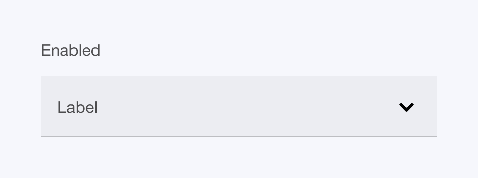

<!-- zh-row -->

**`Hover`** Slight visual contrast or border color change.

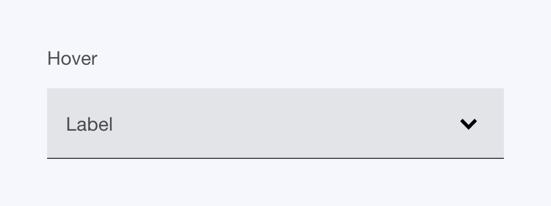

<!-- zh-row -->

**`Focus`** The select input is focused and ready to receive user input. It visually highlights the field to indicate that it's currently editable and interactive.

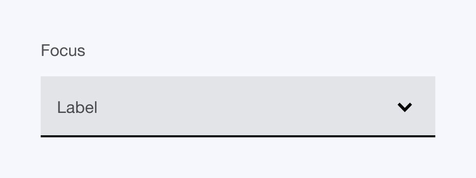

<!-- zh-row -->

**`Expanded`** The component is actively displaying its full list of options. This state is typically triggered by a user interaction, such as a click or tap on the field, and replaces the collapsed state. Visually, it involves changes: an open dropdown panel, a rotated chevron icon, and a highlighted focus ring to indicate active engagement.

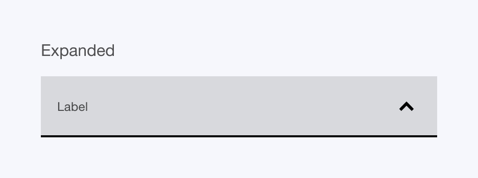

<!-- zh-row -->

**`Loading`** The Loading state indicates that the system is processing or retrieving data related to the select input. A progress indicator appears to inform the user that an action is in progress. During this state, the input may be temporarily disabled to prevent further interaction.

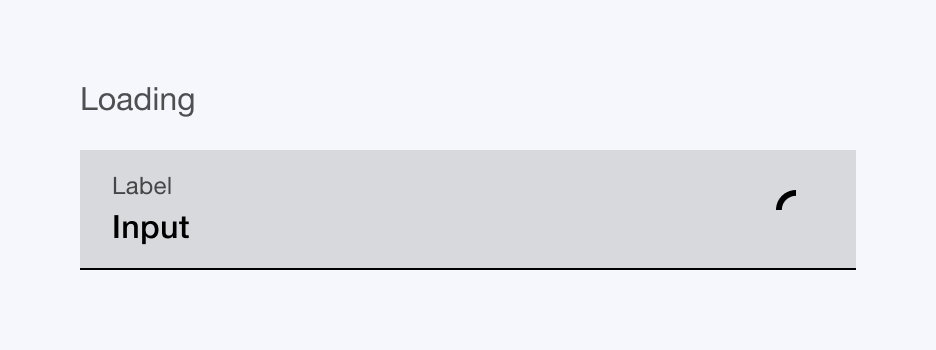

<!-- zh-row -->

**`Read only`** Text visible but not editable (often with a muted or different background).

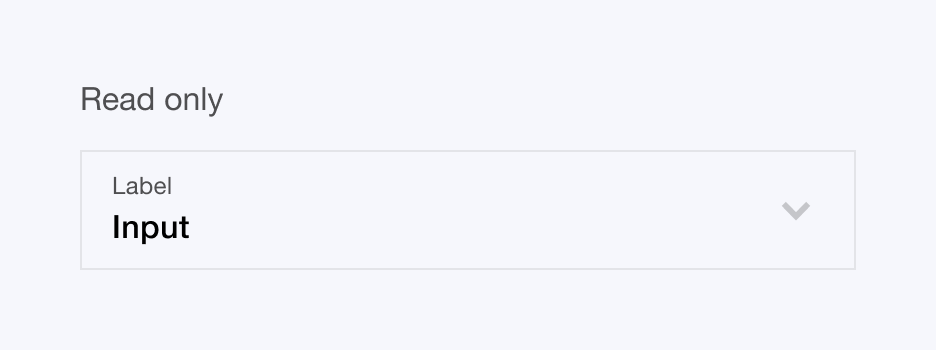

<!-- zh-row -->

**`Disabled`** The field is non-interactive and grayed out to indicate it cannot be changed. The helper text is muted.

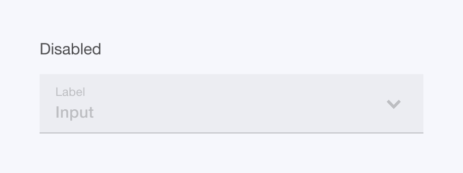

<!-- zh-row -->

**`Skeleton`** Improves the perceived loading time by providing a visual cue of where field will appear once fully loaded. Uses the "Skeleton" component, variant "Security marge=False".

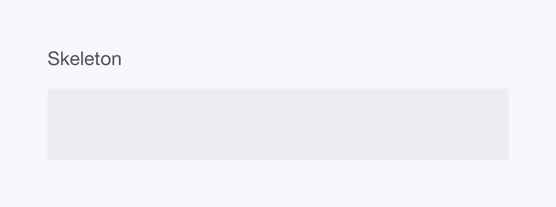

# Accessibility

Work is in progress to deliver this content.

# Develop

## Developer documentation

| Platform | Developer documentation |
|---|---|
| OUDS Web | [S-ouds-web-select-input](https://r.orange.fr/r/S-ouds-web-select-input) |
| OUDS Android | Not available yet |
| OUDS iOS | Not available yet |
| OUDS Flutter | Not available yet |

# Changelog

## Availability

| Platform | Resource | Status | Version |
|---|---|---|---|
| Figma | [Select input component](https://r.orange.fr/r/S-ouds-design-select-input) | Live | 1.3.1 |
| OUDS Web (former Boosted) | [Web dev documentation](https://r.orange.fr/r/S-ouds-web-select-input) | Live | 1.2.0 |
| OUDS Android - Jetpack Compose | Not available yet | To do | – |
| OUDS iOS - Swift | Not available yet | To do | – |
| OUDS Flutter | Not available yet | To do | – |

## Design changelog

| Date | Number | Notes |
|------|--------|-------|
| May 22, 2026 | 1.3.1 | **Version 2.6 of the design tokens is required for the development of this update.** For "Loading" state:<ul><li>The loader frame has been renamed to Circular progress indicator. It now contains the new Circular Progress Indicator component.</li><li>The following tokens are removed: action-button-border-radius-default</li><li>Absolute positioning has been removed and replaced with Auto Layout.<ul><li>The container now uses: ouds/button/space/inset/icon-only-default</li></ul></li></ul> |
| Apr 22, 2026 | 1.3.0 | <ul><li>Scope: Trailing action=False / State=Loading → Replacement of the button component (loading state) with a "Trailing container" frame containing the circular progress indicator component</li><li>The input text reference changes from a regular weight (font-weight-label-default) to a medium weight (font-weight-label-moderate).</li><li>Removal of the component's max-width to avoid blocking certain layouts and to provide greater flexibility of use. The max-width values remain available in the design documentation.</li><li>Update of the tokens applied to the chevron. Depending on the component's state, the tokens applied to the chevrons are replaced by a component token from the button family (example: color-content-default → action-button-color-content-enabled).</li><li>Add spacing tokens between the label and the asterisk:<ul><li>control-text-input-space-column-gap-📄_label-asterisk</li><li>control-text-input-space-column-gap-📄_label-small-asterisk</li></ul></li></ul> |
| Apr 8, 2026 | - | <ul><li>Documentation writing: Rich text</ul> |
| Mar 16, 2026 | - | <ul><li>Documentation writing:<ul><li>Rounded corners brand theme availability<li>Mandatory field indication<li>Truncated input area<li>Multiline and responsiveness</ul></ul> |
| Jan 21, 2026 | - | • Documentation writing: Rounded corners update |
| Jan 6, 2026 | - | <ul><li>Documentation writing: Definition update</ul> |
| Sep 30, 2025 | 1.2.0 | • The name of the "Style" variant has been replaced to "Outlined" with true/false variant |
| Jul 29, 2025 | 1.1.0 | • Several design token updates: [Component tokens changelog 1.5.0](https://www.figma.com/design/Co2t6wHMf4GB9NJVGs2Hes/-OUDS-Core-Lib--Design-tokens?m=auto&node-id=9280-2568&t=HLVB4jOd35DWr8Bj-1) |
| Jun 30, 2025 | 1.0.0 | • Component creation |
