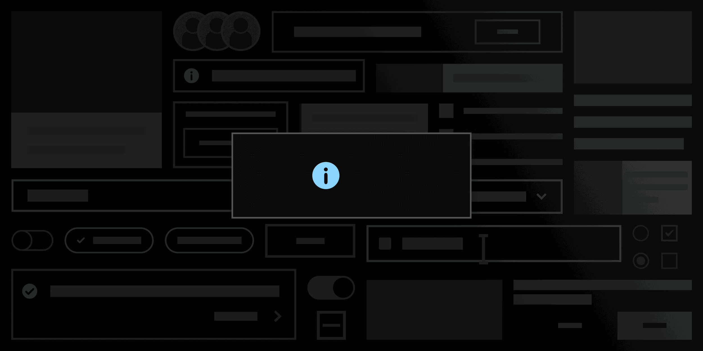
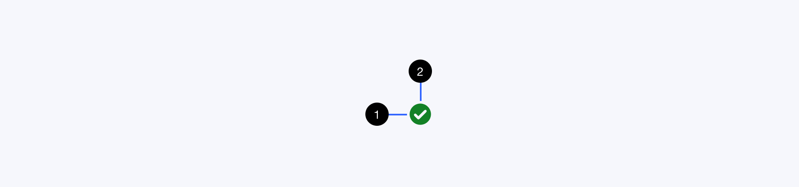
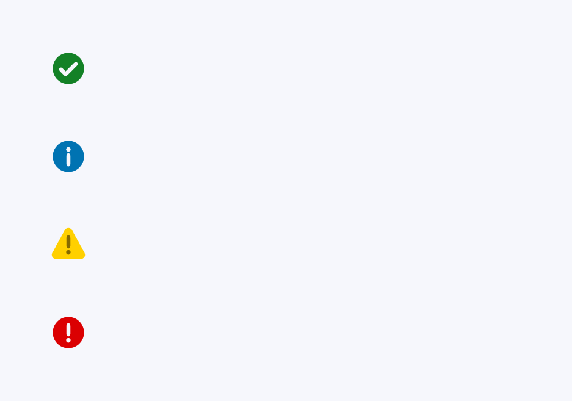
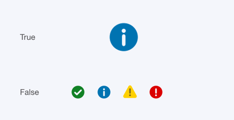
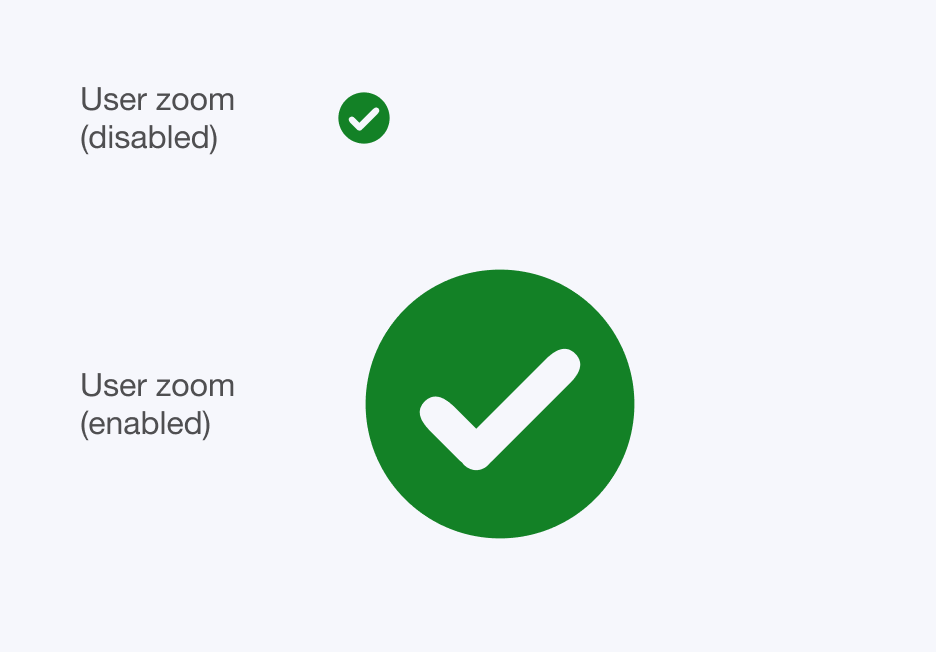
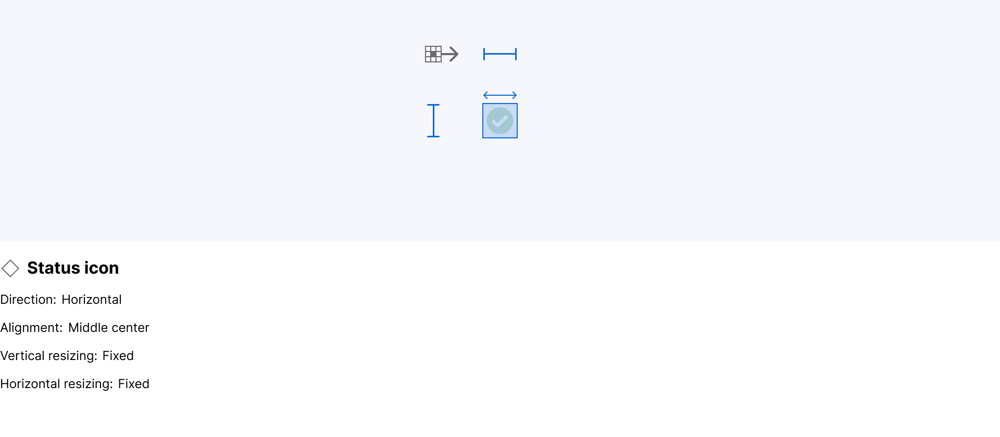
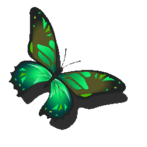
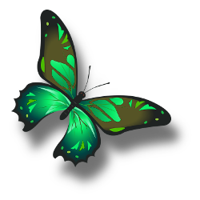
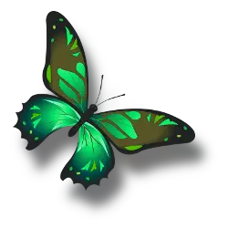

# Status icon

A status icon is a UI element that communicates the functional state of a system or message, such as Success, Info, Warning, or Error.

# Guideline

## Anatomy

| # | Element | Purpose | Optional |
|---|---------|---------|----------|
| 1 | Container | The container that sets the size of the component and holds the icon | No |
| 2 | Icon | The status symbol, paired with its status colour | No |

## Definition

A status icon is a UI element that communicates the functional state of a system or message, such as Success, Info, Warning, or Error.

The status icon offers quick, at-a-glance feedback using standardised colors and symbols to ensure consistent meaning throughout the product. It is typically non-interactive and appears in contexts such as alerts, form validation, notifications, or system messages.

## Status

⚠️ Note:  
Icons must never be replaced or customized. Each type has a dedicated, standardized icon that expresses its meaning clearly.

<!-- zh-row -->

**`Positive`** Confirms that an action was completed successfully.  
Uses a green color and the standard success icon.

**`Info`** Provides neutral information or updates about the system or account status. Uses blue for neutrality and clarity.

**`Warning`** Draws attention to potential issues or upcoming changes.  
Uses yellow to signal caution while remaining non-blocking.

**`Negative`** Indicates a failure, error, or blocking issue that needs user attention.  
Uses red color and must include the standardized error icon.

## Animated

<!-- zh-row -->

**`True`** The Status Icon includes a subtle animation to reinforce the status change or draw attention to the state. The animation remains minimal and purposeful, supporting clarity without distraction.

**`False`** The Status Icon is displayed in a static state, without motion. It provides immediate visual feedback using color and symbol only.

## Multiline and responsiveness

<!-- zh-row -->

### User zoom in/out
The component's height and width must be flexible, never fixed, in order to automatically adapt its dimensions according to the level of zoom (the icons follow the same rules as the text).  
In order to preserve the minimun interactive area during user zoom out, this component have a min-width and a min-height **of 28px**.

# Specs

## Layout and spacing

# Accessibility

## Motion & Animation accessibility rules

In terms of animation, there are accessibility criteria to consider: “Animation from Interactions” and “Pause, Stop, Hide.”  
These two main criteria address different issues:

&nbsp;

### Pause, Stop, Hide - WCAG 2.2.2
This concerns moving, blinking, scrolling, or automatically updating content.  
The question to ask is: does the animation start automatically and meet the criterion’s conditions?  
When a relevant animation lasts more than 5 seconds, users must be able to pause, stop, or hide it.  
The two criteria should therefore be evaluated independently.

&nbsp;

### Reduced Motion (Animation from Interactions) - WCAG 2.3.3
This primarily concerns motion-based animations triggered by user interaction.  
The question to ask is: is the movement essential to the functionality or to the information being conveyed?  
If not, the animation should be removed, reduced, or replaced when the user has enabled Reduced Motion.

ℹ️ The reduced motion preference can be configured by the user at the operating system level and is available to websites through the CSS prefers-reduced-motion media feature.

Concrete application to the Status icon:

&nbsp;

### Pause, Stop, Hide
If the icon animation starts automatically and repeats for more than 5 seconds, it must be possible to pause, stop, or hide it, unless a WCAG exception applies.  
Whenever possible, it is recommended to use a short, non-repeating animation rather than maintaining a looping animation.

&nbsp;

### Reduced Motion
Animation applied to a functional icon is generally not essential to understanding the information being conveyed.  
When Reduced Motion is enabled, the animation should be removed or replaced with a static representation of the corresponding state.  
If the animation conveys essential information, that information must remain available through a non-animated representation.

testing image formats

# Develop

## Developer documentation

| Platform | Developer documentation |
|---|---|
| OUDS Web | Not available yet |
| OUDS Android | Not available yet |
| OUDS iOS | Not available yet |
| OUDS Flutter | Not available yet |

# Changelog

## Availability

| Platform | Resource | Status | Version |
|---|---|---|---|
| Figma | [Status icon component](https://r.orange.fr/r/S-ouds-design-status-icon) | Early Access | 1.0.0 |
| OUDS Web (former Boosted) | Not available yet | To do | – |
| OUDS Android - Jetpack Compose | Not available yet | To do | – |
| OUDS iOS - Swift | Not available yet | To do | – |
| OUDS Flutter | Not available yet | To do | – |

## Design changelog

| Date | Number | Notes |
|------|--------|-------|
| Sep 1, 2026 | - | <ul><li>Documentation writing: Motion & Animation accessibility rules.</ul> |
| Jun 8, 2026 | 1.0.0 | Version 2.6 of the design tokens is required for the development of this update.<ul><li>Component creation</ul> |
