# Suggestion chip

A suggestion chip is a UI element that presents recommended or predictive options based on the user's input or context, often utilised to capture filtering decisions.

# Guideline

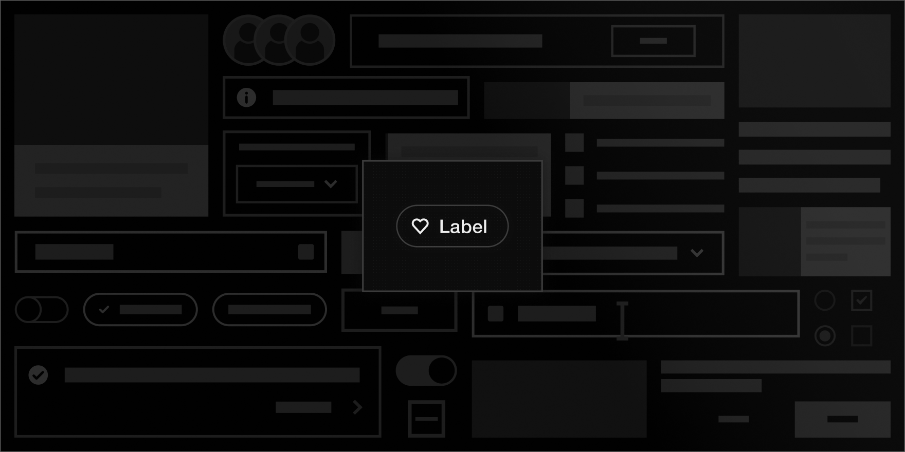

## Anatomy

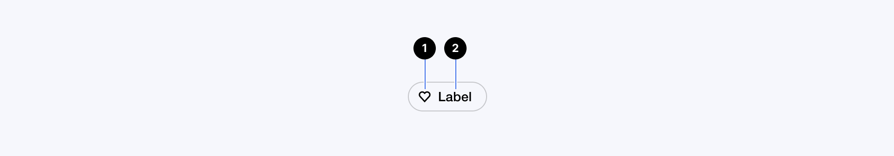

| # | Element | Purpose | Optional |
|---|---------|---------|----------|
| 1 | Icon | Use an icon to add additional affordance where the icon has a clear and well-established meaning. | No |
| 2 | Label | Information about the chip description. | No |

## Definition

A suggestion chip is a UI element that presents recommended or predictive options based on the user's input or context, often utilised to capture filtering decisions.

The suggestion chip is usually unselected by default and can be tapped or clicked to apply the suggestion, making input easier and improving usability.

## Layouts

<!-- zh-row -->

**`Text only`** Displays only text, offering a clean and minimalistic look. Best suited for category-based filters that do not require additional visual elements.

**`Text + icon`** Combines text with an icon to enhance clarity and recognition. Ideal when a visual cue helps reinforce the filter's meaning.

**`Icon only`** Uses only an icon, making it a compact option for limited space. Works well with universally recognized symbols, such as a heart for favorites or a checkmark for selection.

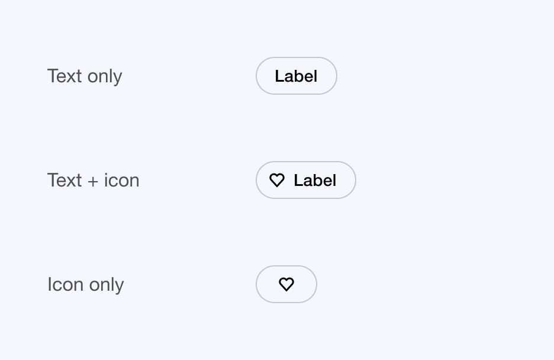

### Text only

**Do:** Use short, clear labels.  
A single concise word is easier to scan and quickly communicates the meaning of the filter or suggestion.

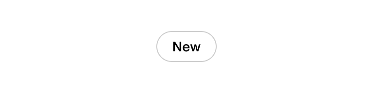

**Don't:** Don’t use long, sentence-like labels.  
Lengthy phrases make the chip hard to read and turn it into a button-like element, breaking the visual rhythm.

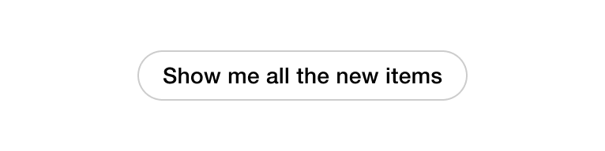

### Text + icon

**Do:** Use an icon that directly reflects the meaning of the text.  
A usage-related symbol (like a chart) helps users instantly understand what the suggestion refers to.

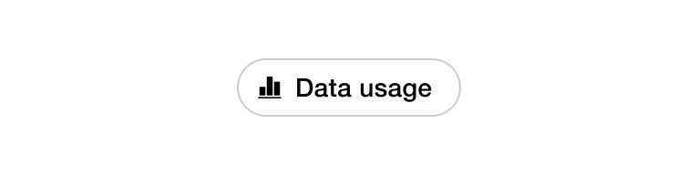

**Don't:** Don’t use icons that represent a different concept.  
A connectivity icon suggests network status, not data consumption, which can confuse the user.

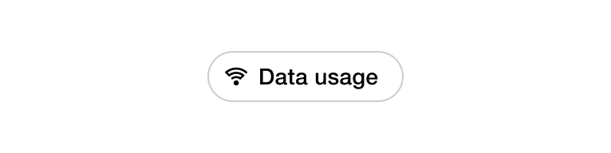

### Icon only

**Do:** Use an icon that most users immediately recognize.  
Simple, universal symbols (like a star for favorites) work well because their meaning is instantly clear without text.

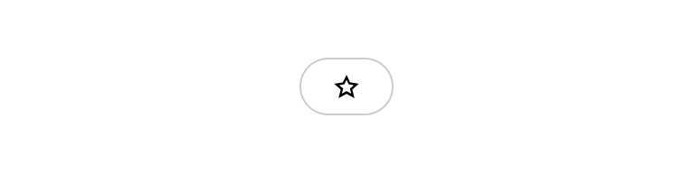

**Don't:** Avoid icons that can be interpreted in many different ways.  
Abstract symbols (like a puzzle piece) may confuse users, since they don’t clearly communicate a single, predictable meaning.

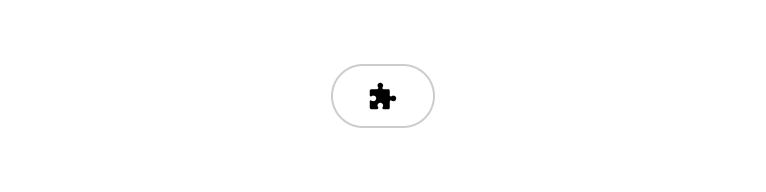

## Multiline and responsiveness

<!-- zh-row -->

### Multiline
Depending on the use case, permissions for editing multi-line text vary:
- In a "chips bar" context (the chips are positioned one after another in a horizontal carousel with no width limit), this component doesn't allow multi-line text editing.
- In a "Quick Replies" context (the chips are used as action and disambiguation elements in a conversational interface), this component allows multi-line text editing.

This is a design recommendation, technically, and for several reasons (responsive behavior, user zoom, etc.), multiline remains possible.

&nbsp;

### Max-width vs full-width
For greater flexibility, this component doesn't have a default max-width. To avoid exceeding a width that would degrade readability and the perception of a compact interactive element, we recommend applying **a max-width of around 200px.**  
It is not possible to set this component to use the full available width (of the screen or the container).

&nbsp;

### User zoom in/out
The behavior of the text during user zoom in/out must follow a fundamental principle: the text must remain readable, accessible, and must never break the structure or lose information.
* The text must always scale proportionally with user zoom. Text resizing must never be blocked.
* Zooming must never cause text to be truncated or hidden. The component must expand vertically to allow line wrapping.
* The component's height and width must be flexible, never fixed, in order to automatically adapt its dimensions according to the level of zoom.
* In order to preserve the minimun interactive area during user zoom out, this component have a min-width **of 52px** and a min-height **of 48px**.
* Even if, the component has a max-height or a max-width for resizing control purposes, technically, during user zoom in, these limitations are not fixed but must be scalable in order to adapt to the user's zoom level.
* In its "Text + icon" variant, user zoom in/out doesn't affect the size of the icons; they remain fixed in size (decorative use).
* As the text is missing, in its "Icon only" variant, the icons follow the same rules as the text.

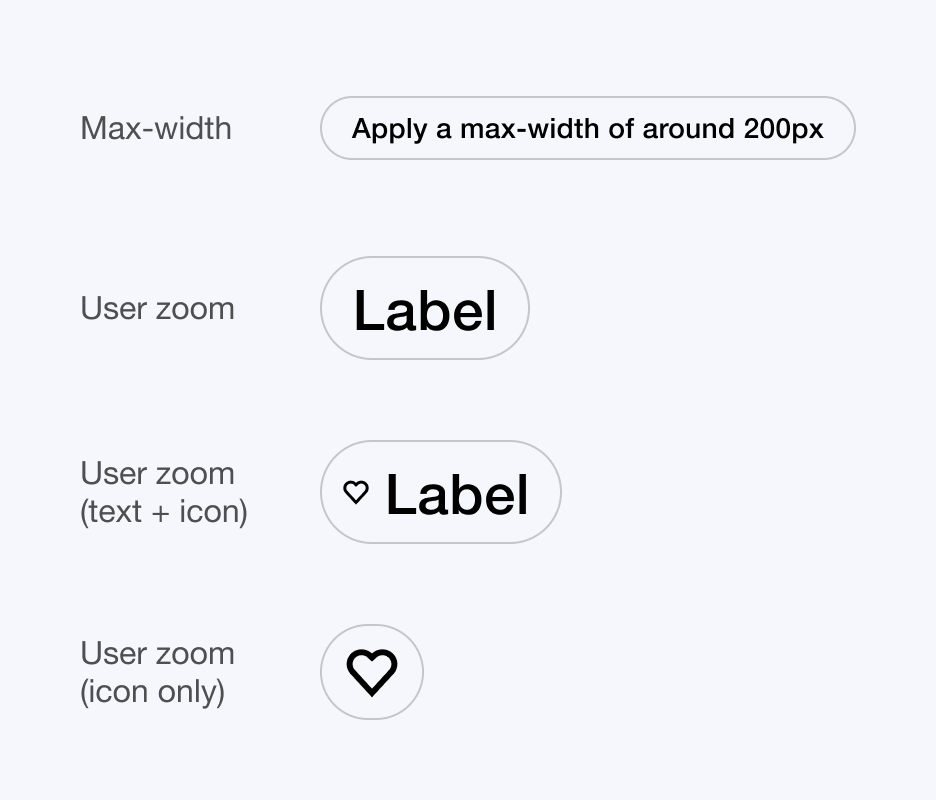

# Specs

## Layout and spacing

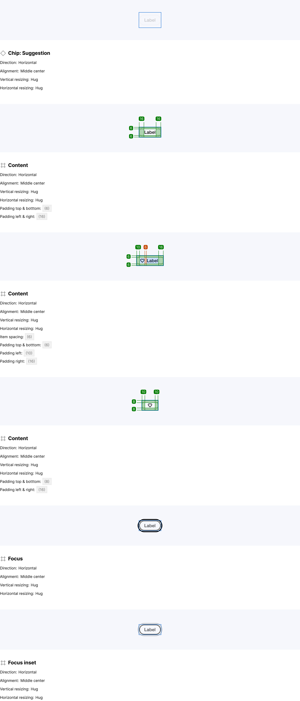

## States

<!-- zh-row -->

**`Enabled`** The chip is active and available for interaction. It is displayed in its standard style without additional effects.

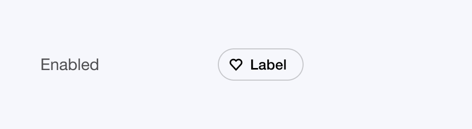

<!-- zh-row -->

**`Hover`** The appearance of the chip changes when the cursor hovers over it. This includes a color change for the border and the chip's content.

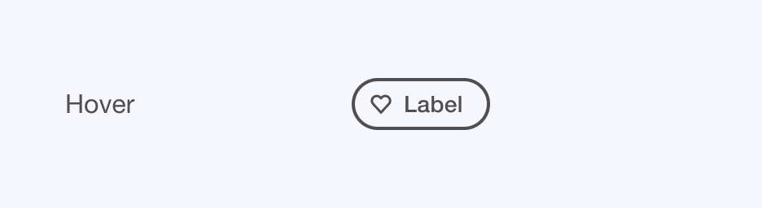

<!-- zh-row -->

**`Pressed`** The active state when the chip is being pressed. Accompanied by a color change in the content and border.

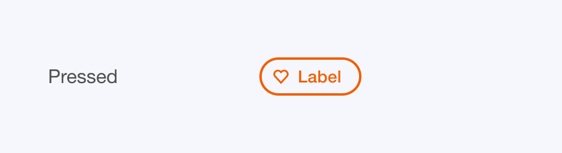

<!-- zh-row -->

**`Disabled`** The chip is unavailable for interaction. It is visually represented with a muted color change in the content and border (reduced brightness and contrast).

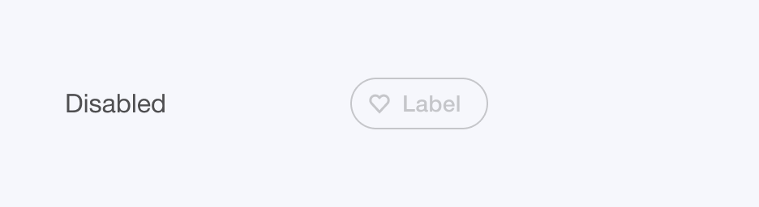

<!-- zh-row -->

**`Focus`** The state when the chip receives focus (during keyboard navigation). It features a triple contrasting border to indicate the active element.

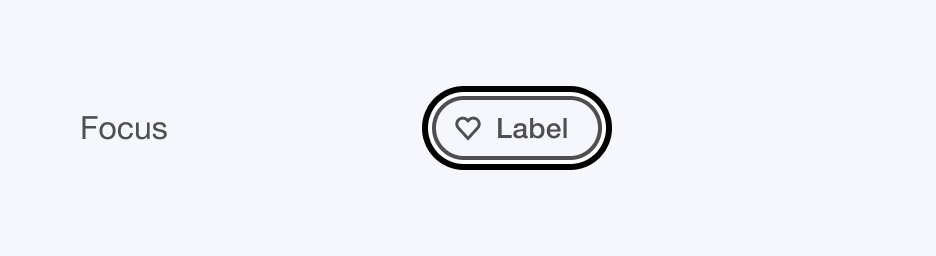

<!-- zh-row -->

**`Skeleton`** Displays a placeholder chip while the content is loading. It appears as a semi-transparent gray block without content.

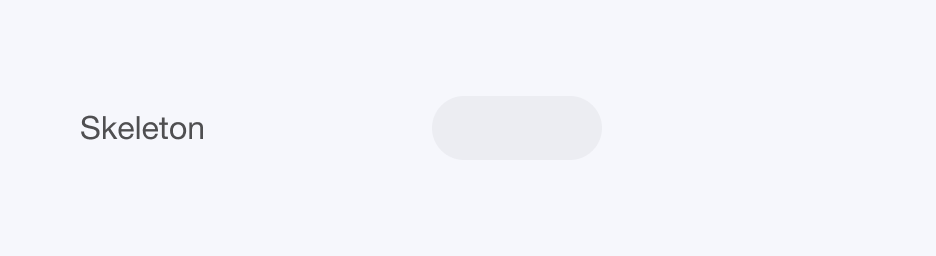

# Accessibility

## Use case

Users should be able to:

- Quickly select a suggested option based on context or previous input
- Navigate between suggestion chips using keyboard or switch input
- Activate a suggestion chip to auto-fill, refine, or narrow their input
- Understand each suggestion through clear text or icons that reinforce meaning

## Interaction and style

The text on the chip must have at least a 4.5:1 contrast ratio against its background when the chip is in the enabled state. High contrast helps differentiate chips clustered together

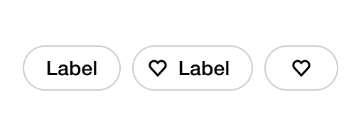

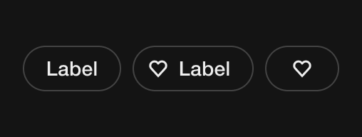

## Screen reader behavior

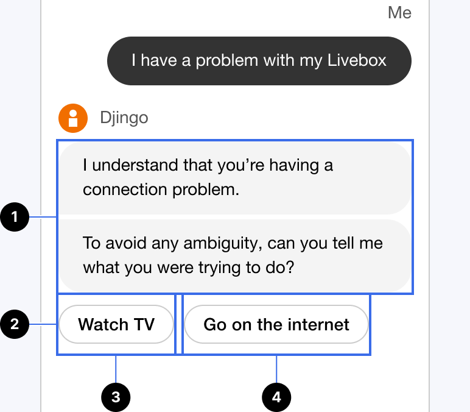

## How suggestion chips are read aloud

Suggestion chips announce two key pieces of information:

1. label
2. available action (“double-tap to select”)

# Develop

## OUDS-Web example

[Components/Chips › Chips 7](https://web.unified-design-system.orange.com/storybook/?path=/story/components-chips--chips-7)

## Developer documentation

| Platform | Developer documentation |
|---|---|
| OUDS Web | [S-ouds-web-suggestion-chip](https://r.orange.fr/r/S-ouds-web-suggestion-chip) |
| OUDS Android | [S-ouds-android-suggestion-chip](https://r.orange.fr/r/S-ouds-android-suggestion-chip) |
| OUDS iOS | [S-ouds-ios-suggestion-chip](https://r.orange.fr/r/S-ouds-ios-suggestion-chip) |
| OUDS Flutter | [S-ouds-flutter-suggestion-chip](https://r.orange.fr/r/S-ouds-flutter-suggestion-chip) |

# Changelog

## Availability

| Platform | Resource | Status | Version |
|---|---|---|---|
| Figma | [Suggestion chip component](https://r.orange.fr/r/S-ouds-design-suggestion-chip) | Live | 1.5.0 |
| OUDS Web (former Boosted) | [Web dev documentation](https://r.orange.fr/r/S-ouds-web-suggestion-chip) | Live | 1.5.0 |
| OUDS Android - Jetpack Compose | [Android dev documentation](https://r.orange.fr/r/S-ouds-android-suggestion-chip) | Live | 1.5.0 |
| OUDS iOS - Swift | [iOS dev documentation](https://r.orange.fr/r/S-ouds-ios-suggestion-chip) | Live | 1.5.0 |
| OUDS Flutter | [Flutter dev documentation](https://r.orange.fr/r/S-ouds-flutter-suggestion-chip) | Live | 1.5.0 |

## Design changelog

| Date | Number | Notes |
|------|--------|-------|
| Jul 1, 2026 | 1.5.0 | <ul><li>The label text is no longer centred but left-aligned.</ul> |
| Apr 22, 2026 | 1.4.0 | <ul><li>Version 2.4 of the design tokens is required for the development of this update.<li>The text reference of the label changes from a bold weight (font-weight-label-strong) to a medium weight (font-weight-label-moderate).</ul> |
| Mar 16, 2026 | - | <ul><li>Documentation writing: Multiline and responsiveness</ul> |
| Jan 6, 2026 | - | <ul><li>Documentation writing: Definition update</ul> |
| Jul 21, 2025 | 1.3.0 | <ul><li>The name of the family to which this component belongs is changing: Input → Control. As a result, the token naming convention is being updated. <li>Several design token updates: [Component tokens changelog 1.3.0](https://www.figma.com/design/Co2t6wHMf4GB9NJVGs2Hes/-OUDS-Core-Lib--Design-tokens?m=auto&node-id=9280-2568&t=HLVB4jOd35DWr8Bj-1)</ul> |
| Jul 2, 2025 | 1.2.0 | <ul><li>Modification of the typographic alignment "Label text", the alignment is now centered.</ul> |
| Jun 13, 2025 | 1.1.0 | <ul><li>Modification of the minimum height of the frame containing the component to increase the interactive area (48px). Component token: $ouds-input-chip-size-min-height-interactive-area <li>Modification of the semantic token corresponding to the inline padding used when displaying an icon. Component token: $ouds-input-chip-space-padding-inline-icon Semantic token: $ouds-space-padding-inline-sm <li>Modification of the typographic alignment of the "Content" frame, the alignment is now centered.</ul> |
| Apr 9, 2025 | 1.0.0 | <ul><li>Component creation</ul> |
