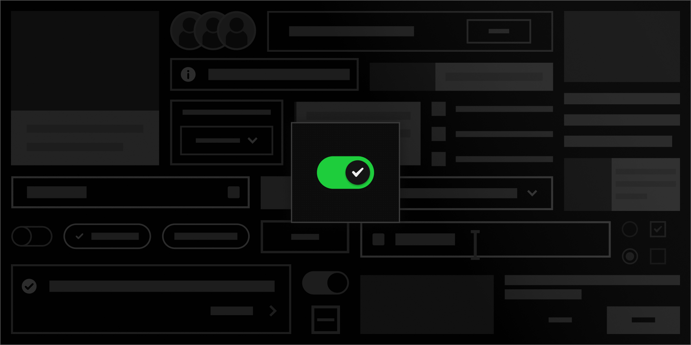
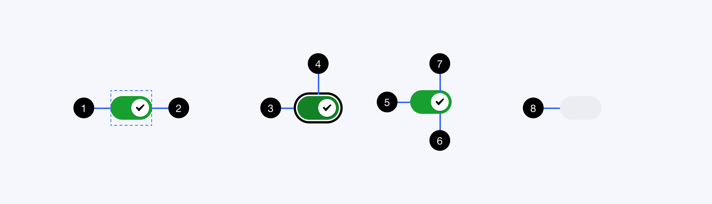
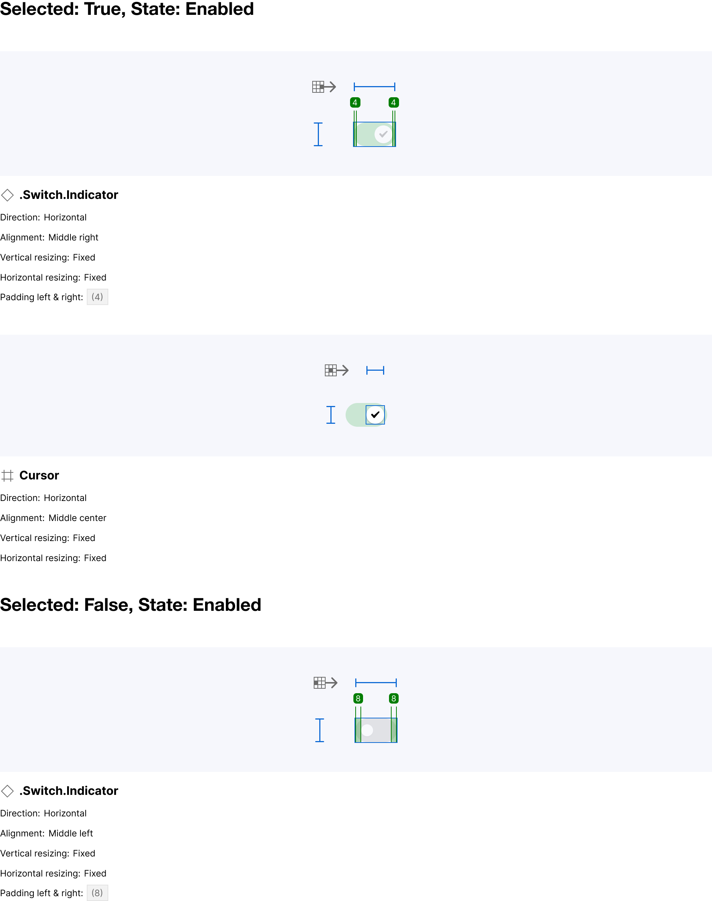

# Switch

A switch is a UI element that toggles between two states, typically "On" and "Off," and is used to enable or disable features, options, or settings.

# Guideline

## Anatomy

| # | Element | Purpose | Optional |
|---|---------|---------|----------|
| 1 | Container | The interactive area of the control that holds the indicator. | No |
| 2 | Indicator | The part of the control that shows the On / Off state: the track background and the cursor. | No |
| 3 | Focus | Focus indicator shown around the control when it receives keyboard focus. | Yes |
| 4 | Focus inset | Inner line of the focus indicator that keeps it visible on any surface. | Yes |
| 5 | Track background | The pill behind the cursor; its colour shows the On / Off state. | No |
| 6 | Cursor | The round handle that moves from one end of the track to the other. | No |
| 7 | Selected indicator | The check mark shown in the cursor when the switch is On. | Yes |
| 8 | Skeleton | Placeholder shown while the control is loading. | Yes |

## Definition

A **switch** is a UI element that toggles between two states, typically "On" and "Off," and is used to enable or disable features, options, or settings.

The switch, that lacks an additional icon asset or text label, provides greater flexibility when creating other components that require a switch.

## Selected

<!-- zh-row -->

Typically, a switch has two main states: Selected and Unselected.

**`False`** The switch is off, the option or feature is disabled.  
Used as the default state before activation.

**`True`** The switch is on, the option or feature is enabled.  
Indicates that the setting or action is currently active.

# Specs

## Layout and spacing

## States

<!-- zh-row -->

**`Enabled`** The status of the switch before a user has interacted with it, or other content affects it.

<!-- zh-row -->

**`Hover`** When a user places a pointing device over a switch, but has not yet taken action on it.

<!-- zh-row -->

**`Focus`** When a user selects a switch via keyboard or voice command, but has not yet taken action on it.  
Mirrors the "Hover" state but includes an additional border.

<!-- zh-row -->

**`Pressed`** A temporary interaction state displayed while the user presses the Switch to change its current On/Off state.

<!-- zh-row -->

**`Read only`** The switch is displayed in a specific state (true or false), but the user cannot modify it.

<!-- zh-row -->

**`Disabled`** Used to indicate an option that cannot be selected.

<!-- zh-row -->

**`Skeleton`** Improves the perceived loading time by providing a visual cue of where switch will appear once fully loaded.  
Uses the "Skeleton" component, variant “Security marge=True”.

# Accessibility

## Motion & Animation accessibility rules

In terms of animation, there are accessibility criteria to consider: “Animation from Interactions” and “Pause, Stop, Hide.”  
These two main criteria address different issues:

&nbsp;

### Pause, Stop, Hide - WCAG 2.2.2
This concerns moving, blinking, scrolling, or automatically updating content.  
The question to ask is: does the animation start automatically and meet the criterion’s conditions?  
When a relevant animation lasts more than 5 seconds, users must be able to pause, stop, or hide it.  
The two criteria should therefore be evaluated independently.

&nbsp;

### Reduced Motion (Animation from Interactions) - WCAG 2.3.3
This primarily concerns motion-based animations triggered by user interaction.  
The question to ask is: is the movement essential to the functionality or to the information being conveyed?  
If not, the animation should be removed, reduced, or replaced when the user has enabled Reduced Motion.

ℹ️ The reduced motion preference can be configured by the user at the operating system level and is available to websites through the CSS prefers-reduced-motion media feature.

Concrete application to the Switch:

&nbsp;

### Pause, Stop, Hide
The animation of a switch is triggered by a user action and therefore does not generally fall within the scope of this criterion.  
If the state change triggers additional animation or automatically moving content that meets the conditions of the criterion, that content must be evaluated separately.

&nbsp;

### Reduced Motion
The animation applied when a switch changes state is generally not essential to its functionality or to understanding its state.  
When Reduced Motion is enabled, the animation should therefore be removed or replaced with an instantaneous transition.  
The state of the switch must remain clearly identifiable without relying on animation.  
Default: animated state change  
Reduced Motion: instantaneous state change

## Behaviour and accessibility

### Accessible labeling

The standalone Switch does not include a built-in visible label. However, it must have a clear accessible name provided through an associated label or an appropriate programmatic association.

### Keyboard navigation

The Switch must remain keyboard-accessible and provide visible focus feedback.

### State indication

The current On/Off state must be clearly identifiable visually and exposed to assistive technologies.

### Reduced Motion

When Reduced Motion is enabled, use an instantaneous state transition. The Switch state must remain identifiable without relying on animation.

# Develop

## OUDS Web

[Components/Switches › Switches 0](https://web.unified-design-system.orange.com/storybook/?path=/story/components-switches--switches-0)

[Components/Switches › Switches 13](https://web.unified-design-system.orange.com/storybook/?path=/story/components-switches--switches-13)

## Developer documentation

| Platform | Developer documentation |
|---|---|
| OUDS Web | [S-ouds-web-switch](https://r.orange.fr/r/S-ouds-web-switch) |
| OUDS Android | [S-ouds-android-switch](https://r.orange.fr/r/S-ouds-android-switch) |
| OUDS iOS | [S-ouds-ios-switch](https://r.orange.fr/r/S-ouds-ios-switch) |
| OUDS Flutter | [S-ouds-flutter-switch](https://r.orange.fr/r/S-ouds-flutter-switch) |

# Changelog

## Availability

| Platform | Resource | Status | Version |
|---|---|---|---|
| Figma | [Switch component](https://r.orange.fr/r/S-ouds-design-switch) | Live | 1.5.0 |
| OUDS Web (former Boosted) | [Web dev documentation](https://r.orange.fr/r/S-ouds-web-switch) | Live | 1.5.0 |
| OUDS Android - Jetpack Compose | [Android dev documentation](https://r.orange.fr/r/S-ouds-android-switch) | Live | 1.5.0 |
| OUDS iOS - Swift | [iOS dev documentation](https://r.orange.fr/r/S-ouds-ios-switch) | Live | 1.5.0 |
| OUDS Flutter | [Flutter dev documentation](https://r.orange.fr/r/S-ouds-flutter-switch) | Live | 1.5.0 |

## Design changelog

| Date | Number | Notes |
|------|--------|-------|
| Nov 16, 2026 | - | <ul><li>Documentation update: Switch Overview separation<ul><li>Created a dedicated Overview for the standalone Switch component, clarifying its properties, states, selection behavior, and accessibility requirements.</ul></ul> |
| Sep 1, 2026 | - | <ul><li>Documentation writing: Motion & Animation accessibility rules.</ul> |
| Apr 8, 2026 | - | <ul><li>Documentation writing: Rich text</ul> |
| Mar 16, 2026 | - | <ul><li>Documentation writing:<ul><li>Mandatory field indication<li>Multiline and responsiveness<li>Technical layout adjustments</ul></ul> |
| Jan 6, 2026 | - | <ul><li>Documentation writing: Definition update</ul> |
| Nov 7, 2025 | 1.5.0 | • A new Read-only variant has been added for the .Switch.Indicator component, supporting two boolean variants — Selected = True/False. This variant introduces two new color tokens: &nbsp;&nbsp;&nbsp;&nbsp;• ouds/color/action/read-only-primary &nbsp;&nbsp;&nbsp;&nbsp;• ouds/color/action/read-only-secondary • The new Read-only variant has been integrated into the Read-only variant of both the Switch and Switch Item components. • We replaced the token in Error text container ouds-control-text-input-space-padding-block-top-helper-text with ouds-control-control-item-space-padding-block-top-error-text. • "Helper text" is now called "Description". |
| Oct 20, 2025 | 1.4.0 | • The Switch item has been split into two boolean variants: Error = True/False, Selected = True/False • The divider color is now functional in the Error state — it changes dynamically according to the component status. • The icon in the Error state is fixed to .Component/alert/important; its color changes together with the divider depending on the component's status. → The new token $control-control-item-size-error-icon is used for the icon size. → The new token $control-text-input-space-padding-inline-error-icon is used for the error icon container. 🆕 Both tokens are now available in the latest release of the Token Library 2.1.0. • Added Error text (from the Input component) — it follows the same padding-inline as control-item (16px) and uses → $control-text-input-space-padding-block-top-helper-text for block padding. By default, the Error text adapts automatically to match the component status: → Selected → displays the corresponding default error message for the selected state. → Unselected → displays the corresponding default error message for the unselected state. • The "Read only" state will be updated with the goal of replacing the control items (in their "disabled" states), whether selected or unselected, with the component Tag → Text only → Muted: → Positive with a label text "Selected" if status selected=True → Negative with a label text "Unselected" if status selected=False  • Harmonisation of spacing across the control-item family We've unified sizing tokens across the entire control-item family (previously they were defined per component) to align spacing with other control items such as Text input. Replacement note: instead of the single token padding inset 12, use the following tokens: → ouds/_control/control-item/space/padding-inline → 16 → ouds/_control/control-item/space/padding-block → 12 Additionally, for the control-item family: → ouds/_control/control-item/space/column-gap → 12 → ouds/_control/control-item/size/max-width → 480 |
| Sep 19, 2025 | 1.3.0 | • In the initial settings, the 'Divider' variant is now hidden. |
| Jul 21, 2025 | 1.2.0 | • The name of the family to which this component belongs is changing: Input → Control. • Following the renaming, the token sub-family 'control-item' is now becoming 'item'. |
| Jun 16, 2025 | 1.1.0 | • Modification of the minimum height of the frame containing the component "Switch" to increase the interactive area (48px). Component token: $ouds-input-switch-size-min-height-interactive-area  • Application of a border radius token to the "Focus" and "Focus inset" frames. The UI rendering of the focus state stroke of the component is now rounded like the rest of the component. Component token: $ouds-input-switch-border-radius-track • Application of a border radius token to the "Content" frame. The UI rendering of the skeleton state stroke of the component is now rounded like the rest of the component. Component token: $ouds-input-switch-border-radius-track |
| Mar 6, 2025 | 1.0.0 | • Component creation |
