# Text area

A text area is a UI element that allows users to type, edit, or select longer blocks of text, such as comments, messages, or descriptions, by expanding vertically to provide more space for input.

# Guideline

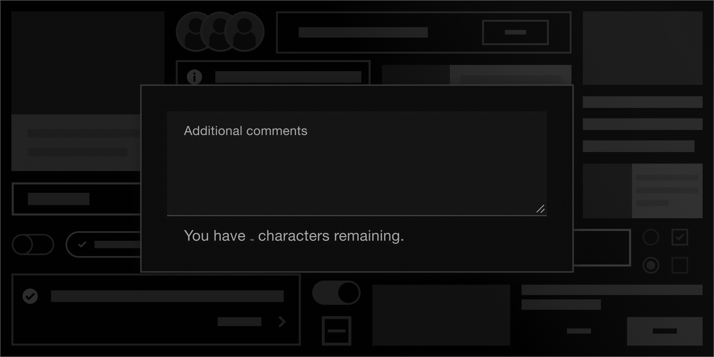

## When to use

✅ To capture long-form or multi-line text

✅ When users need to provide comments, descriptions, or feedback

✅ If the text length is variable or exceeds a single line

✅ For scenarios requiring auto-expansion, character limits, and validation

## Anatomy

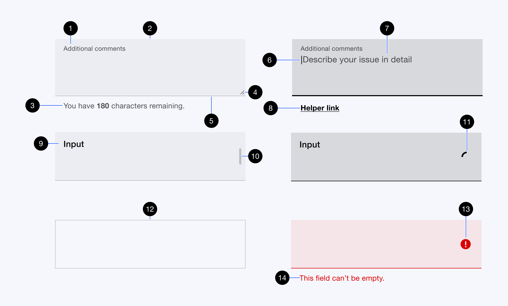

| # | Element | Purpose | Optional |
|---|---------|---------|----------|
| 1 | Label | Tells users what information to enter. | No |
| 2 | Input container | Holds and aligns all parts of the field (label, value, icons, etc.). | No |
| 3 | Character counter | Shows how many characters are remaining as users type. | Yes |
| 4 | Resize handle | Lets users resize the text area when resizing is supported. | Yes |
| 5 | Divider | The visible divider for the non-outlined style. | No |
| 6 | Text cursor | Indicates where the next character will be inserted while typing. | No |
| 7 | Placeholder | Provides guidance on expected input format or content | Yes |
| 8 | Helper link | Provides a link to supporting guidance or related information. | Yes |
| 9 | Input text | Show the entered text | No |
| 10 | Scroll bar | Indicates the scrollable content and lets users scroll when the content exceeds the visible area. | Yes |
| 11 | Loading indicator | Shows progress while validation or authentication is in progress. | Yes |
| 12 | Outlined container | Alternative visual style using a full border. | Yes |
| 13 | Error icon | Highlights the field’s error state to improve visibility and feedback. | Yes |
| 14 | Error text | Explains what’s wrong and how to fix it when validation fails. | Yes |

## Definition

A text area is a UI element that allows users to type, edit, or select longer blocks of text, such as comments, messages, or descriptions, by expanding vertically to provide more space for input.

The text area includes a visible label, placeholder text, character limits, and resize behavior, making it ideal for open-ended responses where users can provide detailed information.

## Outlined

<!-- zh-row -->

**`False`** An input with a subtle background fill and un visible bottom border, creating a softer and more contained look. Best suited for dense layouts or to enhance visibility.

**`True`** A minimalist input with a transparent background and a visible stroke outlining the field. This style may be interesting for contexts other than form pages:
* When inputs need to feel lightweight and unobtrusive
* In a header (search field)
* In a selection/filtering feature in a product catalog

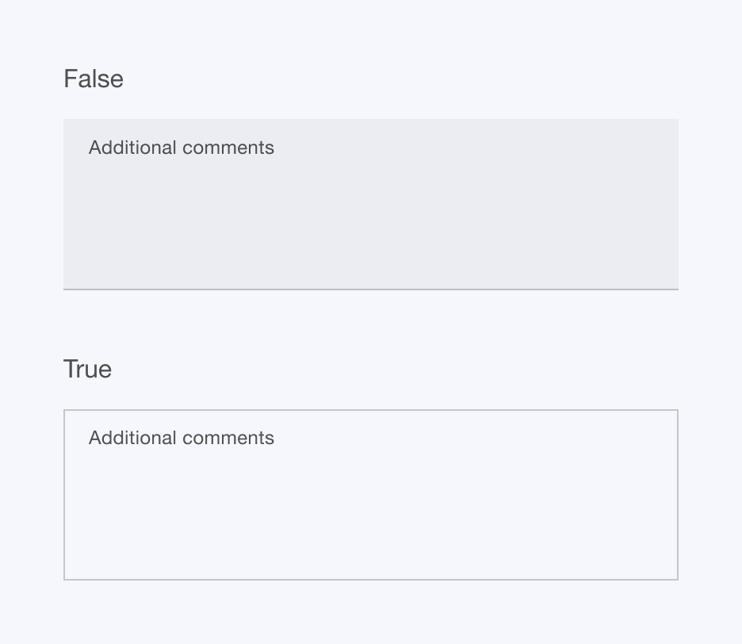

## Rounded corner

<!-- zh-row -->

Even though in Figma this rendering option is available and editable from the properties of each input component, the configuration of this rendering option is actually transversal across the entire product/service in which the component is used. It is therefore impossible to have one input component set to Rounded corner=True and another set to Rounded corner=False within the same product/service.

This option is technically not available for all brand themes. Here's the list of rounded corners availability by brand theme:

| Brand theme | Availability |
| --- | --- |
| **Orange** | Available |
| **Orange Compact** | Available |
| **Sosh** | Unavailable |
| **Wireframe** | Unavailable |

**`False`** The square rendering corresponds to Orange's historical style. It conveys the brand's sense of seriousness, robustness and utility-driven. It remains the default style for our digital interface components.

**`True`** The rounded rendering offers flexibility without sacrificing the attribution to the brand. It helps anchoring the service in a reality where the visual codes of the mobile area tends to rub off on all interfaces. Use rounded corners for a softer, more approachable, friendly and tactile feel.

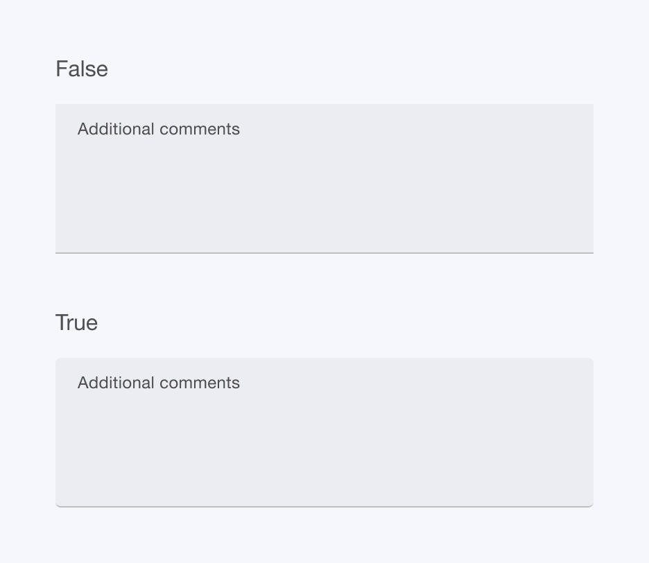

## Input status

<!-- zh-row -->

**`Empty`** The Empty state indicates that the text area is blank with no content or placeholder, a neutral starting point.

**`Empty (Placeholder)`** The Empty with Placeholder state provides a hint or guidance inside the field to suggest expected input.

**`Filled`** The Filled state shows that the user has entered valid content into the field, replacing any placeholder.

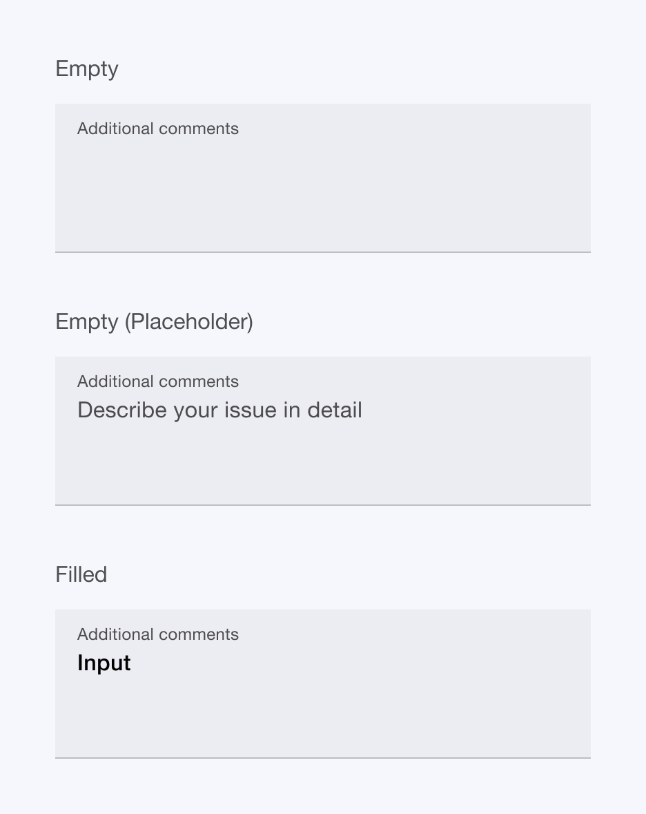

## Error

<!-- zh-row -->

The Error status indicates that the user input does not meet validation rules, for example, in this specific case, if the number of characters entered by the user exceeds the allowed limit. It provides immediate visual feedback, typically through a red border, error icon, and a clear, accessible error message positioned below the input (mandatory).

This state helps users quickly identify and correct mistakes by explaining what went wrong and, when possible, how to fix it. The input remains editable, encouraging users to revise their input without starting over.

**⚠️ Error message vs helper text / link** If a helper text accompanies the text input, it is replaced by the error message. However, a helper link must not be replaced and should remain positioned below the error message.

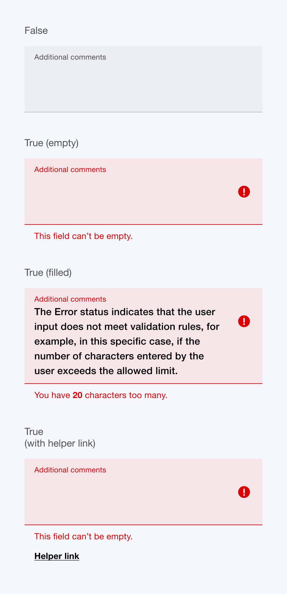

**Do:** Write error messages that explain what went wrong and provide specific guidance on how to fix it

**Don't:** Use technical jargon or error codes in messages; keep language plain and user-friendly

## Other boolean options

<!-- zh-row -->

**`Scrolled`** Represents the state in which the field contains more text than its visible height can display and that internal scrolling is available. This allows users to navigate through the overflowing text without expanding the text area beyond **the maximum planned height of 240px, allowing the display of about 10 lines of text**. It is particularly useful when preserving space is important, or when the text area is embedded within a fixed-height container.

**`Helper text`** Supporting text conveys additional information about the input field, such as how it will be used. It should ideally only take up a single line, though may wrap to multiple lines if required, and be either persistently visible or visible only on focus.

**`Helper link`** If the helper text is not sufficient (It can also be displayed on its own without helper text), it's possible to offer the user an additional help link (the link can be external or open a modal).

**`Resize handle`** In certain contexts or environments, such as television or touch use on mobile, the use of this option is not relevant.

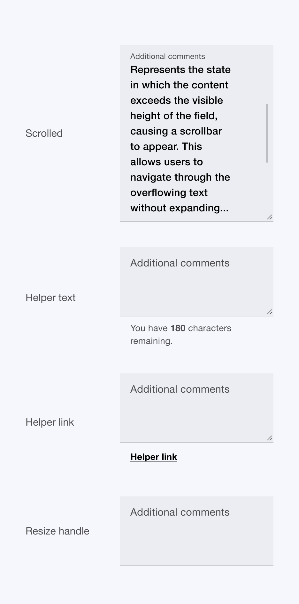

## Character counter

<!-- zh-row -->

• **Character limit not exceeded**  
The character counter, located in the helper text area, displays in real time (with each keystroke) the number of characters the user can still enter before reaching the field's allowed limit.

⚠️ It is impossible to provide a recommendation for the maximum number of characters, as this depends too specifically on the constraints (or lack thereof) of each project.  
If the count cannot be added and the text should be changed to "XXX characters maximum."

• **Character limit exceeded**  
If the user exceeds the set limit, the field enters an error state, but input is not blocked. The character counter then shows the user, still in real time, how many characters have been entered beyond the field's allowed limit.

The user must reduce the number of characters entered for the text area to exit the error state.  
In the case where the maximum number of characters is 180, for example: When the input is at 180 char filled in the helper text changes "You have 0/180 characters left".

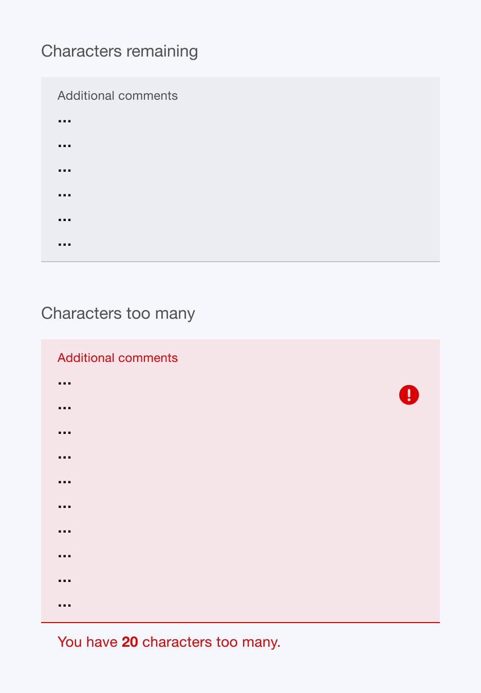

**Do:** Set character limits based on actual content requirements and database constraints, not arbitrary numbers

**Don't:** Use unnecessarily restrictive character limits that frustrate users trying to provide complete information

**Do:** Allow users to see and edit content that exceeds the limit so they can make informed decisions about what to cut

**Don't:** Truncate or delete user content automatically when limits are exceeded

## Behavior by entered line count

<!-- zh-row -->

• **Default display**  
By default, the height of **the input text container is set to 72px, which allows 3 lines of text** to be displayed without expanding the component. This height helps distinguish the field from other text inputs, prevents discouraging users with an overly large field, and keeps the layout compact at the start of a form.

• **Auto-resize (automatic expansion)**  
Above 3 lines of text, the field automatically increases in height as the user types their comment.  
This behavior is not mandatory. It is possible to enable or disable the component’s expansion depending on the page layout. In a mobile chat-type use case, for example, the height of the text area must remain fixed even if the text entered by the user exceeds 3 lines.

• **Vertical scrollbar**  
If expansion is disabled or **the maximum height is reached at 240px, corresponding to about 10 lines of text**, an internal scrollbar appears allowing the user to scroll through the overflowing text. This choice prevents breaking the layout but has the drawback, on mobile, of creating a scroll within a scroll (text area scroll inside a page scroll).

&nbsp;

### ⚠️ Old web browsers
The automatic expansion of the text area’s height based on the number of lines entered by the user is not a behavior supported by older web browsers. To address this issue, we have planned an alternative behavior for the component, which in this case has a fixed height of 144px (corresponding to about 6 lines of text), whether it is filled in or not. The selection of the appropriate expected behavior for the component is done automatically based on the version of the user’s web browser.

&nbsp;

### ⚠️ Manual resize (by the user)
We have chosen to disable horizontal resizing to avoid behaviors inconsistent with the design system.  
Even if the user manually increases the height of the text area, the max-height of 240px remains applied.  
On web desktop (keyboard/mouse use), manual resizing is enabled.  
On both web mobile/tablet and natif iOS/Android (touch use), manual resizing is disabled. For information (for web), the media query is : @media (pointer: coarse) and not (any-pointer: fine).

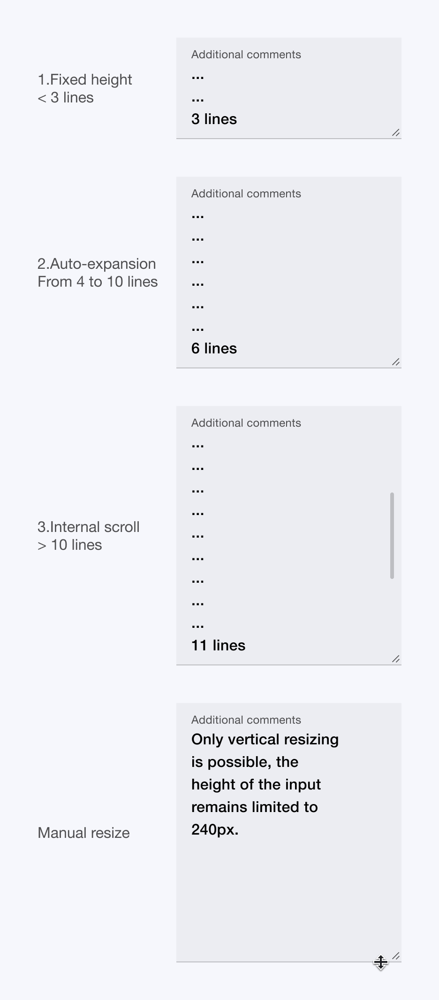

## ⚠️ Label (can it be hidden?)

<!-- zh-row -->

Describes the purpose of the input. Why hide a text area label?

In some UI contexts, especially when space is limited or when the input is part of a compact layout (search bars, filters, inline forms), visually hiding the label can help maintain a clean and uncluttered interface.

However, hiding the label should only be done if:
* The purpose of the input remains clear thanks to a placeholder or contextual icon.
* The label is still accessible to screen readers (using aria-label, aria-labelledby, or visually hidden text).

Hiding a label is a design choice that must balance visual simplicity and clarity of intent, without compromising inclusiveness or form guidance.

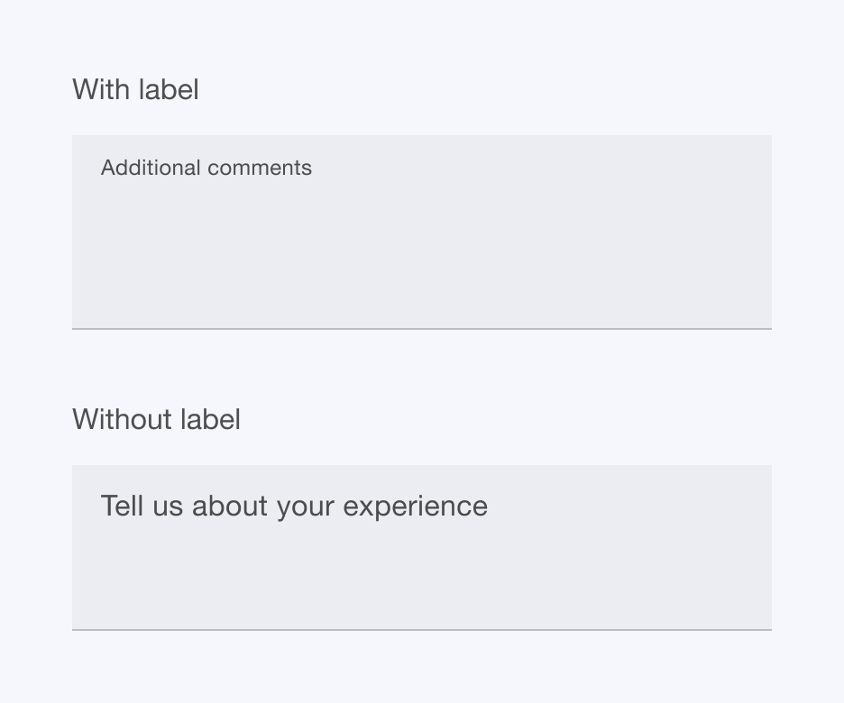

**Do:** Keep labels short, direct, and without punctuation at the end

**Don't:** Use vague labels and long sentences, with punctuation at the end

## Mandatory field indication

<!-- zh-row -->

**If all fields are mandatory (several fields present):**

1. Display the message "All fields are mandatory." at the top.
2. Do not use an asterisk (*) at the end of each field label, nor the word "mandatory."

**If not all fields are mandatory (and there are several fields present):**

1. Display the message "All fields marked with an * are mandatory." at the top.
2. Use an asterisk (*) at the end of each mandatory field label. ⚠️ Important:
   - In Figma, the asterisk must be entered manually by designers in the label text. UI rendering of the asterisk: font-weight-bold + color-content-negative (red).
   - Technically, for web/iOS/Android, the asterisk is positioned in a dedicated container after the label text. Spacing between label and asterisk: Empty state → 4px / Other states (reduced label) → 3px. If the label is truncated due to a large amount of text, the asterisk must remain visible at the end of the field.
3. Either the technology allows a 'required' attribute to be managed on the fields (usually in Web), in which case any asterisks must be hidden from users using assistive technologies, or the technology does not allow the mandatory nature of the field to be indicated. In this case, the asterisk must be vocalised as well as a 'mandatory' mention. Please refer to the technical documentations for more information.
4. Depending on the use case, an 'optional' label can be added to non-mandatory fields.

**If there is only one field in the form, or if the mandatory nature is obvious (such as login/password), no mention is necessary since the fields are essential to the form's functionality.**

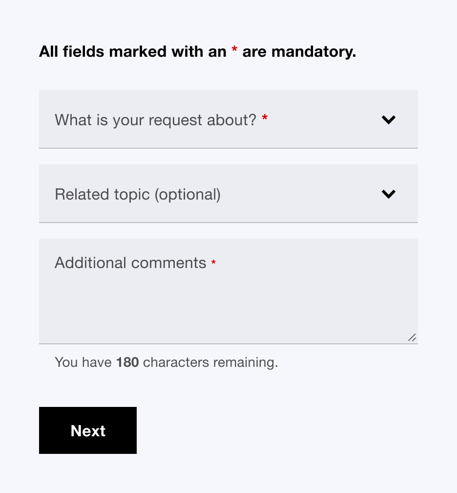

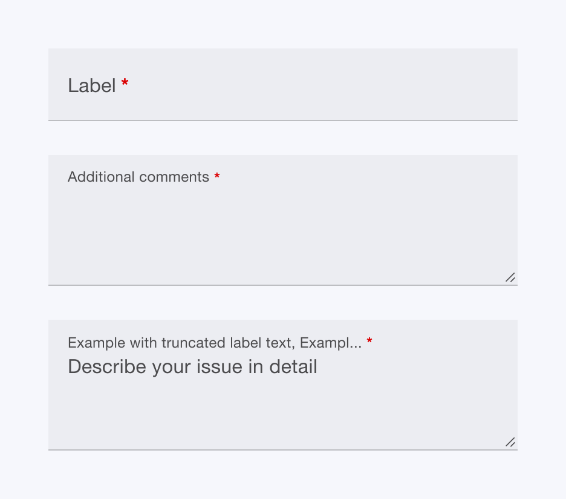

## Truncated input area

<!-- zh-row -->

When losing focus, the truncation behavior of the input area differs depending on the technical environment. It's important to respect the native behaviors designed to handle truncation:

• **On web**, by default (even if the project retains control over this setting), if the text volume exceeds the visible width of the field, the input displays the end of the text (bottom-aligned) and the beginning of the text becomes invisible (masked on the top). There should be no visual truncation indicator (...). This choice is intentional because, for many fields, showing the end often makes it easier to identify the value (file names, paths, emails).

• **On Android**, by default (even if the project retains control over this setting), the behavior is the same as on the web.

• **On iOS**, by default (even if the project retains control over this setting), the behavior is the same as on the web.

**⚠️ In all cases:** the entire text must remain accessible when the field regains focus:
- Either by refocusing the field, the text becomes horizontally scrollable again (the blinking cursor is visible).
- Or via a tooltip on hover in certain desktop contexts.

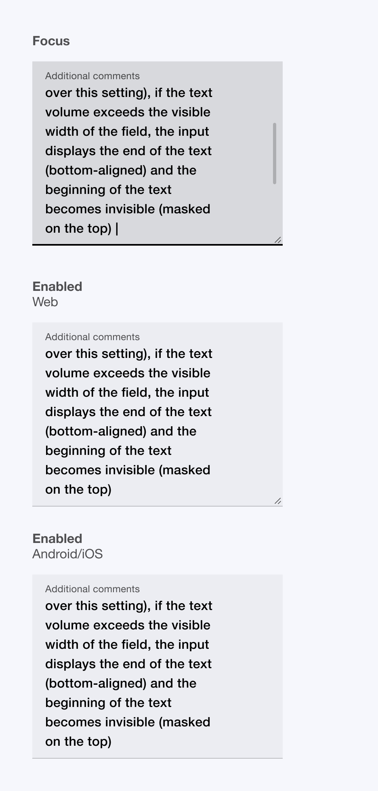

## Multiline and responsiveness

<!-- zh-row -->

• **Multiline**  
This component allows multi-line text editing. Further details are available in the "Behavior by entered line count" section.

• **Max-width vs full-width**  
For greater flexibility, this component doesn't have a default max-width. To avoid exceeding a width that would degrade readability and the perception of a compact interactive element, we recommend applying **a max-width of around 640px.**  
For mobile or tablet use (or if the component is positioned inside a specific container), it is possible to set this component to use the full available width (of the screen or the container). Please note that this behavior is not the default rule; it may be preferred if the template allows it (to improve user comfort or for better page structure/hierarchy).

• **User zoom in/out**  
The behavior of the text during user zoom in/out must follow a fundamental principle: the text must remain readable, accessible, and must never break the structure or lose information. However, "Text input" components present an exception regarding the loss of textual information following the activation of user zoom in, since text truncation (label, placeholder, input text) is exceptionally allowed and enabled.

  - The text must always scale proportionally with user zoom. Text resizing must never be blocked.
  - Zooming must never cause text to be truncated or hidden. The component must expand vertically to allow line wrapping.
  - The component's height and width must be flexible, never fixed, in order to automatically adapt its dimensions according to the level of zoom.
  - In order to preserve the minimum interactive area during user zoom out, this component has a min-width **of 240px** and a min-height **of 92px**.
  - Even if the component has a max-height or a max-width for resizing control purposes, technically, during user zoom in, these limitations are not fixed but must be scalable in order to adapt to the user's zoom level.
  - In its "Leading icon" variant, user zoom in/out doesn't affect the size of the icons; they remain fixed in size (decorative use).
  - As the error icon is functional, it must follow the same rules as text.
  - The behaviors of the button (layout: icon only) component during user zoom are available in the corresponding documentation.  
**Learn more about the behavior of the button component.**

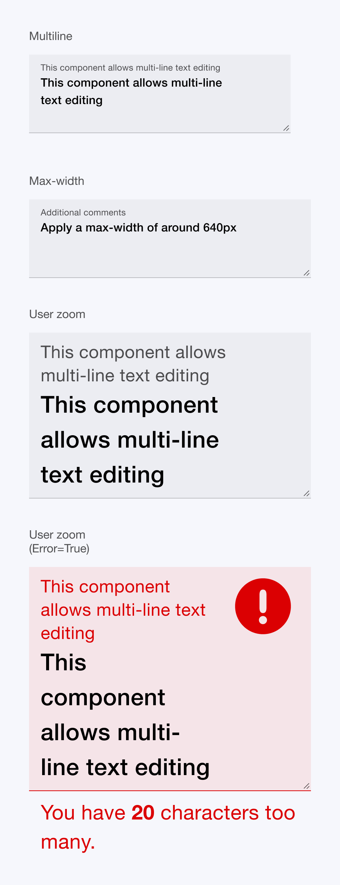

## Rich text

<!-- zh-row -->

• **Strong text**  
Strong text can be used sparingly to highlight key information within the content. Text is allowed using the corresponding "Strong" token (e.g. Label/Large/Strong or Label/Medium/Strong) depending on the selected text style. No other text styles or custom font weights should be used.

• **⚠️ Underline text and Hyperlinks**  
Underlined text must not be applied manually (e.g. in helper text), as it is commonly associated with hyperlinks and may mislead users. If a link is required, the dedicated helper link component must be used (e.g. **Writing guidelines**).

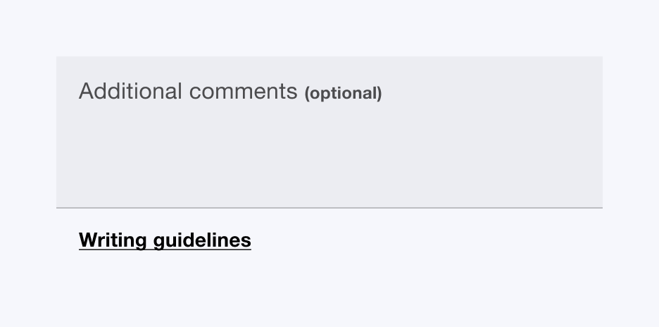

# Specs

## Layout and spacing

## States

<!-- zh-row -->

**`Enabled`** Neutral appearance, whether empty or filled. It allows users to click, focus, and type freely without restrictions.

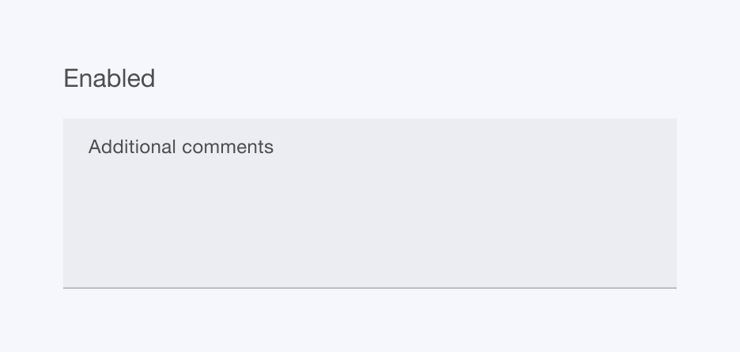

<!-- zh-row -->

**`Hover`** Slight visual contrast or border color change.

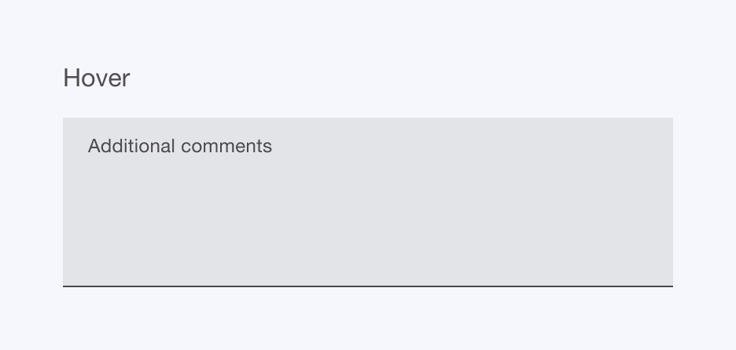

<!-- zh-row -->

**`Focus`** The text area is focused and ready to receive user input. It visually highlights the field to indicate that it's currently editable and interactive. This state typically appears after a user clicks or taps into the field.

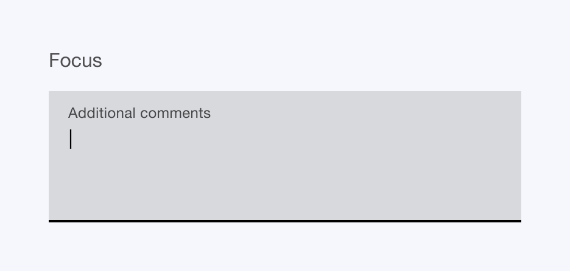

<!-- zh-row -->

**`Loading`** The Loading state indicates that the system is processing or retrieving data related to the text area. A progress indicator appears to inform the user that an action is in progress. During this state, the input may be temporarily disabled to prevent further interaction.

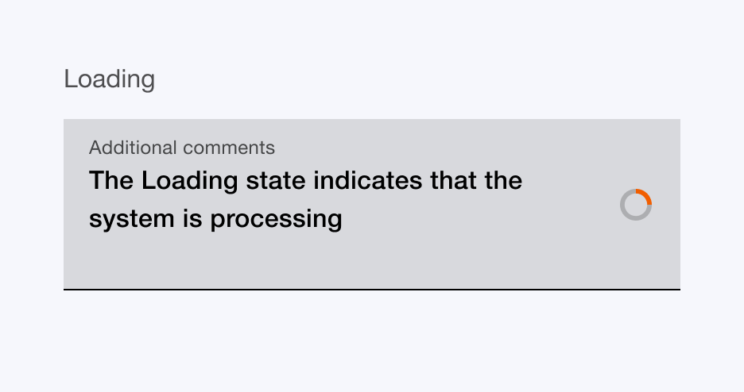

<!-- zh-row -->

**`Read only`** Text visible but not editable (often with a muted or different background).

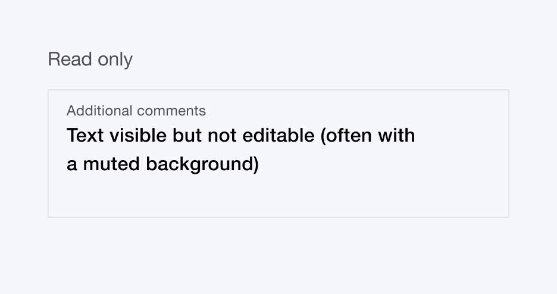

<!-- zh-row -->

**`Disabled`** The field is non-interactive and grayed out to indicate it cannot be changed. The helper text is muted.

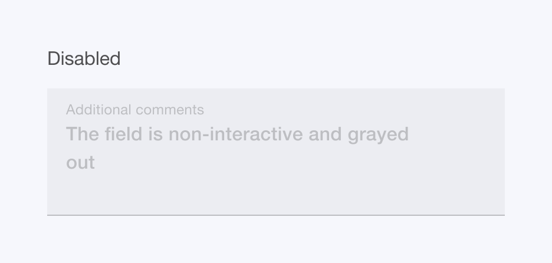

<!-- zh-row -->

**`Skeleton`** Improves the perceived loading time by providing a visual cue of where field will appear once fully loaded. Uses the "Skeleton" component, variant "Security marge=False".

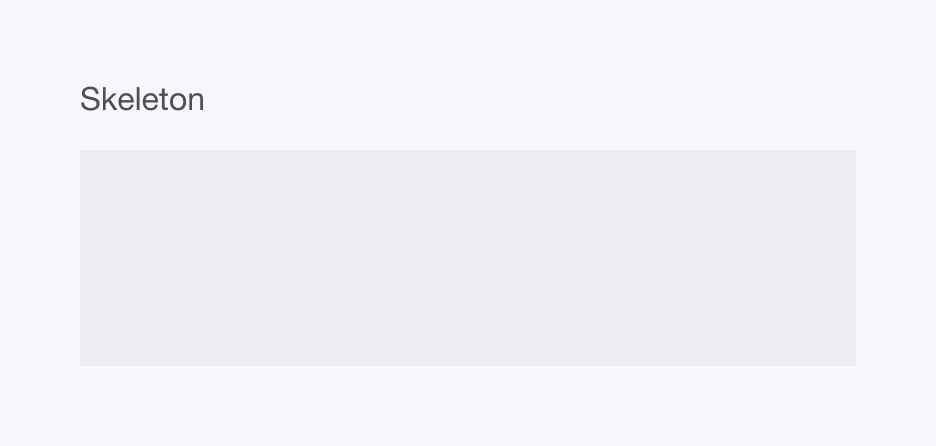

# Accessibility

Work is in progress to deliver this content.

# Develop

## OUDS-Web example

[Components/TextArea › Text Area 0](https://web.unified-design-system.orange.com/storybook/?path=/story/components-textarea--text-area-0)

## Developer documentation

| Platform | Developer documentation |
|---|---|
| OUDS Web | [S-ouds-web-text-area](https://r.orange.fr/r/S-ouds-web-text-area) |
| OUDS Android | [S-ouds-android-text-area](https://r.orange.fr/r/S-ouds-android-text-area) |
| OUDS iOS | [S-ouds-ios-text-area](https://r.orange.fr/r/S-ouds-ios-text-area) |
| OUDS Flutter | Not available yet |

# Changelog

## Availability

| Platform | Resource | Status | Version |
|---|---|---|---|
| Figma | [Text area component](https://r.orange.fr/r/S-ouds-design-text-area) | Live | 1.2.1 |
| OUDS Web (former Boosted) | [Web dev documentation](https://r.orange.fr/r/S-ouds-web-text-area) | Live | 1.2.0 |
| OUDS Android - Jetpack Compose | [Android dev documentation](https://r.orange.fr/r/S-ouds-android-text-area) | Live | 1.2.1 |
| OUDS iOS - Swift | [iOS dev documentation](https://r.orange.fr/r/S-ouds-ios-text-area) | Live | 1.2.1 |
| OUDS Flutter | Not available yet | To do | – |

## Design changelog

| Date | Number | Notes |
|------|--------|-------|
| May 26, 2026 | - | • Documentation writing: Addition of a clarification regarding auto-resize (automatic expansion). |
| May 22, 2026 | 1.2.1 | **Version 2.6 of the design tokens is required for the development of this update.** For "Loading" state, "Trailing action: False" variant<ul><li>The loader frame has been renamed to Progress indicator container. It now contains the new Circular Progress Indicator component.</li><li>The following token has been removed: action-button-border-radius-default</li><li>Absolute positioning has been removed and replaced with Auto Layout.</li><li>The container now uses: ouds/action/button/size/min-width-default, ouds/action/button/space/inset/icon-only-default, ouds/control/text-area/space/padding-block-trailing-container</li></ul> |
| Apr 22, 2026 | 1.2.0 | <ul><li>Scope: Trailing action=False / State=Loading → Replacement of the button component (loading state) with a "Trailing container" frame containing the circular progress indicator component</li><li>The input text reference changes from a regular weight (font-weight-label-default) to a medium weight (font-weight-label-moderate).</li><li>Removal of the component's max-width to avoid blocking certain layouts and to provide greater flexibility of use. The max-width values remain available in the design documentation.</li><li>Adding the resize handle boolean property</li><li>For the "Empty" status and for all states (except the "Focus" state): Update of the typographic reference for the "Label text" → From "Label-small-default" to "Label-large-default" / Modification of the padding block top value, with the addition of a new token → control-text-area-space-padding-block-top-empty / Removal of the padding block bottom to rebalance the component height across all statuses and all states.</li><li>For the "Trailing container" frames: The responsive behavior (auto-layout) of the height changes from "Fill container" to "Hug content." / Removal of the max-height (ouds-control-text-area-size-max-height-assets-container) / Removal of the min-height (ouds-action-button-size-min-height) / Modification of the padding block, addition of 2 new tokens.</li><li>Add spacing tokens between the label and the asterisk: control-text-input-space-column-gap-label-asterisk / control-text-input-space-column-gap-label-small-asterisk</li></ul> |
| Apr 8, 2026 | - | • Documentation writing: Rich text |
| Mar 16, 2026 | - | • Documentation writing:<ul><li>Rounded corners brand theme availability</li><li>Mandatory field indication</li><li>Truncated input area</li><li>Multiline and responsiveness</li></ul> |
| Jan 21, 2026 | - | • Documentation writing: Rounded corners update |
| Jan 6, 2026 | - | <ul><li>Documentation writing: Definition update</ul> |
| Nov 10, 2025 | 1.2.0 | • Scope: Trailing action=False / State=Loading → Replacement of the button component (loading state) with a "Trailing container" frame containing the circular progress indicator component |
| Sep 30, 2025 | 1.1.0 | • The name of the "Style" variant has been replaced to "Outlined" with true/false variant |
| Jun 30, 2025 | 1.0.0 | • Component creation |
